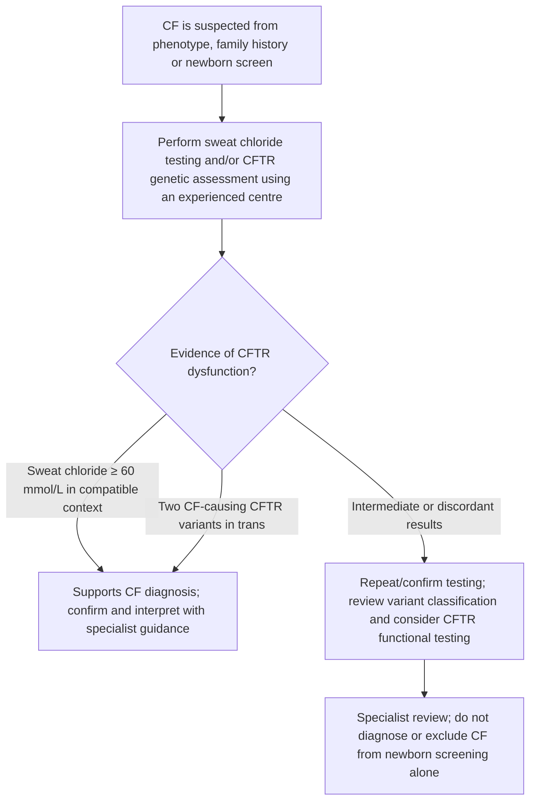
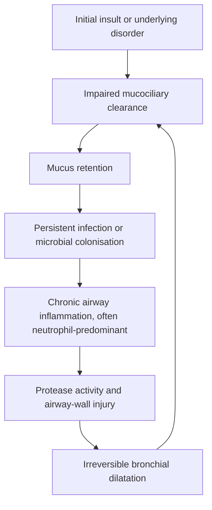

# Topic 36 — Cystic Fibrosis and Bronchiectasis

# PART I: CYSTIC FIBROSIS (MUCOVISCIDOSIS)

## 1. Inheritance and Molecular Genetics

Cystic fibrosis (CF) is an autosomal-recessive multisystem disorder caused by pathogenic variants in the CFTR gene. Its prevalence and mutation spectrum vary substantially by ancestry and population; the statement “most common fatal autosomal-recessive disorder in ==Caucasians==” is a historical epidemiologic generalisation rather than a universal description.
* **Inheritance:** Autosomal Recessive (AR).
* **Gene Localization:** Chromosome **7q31.2**, encoding the **Cystic Fibrosis Transmembrane Conductance Regulator (CFTR)** protein.
* **Common mutation:** **F508del (ΔF508)** deletes the ==phenylalanine== residue at ==position 508== and is common in people of European ancestry. Its frequency differs widely by population; it should not be described as present in more than 70% of all CF alleles worldwide.

---

## 2. Pathophysiology and Organ-Specific Effects

CFTR is a cAMP-regulated <strong>ATP-binding cassette (ABC)</strong> **chloride ($\text{Cl}^-$) channel** expressed on mucosal epithelial surfaces.

### CFTR function in different epithelial sites

| Site | Normal CFTR function | Effect of CFTR dysfunction in cystic fibrosis |
|---|---|---|
| Respiratory epithelium | Supports chloride and bicarbonate transport and airway-surface hydration. | Abnormal ion/fluid transport can produce poorly hydrated airway-surface liquid (often described in teaching models as dehydrated, with altered pH), impaired mucociliary clearance and mucus plugging, promoting infection and inflammation. |
| Gastrointestinal tract and pancreas | Contributes to epithelial ion/fluid transport and bicarbonate secretion. | Thick secretions and duct obstruction can contribute to <strong>pancreatic insufficiency and gastrointestinal complications.</strong> |
| Sweat-gland duct | Reabsorbs chloride from primary sweat; sodium reabsorption is also reduced secondarily. | Sweat chloride and sodium concentrations are elevated, causing salt loss and potential dehydration; in some settings, salt loss can lead to hypochloraemic metabolic alkalosis. |

### Multisystem manifestations of cystic fibrosis

| System | Important features |
|---|---|
| Respiratory | Recurrent or chronic airway infection (including *Staphylococcus aureus* and *Pseudomonas aeruginosa*), bronchiectasis often affecting upper lobes, chronic sinus disease and nasal polyps. |
| Gastrointestinal | ==Meconium ileus in newborns==; distal intestinal obstruction syndrome (DIOS); reflux or other gastrointestinal complications may occur. |
| Pancreatic / biliary / nutrition | Exocrine pancreatic insufficiency in most patients with classic CF (often cited as >85%, varying by genotype and cohort), ==malabsorption and deficiency of fat-soluble vitamins A, D, E and K==; hepatobiliary disease may occur. |
| Reproductive | <strong><mark style="background-color: #c8f2d2; color: #173b22;">Congenital bilateral absence of the vas deferens (CBAVD)</mark></strong> is common in males with CF and causes obstructive infertility (often cited in >95% of males with classic CF); fertility effects vary by sex, genotype and individual. |

## 3. Diagnostic Criteria and Sweat Chloride Testing

Diagnosis requires a compatible clinical context (or positive newborn screen/family history) plus objective evidence of CFTR dysfunction. A positive screening result alone is not a confirmed diagnosis.

### Diagnostic framework for cystic fibrosis

| Stage                                      | What to establish                                                                                                                                                             |
| ------------------------------------------ | ----------------------------------------------------------------------------------------------------------------------------------------------------------------------------- |
| **Clinical indication**                    | Compatible clinical features, a positive newborn screen, or a family history that raises suspicion. Newborn screening alone is not diagnostic.                                |
| **Objective evidence of CFTR dysfunction** | Sweat chloride $\ge60\ \text{mmol/L}$ in a compatible context; or two CF-causing CFTR variants in trans; or specialist CFTR functional testing when results are inconclusive. |
| **When results are uncertain**             | Repeat/confirm sweat testing according to protocol, review CFTR variant classification and phase, and refer for specialist assessment and functional testing as indicated.    |

### Sweat chloride testing

Quantitative pilocarpine iontophoresis with sweat chloride measurement is the standard diagnostic test. Interpret the result in conjunction with the clinical context and confirm according to the relevant protocol.

| Sweat chloride | Interpretation in a compatible clinical context |
|---|---|
| $\ge60\ \text{mmol/L}$ | Consistent with CFTR dysfunction and supports diagnosis; confirm and interpret with specialist guidance as appropriate. |
| $30–59\ \text{mmol/L}$ | Intermediate range; repeat testing and assess CFTR genetics/function. |
| $<30\ \text{mmol/L}$ | Makes cystic fibrosis less likely, but does not absolutely exclude it when clinical suspicion remains high. |

### Pitfalls in Sweat Chloride Interpretation

Sweat chloride results depend on adequate collection, a validated quantitative method and correct interpretation. Insufficient or technically poor samples should not be interpreted. Some non-CF conditions can raise sweat chloride, and a low or intermediate value does not completely exclude CF when clinical suspicion or genotype is compelling. Repeat testing at an accredited CF centre and correlate the result with phenotype, CFTR genotyping and, when needed, functional testing. Avoid using unverified “false-positive/false-negative” lists as a substitute for this diagnostic process.

---

## 4. Comprehensive Management Strategy

### 1. Respiratory Management
* **Mucolytics and Airway Hydration:**
  * **Recombinant Human DNase 1 (Dornase Alfa / Pulmozyme):** Cleaves extracellular DNA released by disintegrating neutrophils, reducing sputum viscosity.
  * **Nebulized 3% Hypertonic Saline:** Osmotically draws water into airway lumen, restoring the periciliary fluid layer.
* **Antimicrobial treatment for *Pseudomonas aeruginosa*:**
  * **Initial/new airway isolation:** Treat promptly using a CF-team protocol. A well-established regimen is inhaled tobramycin **300 mg twice daily for 28 days**. Other eradication regimens (including inhaled colistin with or without oral ciprofloxacin) are used in selected settings; do not treat a single combination/duration as universal. Routine prophylactic anti-pseudomonal antibiotics to prevent acquisition are not recommended.
  * **Chronic infection:** Long-term inhaled antibiotics (for example, tobramycin or aztreonam, selected according to culture history, response and local guidance) may be used for chronic *P. aeruginosa* infection. Regimens and cycling schedules are CF-centre specific.

### 2. Targeted CFTR Modulators
* **Ivacaftor:** CFTR potentiator; increases gating probability of open channel (indicated for gating mutations like $G551D$).
* **Elexacaftor/tezacaftor/ivacaftor (ETI):** A triple combination of two CFTR correctors (**elexacaftor and tezacaftor**) plus the potentiator **ivacaftor**. It is distinct from **lumacaftor/ivacaftor**, a separate combination. Eligibility depends on the CFTR variant(s), age, local authorisation and clinical factors; check the current product label.

### 3. Gastrointestinal and Nutritional Support
* **Pancreatic Enzyme Replacement Therapy (PERT):** Enteric-coated lipase, protease, and amylase administered with every meal. *Caution:* High doses cause **fibrosing colonopathy** and colonic strictures.
* **Fat-Soluble Vitamin Supplementation:** High-dose oral water-miscible formulations of **Vitamins A, D, E, and K**.

---

---

# PART II: BRONCHIECTASIS

## 5. Definition and Etiopathogenesis

Bronchiectasis is defined as the **abnormal, permanent, and irreversible dilation of bronchi** resulting from destruction of the muscular and elastic components of bronchial walls.

### Pathological Criteria
On CT, abnormal bronchi may fail to taper and may be visible unusually close to the pleural surface (within about 1 cm). “Bronchi terminate 2–3 cm from the pleura” is not a reliable standalone normal-anatomy rule; diagnosis is based on the overall CT pattern and clinical context.

### Bronchiectasis pathogenesis: the “vicious cycle”

1. **Initial insult:** infection, aspiration, airway obstruction or another underlying disorder.
2. **Impaired mucociliary clearance:** mucus is retained rather than effectively removed.
3. **Mucus retention and microbial persistence:** promotes recurrent infection or chronic colonisation.
4. **Persistent airway inflammation:** often neutrophil-predominant, with release of proteases such as neutrophil elastase.
5. **Airway-wall injury:** inflammation and protease activity damage bronchial structural components.
6. **Irreversible bronchial dilatation:** damaged airways clear mucus less effectively, reinforcing the cycle.

The sequence varies by cause; not every patient follows an identical pathway.
---

## 6. Etiology and Anatomical Distribution

The anatomical distribution of bronchiectatic changes offers strong diagnostic clues to the underlying etiology.

### Bronchiectasis: patterns of anatomical distribution

| Distribution | Possible associations (not diagnostic on their own) |
|---|---|
| **Upper lobe** | Cystic fibrosis, previous tuberculosis and other causes. |
| **Right middle lobe / lingula** | Nontuberculous mycobacterial infection (including MAC), airway obstruction or other chronic infection. |
| **Lower lobe** | Aspiration, post-infectious disease and other causes. |
| **Central / proximal** | Allergic bronchopulmonary aspergillosis (ABPA) and mucus plugging. |
| **Diffuse / multilobar** | Primary ciliary dyskinesia, immunodeficiency, cystic fibrosis or multiple contributing causes. |

Distribution should guide the differential diagnosis but should not be used as a stand-alone etiological diagnosis.

### Specific Congenital & Acquired Syndromes
1. **Kartagener's Syndrome (Primary Ciliary Dyskinesia - PCD):**
   * **Inheritance:** Autosomal Recessive; defect in **outer/inner dynein arms** of cilia and sperm flagella.
   * **Clinical Triad:**
     1. Chronic Sinusitis
     2. Bronchiectasis
     3. **Situs Inversus Totalis** (plus Male Infertility due to immotile spermatozoa).
   * **Diagnosis:** Modern assessment combines the compatible clinical phenotype with tests at an experienced centre, such as nasal nitric oxide (in appropriate age groups and after excluding confounders), high-speed video microscopy, transmission electron microscopy and/or genetic testing. The saccharin transit test is historical and is not a definitive standalone test; availability and recommended test sequence vary.
2. **Brock's Syndrome:** Middle lobe bronchiectasis caused by extrinsic compression of the right middle lobe bronchus by tuberculous lymphadenopathy.
3. **Williams-Campbell Syndrome:** Congenital deficiency or complete absence of bronchial cartilage (from 4th to 6th order bronchi) leading to expiratory airway collapse.
4. **Mounier-Kuhn Syndrome:** Tracheobronchomegaly due to marked atrophy of elastic fibers and smooth muscle in the trachea and main bronchi.

---

## 7. Clinical Features and Diagnostic Radiology

### Clinical Presentation
* Chronic productive cough with daily copiously foul-smelling, purulent sputum (may separate into three layers upon standing).
* **Hemoptysis:** Occurs due to rupture of hypertrophied, high-pressure **bronchial arteries**.
* Physical Signs: Coarse late-inspiratory crackles/crepitations, rhonchi, and **digital clubbing**.

### Radiology: High-Resolution Computed Tomography (HRCT)
HRCT is the **investigation of choice** for diagnosing bronchiectasis.

**Key HRCT signs**

1. **Signet-ring sign:** The bronchial lumen is larger than its accompanying pulmonary artery branch; a broncho-arterial ratio above 1 is suspicious and a ratio above about 1.5 is more specific in the appropriate context. Age, hypoxic vasoconstriction, pulmonary vascular disease and technical factors affect the comparison; no single ratio should be used alone.
2. **Tram-track sign:** Non-tapering, parallel thickened bronchial walls seen longitudinally.
3. **Finger-in-glove appearance:** Mucoid impaction in central dilated bronchi; classically associated with ABPA, but not exclusive to it.
4. **Tree-in-bud sign:** Centrilobular branching opacities suggest small-airway impaction/inflammation. Infection is common, but aspiration and other bronchiolitides are also possible causes.

---

## 8. Management Protocol and Complications

### Bronchiectasis treatment strategy and complications

| Treatment pillar | Approach |
|---|---|
| **Airway clearance and hygiene** | Individualised airway-clearance techniques; review technique and adherence. Consider pulmonary rehabilitation when indicated. |
| **Pharmacotherapy** | Culture-guided antibiotics for exacerbations. Consider long-term antibiotics only for appropriately selected patients at high exacerbation risk after standard management and specialist review. Mucoactive therapies may help selected patients. |
| **Underlying cause and follow-up** | Investigate and treat relevant causes, monitor symptoms/exacerbations, obtain sputum microbiology as appropriate, and manage comorbidities. |
| **Severe haemoptysis** | Urgent airway and haemodynamic assessment/resuscitation; bronchial artery embolisation is often the preferred definitive intervention when feasible. Involve respiratory, interventional radiology and thoracic teams as indicated. |
| **Other complications** | Respiratory failure, pulmonary hypertension, secondary AA amyloidosis and, rarely, brain abscess. |

### Management of Recurrent Exacerbations
Consider long-term antibiotics only after optimising airway clearance, sputum microbiology, underlying causes and standard care. The 2025 ERS adult guideline defines high risk in a way that can include **at least 2 exacerbations in the previous year, at least 1 severe exacerbation, or 1 exacerbation plus severe daily symptoms**; the decision remains individualised.
* **Long-term macrolide:** Azithromycin may be considered for patients at high exacerbation risk despite standard care. Before starting, exclude non-tuberculous mycobacterial (NTM) infection and assess QT prolongation/interactions, hearing risk and liver function; monitor according to local guidance. Do not use macrolide monotherapy for NTM disease.
* **Inhaled antibiotics:** Consider for patients at high exacerbation risk with chronic *P. aeruginosa* infection despite standard care. Select the agent, trial duration and follow-up according to cultures, tolerance and specialist guidance; do not prescribe solely for any isolated positive culture.

### Management of Life-Threatening Hemoptysis
* **Definition/triage:** There is no single universally reliable volume threshold for life-threatening haemoptysis; airway compromise, rate of bleeding, gas exchange and haemodynamic effects matter, and reported volume thresholds vary between sources.
* **Management:** Protect the airway and stabilise the patient. **Bronchial artery embolisation (BAE)** is commonly the first-line definitive procedure when indicated. Surgery may be considered for selected localised/refractory cases or where embolisation is unavailable/unsuccessful, with specialist input.

---

## 9. Coverage Audit

* **Review note:** Corrected the worldwide F508del frequency claim, sweat chloride threshold interpretation, the CFTR-modulator combination name, and the overly prescriptive *Pseudomonas* eradication regimen. Updated bronchiectasis guidance on airway-clearance/long-term antimicrobial selection, PCD testing, CT criteria and life-threatening haemoptysis.
* **Safety note:** Dornase alfa is used for cystic fibrosis but should **not be routinely used in non-CF bronchiectasis**; current ERS guidance suggests against it. Airway-clearance teaching is central to bronchiectasis care. Use CF/bronchiectasis specialist guidance for individual antibiotic regimens.

---

## References for reviewed clinical recommendations

- [Cystic Fibrosis Foundation: CF diagnosis guidelines](https://www.cff.org/medical-professionals/cf-diagnosis-clinical-care-guidelines) — sweat chloride interpretation and diagnostic framework.
- [Cystic Fibrosis Foundation: initial/new *Pseudomonas aeruginosa* eradication](https://www.cff.org/medical-professionals/eradication-initial-p-aeruginosa-clinical-care-guidelines) — inhaled tobramycin 300 mg twice daily for 28 days is a recommended regimen.
- [Cystic Fibrosis Foundation: CFTR modulator therapies](https://www.cff.org/managing-cf/cftr-modulator-therapies) — correct distinction between ETI and lumacaftor/ivacaftor.
- [European Respiratory Society 2025 adult bronchiectasis guideline](https://doi.org/10.1183/13993003.01126-2025) — airway clearance, long-term macrolide/inhaled antibiotic selection, NTM safety and mucoactive treatment.

> **Citation note:** Original numeric citations in the NotebookLM export were not accompanied by a bibliography. Verify them against the original source notebook. Antibiotic and modulator use must follow current local specialist protocols and product labels.
