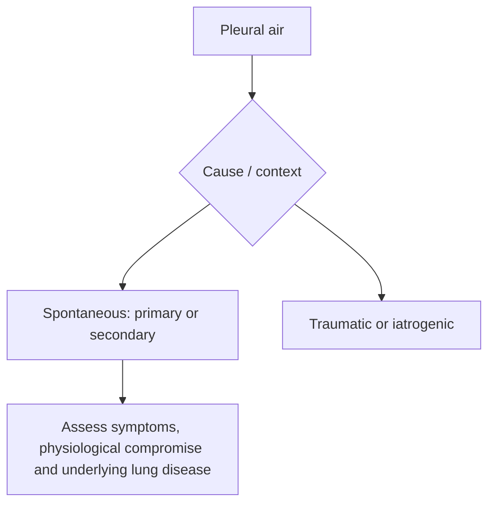
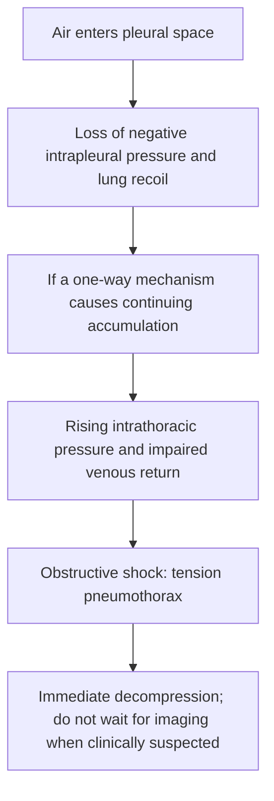
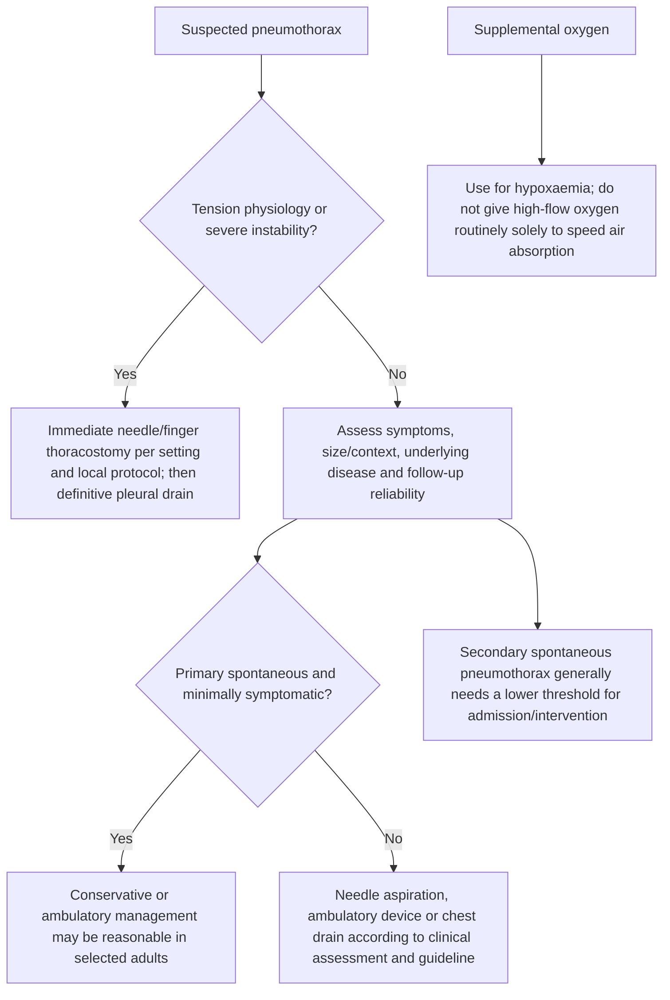

# Topic 37 — Pneumothorax

## 1. Classification and Etiopathogenesis

Pneumothorax is defined as the accumulation of free gas or air within the pleural cavity, resulting in loss of negative intrapleural pressure and partial or complete pulmonary collapse.

### Etiological Categories
1. **Primary Spontaneous Pneumothorax (PSP):**
   * Occurs in individuals without clinically overt underlying pulmonary parenchymal disease.
   * *Classic Demographics:* Tall, thin, young males (aged 10–30 years). Smoking increases risk up to 20-fold.
   * *Pathophysiology:* Rupture of subpleural apical blebs or bullae (likely formed due to apical ischemia and high mechanical transpulmonary pressure gradients in tall individuals).
2. **Secondary Spontaneous Pneumothorax (SSP):**
   * Occurs as a complication of pre-existing lung pathology.
   * *Etiologies:* COPD / Emphysema (most common overall), [[Chronic Obstructive Pulmonary Disease|COPD]] emphysematous bullae rupture, Severe Asthma, Tuberculosis (cavitary rupture), *Pneumocystis jirovecii* Pneumonia (PCP in HIV patients via pneumatocele rupture), [[Cystic Fibrosis and Bronchiectasis|Cystic Fibrosis]], Interstitial Lung Disease, Marfan Syndrome, and **Catamenial Pneumothorax** (recurring within 48–72 hours of menstrual onset due to thoracic endometriosis).
3. **Traumatic Pneumothorax:** Penetrating or non-penetrating chest wall trauma.
4. **Iatrogenic Pneumothorax:** Complication of central venous line cannulation (subclavian/internal jugular vein access), pleural biopsy, transthoracic needle aspiration (TTNA), mechanical ventilation (barotrauma), or transbronchial biopsy.

---

## 2. Tension Pneumothorax: Medical Emergency Mechanics

Tension pneumothorax develops when a disruption in the pleura functions as a **one-way ball-valve mechanism**.

### Pathophysiologic Triad of Tension Pneumothorax
1. **Intrapleural Hyperpressure:** Intrapleural pressure exceeds atmospheric pressure throughout the respiratory cycle.
2. **Contralateral Mediastinal Shift:** Drives the trachea and heart to the opposite side, compressing the non-affected lung.
3. **Vena Cava Collapse:** Compression and mechanical kinking of the vena cava block venous return to the heart, leading to a sudden fall in end-diastolic volume, precipitous drop in cardiac output, **obstructive shock**, and PEA (Pulseless Electrical Activity) cardiac arrest.

---

## 3. Clinical Presentation and Physical Examination

### Physical Examination Findings Matrix

| Parameter | Uncomplicated Pneumothorax | Tension Pneumothorax |
| :--- | :--- | :--- |
| **Symptoms** | Sudden pleuritic chest pain, localized dyspnea | Severe progressive dyspnea, extreme agitation, air hunger |
| **Perfusion / Hemodynamics** | Stable; mild tachycardia | **Severe Hypotension, Obstructive Shock, Cyanosis** |
| **Tracheal Position** | Central / Midline | **Markedly Deviated to Contralateral Side** |
| **Percussion Note** | **Hyperresonant** over affected side | **Tympanitic / Hyperresonant** over affected side |
| **Breath Sounds** | Diminished or absent on affected side | **Completely Absent** on affected side |
| **Tactile Vocal Fremitus** | Markedly decreased or absent | Absent |
| **Jugular Venous Pressure** | Normal | **Distended Neck Veins (JVD)** |

---

## 4. Radiological Evaluation

| Imaging context | Key sign |
|---|---|
| Erect CXR | Visceral pleural line with absent peripheral lung markings |
| Supine CXR | Deep-sulcus sign / abnormally deep, lucent costophrenic angle |
| Ultrasound | Absent lung sliding / lung point when seen; interpret in context |
| CT | Most sensitive for small/occult pneumothorax; use when clinically appropriate |

### Erect Expiratory Chest X-Ray (CXR) Findings
* **Visceral Pleural Line:** Thin, sharp line representing the displaced visceral pleura separated from the thoracic cage.
* **Absence of Peripheral Vascular Markings:** Complete lucency (blackness) between the visceral pleural line and the inner chest wall.
* **Mediastinal Shift:** In simple pneumothorax, midline; in tension pneumothorax, marked contralateral tracheal and mediastinal shift with depression of the ipsilateral hemidiaphragm.
* **Supine CXR Sign ("Deep Sulcus Sign"):** In supine trauma patients, air accumulates anteromedially and basally, creating an abnormally deep, hyperlucent costophrenic angle.

---

## 5. Evidence-Based Management Protocols

### 1. Immediate Emergency Intervention for Tension Pneumothorax
* **Rule:** **DO NOT WAIT FOR A CHEST X-RAY!** Diagnosis is clinical.
* **Procedure:** Perform immediate **Needle Decompression**. Insert a large-bore (14–16 Gauge) intravenous cannula into the **2nd intercostal space in the midclavicular line** (or 4th/5th intercostal space in the anterior axillary line) on the affected side.
* **Definitive Step:** Convert needle decompression to formal **Intercostal Drain (ICD) tube thoracostomy** connected to an underwater seal drainage system.

### 2. Primary Spontaneous Pneumothorax (PSP): Clinical Decision Principles

Pneumothorax size can be described on imaging, but symptom burden, physiological compromise, underlying disease, patient preference and reliable follow-up should guide management. BTS 2023 permits conservative management for selected minimally symptomatic or asymptomatic adults regardless of PSP size.
* **Minimally symptomatic/asymptomatic primary spontaneous pneumothorax (PSP):** conservative management may be considered regardless of pneumothorax size after clinical assessment and with reliable follow-up.
  * Discharge with safety advice and outpatient follow-up.
  * Give supplemental oxygen for hypoxaemia; do not routinely use high-flow oxygen solely to accelerate pleural-air absorption.
* **More symptomatic or physiologically concerning PSP:** select aspiration, ambulatory management or chest drainage according to clinical assessment and local pathway; size alone is not the indication for intervention.
  * Initial step: **Simple Needle Aspiration** (16–18G cannula; aspirate up to 2.5 Liters).
  * If aspiration fails (or $>2.5\text{ L}$ air drawn without resistance): Insert a small-bore chest tube ($12–14\text{ Fr}$) or ICD attached to an underwater seal.

### 3. Secondary Spontaneous Pneumothorax (SSP) Thresholds
* Patients with underlying lung disease tolerate pneumothorax poorly due to limited reserve.
* **Secondary spontaneous pneumothorax (SSP):** admission and intervention thresholds are generally lower because underlying lung disease reduces reserve; individualise according to symptoms, physiology and context rather than a single size cutoff.
* Do not use a single 1–2 cm threshold to mandate aspiration.
* When drainage is required, select an appropriate drain and technique according to clinical status and local pleural-procedure guidance.

### 4. Indications for Surgical Intervention (VATS / Pleurodesis)
Indicated to prevent recurrence or manage persistent air leaks:
* Second episode of spontaneous pneumothorax (ipsilateral or contralateral).
* First episode of secondary spontaneous pneumothorax in high-risk professions (pilots, deep-sea divers).
* Persistent air leak through chest tube $> 3–5$ days.
* Initial presentation with Tension Pneumothorax.
* **Surgical Procedures:** Video-Assisted Thoracoscopic Surgery (VATS) with **apical bullectomy** and **mechanical pleural abrasion / chemical pleurodesis** (using talc).

---

## Accuracy and currency note

This is educational revision material, not a patient-specific treatment protocol. Time-sensitive drug regimens, doses, thresholds and service pathways should be checked against the current national/local guideline before clinical use. The batch review file records the main edits and the scope of verification.

**Review log:** [[00 - Batch 4 Accuracy Review]]
