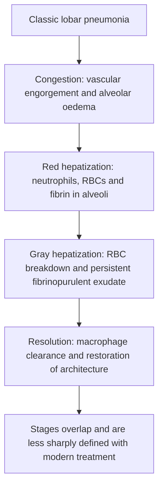
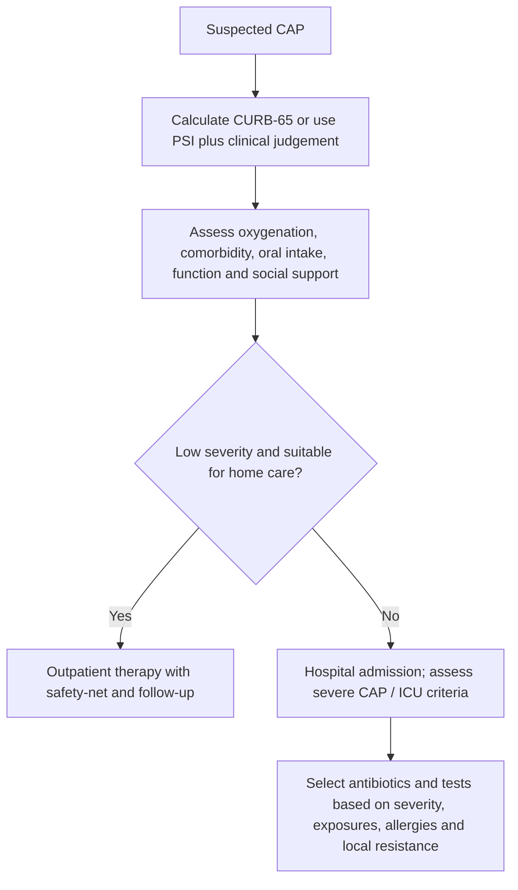
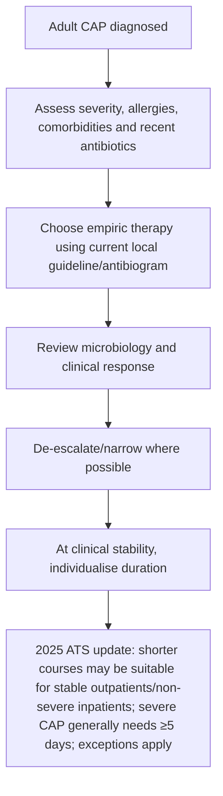

# Topic 38 — Community-Acquired Pneumonia

## 1. Definition and Microbial Etiology

Community-Acquired Pneumonia (CAP) is defined as an acute infection of the pulmonary parenchymal tissue acquired outside of healthcare facilities, or presenting within **48 hours** of hospital admission in a patient who does not meet criteria for healthcare-associated pneumonia.

| Typical organisms | Context / notes |
|---|---|
| *Streptococcus pneumoniae* | Classic cause; frequency varies by setting and vaccination |
| *Haemophilus influenzae* | Chronic lung disease/smoking |
| *Staphylococcus aureus* | Consider after influenza or in severe/necrotising disease |
| Gram-negative bacilli | Comorbidities, aspiration, healthcare and local epidemiology |
| Atypical pathogens | *Mycoplasma*, *Legionella*, *Chlamydia pneumoniae*; exposure patterns matter |

Clinical and radiographic patterns do not reliably divide CAP into typical versus atypical pathogens.

### Etiological Spectrum
1. **Typical Bacterial Pathogens:**
   * **Streptococcus pneumoniae (Pneumococcus):** Most common cause of CAP overall across all age groups (~30–50% of cases). Characterized by lancet-shaped Gram-positive diplococci, optochin sensitivity, bile solubility, and **rust-colored sputum**.
   * **Haemophilus influenzae:** Gram-negative coccobacillus; second most common cause, particularly frequent in patients with underlying [[Chronic Obstructive Pulmonary Disease|COPD]] or structural lung disease.
   * **Staphylococcus aureus:** Gram-positive cocci in clusters; often complicates recovery from viral influenza (**post-influenza pneumonia**). Tends to produce severe necrotizing pneumonia, pneumatoceles, and empyema.
   * **Klebsiella pneumoniae:** Gram-negative encapsulated rod; classic cause in chronic alcoholics, diabetics, and elderly patients. Characterized by **"currant jelly sputum"** (blood-tinged viscous mucoid sputum) and **bulging interlobar fissure sign** on chest radiograph due to voluminous inflammatory exudate.
2. **Atypical Pathogens:**
   * **Mycoplasma pneumoniae:** Common in young adults and closed populations (dorms, military barracks). Lack cell wall (resistant to $\beta$-lactams). Manifests with extrathoracic features: **Cold Agglutinin Disease** (IgM anti-I cold autoantibodies causing autoimmune hemolytic anemia), Erythema Multiforme, Bullous Myringitis, and Stevens-Johnson syndrome.
   * **Legionella pneumophila:** Fastidious Gram-negative rod transmitted via aerosolized water systems (air conditioning cooling towers, showers). Associated with hyponatremia (SIADH), diarrhea/gastrointestinal symptoms, elevated transaminases, and confusion. Diagnostic test: **Urinary Antigen Test** (detects serogroup 1).
   * **Coxiella burnetii (Q Fever):** Transmitted via contact with infected livestock farm products (parturition fluids, raw milk). Characterized by high fever, severe headache, culture-negative endocarditis, and "ring granulomas" on liver biopsy.

---

## 2. Pathological Stages of Lobar Pneumonia

Classic lobar pneumonia (most typically caused by *Streptococcus pneumoniae*) evolves through four distinct pathological phases:

---

## 3. Severity Assessment and Stratification Scores

Objective scoring systems guide the clinical decision regarding home care versus inpatient ward admission versus Intensive Care Unit (ICU) management.

### CURB-65 Scoring System (1 Point for Each Parameter Present)
* **C:** **Confusion** (new-onset disorientation in time, place, or person).
* **U:** **Urea** $> 7\text{ mmol/L}$ (Blood Urea Nitrogen [BUN] $> 19\text{ mg/dL}$).
* **R:** **Respiratory Rate** $\ge 30\text{ breaths/min}$.
* **B:** **Blood Pressure** (Systolic BP $< 90\text{ mmHg}$ OR Diastolic BP $\le 60\text{ mmHg}$).
* **65:** **Age** $\ge 65\text{ years}$.

### Management Triage Based on CURB-65 Score

| CURB-65 Score | Risk Category | 30-Day Mortality Risk | Triage & Site of Care Decision |
| :--- | :--- | :--- | :--- |
| **0 – 1** | Low Risk | $< 3\%$ | **Outpatient Treatment** (Oral antibiotics) |
| **2** | Moderate Risk | $\sim 9\%$ | **Inpatient Hospital Ward Admission** (or strict supervised outpatient) |
| **3 – 5** | High Risk | $15 – 40\%$ | **Inpatient Hospital Admission** (Evaluate for **ICU Admission** if score $\ge 3–4$) |

---

## 4. Evidence-Based Empirical Antimicrobial Management

Antimicrobial selection is stratified by treatment setting and patient risk factors for resistant pathogens (*Pseudomonas aeruginosa* and MRSA).

### 1. Outpatient Management Regimens
* **Otherwise Healthy Patients (No Comorbidities or Recent Antibiotic Use):**
  * **Amoxicillin** $1\text{ g}$ orally 3 times daily (First-line) **OR**
  * **Macrolide** (Azithromycin $500\text{ mg}$ on day 1, then $250\text{ mg}$ daily; or Clarithromycin $500\text{ mg}$ twice daily) **OR**
  * **Doxycycline** $100\text{ mg}$ orally twice daily.
* **Patients with Comorbidities** (Chronic Heart, Lung, Liver, or Renal Disease; Diabetes; Alcoholism; Malignancy; Immunosuppression):
  * **Combination Therapy:** $\beta$-Lactam (**Amoxicillin/Clavulanate** $875/125\text{ mg}$ BID or Cefpodoxime) **PLUS** Macrolide or Doxycycline. **OR**
  * **Monotherapy:** **Respiratory Fluoroquinolone** (**Levofloxacin** $750\text{ mg}$ daily or **Moxifloxacin** $400\text{ mg}$ daily).

### 2. Inpatient Non-ICU Ward Management
* **Preferred Combination Regimen:** Parenteral $\beta$-Lactam (**Ceftriaxone** $1–2\text{ g}$ IV daily or Cefotaxime or Ampicillin/Sulbactam) **PLUS** Oral/IV **Azithromycin** ($500\text{ mg}$ daily).
* **Alternative Monotherapy:** IV **Levofloxacin** ($750\text{ mg}$ daily) or IV **Moxifloxacin** ($400\text{ mg}$ daily).

### 3. Inpatient Severe ICU Management
* **Dual Coverage Regimen:** IV **Ceftriaxone** $2\text{ g}$ daily **PLUS** IV **Azithromycin** $500\text{ mg}$ daily (or IV Levofloxacin $750\text{ mg}$ daily).
* **If Risk Factors for *Pseudomonas aeruginosa* Present** (Structural lung disease like bronchiectasis, severe COPD, recent hospitalization):
  * Antipseudomonal $\beta$-lactam (**Piperacillin/Tazobactam** $4.5\text{ g}$ IV q6h, or **Cefepime** $2\text{ g}$ IV q8h, or **Meropenem** $1\text{ g}$ IV q8h) **PLUS** **Ciprofloxacin** ($400\text{ mg}$ IV q12h) or Levofloxacin.
* **If Risk Factors for Methicillin-Resistant *Staphylococcus aureus* (MRSA) Present:**
  * Add **Vancomycin** ($15–20\text{ mg/kg}$ IV q8–12h) **OR** **Linezolid** ($600\text{ mg}$ IV q12h).

---

## 5. Prevention via Immunization

1. **Pneumococcal Vaccines:**
   * **PCV15 / PCV20 (Pneumococcal Conjugate Vaccine):** Induces T-cell dependent immune response with long-term immunological memory.
   * **PPSV23 (Pneumococcal Polysaccharide Vaccine):** T-cell independent response.
   * *ACIP Recommendations:* Single dose of **PCV20** (or PCV15 followed by PPSV23 1 year later) for all adults aged $\ge 65$ years, and adults aged 19–64 years with underlying chronic medical conditions (COPD, asthma, diabetes, heart failure, asplenia).
2. **Influenza Vaccination:** Annual inactivated influenza vaccine recommended to prevent post-viral secondary bacterial pneumonia.

---

### Current treatment-duration update (ATS focused update, 2025)

For adults who reach clinical stability, the ATS update conditionally supports **at least 3 days** (rather than automatically 5 or more) for outpatients and non-severe inpatients with CAP; **severe CAP generally warrants at least 5 days**. Individualise for complications, pathogens requiring longer courses, immunocompromise, and local guidance. Systemic corticosteroids are not recommended for non-severe CAP; they may be considered in selected severe CAP, with influenza and other contraindications carefully assessed. See the linked guideline in the Batch 4 accuracy review.

---

## Accuracy and currency note

This is educational revision material, not a patient-specific treatment protocol. Time-sensitive drug regimens, doses, thresholds and service pathways should be checked against the current national/local guideline before clinical use. The batch review file records the main edits and the scope of verification.

**Review log:** [[00 - Batch 4 Accuracy Review]]
