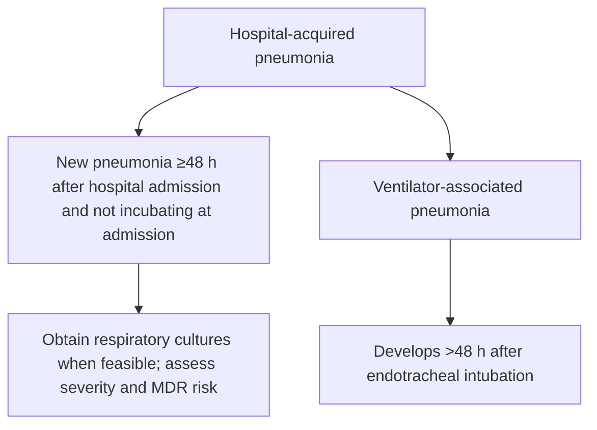
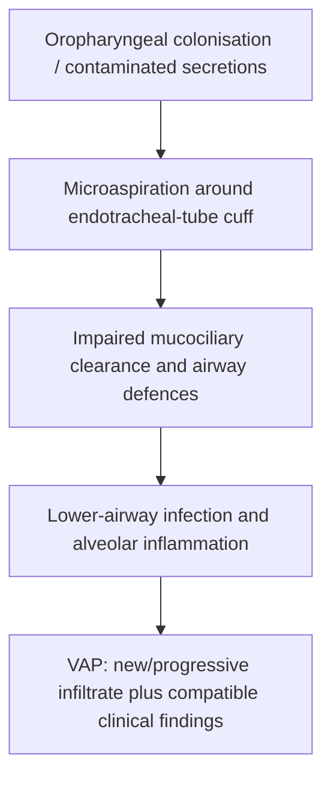
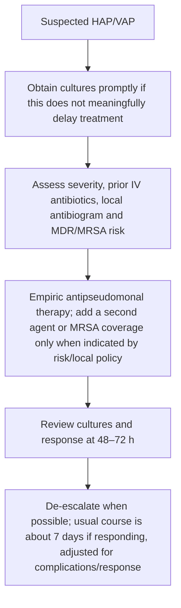

# Topic 39 — Hospital-Acquired Pneumonia

## 1. Definitions and Diagnostic Boundaries

Nosocomial lower respiratory tract infections are classified based on the timing and setting of acquisition to guide empirical antimicrobial selection and infection control measures.

### Classification Matrix
* **Hospital-Acquired Pneumonia (HAP):** Pneumonia occurring $\ge 48\text{ hours}$ after hospital admission that was not incubating at the time of entry.
* **Ventilator-Associated Pneumonia (VAP):** Pneumonia developing $> 48-72\text{ hours}$ following endotracheal intubation and mechanical ventilation.
* **Healthcare-Associated Pneumonia (HCAP):** Historical entity previously used to categorize non-hospitalized patients with frequent healthcare contact (e.g., hemodialysis, nursing homes). *Current IDSA/ATS guidelines have retired HCAP as a distinct category*, recommending that risk assessment for multidrug-resistant (MDR) pathogens be individualized based on local antibiograms and validated patient-specific risk factors.

---

## 2. Etiology and Risk Stratification

The microbiological spectrum of HAP and VAP differs fundamentally from community-acquired pneumonia, shifting heavily toward Gram-negative bacilli and resistant Gram-positive cocci.

| Organism group | Examples | Risk considerations |
|---|---|---|
| Gram-negative bacilli | *Pseudomonas*, Enterobacterales, *Acinetobacter* | Prior IV antibiotics, known colonisation, local ICU resistance |
| *Staphylococcus aureus* | MSSA or MRSA | MRSA coverage depends on local prevalence and patient risk factors |
| Early vs late onset | May inform epidemiology but is not sufficient by itself | Base empiric therapy primarily on MDR risk factors, severity and unit antibiogram |

### Risk Factors for Multidrug-Resistant (MDR) Pathogens

| MDR Risk Category | Specific Clinical Risk Factors |
| :--- | :--- |
| **MDR VAP Risk Factors** | • Prior intravenous antibiotic use within the preceding 90 days • Septic shock at the time of VAP onset • Acute Respiratory Distress Syndrome (ARDS) preceding VAP • $\ge 5\text{ days}$ of hospitalization prior to VAP onset • Acute renal replacement therapy prior to VAP onset |
| **MDR HAP Risk Factors** | • Prior intravenous antibiotic use within the preceding 90 days • High risk of mortality (need for ventilatory support or septic shock) |
| **MRSA Risk Factors** | • Prior IV antibiotic use within 90 days • Treatment in a unit where MRSA prevalence among *S. aureus* isolates is $> 10-20\%$ or unknown |
| **MDR Pseudomonas Risk Factors** | • Prior IV antibiotic use within 90 days • Treatment in an ICU where Gram-negative resistance is $> 10\%$ for monotherapy agents |

---

## 3. Pathophysiology and Pathogenesis

1. **Oropharyngeal and Gastric Colonization:** Hospitalization and broad-spectrum antibiotic pressure alter normal flora, promoting colonization of the oropharynx and stomach by Gram-negative bacilli (*P. aeruginosa*, *Acinetobacter*, *Klebsiella*) and *S. aureus*.
2. **Endotracheal Tube Biofilm:** Within hours of intubation, a bacterial biofilm forms on the inner surface of the polyvinyl chloride endotracheal tube (ETT), serving as a persistent reservoir for pathogen dislodgement.
3. **Microaspiration:** Incomplete sealing by the inflated ETT cuff permits pooled secretions above the cuff (subglottic area) to leak into the distal tracheobronchial tree.
4. **Impaired Clearance:** Mechanical ventilation impairs mucociliary transport, suppresses cough reflexes, and causes local mucosal injury, facilitating parenchymal invasion.

---

## 4. Clinical Features and Diagnostic Workup

### Clinical Presentation
* New or progressive pulmonary infiltrate on chest radiography **plus** at least two of the following clinical signs:
  * Fever ($>38^\circ\text{C}$) or hypothermia ($<36^\circ\text{C}$)
  * Leukocytosis ($\text{WBC} > 12,000/\mu\text{L}$) or leukopenia ($\text{WBC} < 4,000/\mu\text{L}$)
  * Purulent endotracheal secretions or tracheobronchial sputum
  * Deterioration in gas exchange ($\text{PaO}_2/\text{FiO}_2$ decline or increased oxygen requirement)

### Clinical Pulmonary Infection Score (CPIS)
A semi-quantitative historical adjunct. CPIS $>6$ has limited diagnostic performance and should not be used as the sole basis for starting, withholding or stopping antibiotics; integrate clinical findings, imaging, microbiology and trajectory.

| CPIS Parameter | 0 Points | 1 Point | 2 Points |
| :--- | :--- | :--- | :--- |
| **Tracheal Secretions** | Rare | Moderate | Abundant & Purulent |
| **Chest Radiograph** | No infiltrate | Diffuse infiltrate | Localized infiltrate |
| **Temperature ($^\circ\text{C}$)** | $36.5 - 38.4$ | $38.5 - 38.9$ | $\ge 39.0$ or $\le 36.0$ |
| **Leukocyte Count ($/\mu\text{L}$)** | $4,000 - 11,000$ | $<4,000$ or $>11,000$ | $<4,000$ or $>11,000$ + Band forms $\ge 50\%$ |
| **$\text{PaO}_2/\text{FiO}_2$ Ratio** | $> 240$ or ARDS | - | $\le 240$ and no ARDS |
| **Microbiology** | Negative | - | Positive culture + morphology |

### Diagnostic Sampling and Quantitative Cutoffs
To distinguish airway colonization from true parenchymal infection, quantitative microbiological cultures are performed:

$$\text{Endotracheal Aspirate (ETA)} \ge 10^5 \text{ CFU/mL}$$
$$\text{Bronchoalveolar Lavage (BAL)} \ge 10^4 \text{ CFU/mL}$$
$$\text{Protected Specimen Brush (PSB)} \ge 10^3 \text{ CFU/mL}$$

---

## 5. Management Protocols

When HAP/VAP is clinically suspected and treatment is indicated, obtain respiratory cultures promptly when feasible without meaningfully delaying empiric antibiotics. Reassess at 48–72 hours and de-escalate where possible; about 7 days is usual for responding patients, with individualisation for complications and response.

### Recommended Empirical Regimens

| Targeted Pathogen Class | Drug Options & Doses | Key Pharmacological Considerations |
| :--- | :--- | :--- |
| **Antipseudomonal $\beta$-lactams** | • **Piperacillin-Tazobactam:** $4.5\text{ g IV q6h}$ (extended infusion over 4h preferred) • **Cefepime:** $2\text{ g IV q8h}$ • **Ceftazidime:** $2\text{ g IV q8h}$ • **Meropenem:** $1\text{ g IV q8h}$ • **Imipenem-Cilastatin:** $500\text{ mg IV q6h}$ | Mainstay of Gram-negative empirical coverage. Extend infusions to optimize $T > \text{MIC}$. |
| **Second Antipseudomonal Agent** | • **Levofloxacin:** $750\text{ mg IV q24h}$ • **Ciprofloxacin:** $400\text{ mg IV q8h}$ • **Amikacin:** $15-20\text{ mg/kg IV q24h}$ • **Gentamicin/Tobramycin:** $5-7\text{ mg/kg IV q24h}$ | Added when MDR risk is high or local Gram-negative resistance $>10\%$. Avoid dual $\beta$-lactam therapy. |
| **Anti-MRSA Agents** | • **Vancomycin:** $15-20\text{ mg/kg IV q8-12h}$ (Target trough $15-20\text{ \mu g/mL}$ or AUC/MIC $400-600$) • **Linezolid:** $600\text{ mg IV q12h}$ | Linezolid exhibits superior lung tissue penetration compared to vancomycin. *Daptomycin is inactivated by pulmonary surfactant and strictly contraindicated.* |

### Duration of Therapy
A **7-day course** of antimicrobial therapy is as effective as longer durations (10–14 days) for both HAP and VAP, resulting in fewer recurrent infections with resistant strains, provided clinical response is satisfactory and the etiology is not *Pseudomonas* or *Acinetobacter* with delayed response.

---

## 6. Prevention: The VAP Bundle

Prevention of VAP requires strict adherence to evidence-based care bundles:

1. **Elevation of Head of Bed:** Maintain patient in a semi-recumbent position (**$30^\circ - 45^\circ$**) to reduce gastroesophageal reflux and microaspiration.
2. **Subglottic Secretion Drainage:** Use endotracheal tubes equipped with a continuous or intermittent subglottic suction port above the cuff.
3. **Sedation Vacation and SAT/SBT:** Daily Spontaneous Awakening Trials (SAT) and Spontaneous Breathing Trials (SBT) to minimize intubation duration.
4. **Endotracheal Cuff Pressure Maintenance:** Maintain cuff pressure strictly between **$20-30\text{ cmH}_2\text{O}$** (too low permits microaspiration; too high causes tracheal mucosal ischemia and necrosis).
5. **Oral Hygiene:** Regular oral decontamination using $0.12\%$ chlorhexidine gluconate solution.
6. **Early Extubation & Non-Invasive Ventilation:** Wean mechanical ventilation as early as clinically feasible.

---

## Accuracy and currency note

This is educational revision material, not a patient-specific treatment protocol. Time-sensitive drug regimens, doses, thresholds and service pathways should be checked against the current national/local guideline before clinical use. The batch review file records the main edits and the scope of verification.

**Review log:** [[00 - Batch 4 Accuracy Review]]
