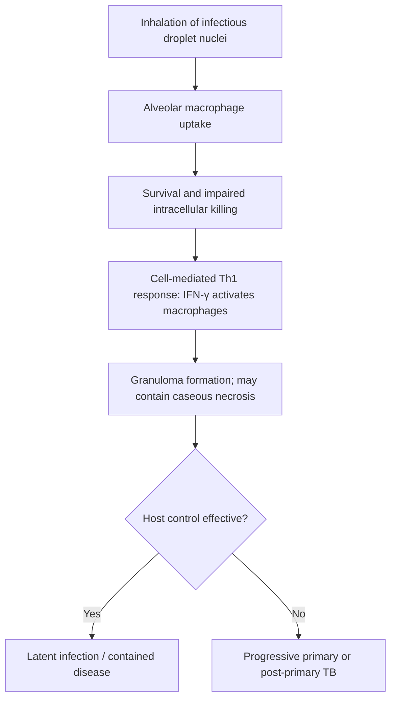
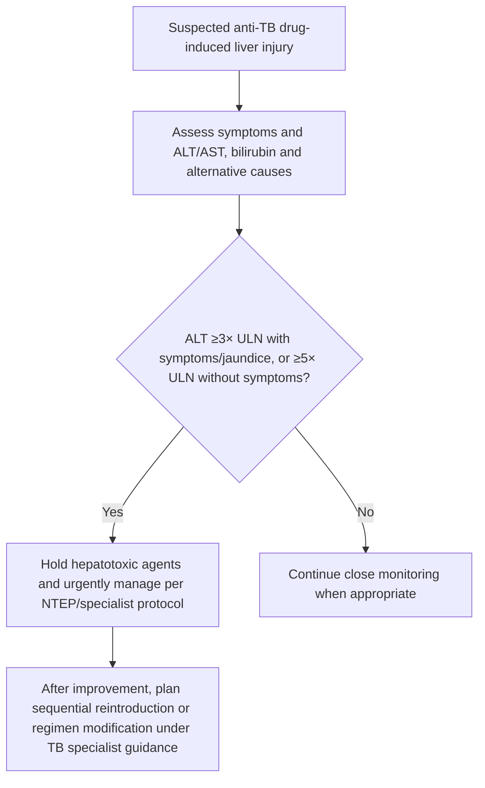

# Topic 40 — Pulmonary Tuberculosis

## 1. Microbiology and Pathogenesis

Pulmonary tuberculosis is caused by *Mycobacterium tuberculosis* (MTB), an obligate aerobic, non-motile, non-spore-forming, acid-fast bacillus (AFB).



### Microbiological Characteristics
* **Acid-Fast Staining:** High cell wall lipid and mycolic acid content retains carbolfuchsin dye despite decolorization with acid-alcohol ($3\%\text{ HCl}$ in ethanol or $20\%\text{ H}_2\text{SO}_4$).
* **Microscopic Visualizations:**
  * **Ziehl-Neelsen (ZN) Stain:** Bright red rod-shaped bacilli against a blue background. Requires $\ge 10,000\text{ bacilli/mL}$ of sputum for detection.
  * **Auramine-Rhodamine Stain:** Fluorescent staining allowing rapid screening under low power.
* **Culture Media:**
  * **Solid Medium:** Löwenstein-Jensen (LJ) slant (egg-based). Shows rough, tough, buff-colored colonies in **4 to 8 weeks**.
  * **Liquid Medium:** Mycobacteria Growth Indicator Tube (MGIT). Provides detection within **1 to 3 weeks**.

### Primary vs. Secondary Tuberculosis

| Feature | Primary Tuberculosis | Secondary (Reactivation) Tuberculosis |
| :--- | :--- | :--- |
| **Typical Host** | Non-sensitized individual (children, naive adults) | Previously sensitized host (adults, immunocompromised) |
| **Anatomical Site** | Subpleural region of lower upper lobe or upper lower lobe (**Ghon Focus**) | Apical and posterior segments of upper lobes |
| **Nodal Involvement** | Prominent hilar/mediastinal lymphadenopathy | Unfrequent lymphadenopathy |
| **Pathological Hallmarks** | **Ghon Complex:** Ghon focus + inflamed lymphatics + regional hilar lymph node.<br>**Ranke Complex:** Calcified Ghon complex. | Prominent tissue necrosis with **cavitation**, fibrous scarring, and endobronchial spread. |
| **PPD/TST Status** | Converts from negative to positive after 2–8 weeks | Positive baseline test |

---

## 2. Histopathology: The Caseating Granuloma

The hallmark histologic tissue response in tuberculosis is the **caseating granuloma** (type IV hypersensitivity response):

| Granuloma component | Typical histology |
|---|---|
| Centre | Caseous necrosis (may be absent in some TB lesions) |
| Inner rim | Epithelioid histiocytes and Langhans-type giant cells |
| Surrounding zone | Lymphocytes, macrophages and variable fibrosis |

Histology is supportive; microbiology and molecular testing are essential where obtainable.

* **Epithelioid Cells:** Activated macrophages transformed by IFN-$\gamma$, featuring abundant pale pink cytoplasm and elongated, slipper-shaped nuclei.
* **Langhans Giant Cells:** Large multinucleate giant cells formed by histiocyte fusion, displaying nuclei arranged in a horseshoe or peripheral ring configuration.
* **Caseous Necrosis:** Cheesy, acellular central region composed of dead cells and mycobacterial debris, inhibited from liquefaction by low oxygen tension and acidic pH.

---

## 3. Diagnostic Modalities

```mermaid
flowchart TD
A[Possible pulmonary TB] --> B[Collect appropriate respiratory specimen(s)]
B --> C[Rapid molecular test for MTB and rifampicin resistance, per NTEP algorithm]
C --> D{MTB detected?}
D -- Yes --> E[Assess rifampicin result; obtain additional DST/culture as indicated]
E --> F[Start regimen per current NTEP guidance and resistance profile]
D -- No --> G[If suspicion persists, repeat/alternate specimen, culture and reassess differential]
G --> H[Do not use one negative test alone to rule out TB in every high-suspicion case]
```

### Diagnostic Tools Matrix

| Diagnostic Tool | Mechanism & Diagnostic Target | Sensitivity / Limit of Detection | Key Clinical Utility & Pitfalls |
| :--- | :--- | :--- | :--- |
| **CBNAAT / GeneXpert MTB/RIF** | Automated real-time PCR targeting *MTB* DNA and the **$rpoB$ gene** (detecting rifampicin resistance). | Detection limit $\approx 130\text{ CFU/mL}$. High sensitivity ($>95\%$). | First-line diagnostic test for suspected TB. Results within 2 hours. |
| **Line Probe Assay (LPA)** | Polymerase chain reaction hybridization strip test. | Requires smear-positive or culture-positive specimen. | **First-line LPA:** Detects *rpoB* (Rifampicin) and *katG/inhA* (Isoniazid) mutations.<br>**Second-line LPA:** Detects fluoroquinolone ($gyrA/gyrB$) and second-line injectable resistance. |
| **Tuberculin Skin Test (TST / Mantoux)** | Intradermal injection of $5\text{ TU}$ Purified Protein Derivative (PPD); read at **48–72 hours**. | Measures cell-mediated delayed hypersensitivity (induration diameter). | **Cutoffs for Positivity:**<br>• **$\ge 5\text{ mm}$:** HIV-infected, recent TB contacts, organ transplants, immunosuppressed ($>15\text{ mg/day}$ prednisolone).<br>• **$\ge 10\text{ mm}$:** Immigrants from high-prevalence areas, healthcare workers, silicosis, end-stage renal disease, diabetics.<br>• **$\ge 15\text{ mm}$:** Healthy individuals with no risk factors. |
| **Interferon-Gamma Release Assay (IGRA)** | Measures IFN-$\gamma$ release by T-cells stimulated by *MTB*-specific antigens (**ESAT-6** and **CFP-10**). | Higher specificity than TST. Unaffected by prior BCG vaccination. | Cannot distinguish between Latent TB Infection (LTBI) and Active TB Disease. |

---

## 4. National Tuberculosis Elimination Program (NTEP) Regimens

### First-Line Anti-Tubercular Therapy (ATT) Dosing for Drug-Susceptible TB (DS-TB)
Under NTEP, treatment for adult drug-susceptible pulmonary tuberculosis consists of a **2-month Intensive Phase (IP)** followed by a **4-month Continuation Phase (CP)** administered as daily Fixed-Dose Combinations (FDC) based on weight bands.

$$\text{Illustrative drug-sensitive TB regimen: } 2 \text{ HRZE } / 4 \text{ HRE}$$

| Drug Name | Code | Daily Pediatric Dose | Daily Adult Dose | Primary Mechanism of Action | Major Adverse Effects & Monitoring |
| :--- | :--- | :--- | :--- | :--- | :--- |
| **Isoniazid** | **H** | $10\text{ mg/kg}$ | $5\text{ mg/kg}$ ($300\text{ mg}$) | Inhibits mycolic acid synthesis via *InhA* and *katG* activation | **Peripheral neuropathy** (prevent with Pyridoxine/B6 $10-25\text{ mg/day}$), drug-induced hepatitis, lupus-like syndrome |
| **Rifampicin** | **R** | $15\text{ mg/kg}$ | $10\text{ mg/kg}$ ($450-600\text{ mg}$) | Inhibits DNA-dependent RNA polymerase ($\beta$-subunit, $rpoB$) | **Orange-red discoloration of body fluids**, hepatotoxicity, strong CYP450 enzyme induction, acute renal failure |
| **Pyrazinamide**| **Z** | $30\text{ mg/kg}$ | $25\text{ mg/kg}$ ($1500\text{ mg}$) | Disrupts membrane potential & energy metabolism in acid pH | **Hyperuricemia** (gouty arthralgia), **most hepatotoxic** first-line agent, photosensitivity |
| **Ethambutol** | **E** | $20\text{ mg/kg}$ | $15\text{ mg/kg}$ ($800-1200\text{ mg}$) | Inhibits arabinosyl transferase (*embB*), blocking cell wall assembly | **Retrobulbar optic neuritis** (red-green color blindness, decreased visual acuity), hyperuricemia |

*Note: Streptomycin ($S$) is a aminoglycoside ($15\text{ mg/kg}$) causing ototoxicity and nephrotoxicity, now largely replaced in standard first-line oral regimens.*



---

## 5. Drug-Resistant Tuberculosis Definitions and Regimens

### Standardized WHO / NTEP Definitions
* **Multidrug-Resistant TB (MDR-TB):** Resistance to at least **Isoniazid (H) and Rifampicin (R)**.
* **Pre-Extensive Drug-Resistant TB (Pre-XDR-TB):** TB that meets the definition of MDR/RR-TB **and** is also resistant to any fluoroquinolone (e.g., Levofloxacin or Moxifloxacin).
* **Extensively Drug-Resistant TB (XDR-TB):** TB that meets the definition of MDR/RR-TB **and** is resistant to any fluoroquinolone **and** at least one additional Group A drug (**Bedaquiline** or **Linezolid**).

### All-Oral Short Regimens for Drug-Resistant TB
NTEP utilizes all-oral regimens eliminating injectable second-line agents (amikacin/kanamycin/capreomycin):
1. **BPaLM Regimen (6-Month All-Oral Regimen):**
   * **Composition:** Bedaquiline (B) + Pretomanid (Pa) + Linezolid (L) + Moxifloxacin (M) for 26 weeks.
   * Indicated for MDR/RR-TB without fluoroquinolone resistance.
2. **BPaL Regimen:** Used when fluoroquinolone resistance is confirmed (Pre-XDR-TB).
3. **Key Novel Anti-TB Drugs:**
   * **Bedaquiline:** Inhibits mycobacterial **ATP synthase** (proton pump). *Adverse effect:* QTc interval prolongation.
   * **Pretomanid / Delamanid:** Nitroimidazoles inhibiting mycolic acid synthesis and blocking protein synthesis.
   * **Linezolid:** Protein synthesis inhibitor ($50\text{S}$ ribosomal subunit). *Adverse effects:* Myelosuppression (anemia, thrombocytopenia) and peripheral/optic neuropathy with prolonged use ($>28\text{ days}$).

---

## 6. Special Clinical Scenarios

### 1. TB and HIV Co-Infection
* **CD4 Count Correlation:**
  * $\text{CD4} > 350/\mu\text{L}$: Classic presentation (apical cavities, typical symptoms).
  * $\text{CD4} < 200/\mu\text{L}$: Atypical presentation (lower lobe infiltrates, hilar adenopathy, miliary pattern, negative tuberculin skin test, higher incidence of extrapulmonary TB).
* **Timing of Antiretroviral Therapy (ART) Initiation:**
  * Initiate ART within **2 weeks** of starting ATT for patients with $\text{CD4} < 50/\mu\text{L}$.
  * Initiate ART within **8 weeks** for patients with higher CD4 counts.
  * *Exception:* In tuberculous meningitis, ART initiation is delayed by $4-6\text{ weeks}$ to prevent fatal intracranial Immune Reconstitution Inflammatory Syndrome (IRIS).
* **Immune Reconstitution Inflammatory Syndrome (IRIS):** Paradoxical worsening of preexisting TB lesions or appearance of new lesions after starting ART, mediated by rapid recovery of cell-mediated immunity. Managed with systemic corticosteroids (Prednisolone $1-2\text{ mg/kg}$).

---

### Current-regimen caution

The drug-sensitive regimen shown here is an exam-oriented summary, not an instruction to prescribe. Verify the current NTEP version, weight-band dosing, site of disease, resistance testing, comorbidities and special-population guidance. For MDR/RR-TB, eligibility and DST drive regimen selection; WHO’s updated September 2026 options must not be assumed to be automatically adopted by Indian NTEP.

---

## Accuracy and currency note

This is educational revision material, not a patient-specific treatment protocol. Time-sensitive drug regimens, doses, thresholds and service pathways should be checked against the current national/local guideline before clinical use. The batch review file records the main edits and the scope of verification.

**Review log:** [[00 - Batch 4 Accuracy Review]]
