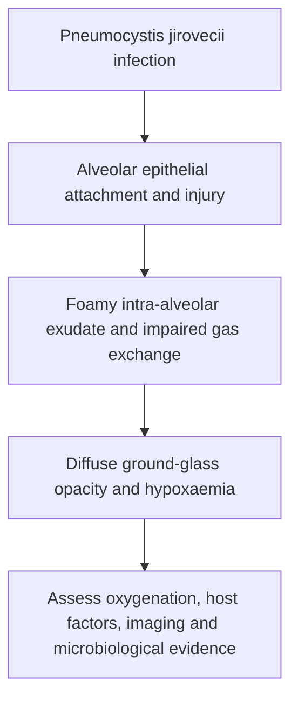
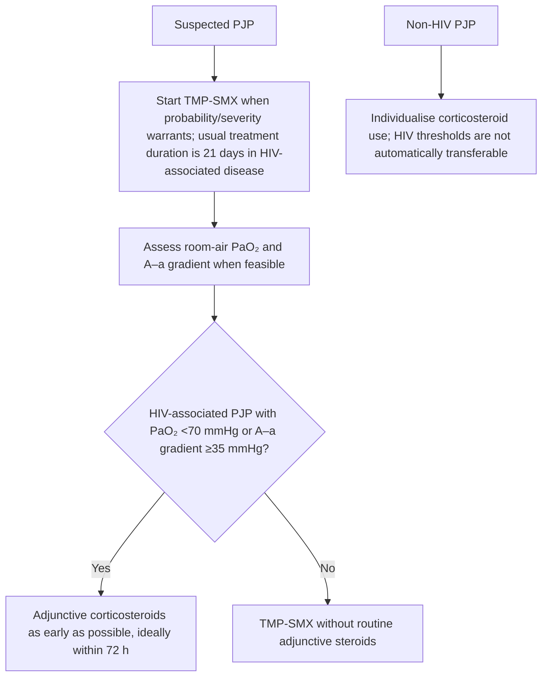

# Topic 41 — The Immunocompromised Patient

## 1. Immune Defect Categories and Susceptibility

Pulmonary infections in immunocompromised hosts are dictated by the specific arm of the immune system that is impaired.

| Immune defect | Opportunistic / characteristic pulmonary pathogens |
|---|---|
| Neutropenia / phagocyte dysfunction | *Aspergillus*, *Pseudomonas*, other Gram-negative bacilli; Mucorales in selected hosts |
| T-cell dysfunction | *Pneumocystis jirovecii*, CMV, TB/NTM, *Cryptococcus*, endemic fungi |
| Antibody deficiency | Encapsulated bacteria, including *S. pneumoniae* and *H. influenzae* |
| Complement deficiency | *Neisseria* and other selected invasive bacterial infections |

These are probabilistic patterns; prophylaxis and empiric therapy depend on the specific host and setting.

### Risk Stratification Matrix

| Primary Immune Defect | Key Clinical Settings | Pathogen Susceptibility Spectrum |
| :--- | :--- | :--- |
| **Severe Neutropenia ($\text{ANC} < 500/\mu\text{L}$)** | Hematologic malignancies, post-chemotherapy, bone marrow failure | • **Fungi:** *Aspergillus spp.*, *Mucorales* (*Rhizopus*, *Mucor*), *Candida spp.* • **Bacteria:** *Pseudomonas aeruginosa*, *Acinetobacter*, *Enterobacteriaceae* |
| **Cell-Mediated / T-Cell Defect** | Advanced HIV ($\text{CD4} < 200/\mu\text{L}$), organ transplants, prolonged corticosteroids, anti-TNF therapy | • **Fungi:** *Pneumocystis jirovecii*, *Cryptococcus neoformans*, *Histoplasma* • **Viruses:** Cytomegalovirus (CMV), HSV, VZV • **Bacteria:** *Mycobacterium tuberculosis*, NTM, *Listeria*, *Nocardia* |
| **Humoral / B-Cell Defect** | Hypogammaglobulinemia, CVID, multiple myeloma, post-splenectomy | Encapsulated bacteria (*Streptococcus pneumoniae*, *Haemophilus influenzae*, *Neisseria meningitidis*) |
| **Impaired Cell-Mediated & Phagocytic** | High-dose corticosteroids ($>20\text{ mg/day}$ prednisolone equivalent) | *Pneumocystis*, *Aspergillus*, *Nocardia*, *Strongyloides stercoralis* hyperinfection |

---

## 2. Pneumocystis jirovecii Pneumonia (PJP / PCP)

*Pneumocystis jirovecii* is an atypical, non-culturable fungus exhibiting tropism for type I alveolar epithelial cells.

### Clinical Presentation and Diagnostics
* **Classic Triad:** Progressive exertional dyspnea, non-productive dry cough, and fever developing over weeks (in HIV) or days (in non-HIV immunosuppression).
* **Laboratory Markers:**
  * Marked elevation in serum **Lactate Dehydrogenase (LDH)** ($>500\text{ IU/L}$).
  * Elevated serum **$(1\rightarrow 3)\text{-\beta-D-Glucan}$** (high negative predictive value).
* **Imaging:** High-Resolution CT (HRCT) displays bilateral, symmetric **ground-glass opacities (GGO)** with central/perihilar distribution and upper lobe sparing.
* **Microscopic Staining:** Direct visualization from Sputum, Induced Sputum, or Bronchoalveolar Lavage (BAL) using:
  * **Grocott-Gori Methenamine Silver (GMS) Stain:** Shows classic crushed ping-pong ball or cup-shaped cysts containing central dark spots.

---

## 3. Invasive Pulmonary Aspergillosis (IPA)

Invasive infection predominantly affecting severely neutropenic patients or stem cell transplant recipients, caused by *Aspergillus fumigatus* or *Aspergillus flavus*.

| Condition | Diagnostic clues | Notes |
|---|---|---|
| Invasive pulmonary aspergillosis | Host risk, CT nodules/halo sign; microbiology/galactomannan where appropriate | Air-crescent sign may appear later; no single CT sign is diagnostic |
| Histology | Septate hyphae with acute-angle branching is classic | Morphology is supportive, not sufficient alone |
| CMV pneumonitis | Appropriate immunosuppressed host, compatible syndrome and virological/tissue evidence | Ganciclovir/valganciclovir-based therapy is typical; IVIG is not a universal routine adjunct |

### Imaging and Diagnostic Features
* **HRCT Findings:**
  * **Halo Sign:** Nodular shadow surrounded by a perimeter of ground-glass attenuation, representing ischemic tissue necrosis surrounded by alveolar hemorrhage (early sign).
  * **Air-Crescent Sign:** Crescentic collection of air surrounding a central necrotic mass, seen during neutrophil recovery phase.
* **Serological Biomarkers:** Positive serum and BAL **Galactomannan antigen assay** (polysaccharide constituent of *Aspergillus* cell wall).
* **Histopathology:** Tissue biopsy or BAL microscopy demonstrates narrow, **septate hyphae with dichotomous acute-angle ($45^\circ$) branching**.

### Treatment Guidelines
* **First-Line Therapy:** **Voriconazole** ($6\text{ mg/kg IV q12h}$ on day 1, then $4\text{ mg/kg IV q12h}$) or **Isavuconazole**.
* **Second-Line / Salvage:** Liposomal Amphotericin B ($3-5\text{ mg/kg/day}$) or Posaconazole.

---

## 4. Cytomegalovirus (CMV) Pneumonitis

CMV pneumonitis is a life-threatening complication in allogeneic hematopoietic stem cell transplant (HSCT) and solid organ transplant recipients (highest risk in $\text{Donor}^+ / \text{Recipient}^-$ mismatches).

### Clinical Features and Histopathology
* **Presentation:** Fever, non-productive cough, hypoxia, and bilateral interstitial pulmonary infiltrates.
* **Pathognomonic Cytology:** Bronchoalveolar lavage or lung biopsy demonstrates enlarged cells with intranuclear inclusions surrounded by a clear halo, giving a classic **"Owl's-eye" appearance**.
* **Treatment:** IV ganciclovir is commonly used for significant CMV pneumonitis in the appropriate host. CMV immunoglobulin/IVIG is not a universal routine adjunct; consider only in selected transplant-specific situations with specialist input.

---

## 5. Pulmonary Mucormycosis and Nocardiosis

### Pulmonary Mucormycosis
* **Pathogens:** *Rhizopus*, *Mucor*, *Lichtheimia*.
* **Risk Factors:** Uncontrolled diabetes mellitus with ketoacidosis (DKA), severe neutropenia, deferoxamine chelation therapy.
* **Pathology:** Angioinvasion leading to thrombosis, tissue infarction, and black necrotic eschars.
* **Microscopy:** Broad, **non-septate (aseptate) hyphae branching at right angles ($90^\circ$)**.
* **Treatment:** Emergency surgical debridement **plus** **Liposomal Amphotericin B** ($5-10\text{ mg/kg/day IV}$). *Voriconazole is ineffective against Mucorales.*

### Pulmonary Nocardiosis
* **Pathogen:** *Nocardia asteroides* / *Nocardia farcinica* (Gram-positive, weakly acid-fast, strictly aerobic actinomycete).
* **Clinical Presentation:** Cavitating pulmonary nodules, brain abscesses, and cutaneous lesions.
* **Microscopy:** Thin, **filamentous, branching Gram-positive rods** that demonstrate **weak acid-fastness** ($1-2\%\text{ H}_2\text{SO}_4$ modified ZN stain).
* **Treatment:** High-dose **Trimethoprim-Sulfamethoxazole (TMP-SMX)** for $6-12\text{ months}$.

---

### PJP treatment clarification

For HIV-associated moderate-to-severe PJP, TMP–SMX is first line (commonly TMP 15–20 mg/kg/day in divided doses, adjusted for renal function and local protocol). Alternatives depend on severity: atovaquone is for mild–moderate disease; dapsone plus trimethoprim or primaquine plus clindamycin may be options after checking G6PD status; IV pentamidine is an option for moderate–severe disease. The PaO₂ <70 mmHg or A–a gradient ≥35 mmHg adjunctive-steroid thresholds are for HIV-associated PJP and should not automatically be transferred to non-HIV PJP.

---

## Accuracy and currency note

This is educational revision material, not a patient-specific treatment protocol. Time-sensitive drug regimens, doses, thresholds and service pathways should be checked against the current national/local guideline before clinical use. The batch review file records the main edits and the scope of verification.

**Review log:** [[00 - Batch 4 Accuracy Review]]
