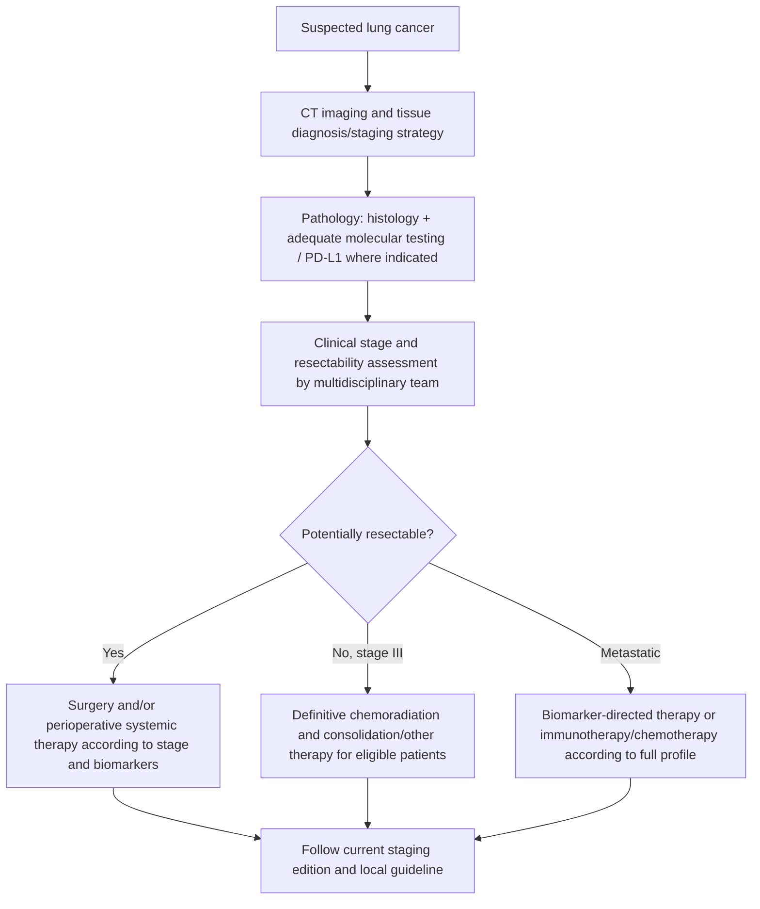

# Topic 42 — Lung Cancer

## 1. Classification and Histopathology

Bronchogenic carcinoma is broadly divided into **Non-Small Cell Lung Cancer (NSCLC)** ($\sim 85\%$) and **Small Cell Lung Cancer (SCLC)** ($\sim 15\%$).

| Type | Typical findings | Common immunohistochemical markers (context-dependent) |
|---|---|---|
| Adenocarcinoma | Often peripheral; glandular/mucin production | TTF-1, Napsin A |
| Squamous cell carcinoma | Often central; keratinisation/intercellular bridges; may cavitate | p40, CK5/6 |
| Small-cell carcinoma | High-grade neuroendocrine tumour; often central; crush artefact | Synaptophysin, chromogranin, INSM1, CD56 |
| Large-cell / other NSCLC | Diagnosis after excluding specific differentiation | Panel selected by pathologist |

### Pathological Subtypes Comparison Matrix

| Histological Subtype | Anatomical Location | Smoking Association | Key Immunohistochemical (IHC) Markers | Histological Hallmarks |
| :--- | :--- | :--- | :--- | :--- |
| **Adenocarcinoma** | **Peripheral** (subpleural) | Most common subtype in **non-smokers**, females, and overall | **TTF-1 positive** **Napsin A positive** | Gland formation, mucin production, lepidic growth pattern (formerly bronchioloalveolar carcinoma) |
| **Squamous Cell Carcinoma** | **Central** (hilar/main bronchi) | **Strongly associated** with cigarette smoking | **p40 positive** **p63 positive** CK5/6 positive | **Keratin pearls**, **intercellular bridges** (desmosomes), central necrosis with cavitation |
| **Small Cell Carcinoma (SCLC)** | **Central** | **Extremely strong** association with heavy smoking | **Synaptophysin positive** **Chromogranin A positive** **CD56 positive** | Small blue round cells with scant cytoplasm, granular "salt-and-pepper" chromatin, nuclear molding, **Azzopardi effect** (basophilic staining of vascular walls by DNA from necrotic cells) |
| **Large Cell Carcinoma** | Peripheral or Central | Strongly associated | Diagnosis of exclusion (negative for TTF-1, p40, mucin) | Undifferentiated large, sheets of atypical cells with prominent nucleoli |

---

## 2. Molecular Oncology and Driver Mutations

Driver mutations are predominantly identified in non-squamous NSCLC (adenocarcinoma), enabling targeted molecular therapies.

| Biomarker / alteration | Treatment relevance (examples, not a complete prescribing rule) |
|---|---|
| EGFR sensitising variants | EGFR-targeted therapy; osimertinib is commonly used in appropriate advanced disease and selected adjuvant settings |
| ALK rearrangement | ALK inhibitors, e.g. alectinib, in appropriate disease settings |
| ROS1 / RET / NTRK fusions; MET exon 14 skipping; BRAF V600E; HER2; KRAS G12C | Alteration-specific targeted options may be available |
| PD-L1 expression | Helps inform immunotherapy selection only in context |

**Do not assign treatment from a mutation table alone.** Stage, full molecular panel, histology, performance status, comorbidities and current local guideline determine therapy.

* **EGFR (Epidermal Growth Factor Receptor) Mutations:** Occurs in $10-15\%$ of Western and up to $40-50\%$ of Asian non-smoker adenocarcinoma patients. Common mutations: Exon 19 deletion, Exon 21 L858R point mutation.
  * *Targeted Therapy:* First-generation (Gefitinib, Erlotinib), Second-generation (Afatinib), Third-generation (**Osimertinib** - active against T790M resistance mutation).
* **ALK (Anaplastic Lymphoma Kinase) Gene Rearrangements:** Results from $INVT(2)(p21;p23)$ creating the **EML4-ALK fusion protein**.
  * *Targeted Therapy:* Crizotinib, **Alectinib**, Brigatinib, Lorlatinib.
* **ROS1 Rearrangements:** Treated with Crizotinib or Entrectinib.
* **KRAS Mutations (p.G12C):** Associated with heavy smoking history. Treated with Sotorasib or Adagrasib.
* **PD-L1 Expression:** Tumors with high PD-L1 ($\ge 50\%$) without driver mutations respond to **Pembrolizumab** (immune checkpoint inhibitor).

---

## 3. Clinical Features and Paraneoplastic Syndromes

### Local and Regional Manifestations
* **Local Tumors:** Persistent cough, hemoptysis, dyspnea, localized wheeze/stridor, non-resolving pneumonia.
* **Pancoast Tumor (Superior Sulcus Tumor):** Apical lung carcinoma invading structures at the thoracic inlet:
  * **Horner Syndrome:** Invasion of the cervical sympathetic chain (stellate ganglion), presenting with **ptosis, miosis, anhidrosis, and enophthalmos**.
  * **Brachial Plexus Involvement:** Severe shoulder and arm pain along the C8-T2 dermatomal distribution with intrinsic hand muscle atrophy.
  * Erosion of 1st and 2nd ribs.
* **Superior Vena Cava (SVC) Syndrome:** Compression of SVC causing facial edema, neck vein distension, thoracic wall venous collateralization, and plethoric facial suffusion.

| Syndrome | Classic association | Mechanism / clue |
|---|---|---|
| SIADH | SCLC | Ectopic ADH → hyponatraemia |
| Ectopic ACTH | SCLC | Cushing syndrome |
| Lambert–Eaton myasthenic syndrome | SCLC | Presynaptic voltage-gated calcium-channel antibodies |
| Hypercalcaemia | Squamous NSCLC | PTHrP |
| Hypertrophic pulmonary osteoarthropathy / clubbing | Often NSCLC, including adenocarcinoma | Periostosis and digital clubbing |
| Trousseau syndrome | Mucin-producing adenocarcinomas, including lung | Migratory thrombophlebitis |

### Paraneoplastic Syndromes Summary Table

| Paraneoplastic Condition | Underlying Pathophysiology | Responsible Cancer Subtype | Key Clinical Diagnostic Features |
| :--- | :--- | :--- | :--- |
| **SIADH** | Ectopic production of Antidiuretic Hormone (Vasopressin) | **Small Cell Lung Cancer** | Euvolmic **hyponatremia**, low plasma osmolality ($<275\text{ mOsm/kg}$), inappropriately concentrated urine ($>100\text{ mOsm/kg}$) |
| **Ectopic ACTH Syndrome** | Ectopic Adrenocorticotropic Hormone secretion | **Small Cell Lung Cancer** | Severe hypertension, hypokalemic metabolic alkalosis, hyperpigmentation, rapid-onset Cushingoid features |
| **Lambert-Eaton Myasthenic Syndrome (LEMS)** | Autoantibodies against **presynaptic voltage-gated calcium channels (VGCC)** | **Small Cell Lung Cancer** | Proximal muscle weakness that **improves with repeated muscle exertion**; autonomic dysfunction (dry mouth), loss of deep tendon reflexes |
| **Hypercalcemia of Malignancy** | Ectopic secretion of **Parathyroid Hormone-related Protein (PTHrP)** | **Squamous Cell Carcinoma** | Elevated serum ionized calcium, suppressed intact PTH, bone pain, confusion, shortened QTc interval |
| **Hypertrophic Pulmonary Osteoarthropathy (HPOA)** | Periosteal proliferation and inflammation of long bones | **Adenocarcinoma** | Severe pain and swelling of wrists/ankles, digital **clubbing**, periostitis on x-rays (Pierre-Marie-Bamberger syndrome) |

---

## 4. Diagnostic Workup and Staging

### Diagnostic Cascade
1. **Imaging:** Chest Radiography followed by Contrast-Enhanced CT (CECT) of chest and upper abdomen.
2. **Pathological Confirmation:**
   * **Central Lesions:** Flexible Fiberoptic Bronchoscopy with endobronchial biopsy, bronchial brushing, or transbronchial needle aspiration (TBNA).
   * **Peripheral Lesions:** Image-guided (CT or ultrasound) transthoracic core needle biopsy.
   * **Mediastinal Staging:** Endobronchial Ultrasound with real-time TBNA (EBUS-TBNA).
3. **Metastatic Staging:** Whole-body $^{18}\text{F-FDG PET-CT}$ and Brain Contrast MRI.

### Staging Frameworks
* **NSCLC:** Staged according to the **TNM 8th Edition Classification System** (Stage I to IV).
* **SCLC:** Veterans Administration Lung Study Group (VALG) two-stage system:
  * **Limited Stage:** Tumor confined to one hemithorax and regional lymph nodes that can be encompassed within a single tolerable radiation portal.
  * **Extensive Stage:** Disease beyond a single radiation field (distant metastases, malignant pleural/pericardial effusion, contralateral hilar nodes).

---

## 5. Management Protocols

### Non-Small Cell Lung Cancer (NSCLC)
* **Stage I & II (Early Disease):** Surgical resection (**Lobectomy** with systemic mediastinal lymph node dissection) is the treatment of choice. Adjuvant platinum-based chemotherapy indicated for Stage II and resected Stage IB $>4\text{ cm}$.
* **Unresectable stage III NSCLC:** concurrent chemoradiotherapy followed by consolidation therapy (often durvalumab) is an option for eligible patients without progression; histology, molecular findings, contraindications and current guideline/approval determine the pathway. This is not the pathway for every stage III patient.
* **Stage IV (Metastatic):**
  * *With Driver Mutation:* Targeted Tyrosine Kinase Inhibitors (Osimertinib for EGFR; Alectinib for ALK).
  * *Without Driver Mutation:* Pembrolizumab monotherapy (if $\text{PD-L1} \ge 50\%$) or Pembrolizumab + Platinum-doublet chemotherapy.

### Small Cell Lung Cancer (SCLC)
* **Limited Stage:** Concurrent **Chemoradiotherapy** (Cisplatin + Etoposide + thoracic radiation). Patients achieving complete or good partial response receive **Prophylactic Cranial Irradiation (PCI)** to prevent brain relapse.
* **Extensive Stage:** First-line systemic **Chemotherapy + Immunotherapy** (Platinum + Etoposide + Atezolizumab or Durvalumab).

---

## Accuracy and currency note

This is educational revision material, not a patient-specific treatment protocol. Time-sensitive drug regimens, doses, thresholds and service pathways should be checked against the current national/local guideline before clinical use. The batch review file records the main edits and the scope of verification.

**Review log:** [[00 - Batch 5 Accuracy Review]]
