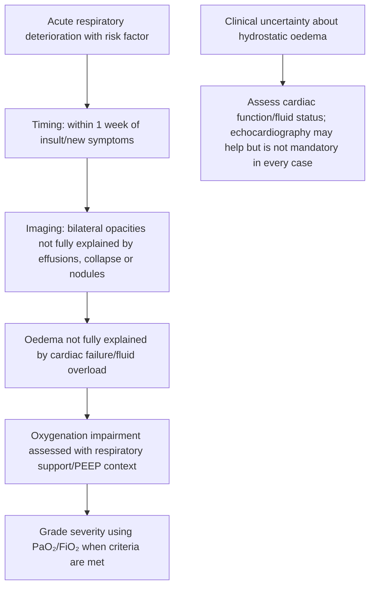
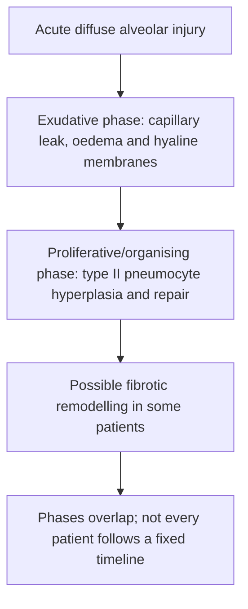
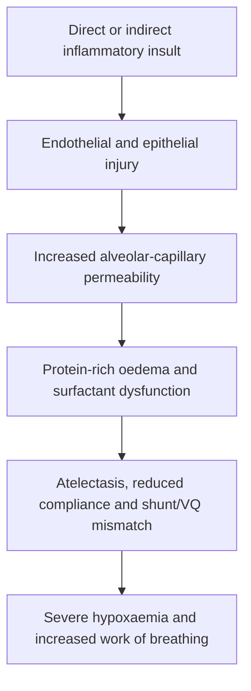
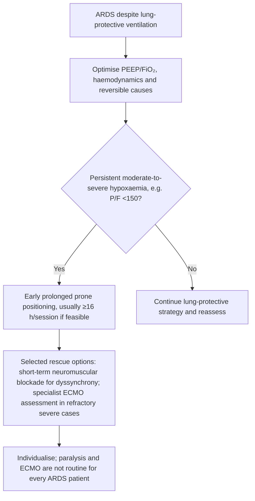

# Topic 43 — Acute Respiratory Distress Syndrome

## 1. Berlin Definition and Severity Grading

Acute Respiratory Distress Syndrome (ARDS) is a form of non-cardiogenic pulmonary edema caused by acute diffuse alveolar-capillary membrane injury.

### Berlin Diagnostic Criteria & Severity Stratification

$$\text{PaO}_2/\text{FiO}_2 \text{ Ratio calculated at PEEP or CPAP } \ge 5 \text{ cmH}_2\text{O}$$

| ARDS Severity Grade | $\text{PaO}_2/\text{FiO}_2$ Ratio | Mortality Risk | Clinical Management Focus |
| :--- | :--- | :--- | :--- |
| **Mild ARDS** | $200 < \text{PaO}_2/\text{FiO}_2 \le 300\text{ mmHg}$ | $\sim 27\%$ | High-Flow Nasal Cannula (HFNC), Non-Invasive Ventilation (NIV) or protective mechanical ventilation |
| **Moderate ARDS** | $100 < \text{PaO}_2/\text{FiO}_2 \le 200\text{ mmHg}$ | $\sim 32\%$ | Lung-Protective Mechanical Ventilation ($6\text{ mL/kg}$ PBW), higher PEEP titration |
| **Severe ARDS** | $\text{PaO}_2/\text{FiO}_2 \le 100\text{ mmHg}$ | $\sim 45\%$ | Prone positioning ($\ge 16\text{ h/day}$), Neuromuscular blockade, consideration of VV-ECMO |

---

## 2. Etiology and Risk Factors

ARDS results from direct or indirect lung injury:

| Direct pulmonary insults | Indirect systemic insults |
|---|---|
| Pneumonia, aspiration, pulmonary contusion, inhalation injury, near-drowning | Sepsis, major trauma/shock, acute pancreatitis, transfusion-related lung injury and selected systemic insults |

---

## 3. Pathophysiology and Histopathology

The histological hallmark of ARDS is **Diffuse Alveolar Damage (DAD)**, which evolves through three overlapping phases:

### Pathological Phases

| Phase | Duration | Key Histological & Physiological Hallmarks |
| :--- | :--- | :--- |
| **Exudative Phase** | Days 1 – 7 | Neutrophilic alveolar infiltration, destruction of type I pneumocytes, microvascular thrombosis, and formation of pink, proteinaceous **hyaline membranes** lining alveoli. Leads to intrapulmonary shunt and decreased compliance. |
| **Proliferative Phase** | Days 7 – 21 | Proliferation of **Type II pneumocytes** (stem cells) to repair damaged alveolar epithelium, expansion of fibroblasts in interstitium, and gradual absorption of alveolar exudate. |
| **Fibrotic Phase** | $> 21$ Days | Extensive collagen deposition, alveolar destruction, interstitial fibrosis, pulmonary vascular remodeling, and secondary pulmonary hypertension. |

---

## 4. Lung-Protective Mechanical Ventilation Strategy

The primary goal of mechanical ventilation in ARDS is to maintain adequate oxygenation while preventing **Ventilator-Induced Lung Injury (VILI)** (volutrauma, barotrauma, and atelectotrauma).

| Ventilator parameter | Core principle | Caution |
|---|---|---|
| Tidal volume | Start near 6 mL/kg predicted body weight; individualise within lung-protective range | Do not use actual body weight |
| Plateau pressure | Target ≤30 cmH₂O | Measure using an appropriate inspiratory hold |
| PEEP | Individualise to oxygenation/recruitability and haemodynamics | Avoid inappropriate recruitment manoeuvres; monitor overdistension |
| Driving pressure | Pplat − PEEP; useful physiologic marker | ≤15 cmH₂O is not a universally validated stand-alone treatment target |

### Key Ventilator Settings & Targets
1. **Low Tidal Volume ($V_T$):** Initiate at $6\text{ mL/kg}$ of **Predicted Body Weight (PBW)** (range $4-8\text{ mL/kg}$).
   $$\text{Male PBW (kg)} = 50 + 0.91 \times (\text{Height in cm} - 152.4)$$
   $$\text{Female PBW (kg)} = 45.5 + 0.91 \times (\text{Height in cm} - 152.4)$$
2. **Plateau Pressure ($P_{plat}$) Restriction:** Maintain $P_{plat} \le 30\text{ cmH}_2\text{O}$ measured during an inspiratory hold maneuver.
3. **Driving Pressure ($\Delta P$) Optimization:**
   $$\Delta P = P_{plat} - \text{PEEP}$$
   Driving pressure (Pplat − PEEP) is a useful physiologic marker; values around ≤15 cmH₂O are sometimes used as a contextual goal, but it is not a universally validated stand-alone treatment target replacing low-tidal-volume ventilation and plateau-pressure monitoring.
4. **Positive End-Expiratory Pressure (PEEP) Titration:** High PEEP strategy using the ARDSNet PEEP/$\text{FiO}_2$ titration table to prevent cyclic alveolar collapse and re-opening (atelectotrauma).
5. **Permissive Hypercapnia:** Allow arterial $\text{PaCO}_2$ to rise ($50-70\text{ mmHg}$) to achieve low-volume lung protection, provided arterial $\text{pH}$ is maintained **$\ge 7.15-7.20$**.

---

## 5. Evidence-Based Rescue Therapies for Severe ARDS

1. **Prone Positioning:** Recommended for patients with $\text{PaO}_2/\text{FiO}_2 < 150\text{ mmHg}$. Must be maintained for **at least 16 consecutive hours per day**.
   * *Mechanism:* Prone positioning redistributes transpulmonary pressure, recruits dorsal lung regions, shifts heart weight off lung tissue, and improves ventilation-perfusion matching without increasing global airway pressure.
2. **Neuromuscular blockade:** Consider a short course in selected severe ARDS patients with persistent ventilator dyssynchrony or when required to deliver lung-protective ventilation; it is not routine for every patient with P/F <150.
3. **Fluid Management Strategy:** Conservative fluid strategy (diuretics and fluid restriction once shock has resolved) shortens mechanical ventilation duration and ICU length of stay.
4. **Veno-Venous Extracorporeal Membrane Oxygenation (VV-ECMO):** Considered in refractory severe ARDS ($\text{P/F} < 80\text{ mmHg}$ for $>6\text{ hours}$ or $\text{pH} < 7.15$ despite optimal mechanical ventilation).

---

## Accuracy and currency note

This is educational revision material, not a patient-specific treatment protocol. Time-sensitive drug regimens, doses, thresholds and service pathways should be checked against the current national/local guideline before clinical use. The batch review file records the main edits and the scope of verification.

**Review log:** [[00 - Batch 5 Accuracy Review]]
