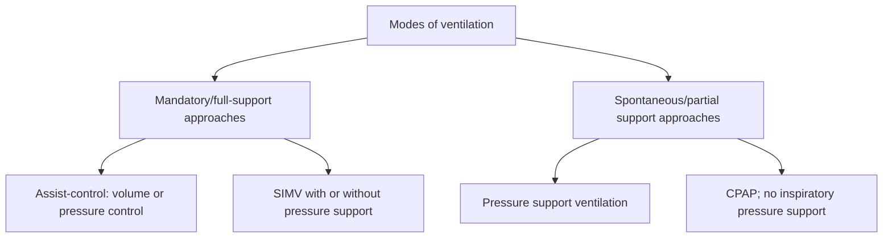
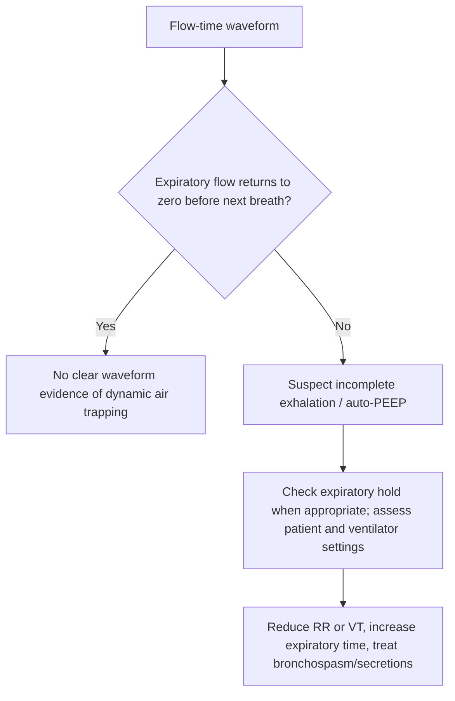
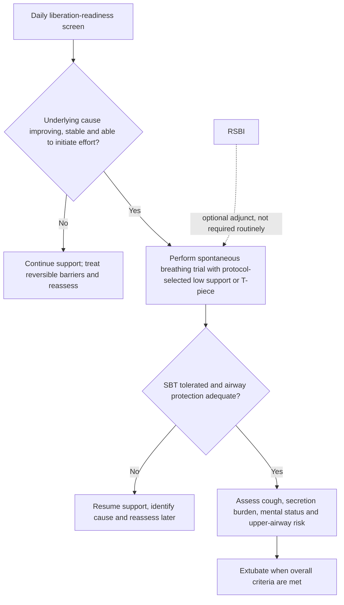

# Topic 44 — Mechanical Ventilation

## 1. Physical Principles and Respiratory Mechanics

Mechanical ventilation provides artificial respiratory support by applying positive pressure to the airway.

$$P_{\text{aw}} \approx P_{\text{resistive}} + P_{\text{elastic}} + PEEP$$

$$P_{\text{resistive}} = \dot V \times R, \qquad P_{\text{elastic}} = \frac{V}{C}$$

### Key Mechanical Parameters

$$\text{Static Compliance } (C_{stat}) = \frac{V_T}{P_{plat} - \text{PEEP}}$$
$$\text{Dynamic Compliance } (C_{dyn}) = \frac{V_T}{P_{peak} - \text{PEEP}}$$
$$\text{Airway Resistance } (R_{aw}) = \frac{P_{peak} - P_{plat}}{\text{Inspiratory Flow Rate}}$$

* **Peak Airway Pressure ($P_{peak}$):** The maximum pressure generated during inspiration. Reflects both airway resistance and thoracoabdominal compliance.
* **Plateau Pressure ($P_{plat}$):** Pressure measured during an inspiratory hold maneuver (zero gas flow). Reflects true static alveolar pressure and lung compliance. Target **$P_{plat} \le 30\text{ cmH}_2\text{O}$**.
* **Elevated $P_{peak}$ with Normal $P_{plat}$:** Indicates increased **Airway Resistance** (e.g., bronchospasm, endotracheal tube biting/clot, secretions, asthma/COPD).
* **Elevated $P_{peak}$ AND Elevated $P_{plat}$:** Indicates decreased **Thoracopulmonary Compliance** (e.g., ARDS, pulmonary edema, pneumothorax, atelectasis, severe abdominal distension).

---

## 2. Modes of Mechanical Ventilation

### Modes Comparison Matrix

| Ventilator Mode | Control Variable | Trigger Mechanism | Target Variable | Cycle Variable | Key Indications & Clinical Characteristics |
| :--- | :--- | :--- | :--- | :--- | :--- |
| **Assist-Control Volume Control (AC-VC)** | Volume | Time or Patient effort (Pressure/Flow) | Flow / Volume | Volume | Full ventilatory support. Delivers set $V_T$ with every breath. If patient triggers, ventilator delivers full set $V_T$. Risk of hyperventilation/alkalosis. |
| **Assist-Control Pressure Control (AC-PC)** | Pressure | Time or Patient effort | Pressure | Time | Controls peak pressure ($P_{plat}$). $V_T$ varies with lung compliance. Deceleration flow waveform improves gas distribution. |
| **Synchronized Intermittent Mandatory Ventilation (SIMV)** | Volume or Pressure | Time or Patient effort | Flow or Pressure | Volume or Time | Delivers set number of mandatory breaths. Patient can take spontaneous breaths between mandatory breaths without machine support (or supported by PS). |
| **Pressure Support Ventilation (PSV)** | Pressure | Patient effort | Pressure | Flow ($25\%$ peak flow) | Spontaneous mode. Patient controls rate, $V_T$, and inspiratory time. Used extensively during weaning. |
| **Continuous Positive Airway Pressure (CPAP)** | Baseline Pressure | Patient effort | Baseline Pressure | Patient | Maintains continuous positive pressure throughout spontaneous cycle. No inspiratory pressure support. Used in OSA and weaning. |

---

## 3. Complications of Mechanical Ventilation

| Problem | Mechanism / clue | Initial response concept |
|---|---|---|
| VILI | Overdistension, excessive pressure, repetitive opening/collapse | Lung-protective ventilation; reassess pressure/volume and PEEP |
| Auto-PEEP | Expiratory flow does not return to baseline; gas trapping | Increase expiratory time, reduce minute ventilation demand and treat obstruction |
| Haemodynamic compromise | Raised intrathoracic pressure lowers venous return | Assess tension pneumothorax, auto-PEEP, volume status and RV function |
| VAP | Airway colonisation/microaspiration | Prevention bundle, sedation/ventilator review and appropriate infection control |

### 1. Ventilator-Induced Lung Injury (VILI)
* **Barotrauma:** Alveolar rupture caused by excessive transpulmonary pressure ($P_{plat} > 30\text{ cmH}_2\text{O}$), presenting as subcutaneous emphysema, pneumomediastinum, or tension pneumothorax.
* **Volutrauma:** Damage caused by over-distension of alveoli from excessive tidal volumes.
* **Atelectotrauma:** Shear stress injury from repetitive cyclic opening and collapse of unstable alveoli (mitigated by PEEP).
* **Biotrauma:** Systemic inflammatory cytokine cascade triggered by mechanical lung injury.

### 2. Auto-PEEP (Intrinsic PEEP / Dynamic Hyperinflation)
* **Pathophysiology:** In patients with severe airflow obstruction (asthma, COPD), incomplete exhalation prior to the next mandatory breath causes progressive gas trapping ("breath stacking").
* **Graphics Detection:** Flow-time curve shows that **expiratory flow does not return to baseline zero** before the next inspiration begins.
* **Hemodynamic Impact:** Increased intrathoracic pressure reduces venous return, decreases cardiac output, causes hypotension, and increases work of breathing.
* **Management Strategy:**
  1. Increase expiratory time ($T_e$) by decreasing respiratory rate or increasing inspiratory flow rate.
  2. Reduce tidal volume ($V_T$).
  3. In a spontaneously triggering patient with expiratory flow limitation, carefully titrated external PEEP may reduce trigger work; the often-taught 75–80% figure is not a universal setting and requires waveform/hemodynamic monitoring.
  4. In emergency collapse, disconnect patient from ventilator circuit for 30 seconds to allow complete exhalation.

---

## 4. Weaning Protocols and Extubation

Weaning is the systematic process of liberating patients from mechanical ventilatory support.

### Weaning Readiness Screening Criteria
1. Cause of respiratory failure resolved or significantly improving.
2. Hemodynamic stability (minimal or no vasopressors).
3. Adequate gas exchange: $\text{PaO}_2/\text{FiO}_2 > 150-200\text{ mmHg}$ on $\text{FiO}_2 \le 0.40-0.50$ and $\text{PEEP} \le 5-8\text{ cmH}_2\text{O}$.
4. Patient capable of initiating spontaneous respiratory effort and coughing.

### Spontaneous Breathing Trial (SBT) and RSBI
* Conducted using T-piece trial or low-level Pressure Support ($PS = 5\text{ cmH}_2\text{O}, PEEP = 5\text{ cmH}_2\text{O}$) for **30 to 120 minutes**.
* **Rapid Shallow Breathing Index (RSBI):**
  $$\text{RSBI} = \frac{\text{Respiratory Rate (breaths/min)}}{\text{Tidal Volume (L)}}$$
  * RSBI is a traditional adjunct, but it is not sufficiently accurate as a stand-alone extubation predictor. The 2024 AARC guideline suggests that routine RSBI calculation is not required before an SBT; assess readiness and tolerance clinically.
* **Cuff Leak Test:** Deflate endotracheal tube cuff while occluding tube opening to check for audible air leak around cuff. Absence of a leak indicates upper airway edema and high risk of post-extubation stridor (manage with IV Methylprednisolone $20-40\text{ mg}$ $4-12\text{ hours}$ prior to extubation).

---

## Accuracy and currency note

This is educational revision material, not a patient-specific treatment protocol. Time-sensitive drug regimens, doses, thresholds and service pathways should be checked against the current national/local guideline before clinical use. The batch review file records the main edits and the scope of verification.

**Review log:** [[00 - Batch 5 Accuracy Review]]
