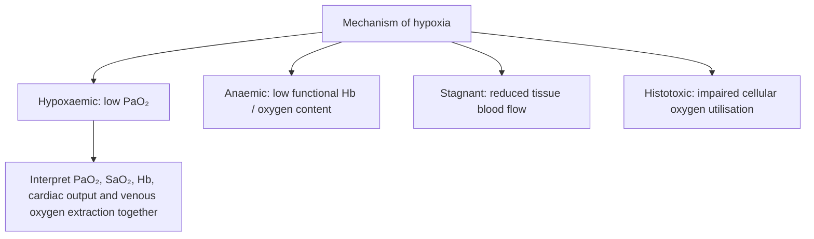
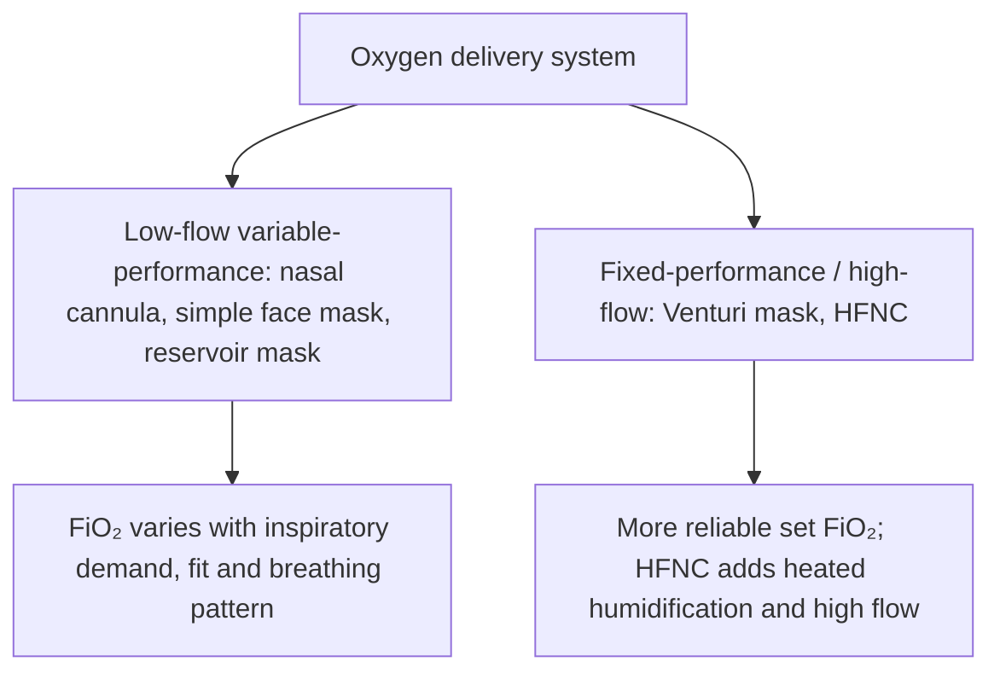
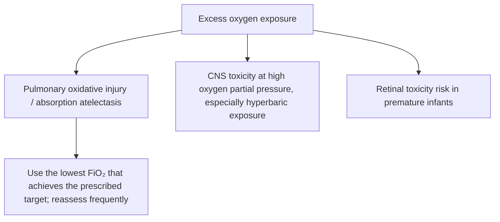

# Topic 45 — Oxygenation and Oxygen Therapy

## 1. Physiological Foundations of Oxygenation

Oxygenation depends on atmospheric partial pressure, alveolar ventilation, alveolo-capillary diffusion, haemoglobin concentration, cardiac output, and peripheral microvascular perfusion.

### Arterial Oxygen Content Formula

The total volume of oxygen carried per decilitre (`100 mL`) of arterial blood ($\mathrm{CaO}_2$) is determined by both haemoglobin-bound oxygen and dissolved oxygen:

$$
\text{CaO}_2 = (1.34 \times \text{Hb} \times \frac{\text{SaO}_2}{100}) + (0.0031 \times \text{PaO}_2)
$$

Where `Hb` is haemoglobin concentration (`g/dL`), $\mathrm{SaO}_2$ is arterial oxygen saturation (`%`), and `PaO₂` is arterial partial pressure of oxygen (`mmHg`).

| Curve feature | Interpretation |
|---|---|
| Plateau region above PaO₂ ~60 mmHg / SaO₂ ~90% | Further rise in PaO₂ produces a smaller rise in saturation |
| Steep middle portion | Small PaO₂ changes can produce large saturation changes |
| Right shift | Reduced Hb affinity and enhanced unloading: ↑H⁺/CO₂, fever, ↑2,3-BPG |
| Left shift | Increased Hb affinity and reduced unloading: alkalosis, hypothermia, ↓2,3-BPG, fetal Hb, CO exposure |

### Oxyhaemoglobin Dissociation Curve (ODC) Dynamics

- **Sigmoidal curve mechanics:** The S-shape reflects cooperative binding of oxygen molecules to the four haem groups. `P₅₀` represents the `PaO₂` at which haemoglobin is `50%` saturated (approximately `27 mmHg`) [48].
- **Saturation plateau:** Above an $\mathrm{SaO}_2$ of **90%–92%** (corresponding to `PaO₂ ≈60 mmHg`), the curve flattens significantly [31]. Escalating supplemental oxygen above this point yields smaller gains in $\mathrm{SaO}_2$ while increasing the risk of hyperoxaemia and reactive oxygen species (ROS) formation [31].
- **Right shift (decreased Hb affinity, increased tissue oxygen unloading):** Triggered by increased `H⁺` (acidosis), elevated $\mathrm{PaCO}_2$ (Bohr effect), fever/hyperthermia, and elevated 2,3-bisphosphoglycerate (2,3-BPG) [48].
- **Left shift (increased Hb affinity, decreased tissue unloading):** Triggered by alkalosis, hypothermia, reduced 2,3-BPG, carboxyhaemoglobin, and methaemoglobinaemia [48].

### Aetiological Classification of Hypoxia



| Hypoxia category | Primary mechanism | `PaO₂` level | Total `O₂` content ($\mathrm{CaO}_2$) | Arteriovenous `O₂` difference | Chemoreceptor stimulation | Clinical examples |
|---|---|---|---|---|---|---|
| **Hypoxaemic hypoxia** | Low ambient `PO₂` or impaired gas exchange [49] | Decreased [49] | Decreased [49] | Normal | Stimulated [49] | High altitude, COPD, ARDS, hypoventilation [49] |
| **Anaemic hypoxia** | Reduced functional haemoglobin concentration or blocked binding sites [49, 50] | Normal [48–50] | Decreased [49, 50] | Normal | Not stimulated by oxygen content alone; peripheral chemoreceptors respond primarily to `PaO₂` [49, 50] | Severe anaemia, carbon monoxide (CO) poisoning, methaemoglobinaemia [48–50] |
| **Stagnant / ischaemic hypoxia** | Reduced tissue blood flow / organ perfusion [49, 50] | Normal [49] | Normal [49] | Markedly increased [49, 50] | Variable; depends on arterial oxygenation and clinical context | Congestive heart failure, cardiogenic/hypovolaemic shock [49, 50] |
| **Histotoxic hypoxia** | Cellular inability to utilise `O₂` due to enzyme inhibition [49, 50] | Normal [48, 49] | Normal [48, 49] | Markedly decreased [49, 50] | Arterial oxygen chemoreceptor response is not necessarily increased | Cyanide poisoning (cytochrome oxidase inhibition) [49, 50] |

---

## 2. Non-Invasive Oxygenation Monitoring

### Pulse Oximetry ($\mathrm{SpO}_2$) Mechanics

- **Dual-wavelength spectrophotometry:** Operates on the Beer–Lambert principle using two light wavelengths [51]:
  - **Red light (`660 nm`):** Preferentially absorbed by reduced (deoxygenated) haemoglobin [51].
  - **Infrared light (`940 nm`):** Preferentially absorbed by oxygenated haemoglobin (`HbO₂`) [51].
- **Placement requirements:** The probe must be placed on the finger/toe for a minimum of **1–2 minutes** and exhibit a stable waveform for at least **5 seconds** prior to recording clinical parameters [52].
- **Clinical artefacts and diagnostic limitations:**
  - **Carboxyhaemoglobinaemia (CO toxicity):** Standard two-wavelength pulse oximeters cannot reliably distinguish carboxyhaemoglobin from oxyhaemoglobin, yielding falsely reassuring $\mathrm{SpO}_2$ readings despite tissue hypoxia [51].
  - **Methaemoglobinaemia:** Can drive conventional pulse oximeter readings toward approximately `85%`, regardless of the true arterial oxygen tension [51].
  - Severe peripheral vasoconstriction, hypothermia, shock, low-perfusion states, motion and nail polish can compromise accuracy. Accuracy can also vary with skin pigmentation and device characteristics.

---

## 3. Oxygen Delivery Systems and Devices



### Low-Flow / Variable-Performance Devices

These systems supply oxygen at flow rates lower than the patient's peak inspiratory flow rate. The patient entrains room air, causing $\mathrm{FiO}_2$ to vary with tidal volume and respiratory rate.

1. **Nasal cannula / prongs:**
   - **Flow rate:** `1–6 L/min` [39, 53].
   - **Delivered $\mathrm{FiO}_2$:** approximately `24%–44%` [39, 53].
   - **Rule of thumb:** Each `1 L/min` increase in gas flow elevates $\mathrm{FiO}_2$ by approximately **4 percentage points** [58].
   - *Limitation:* Delivered $\mathrm{FiO}_2$ is variable and depends on breathing pattern and fit.
2. **Simple face mask (Hudson's mask):**
   - **Flow rate:** `6–10 L/min` [58].
   - **Delivered $\mathrm{FiO}_2$:** maximum approximately `50%–60%` [53, 54, 58]. Flow should generally be kept at **at least `5–6 L/min`** to reduce the risk of carbon dioxide rebreathing.
3. **Partial-rebreathing mask:**
   - Features a reservoir bag that can receive part of the initial exhaled gas from anatomical dead space. Delivers an approximate $\mathrm{FiO}_2$ of `60%`, depending on flow and fit [53, 54].
4. **Non-rebreathing mask (NRBM):**
   - **Configuration:** Contains a reservoir bag and one-way valves intended to limit rebreathing and room-air entrainment [39, 53, 54].
   - **Flow rate:** `10–15 L/min` [39, 54, 58].
   - **Delivered $\mathrm{FiO}_2$:** approximately `80%–95%` under suitable conditions; actual delivery varies with fit, flow and inspiratory demand [39, 53, 54, 58].
   - **Operational requirement:** The reservoir bag should be inflated before application and should not collapse completely during inspiration [39, 54].

### High-Flow / Fixed-Performance Devices

These devices can deliver a total gas flow that meets or exceeds inspiratory demand, allowing a more controlled $\mathrm{FiO}_2$. Performance depends on device configuration and clinical conditions.

1. **Venturi mask:**
   - Operates on the **Venturi principle**, entraining room air through a jet system [54, 55].
   - Uses interchangeable colour-coded adaptors to deliver specified $\mathrm{FiO}_2$ concentrations; exact colours and concentrations can vary by manufacturer [54, 55]. The supplied draft lists:
     - **Blue:** `24% FiO₂` [55]
     - **Yellow:** `28% FiO₂`
     - **White:** `31% FiO₂`
     - **Green:** `35%` or `60% FiO₂` [55]
     - **Pink/orange:** `40% FiO₂`
2. **High-flow nasal cannula (HFNC / HFNO):**
   - **System components:** Air–oxygen blender ($\mathrm{FiO}_2$ `21%–100%`), heated humidifier, warmer (typically near `37 °C`, with absolute humidity around `44 mg H₂O/L`), nasal interface and large-bore tubing [45, 55, 56, 59].
   - **Flow delivery:** Heated, humidified gas at flow rates up to approximately `60–75 L/min`, depending on device and patient [45, 56].
   - **Physiological mechanisms:** Helps preserve mucociliary clearance, washes out upper-airway anatomical dead space, reduces work of breathing and can generate a modest flow-dependent positive airway pressure [45, 56, 59].
   - **Use and caution:** Requires close monitoring. Do not delay intubation when clinical deterioration or respiratory-support failure is evident; no single contraindication list applies universally.
   - **ROX index for HFNC monitoring:**

     $$
     \text{ROX index} = \frac{\left(\frac{\text{SpO}_2}{\text{FiO}_2}\right)}{\text{respiratory rate (breaths/min)}}
     $$

   - **Failure thresholds:** The supplied draft lists the following thresholds for predicting need for intubation [45, 60, 61]:
     - ROX index `<2.85` at **2 hours**.
     - ROX index `<3.47` at **6 hours** in the original pneumonia cohort.
     - ROX index `<3.85` at **12 hours** in the original pneumonia cohort.

```mermaid
flowchart TD
A[Patient on HFNC] --> B[Monitor SpO₂, respiratory rate, work of breathing, gas exchange and trajectory]
B --> C[Calculate ROX index when appropriate: (SpO₂/FiO₂) ÷ RR]
C --> D{ROX low or falling, or clinical deterioration?}
D -- Yes --> E[Urgent senior review; consider escalation/intubation based on full clinical picture]
D -- No --> F[Continue close monitoring]
G[ROX thresholds] -. cohort-derived aid, not stand-alone rule .-> C
```

### Specialized Equipment and Hyperbaric Therapy

- **Oxygen concentrator:** Uses a zeolite molecular sieve to remove much of the nitrogen from atmospheric air, producing oxygen-enriched gas. Used for long-term home oxygen therapy in appropriate patients, including some with COPD or ILD [57, 62].
- **Liquid oxygen:** Stored in insulated vessels at cryogenic temperatures. Approximately `1 L` of liquid oxygen expands to around `860 L` of gaseous oxygen [63].
- **Oxygen hood (`O₂` hood):** Used in neonatal and paediatric care with appropriately controlled flow and monitoring. Flow and delivered FiO₂ depend on the device and infant; use neonatal protocols and continuous monitoring rather than generalising a single flow/FiO₂ claim. The original draft listed flow greater than `7 L/min` and up to `95% FiO₂` at `15 L/min`; actual performance depends on system design [54, 56, 57].
- **Bag-valve-mask (BVM; often called an Ambu bag):** A manual ventilation device. Delivered tidal volume depends on device size, patient size, mask seal and operator technique. The supplied draft lists adult, child and neonatal sizes and approximate capacities; use local equipment specifications and ventilation guidance [56, 57].
- **Hyperbaric oxygen therapy (HBOT):** Administration of high-concentration oxygen at increased ambient pressure, commonly around `2–3 atmospheres absolute` in a specialised chamber [44, 64].
  - **Potential indications in selected cases:** Carbon monoxide poisoning, decompression sickness, gas gangrene, selected radiation injuries, certain difficult wounds and arterial gas embolism [44, 63].
  - **Important safety consideration:** Untreated pneumothorax is a major contraindication. Other exclusions depend on indication, patient factors and chamber protocols; pregnancy is not a universal contraindication when HBOT is indicated for a serious condition.

---

## 4. Oxygen Toxicity and Complications

Hyperoxia can increase the production of **reactive oxygen species (ROS)**, including superoxide anions (`O₂•−`) and hydrogen peroxide (`H₂O₂`). These can overwhelm antioxidant defences and contribute to cellular injury [63]. Risk depends on the intensity and duration of exposure as well as the patient's condition.



### 1. Pulmonary Oxygen Toxicity (Lorrain Smith Effect)

Occurs with prolonged exposure to high inspired oxygen concentrations at normal ambient pressure [63].

- The supplied draft lists approximate exposure thresholds of `100% FiO₂` for more than `12 hours`, `80% FiO₂` for more than `24 hours`, and `60% FiO₂` for more than `36 hours` [63]. These should not be treated as universal clinical thresholds; risk varies with exposure and patient factors.
- **Clinical features:** Substernal or pleuritic pain, dry cough, dyspnoea, reduced lung compliance and vital capacity, pulmonary oedema and, in severe cases, lung injury [63].

### 2. Central Nervous System Toxicity (Paul Bert Effect)

Primarily associated with sufficiently high oxygen partial pressures, particularly in hyperbaric settings [63].

- **Manifestations:** Visual disturbances, tinnitus, nausea, muscle or facial twitching, behavioural changes, dizziness, seizures and loss of consciousness [63].

### 3. Ocular Toxicity

- **Premature infants:** Excess oxygen exposure can contribute to retinopathy of prematurity (ROP), mediated by disrupted retinal vascular development and subsequent abnormal neovascularisation [63].
- **Adults:** Ocular effects depend on exposure and clinical context; they should not be reduced to a single predictable list of cataract, myopia and retinal detachment.

### 4. Absorption Atelectasis

High inspired oxygen concentrations can wash out poorly soluble nitrogen (`N₂`) from alveoli. Oxygen is then absorbed into the pulmonary circulation; in susceptible lung units, loss of alveolar gas volume can contribute to alveolar collapse [63].

---

## Accuracy and currency note

This is educational revision material, not a patient-specific treatment protocol. Time-sensitive drug regimens, doses, thresholds and service pathways should be checked against the current national/local guideline before clinical use. The batch review file records the main edits and the scope of verification.

**Review log:** [[00 - Batch 1 Accuracy Review]]
