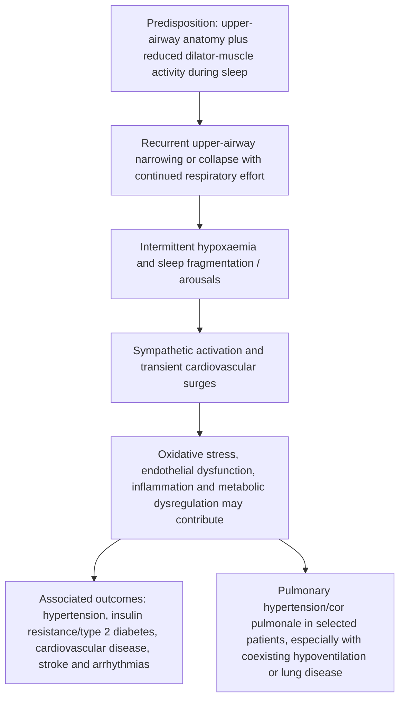

# Topic 46 — Sleep Apnoea

## 1. Classification and Diagnostic Definitions

Sleep-disordered breathing encompasses several conditions, including obstructive sleep apnoea (OSA), central sleep apnoea (CSA), sleep-related hypoventilation and sleep-related hypoxaemia. Sleep-disorder classification is addressed by the **International Classification of Sleep Disorders (ICSD; current text ICSD-3-TR)**; DSM-5 is not the primary classification system for sleep-related breathing disorders.

### Key Physiological Definitions
* **Apnoea:** An event lasting at least **10 seconds** with a marked reduction in airflow (commonly at least 90% under standard adult scoring criteria); it is not necessary for airflow to be mathematically zero.
* **Hypopnoea:** Under the commonly used AASM recommended rule, an event lasting at least 10 seconds with airflow reduced by at least 30% and accompanied by at least 3% oxygen desaturation **or** an EEG arousal. Some payers/clinical systems use a 4%-desaturation rule; the scoring rule should be stated when interpreting an AHI.
* **Apnoea–hypopnoea index (AHI):** Number of apnoeas and hypopnoeas per hour of sleep measured by polysomnography. A home sleep apnoea test may report a respiratory-event index using monitoring time rather than EEG-confirmed sleep time.

### Apnoea–hypopnoea index (AHI): adult severity categories

| Severity category | AHI (events per hour of sleep) |
|---|---:|
| **Mild OSA** | $5$ to $<15$ |
| **Moderate OSA** | $15$ to $<30$ |
| **Severe OSA** | $\ge30$ |

Interpret AHI alongside symptoms, comorbidities, the type of events and the test method. Diagnostic criteria and thresholds differ in some paediatric contexts.

### Diagnostic categories and thresholds
1. **Obstructive sleep apnoea (OSA):** Recurrent partial or complete upper-airway obstruction during sleep, usually despite persistent respiratory effort.
2. **Central sleep apnoea (CSA):** Recurrent pauses in airflow with absent or reduced respiratory effort, reflecting impaired/unstable ventilatory drive. Causes include heart failure with Cheyne–Stokes breathing, opioids and some neurological conditions.
3. **Obesity hypoventilation syndrome (OHS):** Obesity ($\text{BMI} \ge 30\text{ kg/m}^2$), awake daytime hypercapnia ($\text{PaCO}_2 \ge 45\text{ mmHg}$), and sleep-disordered breathing, after excluding other causes of hypoventilation. OHS is related to, but not synonymous with, OSA.

**Adult OSA diagnosis:** AHI/RDI of at least 5 events/hour with compatible symptoms or relevant comorbidity, or at least 15 events/hour even without reported symptoms, is a commonly used diagnostic framework. The clinical evaluation and applicable scoring rules still matter. Severity is commonly described as mild (5–14.9), moderate (15–29.9) and severe (≥30 events/hour). **These adult thresholds should not be applied to children**, who require age-specific scoring and clinical interpretation.

---

## 2. Anatomical Factors and Pathophysiology of OSA

OSA results from an anatomical predisposition combined with sleep-induced loss of pharyngeal dilator muscle tone.

### Pathophysiology: from airway collapse to systemic effects

| Stage | Mechanism / consequence |
|---|---|
| **1. Predisposition** | Anatomical upper-airway collapsibility interacts with reduced pharyngeal dilator activity during sleep; events may be more prominent in REM sleep. |
| **2. Recurrent obstruction** | Repeated upper-airway narrowing or collapse causes obstructive events, with continued respiratory effort. |
| **3. Intermittent hypoxia and arousals** | Repetitive oxygen desaturation and sleep fragmentation activate stress responses. |
| **4. Autonomic activation** | Sympathetic surges can produce transient blood-pressure and heart-rate changes. |
| **5. Downstream mechanisms** | Oxidative stress, endothelial dysfunction, inflammation and metabolic dysregulation may contribute to cardiovascular and metabolic consequences. |
| **6. Associated outcomes** | OSA is associated with hypertension, insulin resistance/type 2 diabetes, cardiovascular disease, stroke and arrhythmias. Pulmonary hypertension/cor pulmonale may occur in selected patients, especially with coexisting hypoventilation or lung disease; these are not inevitable outcomes of OSA. |

### Risk Factors and Structural Abnormalities
* **Anatomical Risk Factors:**
  * Soft-palate/uvular enlargement or elongation can contribute, but no single anatomical feature is the universal cause; OSA is usually multifactorial and includes both anatomical and neuromuscular traits.
  * Increased parapharyngeal and lateral pharyngeal wall fat deposition.
  * Macroglossia, increased tongue fat, and an inferiorly positioned hyoid bone.
  * Micrognathia, retrognathia, or a shortened mandible.
  * Craniofacial Syndromes: Treacher Collins syndrome, Down syndrome.
  * Pediatric Etiology: **Adenotonsillar Hypertrophy** is the leading cause of OSA in children.
* **Demographic Risk Factors:**
  * Male gender (2–3 times higher risk than premenopausal females).
  * Excess body weight, particularly fat deposition around the neck and pharynx, is a major risk factor, but OSA also occurs in people without obesity. The proportion with obesity varies by population and referral setting.
  * Increased neck circumference is a risk factor; thresholds depend on the screening tool. STOP-Bang commonly uses **>40 cm** as its neck item, while some sex-specific screening adaptations use **>43 cm in men** and **>40 cm in women**.
  * Postmenopausal state in women, alcohol consumption, and sedative use.

---

## 3. Clinical Features

### Clinical features of obstructive sleep apnoea

| Nocturnal features | Daytime / waking features |
|---|---|
| Loud, chronic snoring | Excessive daytime sleepiness (may be absent even in clinically significant OSA) |
| Witnessed pauses in breathing, choking or gasping | Morning headache or dry mouth |
| Restless sleep or frequent awakenings | Impaired attention, memory or concentration |
| Nocturia; nocturnal enuresis may occur in children | Irritability, mood or personality changes |
| Reflux symptoms or nocturnal sweating may occur | Reduced libido or erectile dysfunction may occur |
| — | Children may present with behavioural problems or hyperactivity rather than classic adult sleepiness. |
---

## 4. Assessment Scales and Questionnaires

### 1. Epworth Sleepiness Scale (ESS)
Evaluates daytime somnolence across 8 specific daily situations scored from 0 to 3:
1. Sitting and reading
2. Watching television
3. Sitting quietly in a public place (e.g., a theater or meeting)
4. Sitting as a passenger in a car for an hour without a break
5. Lying down to rest in the afternoon
6. Sitting and talking to someone
7. Sitting quietly after a lunch without alcohol
8. In a car, while stopped for a few minutes in traffic

* **Scoring:** Each item is scored 0 (would never doze) to 3 (high chance of dozing), giving a total of 0–24. A score **>10** (equivalently, 11 or higher) suggests excessive daytime sleepiness; ESS is a symptom scale, not a diagnostic test for OSA.

### 2. STOP-BANG Questionnaire (High-Risk Screening Tool)
* **S**noring (loud)
* **T**iredness (daytime fatigue)
* **O**bserved apnea
* **P**ressure (Hypertension)
* **B**MI $> 35\text{ kg/m}^2$
* **A**ge $> 50\text{ years}$
* **N**eck circumference (the standard STOP-Bang item is commonly scored at **>40 cm**; some adaptations use sex-specific cut-offs such as >43 cm for men and >40 cm for women)
* **G**ender (Male)

---

## 5. Diagnostic Evaluation: Overnight Polysomnography

**In-laboratory polysomnography (PSG)** is the standard comprehensive diagnostic test. In uncomplicated adults at increased risk of moderate-to-severe OSA, a technically adequate home sleep apnoea test may also be used. PSG is preferred when significant cardiorespiratory disease, neuromuscular weakness, awake/suspected sleep-related hypoventilation, chronic opioid use, previous stroke or severe insomnia is present; if a home test is negative, inconclusive or technically inadequate despite suspicion, perform PSG. Questionnaires alone cannot diagnose OSA.

### Polysomnography: commonly recorded signals

| Signal / channel | What it assesses |
|---|---|
| Electroencephalogram (EEG) | Sleep stages, arousals and sleep architecture. |
| Electrooculogram (EOG) | Eye movements, helping stage sleep. |
| Electromyogram (EMG) | Muscle tone; commonly submental and tibialis channels. |
| Electrocardiogram (ECG) | Heart rate and rhythm. |
| Airflow sensors | Nasal pressure and/or thermal airflow signal to identify apnoea/hypopnoea events. |
| Thoracic and abdominal effort belts | Respiratory effort; helps distinguish obstructive from central events. |
| Pulse oximetry ($SpO_2$) | Oxygen desaturation associated with respiratory events. |
| Other channels where indicated | Body position, snoring, limb movements and carbon dioxide monitoring may be included according to the clinical question and study type. |

### Distinguishing obstructive from central sleep apnoea on a sleep study

| Feature during an apnoeic event | Obstructive sleep apnoea (OSA) | Central sleep apnoea (CSA) |
|---|---|---|
| Airflow | Absent or markedly reduced during the event (typically at least 10 seconds for an adult apnoea event) | Absent or markedly reduced during the event (typically at least 10 seconds for an adult apnoea event) |
| Respiratory effort | Persists; may show paradoxical thoracoabdominal movement | Absent during the central event because respiratory drive/effort temporarily ceases |
| Mechanism | Upper-airway obstruction despite respiratory effort | Reduced or absent respiratory drive/effort; causes vary (for example, heart failure, opioids, altitude or neurological conditions) |
| Interpretation | Requires airflow and effort signals together; a flat airflow trace alone cannot distinguish OSA from CSA. | Requires airflow and effort signals together; event scoring should follow the sleep-study criteria. |
---

## 6. Management Strategy

### Management options for obstructive sleep apnoea

| Approach | Examples / role |
|---|---|
| **Behavioural and lifestyle measures** | Weight management where appropriate, avoiding alcohol or sedatives near bedtime when relevant, positional therapy for position-dependent OSA, and attention to sleep habits. These measures may complement but do not replace indicated therapy in moderate-to-severe disease. |
| **Positive airway pressure** | CPAP is a common first-line treatment for symptomatic OSA and many patients with moderate-to-severe disease. Select and support treatment according to sleep-study findings, symptoms, comorbidities and patient preference. |
| **Oral appliance** | A custom titratable mandibular advancement device may suit selected patients, particularly those with mild-to-moderate OSA or who cannot tolerate PAP; dental and follow-up assessment are needed. |
| **Surgical / device options** | Selected patients may be considered for upper-airway surgery (for example, uvulopalatopharyngoplasty [UPPP]), hypoglossal nerve stimulation or other interventions after appropriate anatomical and clinical assessment. Tracheostomy is rarely used for exceptional severe cases. |
| **Children** | Adenotonsillectomy is commonly first-line when adenotonsillar hypertrophy is the principal cause; assess residual OSA and alternative causes after treatment. Management should be paediatric and specialist-guided. |

### 1. Continuous Positive Airway Pressure (CPAP)
* **Role:** Positive airway pressure (PAP), usually CPAP or auto-adjusting PAP (APAP), is an effective first-line treatment for many adults, especially those with excessive sleepiness, impaired sleep-related quality of life or hypertension. Treatment choice should incorporate symptoms, comorbidities, tolerability and patient preference.
* **Mechanism:** Positive pressure acts as a pneumatic splint that helps keep the pharyngeal airway open during sleep. Education, mask fitting, adherence support and follow-up are important.

### 2. Oral / Dental Appliances (Mandibular Advancement Devices - MAD)
* **Role:** A custom, titratable mandibular advancement device may be considered for adults who prefer it or cannot tolerate PAP; it is often used in mild-to-moderate OSA, but suitability is individualised. Follow-up sleep testing is recommended to confirm efficacy.

### 3. Surgical Options
* **Uvulopalatopharyngoplasty (UPPP):** Surgical excision of the uvula, tonsils, and redundant soft palatal tissue.
* **Hypoglossal Nerve Stimulation (HGNS):** Implanted neurostimulator that stimulates the hypoglossal nerve ($\text{CN XII}$) during inspiration to move the genioglossus muscle forward.
* **Paediatric treatment:** Adenotonsillectomy is often first-line for children with OSA and adenotonsillar hypertrophy, but it is not universally curative. Reassessment is important, particularly in children with obesity, craniofacial/neuromuscular conditions, severe disease or persistent symptoms.

---

## 7. Coverage Audit

* **Review note:** Corrected sleep-apnoea event definitions, added commonly used diagnostic thresholds and OHS criteria, clarified STOP-Bang/ESS limitations, and distinguished PSG from appropriate home testing. Replaced the overly absolute CPAP and paediatric-surgery statements with patient-selection and follow-up caveats.
* **Coverage limitations:** This note does not replace a full sleep-medicine evaluation; central sleep apnoea, hypoventilation and paediatric sleep-disordered breathing may require distinct pathways.

---

## References for reviewed clinical recommendations

- [AASM clinical practice guideline: diagnostic testing for adult OSA](https://aasm.org/resources/clinicalguidelines/diagnostic-testing-osa.pdf) — PSG vs. home sleep apnoea testing and situations that require PSG.
- [AASM clinical practice guideline: PAP treatment of adult OSA](https://pmc.ncbi.nlm.nih.gov/articles/PMC6374094/) — indications for PAP and support during treatment initiation.
- [American Thoracic Society: STOP-Bang questionnaire](https://site.thoracic.org/assemblies/srn/sleep-related-questionnaires/stop-bang) — questionnaire purpose and scoring items.

> **Citation note:** Numeric citations inherited from the NotebookLM export were not accompanied by a bibliography. Verify them against your original sources.
