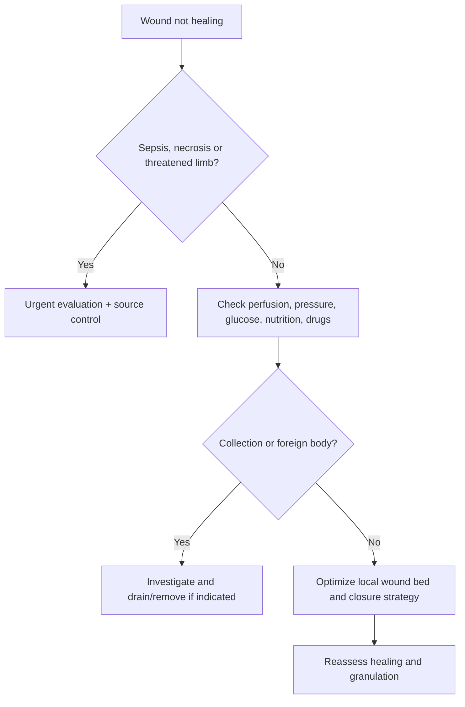

# 03 — Wounds, Wound Healing and Surgical Infections

> [!info] Core sources
> [Robbins Pocket Companion 9e: *Inflammation and Repair*, printed pp. 100–109 / PDF pp. 143–154]; [First Aid 2025: *Pathology—Wound Healing*, PDF p. 233]; [Combined Bootcamp: *Connective Tissue / Collagen*, PDF pp. 23–27]; [WOR—General Surgery pp. 9–12 and Specialty Surgery *Wound Healing*]; [Doctut—Surgical Site Infection]; [05-Pathology part 1: cell injury, necrosis, gangrene, inflammation].

## 1. Classification of wounds

### By cause
- **Incised:** clean-cut edges, usually sharp instrument; more straightforward approximation.
- **Lacerated:** irregular torn edges, tissue bridges/contusion; needs assessment of tissue viability.
- **Abrasion:** superficial epithelial loss from friction.
- **Puncture:** small entrance, deep tract; foreign body/anaerobic infection risk.
- **Crush:** substantial underlying tissue devitalization, compartment syndrome risk.
- **Avulsion/degloving:** separation of skin/subcutis from deeper layers, often damaged vascular supply.
- **Bite:** polymicrobial contamination; consider tetanus/rabies risk and special closure strategies.
- **Burn:** thermal, chemical, electrical or radiation injury; detailed in Ch. 07.

### By operative contamination class

| Class | Defining feature | Examples from sources | Implication |
|---|---|---|---|
| **I: Clean** | No entry into colonized respiratory/GI/GU/genital tracts; no active inflammation | Thyroidectomy, uncomplicated hernia repair, breast operation | Lowest SSI risk; prophylaxis depends on prosthesis/procedure/patient |
| **II: Clean-contaminated** | Controlled entry into colonized tract **without unusual contamination** | Elective biliary/bowel surgery, uncomplicated appendix | Prophylactic antibiotics usually indicated |
| **III: Contaminated** | Gross break in asepsis, major GI spillage, acute nonpurulent inflammation, recent open trauma | Uncontrolled enteric spillage, fresh contaminated traumatic wound | Requires careful debridement and antibiotic strategy |
| **IV: Dirty/infected** | Existing infection, pus, perforated viscus or devitalized/old traumatic tissue | Abscess, feculent peritonitis, established infected wound | **Therapeutic antibiotics and source control** rather than “prophylaxis alone” |

- Baseline SSI probabilities vary by setting; the **exact percentages tabulated in revision books are not universal population estimates**.

## 2. The biologic sequence of wound healing

The phases overlap and depend on tissue, perfusion, infection, age and nutritional state.

| Phase | Dominant events | Main cells / mediators | Clinical interpretation |
|---|---|---|---|
| **Hemostasis** | Vasoconstriction → platelet adhesion/aggregation → coagulation → fibrin/fibronectin scaffold | Platelets; platelet-derived growth factors | Stable clot is provisional matrix; uncontrolled bleeding or hematoma impairs repair |
| **Inflammation** | Neutrophil recruitment, debris removal, then macrophage predominance | Neutrophils early; **macrophages ~day 3**; cytokines | Persistent infection extends inflammation and delays closure |
| **Proliferation** | **Angiogenesis**, fibroblast migration, **granulation tissue**, type III collagen, epithelial migration, myofibroblast contraction | VEGF, FGF, PDGF, TGF-β; fibroblasts, endothelial cells, keratinocytes | Pink/red granular wound bed; fragile newly formed tissue |
| **Remodeling/maturation** | Collagen turnover, increasing type I relative to type III, cross-linking, decreased cellularity/vascularity | Fibroblasts, MMPs, TIMPs; myofibroblasts | Scar pales and strengthens, but never regains 100% original strength |

### Day-wise histologic timeline (Robbins)
- **0–24 h:** blood clot/scab; **neutrophils** migrate into wound; epithelial migration starts.
- **24–48 h:** cells from wound margins proliferate and bridge superficial defect, with basement-membrane repair.
- **~Day 3:** **macrophages** replace many neutrophils; granulation tissue and collagen become evident.
- **~Day 5:** **angiogenesis reaches a peak** in a clean incision, fibroblasts actively lay down ECM, epidermis regains thickness.
- **Second week:** increasing collagen, decreasing inflammatory cells, edema and vascular density.
- **~4 weeks:** an established scar with minimal inflammation, although long-term remodeling continues.

### Granulation tissue: appearance and mechanisms
- **Microscopy:** newly formed capillary loops + proliferating fibroblasts + loose ECM + inflammatory cells.
- **Macroscopic appearance:** reddish, soft and easily bleeding due to abundant immature capillaries.
- **VEGF:** angiogenesis and vascular permeability; **FGF-2** and **PDGF** support growth/migration; **TGF-β** promotes fibroblast proliferation, collagen/fibronectin deposition and limits matrix breakdown.
- **Matrix metalloproteinases (MMPs):** zinc-dependent proteases that remodel ECM; **TIMPs** inhibit them. Excess destruction vs deposition affects scar quality.
- **Myofibroblasts:** fibroblast-like cells with contractile apparatus that **contract wound**; excess contraction causes functional contracture.

### Collagen synthesis and wound repair
1. Preprocollagen chains synthesized in rough ER.
2. Hydroxylation of proline and lysine residues requires **vitamin C** and iron-dependent enzymes.
3. Glycosylation and assembly of triple helix (procollagen).
4. Extracellular cleavage to tropocollagen, fibril assembly.
5. **Lysyl oxidase (copper-dependent)** cross-links collagen; increases tensile strength.

| Deficiency/condition | Mechanism | Typical outcome |
|---|---|---|
| **Vitamin C deficiency** | Impaired proline/lysine hydroxylation | Fragile collagen, poor healing, gingival/skin bleeding |
| **Copper deficiency** | Reduced lysyl oxidase cross-linking | Weak connective tissue |
| **Zinc deficiency** | Impairs MMPs and multiple cellular repair processes | Delayed healing and impaired immune response |
| **Protein-calorie malnutrition** | Inadequate collagen/immune cell synthesis | Dehiscence, infection, delayed healing |
| **Diabetes** | Microvascular dysfunction, impaired immunity, altered collagen regulation | SSI, impaired healing |
| **Glucocorticoids** | Suppress inflammation, fibroblast activity and collagen formation | Fragile wounds |
| **Ischemia/low oxygen** | ATP limitation, reduced cellular function and collagen maturation | Necrosis/nonhealing |
| **Foreign body/infection** | Persistent inflammatory stimulus, biofilm and tissue destruction | Chronic sinus, nonhealing wound |

### Tensile strength
- **At 1 week:** approximately **10% of normal intact skin**.
- **At ~3 months:** reaches approximately **70–80%**; substantial strength returns through collagen synthesis and cross-linking.
- **Never completely restores original normal strength** in a typical scar.
- **Strength is not identical to scar size:** a cosmetically neat incision may still be mechanically vulnerable early.

## 3. Primary, secondary and tertiary intention

| Healing | Wound state | Tissue response | Result |
|---|---|---|---|
| **Primary intention (first union)** | Clean edges approximated by sutures/staples | Small granulation requirement, rapid epithelial bridge | Smaller scar, less contraction |
| **Secondary intention (second union)** | Wide defect, tissue loss or infected wound left open | More inflammation/granulation and **myofibroblast contraction** | Larger scar, greater contracture risk |
| **Tertiary intention (delayed primary closure)** | Initially open for drainage/debridement, closed when conditions improve | Controlled contamination before final approximation | Balance between infection control and final scar size |

**Secondary intention**: large surface wounds may markedly contract during healing; contraction is not the same as **fibrotic contracture**, which is pathologic restriction of mobility.

## 4. Abnormal healing: recognize and distinguish

### Hypertrophic scar vs keloid

| Feature | Hypertrophic scar | Keloid |
|---|---|---|
| Boundary | **Within original wound** | **Extends beyond original margin** |
| Timing | Develops relatively early after injury | Can progress over time |
| Natural history | Often flattens with time | Often persists; recurrence common |
| Common associations | Burns, high-tension wounds | Familial tendency; sternum, shoulders, ear lobes |
| Histology | Collagen more parallel to surface (broadly) | Dense, disorganized thick **keloidal collagen** bundles |
| Management principles | Pressure/silicone, selected steroid or other treatments | Intralesional steroid, silicone and selective multimodal treatment; excision alone may recur |

### Other failures of repair
- **Hypergranulation (“proud flesh”):** excessive granulation projects above epidermis, obstructing epithelial migration.
- **Contracture:** scar shortens across joint/skin fold → restricted range of motion (notably deep burns).
- **Dehiscence:** previously approximated incision separates because of infection, excessive tension, mechanical failure or poor collagen repair.
- **Evisceration:** viscera protrude through full-thickness fascial defect → emergency.
- **Chronic ulcer:** failure of epithelial closure due to vascular disease, pressure, neuropathy, infection or ongoing trauma.

## 5. Surgical-site infection (SSI)

### Clinical classification
1. **Superficial incisional SSI:** skin and subcutaneous tissue.
2. **Deep incisional SSI:** deep fascia and muscle.
3. **Organ/space SSI:** manipulated organ/cavity (e.g., intra-abdominal abscess).

- **Symptoms/signs:** increasing pain, warmth, erythema, purulent discharge, fever, local tenderness, dehiscence or systemic dysfunction.
- **Source organisms:** skin flora (notably *S. aureus* and coagulase-negative staphylococci) in clean surgery; enteric Gram-negative bacilli and anaerobes after colorectal/contaminated abdominal surgery.
- **Risk factors:** prolonged operation, contamination, diabetes/hyperglycemia, obesity, poor nutrition, smoking, hypothermia, impaired perfusion and improper sterile technique.
- **Time window:** source notes teach 30 days after surgery and a longer window with implants. **Do not use a blanket “one-year implant rule” as a current surveillance definition**; definitions vary by system and procedure.

### Southampton wound grading (as presented in revision sources)

| Grade | Finding |
|---|---|
| **0** | Normal healing |
| **I** | Normal healing with mild bruising/erythema |
| **II** | Erythema and other signs of inflammation |
| **III** | Clear/serous discharge |
| **IV** | Purulent discharge |
| **V** | Severe/deep infection ± tissue breakdown |

**ASEPSIS** mnemonic: **A**dditional treatment, **S**erous discharge, **E**rythema, **P**urulent exudate, **S**eparation of deep tissues, **I**solation of bacteria, prolonged **S**tay (>14 days in source score).

### Prevention bundle
- Adequate preoperative washing, infection screening and glycemic control.
- Appropriate **skin antisepsis**, clipping instead of shaving, sterile instruments and field discipline.
- **Antimicrobial prophylaxis** chosen for the wound/procedure, usually timed so effective tissue concentration is present at incision (often within 60 min, with exceptions for longer infusions); repeat intraoperatively when indicated by long duration or major blood loss.
- Maintain **normothermia, perfusion and oxygenation**, minimize dead space/hematoma, close tissue without ischemic tension.
- Stop prophylactic antibiotics at the appropriate protocol point; **dirty/infected wounds require actual treatment**, not prolonged “prophylaxis.”

### If SSI develops
1. Assess **systemic illness**, source and depth; identify organ-space infection or necrotizing infection.
2. Open/drain a purulent superficial collection when appropriate; remove infected/devitalized tissue.
3. Obtain culture if it will guide management; assess need for blood cultures if systemic toxicity.
4. Source control for deep collections (percutaneous or operative) plus antimicrobial therapy when indicated.
5. Treat underlying factors (glucose, perfusion, nutrition, foreign body).

## 6. Cellulitis, abscess and necrotizing infections

| Disease | Dominant process | Distinguishing feature | Management principle |
|---|---|---|---|
| **Cellulitis** | Diffuse dermal/subcutaneous infection | Spreading warmth, erythema, tenderness without discrete pus pocket | Antibiotic therapy and address portal of entry |
| **Abscess** | Localized purulent collection | Fluctuance; localized painful swelling | **Drainage = source control**; antibiotics when indicated |
| **Necrotizing fasciitis** | Rapid fascial and subcutaneous necrosis | **Pain out of proportion**, rapid progression, bullae/skin anesthesia, systemic toxicity; crepitus may be absent | Immediate resuscitation, **urgent surgical debridement** and broad antimicrobial coverage |
| **Gas gangrene (clostridial myonecrosis)** | Toxin-mediated muscle necrosis, classically *Clostridium perfringens* | Severe pain, systemic toxicity, muscle edema and possible gas/bronzing | Urgent extensive debridement, antibiotics and critical-care support |
| **Tetanus** | *C. tetani* toxin impairs inhibitory neurotransmission | Trismus, painful spasms, autonomic instability | Airway/ICU support, immunoglobulin, wound care, antibiotics, vaccination |

### Necrotizing infection: pathogenesis
- Bacterial enzymes/toxins damage fascia, microvessels and soft tissue → **vascular thrombosis → ischemia → rapid tissue necrosis**.
- Lack of dramatic skin findings early **does not exclude** deep severe disease.
- Imaging can support assessment but **must not delay essential surgery** when clinical suspicion is strong.

### Necrosis distinctions (integrating pathology sources)
- **Coagulative necrosis:** architecture preserved initially; ischemic solid organs.
- **Liquefactive necrosis:** enzymatic digestion; bacterial abscess and brain infarction.
- **Fat necrosis:** lipase/trauma, may show chalky calcium soaps (**saponification**).
- **Dry gangrene:** ischemic coagulative necrosis with demarcation.
- **Wet gangrene:** necrosis with superimposed infection and tissue liquefaction; high sepsis risk.
- **Gas gangrene:** distinct rapidly progressive **muscle** infection, not synonymous with all gas-forming infections.

## 7. Sinus and fistula
- **Sinus:** abnormal, usually blind-ending tract from deep focus to skin/mucosa (e.g., chronic osteomyelitis, retained suture).
- **Fistula:** abnormal communication between **two epithelialized surfaces or organs** (e.g., enterocutaneous fistula).
- Causes include chronic infection, inflammatory disease, trauma, surgery, foreign body and malignancy.
- **Management** requires identifying both source and tract, controlling infection, protecting adjacent tissue/skin, correcting nutrition and deciding whether closure requires surgery.

## 8. Pressure injuries and negative-pressure wound therapy
- **Pressure injury:** sustained compression and shear over bony prominence → reduced perfusion and local ischemic tissue damage; common over sacrum, heels and trochanters.
- Risks: immobility, sensory loss, poor nutrition, moisture, low perfusion.
- Prevention: **reposition, off-load pressure, protect skin, manage moisture and nutrition**.
- **Negative-pressure wound therapy (NPWT/VAC):** controlled suction removes excess exudate, helps control the local wound environment and promotes granulation in selected wounds; **do not use over untreated necrotic tissue, unprotected exposed vessels/organs or uncontrolled infection**.

## 9. Exam algorithm: nonhealing surgical wound

### Chapter 03 — rapid revision
- **Day 3 macrophages; day 5 peak angiogenesis; type III collagen early → type I during remodeling.**
- **TGF-β** drives collagen/scarring; **VEGF** drives angiogenesis; **MMPs require zinc**; lysyl oxidase requires **copper**.
- **Wound strength ~10% at 1 week, ~70–80% at 3 months.**
- **Keloid extends outside original injury; hypertrophic scar stays within.**
- **Class I clean → IV dirty/infected**; antibiotics cannot substitute for drainage/debridement.
- **Pain out of proportion + rapid progression** → consider necrotizing fasciitis.

**Sources:** [Robbins—Inflammation and Repair pp. 100–109]; [First Aid 2025—Pathology, wound repair]; [Combined Bootcamp—Collagen/Wound Healing]; [WOR—Wounds, Wound Healing]; [Doctut—SSI]; [05-Pathology—Cell Death/Necrosis].
