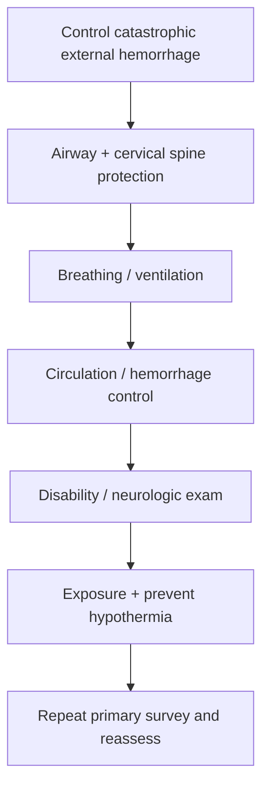
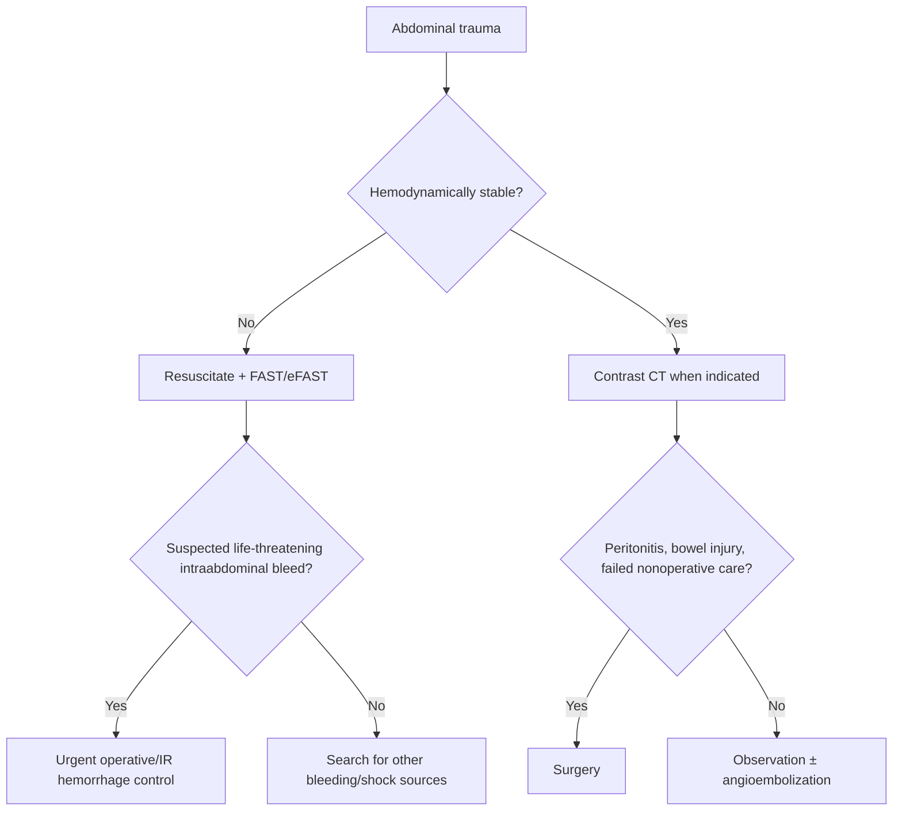

# 06 — Trauma Surgery, ATLS and Damage-Control Principles

> [!info] Major sources
> [WOR—Surgery: Trauma and Burns pp. 158–174, PDF pp. 2231 onward]; [Doctut Merged—Introduction to Trauma; Head/Face/Neck Injury; Thoracic Trauma; Abdominal Injuries; ATLS Protocol]; [Combined Bootcamp—Cardiology: Shock]; [Robbins—Shock and Hemodynamic Disorders]. This chapter emphasizes **initial stabilization and exam recognition**; specific procedural technique/selection depends on specialist trauma protocols.

## 1. Trauma systems and mortality

### Phases of prehospital and emergency care
- **Scene safety:** protect rescuers, control hazards; call an appropriate trauma-response team.
- **Prehospital:** life-saving hemorrhage control, airway and breathing support, spinal movement restriction when indicated, rapid transport to an appropriate trauma center.
- **Handover:** mechanism, time of injury, suspected injuries, vitals/trends, neurologic findings, interventions and response.
- **Primary survey with simultaneous resuscitation:** detect and treat immediately life-threatening injury.
- **Secondary survey:** comprehensive head-to-toe assessment after initial stabilization.
- **Definitive care:** surgery, interventional radiology, critical care, rehabilitation.

### “Golden hour” and classic trimodal mortality concept
- The sources use the **golden hour** to emphasize timely hemorrhage control, airway stabilization and trauma-center access; it is a **teaching concept**, not a rigid biological deadline.
- Classic textbook distribution: **immediate** deaths (catastrophic head/major-vessel injury); **early** deaths (airway obstruction, tension pneumothorax, massive hemothorax, tamponade, hemorrhage); **late** deaths (sepsis and organ failure, delayed CNS complications).
- Modern trauma systems can modify this distribution, but **preventable early deaths** remain important exam targets.

## 2. Triage and mass casualty

| Color | Priority | Typical patient |
|---|---|---|
| **Red** | Immediate, potentially salvageable with prompt action | Critical airway, severe external hemorrhage, tension pneumothorax |
| **Yellow** | Urgent but can briefly wait | Stable significant fracture or controlled injury |
| **Green** | Minor / walking wounded | Small uncomplicated lacerations, minor stable injuries |
| **Black** | Deceased in conventional simplified scheme | No signs of life according to incident protocol |
| **Blue / expectant** | Used in some systems for very low-survival patients when resources are overwhelmed | Supportive care; colors and definitions differ by triage system |

- **Multiple-casualty event:** available resources still adequate; ordinary urgency-focused care may continue.
- **Mass-casualty event:** casualties overwhelm capacity → **triage maximizes survival at a system level**; reassessment is continuous.
- Do not memorize color labels without recognizing the system: some triage algorithms use different colors for expectant patients.

## 3. Primary survey — `cABCDE` or `XABCDE`

### c / X: catastrophic hemorrhage
- Identify external **exsanguinating bleeding** immediately.
- Direct pressure → hemostatic dressing/packing → correctly applied tourniquet for severe compressible extremity bleeding as indicated.
- Record time of tourniquet application; do not loosen without organized definitive care.
- Suspect internal bleeding (chest/abdomen/pelvis/long bones) despite no obvious external blood.

### A: Airway with cervical protection
- **Talking coherently** suggests a currently patent airway; deterioration remains possible.
- Danger signs: stridor, gurgling, severe facial/neck injury, altered sensorium, inhalational injury, blood/vomit in airway, inability to protect airway, falling GCS.
- **Jaw thrust** and suction when required; protect cervical spine with manual in-line stabilization and appropriate motion restriction.
- **Oropharyngeal airway** in unconscious patients without gag reflex; avoid causing obstruction/aspiration.
- **Definitive airway:** cuffed tracheal tube when needed for protection/ventilation; severe TBI with GCS ≤8 often raises need for airway protection but clinical context also determines it.
- **Suspected basal skull fracture:** avoid blind nasotracheal insertion through injured nasal/cranial structures.
- **Failed airway:** emergency front-of-neck access as per age, expertise and setting. WOR discusses needle cricothyroidotomy as a short temporizing option and tracheostomy as definitive; in many emergency algorithms, **surgical cricothyrotomy** is the rapid adult rescue airway. Do not equate the two procedures.

#### LEMON difficult-airway checklist
**L**ook; **E**valuate 3-3-2; **M**allampati; **O**bstruction; **N**eck mobility. Trauma may limit formal mouth/neck testing and requires contingency planning.

### B: Breathing
- **Inspect:** respiratory effort, asymmetry, wounds, paradoxical segment.
- **Palpate:** trachea (late sign), chest-wall tenderness, emphysema, expansion.
- **Percuss:** hyperresonance (air), dullness (fluid/blood).
- **Auscultate:** unilateral reduced breath sounds, bilateral ventilation, heart sounds.
- **Monitor:** SpO₂, RR, ETCO₂ when intubated and physiological response.
- **Immediately treat** tension pneumothorax or massive chest injury based on clinical emergency; do not postpone lifesaving decompression for imaging.

### C: Circulation and hemorrhage
- Pulse, mental state, skin perfusion, BP and urine output are more informative together than BP alone.
- **Two large-bore IV lines** (e.g., 14–18 G if possible) or IO if rapidly unsuccessful; send CBC, blood type/crossmatch, coagulation, lactate, electrolytes and other targeted labs.
- Apply **pelvic binder over the greater trochanters** when pelvic ring hemorrhage suspected; avoid repeated pelvic springing/manipulation.
- Hemostatic resuscitation and definitive bleeding control (OR/angioembolization) take precedence over repeated crystalloid boluses.

### D: Disability
- **GCS:** Eye 4 + Verbal 5 + Motor 6 = **3–15**.
- Pupillary size, reactivity, lateralizing signs, limb movement and glucose assessment.
- **GCS ≤8** generally defines severe TBI; **9–12** moderate, **13–15** mild in common teaching.

| GCS component | Scores |
|---|---|
| **Eye** | Spontaneous **4**; to sound **3**; to pressure **2**; none **1** |
| **Verbal** | Oriented **5**; confused **4**; inappropriate words **3**; sounds **2**; none **1** |
| **Motor** | Obeys **6**; localizes **5**; withdraws **4**; abnormal flexion **3**; extension **2**; none **1** |

- For an intubated patient, record verbal response **not testable (V-NT)** rather than inappropriately labeling a numerical 1.
- **GCS-P:** GCS minus pupil reactivity score (0 no pupils unreactive; 1 one; 2 both).

### E: Exposure / Environment
- Undress and inspect both sides to avoid missing penetrating wounds, bleeding and deformity.
- **Prevent heat loss** (warming blankets, warm fluids, dry coverings): hypothermia aggravates coagulopathy.
- Back examination with a coordinated team/log roll only when justified and with spine/pelvis precautions.

## 4. Imaging in trauma

### FAST and eFAST
- **FAST**: bedside focused ultrasound for **free fluid** in pericardial and peritoneal spaces.
- Classic views: **subxiphoid/pericardial, RUQ (Morrison pouch), LUQ (splenorenal), pelvis (retrovesical/pouch of Douglas)**.
- **eFAST adds pleural evaluation** for pneumothorax/hemothorax.
- **Pneumothorax on lung US:** absent lung sliding; **barcode/stratosphere sign on M-mode** instead of normal seashore sign; interpret in full clinical context.
- **Limitations:** a negative FAST does not exclude early/low-volume bleed, retroperitoneal injury, hollow viscus injury or some penetrating injuries.

### Imaging choice
| Patient | Typical first decision |
|---|---|
| **Hemodynamically unstable with suspected internal bleed** | Resuscitation + bedside eFAST and immediate source control; avoid delay for CT if unstable |
| **Stable significant blunt abdominal trauma** | **Contrast-enhanced CT** to grade organ injury and detect vascular injury |
| **Head injury with red flags** | **Noncontrast CT head** |
| **Possible cervical spine injury** | Apply appropriate clinical clearance criteria; imaging according to age/risk and protocol |
| **Stable major trauma with multiple suspected injuries** | Targeted/whole-body CT in selected patients, not automatically everyone |

### NEXUS low-risk cervical clearance (all criteria needed)
- No posterior **midline cervical tenderness**.
- No **focal neurologic deficit**.
- Normal level of alertness.
- No evidence of intoxication.
- No painful distracting injury.

**Important:** the N-E-X-U-S letter expansion given in one revision chart is only a memory aid, **not the formal criterion list**. Canadian C-spine Rule is an alternative clinical decision tool when applicable.

## 5. Thoracic trauma

### Rib fractures and flail chest
- Common chest trauma; **first-rib fracture** suggests high-energy mechanism and possible subclavian/plexus/apical lung injury; lower rib fractures suggest hepatic/splenic involvement.
- Treat pain adequately to enable deep breathing/cough; assess for pneumothorax, hemothorax and pulmonary contusion.
- **Flail chest:** adjacent rib fractures create a free-moving segment, typically ≥3 adjacent ribs each fractured at ≥2 sites in classic definitions (WOR uses a broader ≥2-rib phrasing). **Paradoxical motion:** inward during inspiration, outward during expiration.
- **Pulmonary contusion** underlies much respiratory failure; management is oxygenation, analgesia, respiratory care and ventilation when needed; selected unstable fractures merit fixation.

### Differentiate life-threatening causes

| Finding | **Tension pneumothorax** | **Massive hemothorax** | **Cardiac tamponade** |
|---|---|---|---|
| Pathology | One-way air accumulation compresses lung/venous return | Blood fills pleural cavity | Pericardial blood impedes filling |
| Breath sounds | Reduced/absent on affected side | Reduced/absent on affected side | Can be preserved |
| Percussion | Hyperresonant | **Dull** | Usually no characteristic change |
| Neck veins | May distend; can be flat in hypovolemia | Often flat with blood loss | May distend |
| Key bedside clue | Severe respiratory distress + hypotension with unilateral findings | Shock + dull chest, hemithorax opacity | **Beck triad:** hypotension, raised JVP, muffled heart sounds (often incomplete) |
| Definitive treatment | Immediate decompression → chest drain | Chest drain + resuscitation; surgery if major ongoing bleed | Urgent operative/pericardial intervention depending on physiology |

### Pneumothorax and chest tube
- **Simple pneumothorax:** air without tension physiology; management depends on size, symptoms, underlying lung disease and clinical context.
- **Open pneumothorax:** large chest-wall defect permits air entry; urgent vented occlusive dressing and drainage at a separate site where indicated.
- **Tension pneumothorax:** **clinical diagnosis in unstable patient**; treat immediately. WOR teaches adult decompression at **5th intercostal space midaxillary region** and second intercostal midclavicular in children; the **exact selected site/device varies with guideline, anatomy and technique**.
- **Chest tube triangle of safety:** anterior border of latissimus dorsi, lateral border of pectoralis major, base at about 5th intercostal space/nipple level, axilla apex.
- Insert above the **superior border of a rib** to avoid the intercostal neurovascular bundle along the inferior rib margin.
- Underwater seal permits gas/fluid drainage while resisting reverse air entry; observe respiratory swing and bubbling as appropriate.

### Massive hemothorax: surgery triggers (classic trauma teaching)
- Immediate tube output roughly **1–1.5 L** or persistent bleeding **>200 mL/h for several hours** are traditional reasons for urgent surgical evaluation. **Clinical instability and transfusion requirement matter as much as thresholds.**

### Cardiac tamponade
- Obstructive shock after penetrating/blunt trauma; bedside echo/FAST may detect pericardial fluid.
- Temporizing pericardiocentesis may be considered under selected circumstances; definitive operative control is frequently needed for **traumatic bleeding**.

### Diaphragmatic injury
- Often on left, since liver provides right-sided protection; bowel sounds/viscera in chest suggest rupture.
- Avoid blind thoracic tube placement when herniated stomach/bowel may be present; repair and manage associated thoracic injury.

## 6. Abdominal trauma

### Blunt vs penetrating
- Blunt: road-traffic collisions, falls, deceleration/crush; may cause solid-organ injury, mesenteric tear or bowel injury.
- Penetrating: stab/gunshot; evaluate trajectory and peritoneal violation; **do not remove impaled object outside controlled operative conditions**.
- **Seat-belt sign:** mesenteric and hollow-viscus injury concern. **Deceleration** may damage fixed junctions, e.g., duodenojejunal flexure.

### Decision framework

### Organ-specific patterns

| Organ | Clue | Management concept |
|---|---|---|
| **Spleen** | Common solid-organ injury in blunt trauma; LUQ pain, left lower ribs | Stable: observation/embolization in selected cases. Unstable hemorrhage: urgent hemostasis/splenectomy when required |
| **Liver** | RUQ trauma, severe bleeding/bile leak | Packing, vascular control, angioembolization, selective repair; unstable injury → surgery |
| **Mesentery** | Seatbelt/deceleration, bowel ischemia | Repair if viable blood supply; resection if devascularized bowel |
| **Bowel** | Peritonitis, free air, hollow-viscus fluid/trauma | Source control, primary repair/resection or diversion as dictated by physiology |
| **Pancreas/duodenum** | Retroperitoneal injury; can initially be occult | Assess duct involvement, CT/adjuncts; specialist management |
| **Kidney/ureter** | Flank trauma/hematuria | Stable: contrast CT to grade; selective intervention |
| **Pelvis** | Fractured pelvic ring with concealed hemorrhage | Binder at trochanters, blood products, packing/angioembolization as appropriate |

**Splenic grades (AAST concepts in WOR):** subcapsular hematoma/laceration ranges from minor superficial injury to hilar vascular injury/shattered spleen. **Hemodynamic stability overrides grade alone** when choosing observation versus intervention.

### Pringle maneuver
- Compresses **hepatoduodenal ligament (portal triad)** to limit hepatic artery and portal vein inflow.
- If bleeding significantly decreases, source is likely inflow-related; if persistent, consider **hepatic veins/retrohepatic IVC or noninflow sources**.
- Principle is temporary vascular control, not prolonged indiscriminate clamping.

### Retroperitoneal hematoma zones

| Zone | Anatomy | Key consideration |
|---|---|---|
| **I (central)** | Aorta, IVC, major central vessels | Major vascular bleeding; often requires urgent exploration depending on mechanism |
| **II (flank)** | Kidneys and renal vessels | Selective evaluation; stable blunt hematomas often observed |
| **III (pelvis)** | Pelvic vessels/plexus | Binder/packing/embolization strategy; **avoid opening a contained hematoma casually** |

### Post-splenectomy consequences
- Loss of splenic filtering → risk of **overwhelming post-splenectomy infection (OPSI)**, especially encapsulated organisms: *S. pneumoniae, N. meningitidis, H. influenzae*.
- Peripheral smear may show **Howell–Jolly bodies** (nuclear remnants).
- Prevention: indicated vaccinations, infection education and urgent evaluation of fever; timing around elective/emergency splenectomy follows protocol.

## 7. Neck trauma

### Anatomical zones
- **Zone I:** clavicles/sternal notch to cricoid cartilage (thoracic inlet).
- **Zone II:** cricoid to angle of mandible (most externally accessible).
- **Zone III:** angle of mandible to skull base (difficult distal exposure).

### Hard vs soft signs
- **Hard signs:** active/pulsatile bleeding, expanding hematoma, shock, bruit/thrill, airway compromise, major neurologic deficit, massive hemoptysis/hematemesis or obvious aerodigestive disruption → urgent expert intervention, often surgery.
- **Soft signs:** stable hematoma, minor hemoptysis, hoarseness, subcutaneous emphysema, dysphagia → assessment and imaging guided by stability and trajectory.
- Initial priority remains **airway and hemorrhage**. A stable patient may undergo CT angiography and targeted aerodigestive evaluation; location alone does not mandate blind exploration.

## 8. Head trauma

### Primary and secondary brain injury
- **Primary:** direct contusion, diffuse axonal injury (DAI), hematomas, laceration at impact.
- **Secondary:** hypotension, hypoxia, edema, raised ICP, seizures, metabolic derangements causing further neuronal injury.
- **CPP = MAP − ICP**. Cushing reflex of **hypertension + bradycardia + irregular respiration** suggests critically elevated ICP/brainstem compression (often late).

### Skull fracture clues
- Basal skull fracture: **raccoon eyes, Battle sign, hemotympanum, CSF rhinorrhea/otorrhea**; CSF β₂-transferrin helps confirm leak.
- Depressed fracture requires urgent evaluation when open/contaminated, marked depression or neurologic compromise.
- **NCCT head** is acute first-line imaging for suspected intracranial hemorrhage.

### Hematoma patterns

| Lesion | Pathology | Imaging / typical clue |
|---|---|---|
| **Epidural hematoma (EDH)** | Commonly meningeal arterial bleed (temporal/pterion), limited by sutures | **Biconvex/lens-shaped**; lucid interval possible but not universal |
| **Subdural hematoma (SDH)** | Tearing of bridging veins; acute after trauma or chronic in elderly | **Crescentic**, may cross sutures; typically limited by falx/tentorium |
| **Subarachnoid hemorrhage** | Blood in sulci/cisterns | Hyperdensity along subarachnoid spaces on CT |
| **Cerebral contusion** | Bruised hemorrhagic brain tissue | Often frontal/temporal contusions |
| **Diffuse axonal injury** | Rotational shear, corpus callosum/gray-white junction lesions | Coma disproportionate to early CT; MRI more sensitive |

### Acute TBI priorities
- Prevent **hypoxia and hypotension**; support ventilation/perfusion, treat seizures when indicated, urgent neurosurgical referral for mass effect/herniation.
- Hyperosmolar agents can temporarily reduce ICP under appropriate care; **steroids are not standard therapy for traumatic brain injury**.
- Routine aggressive hyperventilation can reduce cerebral perfusion; reserve for selected rescue situations with appropriate monitoring.

## 9. Trauma severity scores

| Score | Components | Clinical role |
|---|---|---|
| **GCS** | E4 + V5 + M6 | Consciousness and TBI classification |
| **AIS** | Anatomic severity assigned to individual injury | Input to ISS |
| **ISS** | Square and sum highest AIS values in **three different body regions** | Anatomic polytrauma burden, range 1–75 (an AIS 6 injury yields ISS 75) |
| **RTS** | GCS, SBP, respiratory rate | Physiologic trauma severity |
| **TRISS** | RTS + ISS + age + mechanism | Probability-of-survival estimation |
| **MESS** | Skeletal/soft-tissue injury, ischemia, shock, age | Historically used for mangled limb prognosis; **must not be the sole amputation decision-maker** |

- **ISS >15** is a common definition of major trauma in classic texts; higher ISS suggests severe injury.
- WOR/Doctut give MESS ≥7 as an amputation cue; this is **not a mandatory treatment threshold**.

## 10. Damage-control resuscitation and surgery

### Lethal triad / triad of death
1. **Hypothermia** → impaired platelet/coagulation enzymatic function.
2. **Acidosis** → myocardial and coagulation dysfunction.
3. **Coagulopathy** → hemorrhage → further hypoperfusion/hypothermia.

A feedback loop develops: hemorrhage → hypoperfusion → acidosis; transfusion/dilution and exposure → hypothermia and coagulopathy → more bleeding.

### DCR principles
- Early hemorrhage control, **balanced blood products**, selected TXA, normothermia, ionized calcium and coagulation management.
- Restrict unnecessary crystalloid and avoid inappropriate elevation of BP before hemostasis when permissive hypotension applies.
- **Do not use permissive hypotension in a way that jeopardizes cerebral perfusion in TBI.**

### Damage-control surgery (DCS)

| Stage | Where | Goal |
|---|---|---|
| **Selection / phase 0** | Emergency room | Identify physiological exhaustion and need for abbreviated surgery |
| **Phase I** | Operating theatre | **Control bleeding + limit contamination** (packing, temporary vascular/shunt control, bowel ends closed/diverted), temporary abdominal closure |
| **Phase II** | ICU | Restore temperature, coagulation, acid–base balance and organ perfusion |
| **Phase III** | OT | Planned re-exploration, definitive repair/anastomosis where safe, closure |

- WOR gives **hypothermia <34°C, pH <7.2, lactate >5 mmol/L, profound hypotension, very high transfusion need and ISS >36** as examples of red flags for DCS. **These are not obligatory checklist thresholds; clinical physiology and injury pattern govern selection.**
- Temporary abdominal closure may use negative-pressure/open-abdomen systems; **not** tight closure under dangerous edema (abdominal compartment syndrome risk).

### Chapter 06 — exam recognition matrix
- **Primary survey = immediate life threats; secondary survey = full examination after stabilization.**
- **Tension pneumothorax = hypotension + absent breath sounds + hyperresonance → decompress now.**
- **Hemothorax = dullness; tamponade = raised JVP + muffled sounds + shock.**
- **Stable abdominal trauma → CECT; unstable with bleed → resuscitation and source control.**
- **FAST looks for fluid; negative FAST cannot exclude bowel/retroperitoneal injury.**
- **Pringle = compress hepatic inflow.**
- **EDH lens; SDH crescent; DAI MRI.**
- **DCS = stop blood/contamination → ICU physiology → definitive anatomy.**

**Sources:** [WOR—Trauma and Burns pp. 158–174]; [Doctut—Trauma chapters]; [Bootcamp—Shock]; [Robbins—Shock].
