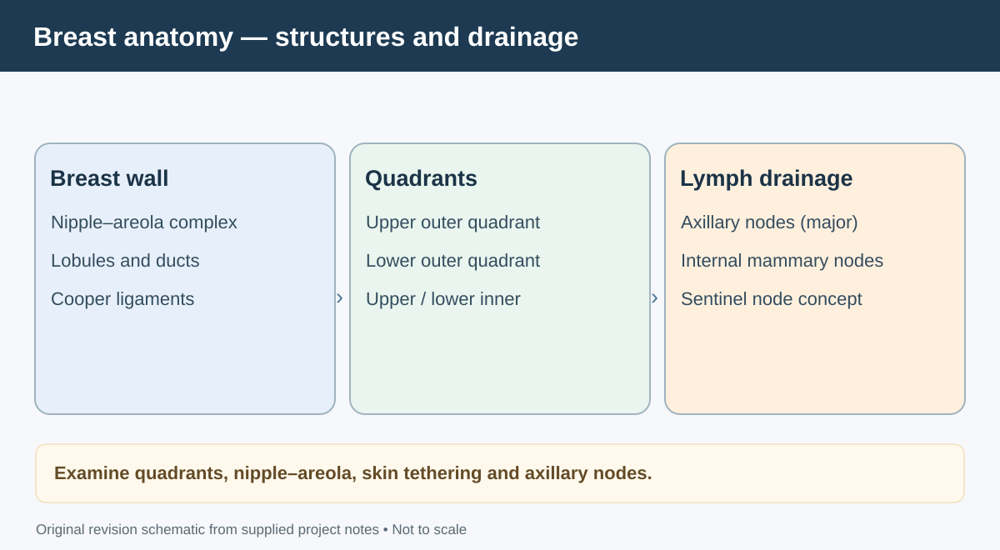
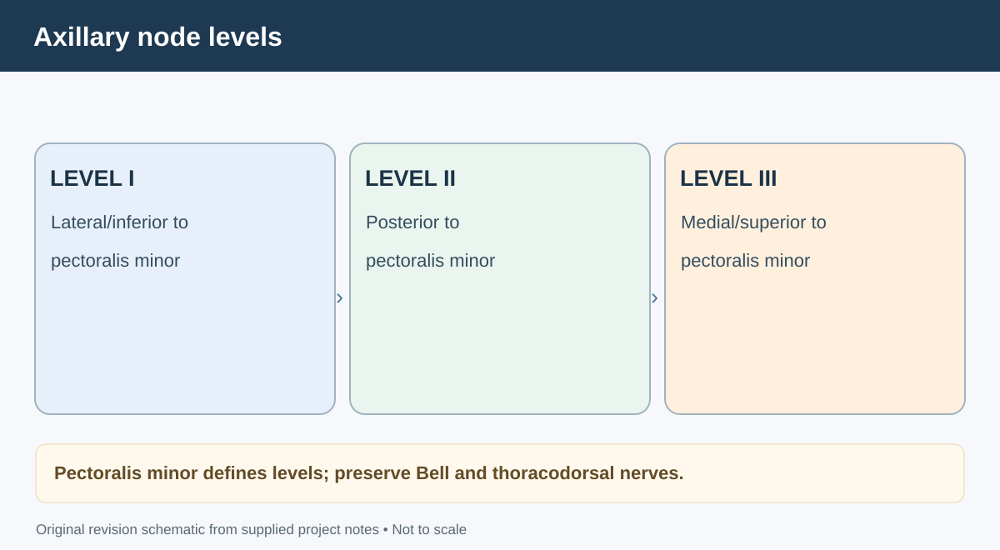
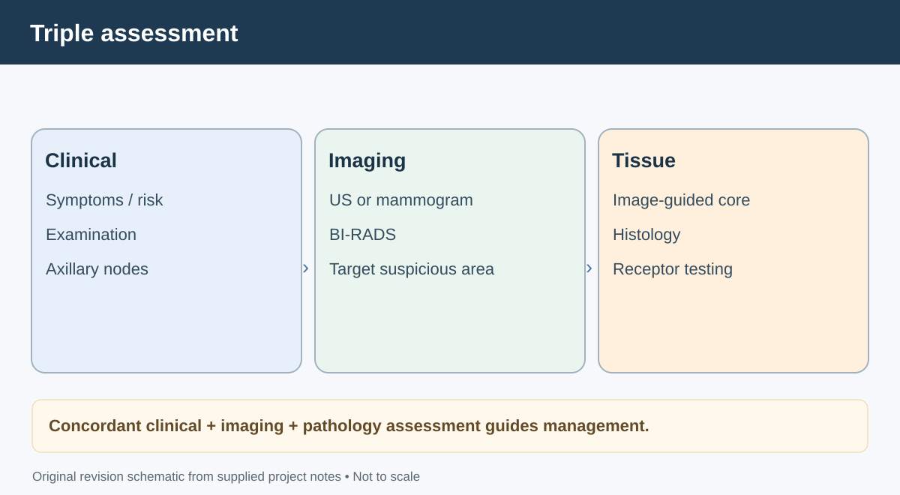

# 06 — Breast Surgery

> [!abstract] Scope
> Surgical anatomy; history and examination; triple assessment; imaging and biopsy; benign disorders; breast carcinoma; breast-conserving and ablative procedures; axillary surgery; reconstruction; complications.
>
> **Study basis:** *World of Revision — Surgery*, printed pp. 23–35 (uploaded PDF pp. 2096–2108); *Pocket Companion to Robbins*, breast section (uploaded PDF pp. 962–976). The supplied revision material is exam shorthand; definitive patient management requires current institutional/oncology protocols.

## 1. Surgical anatomy of the breast

### Functional and structural anatomy
- **Functional unit:** terminal duct–lobular unit (TDLU), from which ductal and lobular neoplasia arises.
- **Nipple–areola complex (NAC):** ducts converge toward the nipple; discharge and nipple retraction are important presenting features.
- **Cooper suspensory ligaments:** fibrous supports tether skin to deeper breast tissue; malignant infiltration/traction can cause **dimpling**.
- **Lactiferous ducts:** ductal shortening or tethering can produce **nipple retraction**.
- **Subdermal lymphatics:** malignant obstruction produces **peau d’orange**; involvement of a large proportion of the skin is associated with inflammatory cancer.
- **Axillary tail:** important on physical examination and on mediolateral oblique mammography.
- Divide clinically into **upper outer, upper inner, lower outer and lower inner quadrants**, plus the central region.
  - **Upper outer quadrant:** most commonly affected quadrant in the supplied breast-cancer notes.
  - Always include the axillary tail and contralateral breast in examination.

### Lymphatic drainage and surgical relevance
- **Axillary lymph nodes** are the major regional lymphatic basin.
- **Internal mammary nodes** are another regional drainage pathway.
- **Sentinel lymph node:** first node(s) receiving drainage from a breast lesion, sampled to stage the axilla in selected patients.
- Drainage pathways may be altered by prior breast/axillary surgery; interpret mapping and eligibility in that context.

| Axillary level | Relation to pectoralis minor | Operative relevance |
|---|---|---|
| **I** | Lateral/inferior | First-echelon region for many axillary metastases |
| **II** | Behind muscle | Intermediate group |
| **III** | Medial/superior | Apical group; more extensive clearance |
| **Rotter nodes** | Interpectoral region | Additional nodal basin |

### Structures to protect in axillary surgery

| Structure | Function/sensory territory | Injury |
|---|---|---|
| Intercostobrachial nerve | Cutaneous sensation of axilla/medial upper arm | Numbness, dysesthesia; often encountered |
| Long thoracic nerve (nerve of Bell) | Serratus anterior | **Winged scapula** |
| Thoracodorsal nerve | Latissimus dorsi | Weakness of extension/adduction/medial rotation |
| Medial/lateral pectoral nerves | Pectoral muscles | Weakness and muscle dysfunction |
| Axillary vein and vessels | Vascular structures | Hemorrhage/vascular injury |

## 2. Clinical assessment of a breast complaint

### History
- Presenting complaint: **lump, pain, discharge, inflammation, skin/nipple change**.
- Lump: site, duration, change with menstrual cycle, growth rate, pain.
- Discharge: **spontaneous or expressed; unilateral or bilateral; single vs multiple ducts; bloody, serous, milky or green**.
- Fever, lactation, breastfeeding difficulties, prior mastitis.
- Prior breast surgery, biopsies, irradiation, implants.
- Menstrual, reproductive and menopause history; hormone exposure.
- Personal and family history of breast/ovarian/pancreatic/prostate cancers.
- Red flags: rapid enlargement, fixed hard mass, new nipple inversion, eczema-like nipple lesion, skin edema/ulceration, palpable hard nodes.

### Examination
1. **Inspection:** symmetry, skin tethering, dimpling, ulceration, redness, visible veins, peau d’orange, NAC changes.
2. **Palpation:** site by quadrant and clock-face notation; size, surface, consistency, mobility, tenderness, relation to skin and chest wall.
3. **NAC:** retraction, eczematous change, discharge and duct of origin.
4. **Regional nodes:** axillary, infraclavicular and supraclavicular.
5. **Contralateral breast:** comparative examination.

| Finding | Mechanism / diagnostic clue |
|---|---|
| Skin dimpling | Infiltration of Cooper ligaments |
| Nipple retraction | Duct tethering; may also occur with benign duct disease |
| Peau d’orange | Dermal lymphatic obstruction |
| Diffuse inflammatory-looking breast | Consider **inflammatory carcinoma**, especially if nonlactating or not resolving |
| Very mobile, firm, well-circumscribed lump | Common fibroadenoma pattern |
| Rapidly enlarging, large mobile mass | Consider phyllodes tumor |

## 3. Triple assessment

**Triple assessment = (1) history + examination, (2) imaging, (3) tissue diagnosis.** The three results should be concordant.

### Breast imaging
- **Ultrasonography:** distinguishes cystic from solid lesions; favored for younger patients and during pregnancy; guides needle sampling.
- **Mammography:** typically used in older patients and screening; conventional views include **craniocaudal (CC)** and **mediolateral oblique (MLO)**.
- **MLO advantage:** includes a large volume of breast tissue and the axillary tail.
- **MRI:** useful for selected high-risk women, implants, extent of disease, suspected multifocality, and problem-solving around scar/recurrence; not routine for every lump.
- Imaging signs in source figures:
  - **Spiculated density** → suspicious for invasive carcinoma.
  - **Pleomorphic microcalcifications** → consider DCIS.
  - **“Popcorn” calcification** → typical involuting fibroadenoma.
  - **Linguine sign on MRI** → intracapsular implant rupture.
  - **US stepladder / snowstorm** → intracapsular / extracapsular implant rupture patterns.

### BI-RADS and next action

| Category | Meaning | Examination-oriented approach |
|---|---|---|
| **0** | Incomplete assessment | Additional imaging |
| **1** | Negative | Routine screening |
| **2** | Benign finding | Routine screening |
| **3** | Probably benign | Short-interval imaging, classically 6 months |
| **4A** | Low suspicion | Tissue sampling |
| **4B** | Moderate suspicion | Tissue sampling |
| **4C** | High suspicion | Tissue sampling |
| **5** | Highly suggestive of malignancy | Tissue sampling |
| **6** | Known biopsy-proven malignancy | Treatment planning |

> [!tip] Key distinction
> **BI-RADS describes imaging assessment, not histopathological stage.** A BI-RADS 6 lesion is *already biopsy-proven*.

### Tissue diagnosis
- **Core needle (Tru-cut) biopsy:** preferred when malignancy is suspected; provides tissue architecture and enables ER/PR/HER2 testing. The revision source illustrates a 14G core.
- **FNAC:** cytology alone cannot reliably distinguish in-situ from invasive malignancy or assess all required tissue markers; not a substitute for core biopsy in this setting.
- **Punch biopsy:** nipple/skin lesion, especially suspected Paget disease.
- **Image-guided biopsy:** for nonpalpable abnormalities, especially mammographic microcalcifications.
- **Histology + IHC** are required to finalize biologic classification before definitive oncologic planning.

## 4. Benign breast disorders

### 4.1 Fibroadenoma
- Very common cause of a breast lump in young women.
- **Clinical:** discrete, smooth, firm, freely mobile (“breast mouse”).
- **Imaging:** typical well-defined solid lesion on ultrasound; older lesions can develop popcorn calcification.
- **Approach:** imaging ± core tissue sampling according to age, lesion features and concordance; observation or excision/vacuum-assisted removal when appropriate.
- **Differentiate from phyllodes:** fibroadenoma usually slow-growing; phyllodes may enlarge rapidly.

### 4.2 Phyllodes tumor (cystosarcoma phyllodes)
- Fibroepithelial neoplasm, classically **rapidly growing** in the third/fourth decades.
- Large lesions can stretch skin and cause visibly dilated veins.
- Histologic categories: benign, borderline and malignant; recurrence and hematogenous spread are the chief concerns with malignant lesions.
- **Lung** is a characteristic distant metastatic site; axillary node involvement is uncommon.
- **Management principle:** complete excision with adequate negative margins; mastectomy if lesion size or recurrence prevents appropriate local excision. Routine axillary clearance is not an intrinsic part of treatment.

### 4.3 Fibrocystic change and mastalgia
- **Symptoms:** cyclical mastalgia, nodularity/lumpiness that fluctuates with the cycle.
- **Pathology:** cyst formation, fibrosis and adenosis; uncomplicated nonproliferative changes do not materially increase carcinoma risk.
- **Treatment approach:** assessment to exclude concerning lesion; reassurance and supportive pain management.
- The revision source mentions ormeloxifene/tamoxifen for selected cases, but this is **not** a blanket recommendation for ordinary mastalgia.

| Histological breast change (Robbins) | Relative future cancer risk |
|---|---|
| Nonproliferative change | No significant increase |
| Proliferative disease **without atypia** | Approximately 1.5–2-fold |
| Proliferative disease **with atypia** | Approximately 4–5-fold |

### 4.4 Breast cyst
| Type | Imaging pattern | Approach |
|---|---|---|
| Simple | Thin/regular wall; fluid; no solid component | Observation if asymptomatic and concordant |
| Complicated | Internal debris or echoes | Evaluate clinical/infective context |
| Complex cystic-solid | **Solid component** | Suspicious → tissue diagnosis |

### 4.5 Acute lactational mastitis and breast abscess
- Usually during lactation; bacteria enter through nipple fissures.
- **Common organisms:** *Staphylococcus aureus* and streptococci.
- **Mastitis:** localized pain, warmth, erythema ± fever; antibiotics when indicated, effective milk drainage and breastfeeding support.
- **Abscess:** fluctuant/painful collection confirmed by ultrasound when required.
- **Management:** antibiotics plus source control, often ultrasound-guided aspiration; drainage for unsuitable or persistent collections.
- Nonlactational, recurrent or nonresolving inflammation warrants evaluation for **granulomatous mastitis, tuberculosis, duct disease and inflammatory carcinoma**.

### 4.6 Periductal mastitis / Zuska disease
- Squamous metaplasia → keratin plugging of ducts → duct dilation/rupture → chronic periareolar inflammation.
- Can cause recurrent **subareolar abscess**, fistula, nipple inversion.
- Strong smoking association in Robbins.
- Recurrent disease may require excision of affected ducts.

### 4.7 Duct ectasia
- Dilated major ducts with inspissated secretions, periductal inflammation and fibrosis.
- **Typical:** periareolar mass, nipple retraction, thick/white or colored discharge; may mimic carcinoma.
- Multiple-duct discharge can occur; work up suspicious features.
- Excision of central ducts (Hadfield operation) is a surgical option for selected persistent/recurrent cases.

### 4.8 Intraductal papilloma
- Fibrovascular epithelial proliferation within a duct.
- **Classic single-duct spontaneous bloody discharge**, sometimes with subareolar lump.
- Imaging and sampling; **microdochectomy**/targeted duct excision may be used for selected lesions.
- Multiple papillomas/papillomatosis carry different risk implications from an isolated benign papilloma.

### 4.9 Fat necrosis and Mondor disease
- **Fat necrosis:** trauma/surgery-associated mass, skin retraction or calcification; important cancer mimic.
- **Mondor disease:** superficial thrombophlebitis of chest wall/breast veins; **palpable tender cord**; often self-limited but evaluate for associated pathology.

### 4.10 Nipple discharge — differential table
| Pattern | Consider |
|---|---|
| Single-duct spontaneous bloody | Intraductal papilloma; carcinoma must be excluded |
| Green/brown, several ducts | Duct ectasia |
| Purulent with periareolar pain | Periductal infection/abscess |
| Eczematous unilateral NAC change | **Paget disease**; punch biopsy |
| Milk-like discharge | Physiological/endocrine/drug-related context |

## 5. Breast carcinoma

### 5.1 Risk factors and etiopathogenesis
- Increasing age; early menarche and late menopause.
- Family history on **maternal or paternal** side; pathogenic inherited variants.
- Nulliparity, later first full-term pregnancy, hormone exposure, postmenopausal obesity, alcohol, irradiation and atypical proliferative lesions.
- Breastfeeding has a protective association.
- **BRCA1 (17q)**: strongly linked to basal-like/triple-negative phenotype.
- **BRCA2 (13q)**: important in male breast, prostate, pancreatic and breast cancers.
- Other inherited syndromes in supplied pathology: TP53/Li-Fraumeni, PTEN/Cowden and others.

### 5.2 Histological categories
| Lesion | Pathology | Typical clue |
|---|---|---|
| DCIS | Malignant ductal proliferation **without basement membrane invasion** | Pleomorphic microcalcifications |
| LCIS / lobular neoplasia | Discohesive lobular cells, E-cadherin loss | Incidental biopsy finding; bilateral/multicentric tendency |
| Invasive carcinoma NST (ductal) | Stromal invasion with desmoplasia | Hard irregular/spiculated mass |
| Invasive lobular carcinoma | Discohesive cells in **single-file (“Indian file”)** arrangement | E-cadherin loss |
| Paget disease | Malignant cells in nipple epidermis, often with underlying DCIS/invasive carcinoma | Persistent unilateral eczema-like nipple lesion |
| Inflammatory carcinoma | Carcinoma obstructs dermal lymphatics | Rapid diffuse swelling, redness, peau d’orange |

- **Comedo-type DCIS:** high-grade cells + central necrosis.
- **Nottingham grade** evaluates tubule formation, nuclear pleomorphism and mitoses.
- A nipple lesion that seems to be “eczema” but persists must be investigated.

### 5.3 Receptor and molecular classification
| Subtype | ER | PR | HER2 | General behavior |
|---|---|---|---|---|
| Luminal A-like | + | Usually + | − | Low proliferation; endocrine-responsive |
| Luminal B-like | + | Variable | − or + | Higher proliferation |
| HER2-enriched | Usually − | Usually − | + | HER2-directed therapy relevant |
| Triple negative / basal-like | − | − | − | Often higher grade; chemotherapy important |

- **ER and PR:** nuclear staining on IHC.
- **HER2:** 0/1+ negative, 3+ positive; **2+ requires confirmatory ISH/FISH** per the source.
- **Ki-67:** proliferation marker.
- Systemic therapy is chosen by stage and tumor biology, not by surgery alone.

### 5.4 TNM — simplified anatomical overview
**T:**
- **Tis:** in situ.
- **T1:** ≤2 cm.
- **T2:** >2 to ≤5 cm.
- **T3:** >5 cm.
- **T4:** extension to chest wall/skin; **T4d inflammatory carcinoma**.

**Regional N (clinical teaching scheme):**
- N0 no regional spread; N1 mobile ipsilateral axillary nodes; N2 fixed/matted axillary or certain internal mammary nodes; N3 infraclavicular/supraclavicular or specified combined basins.
- **M0** no distant metastasis; **M1** distant spread.
- Prognostic staging also incorporates **grade, receptors and biomarkers**; the simple anatomical table is not the whole stage-grouping system.

### 5.5 Breast-conserving surgery (BCS)
- **Lumpectomy / wide local excision** of tumor with clear margins; typically followed by radiotherapy to the conserved breast.
- In appropriately selected early breast cancer, **BCS plus radiotherapy and mastectomy have comparable overall survival**.
- Suitability is driven by **ability to excise the disease with acceptable margins/cosmesis and deliver radiotherapy**.
- Less suitable: widespread multicentric disease not amenable to excision, extensive residual disease, unfavorable tumor-to-breast ratio, certain prior irradiation situations.
- Pregnancy or connective tissue disease requires **individualized radiation planning**, not an automatic conclusion from a short MCQ list.
- **Oncoplastic reconstruction:** volume displacement or replacement to preserve contour.

### 5.6 Mastectomy operations
| Operation | Tissue removed | Key distinction |
|---|---|---|
| **Simple/total mastectomy** | Breast ± NAC/skin pattern according to technique | **No formal axillary clearance** |
| **Modified radical mastectomy (MRM)** | Breast + appropriate axillary nodes; pectoralis major preserved | Historical Patey/Auchincloss variants |
| **Radical/Halsted mastectomy** | Breast + major/minor pectoral muscles + axillary contents | Rarely appropriate today |
| **Skin-/nipple-sparing variants** | Breast parenchyma, preserving selected envelope/NAC | Selected oncologic and reconstruction settings |
| **Palliative (“toilet”) mastectomy** | Symptom-control surgery in selected fungating lesions | Symptom relief rather than stage-based cure |

**MRM — classic operative sequence to recognize**
1. Patient positioned supine with arm abducted; plan ellipse (Stewart incision in source).
2. Raise skin flaps; mobilize breast off pectoral fascia.
3. Preserve **pectoralis major** and identify axillary vessels/nerves.
4. Perform indicated axillary dissection; achieve hemostasis.
5. Place suction drainage where indicated; close and assess viability of skin flaps.

### 5.7 Sentinel lymph node biopsy (SLNB) and axillary surgery
- Used for **selected clinically node-negative** patients to stage the regional basin while avoiding morbidity of full clearance.
- Mapping methods in the source:
  1. Blue dye.
  2. **Tc-99m-labelled colloid** with gamma probe.
  3. Indocyanine green fluorescence.
  4. Combined technique.
- A **“hot”** radioactive node or **“blue”** node is identified and submitted for pathology.
- **Positive SLNB does not invariably mandate completion ALND**; decisions depend on tumor stage, surgical approach, radiotherapy and multidisciplinary criteria.
- Axillary clearance when indicated typically removes **level I/II nodes**, with additional extent based on disease and procedure; distinguish the classical examination diagram from modern selective axillary management.

### 5.8 Surgery-related complications
| Time/course | Complication | Mechanism or recognition |
|---|---|---|
| Early | Hemorrhage / hematoma | Bleeding, swelling, instability |
| Early | Seroma | **Commonest** complication in the supplied MRM notes |
| Early | Flap ischemia/necrosis, infection | Skin flap viability and wound issues |
| Early/late | Intercostobrachial injury | Axillary/medial arm sensory symptoms |
| Early/late | Long thoracic nerve injury | Scapular winging |
| Late | Arm lymphedema | Lymphatic disruption, often worsened by axillary radiation |
| Very late | Stewart–Treves syndrome | Lymphangiosarcoma in chronically lymphedematous limb |
| Late | Local recurrence | Requires imaging and biopsy confirmation |

### 5.9 Reconstructive options
- Implants vs autologous tissue; timing can be immediate or delayed.
- **TRAM:** transverse rectus abdominis myocutaneous flap; potential donor abdominal wall morbidity.
- **DIEP:** deep inferior epigastric perforator flap; attempts to spare rectus muscle.
- **Latissimus dorsi flap:** tissue transfer from back, often for volume replacement or coverage.
- Radiotherapy, body habitus, desired cosmesis and comorbidity affect choice.

## 6. Systemic and radiation treatment — surgically relevant
- **Neoadjuvant systemic therapy** is common in selected locally advanced, triple-negative or HER2-positive tumors and when downstaging could permit BCS.
- **Adjuvant radiotherapy:** standard part of BCS; postmastectomy indications depend on size, nodal status, margins and extent.
- **Endocrine treatment:** for hormone-receptor-positive cancer.
  - Tamoxifen: SERM; classically hot flashes, venous thrombosis and endometrial effects.
  - Aromatase inhibitors: important postmenopausally; bone loss/arthralgia concerns.
- Molecular assays such as **Oncotype DX / MammaPrint** can guide chemotherapy in eligible hormone receptor–positive, HER2-negative cases.

## 7. Rapid revision: discriminators
- **Peau d’orange** = lymphatic obstruction; **dimpling** = Cooper ligament tethering; **retraction** = duct tethering.
- **Blood from one duct** → papilloma until investigated, but always exclude cancer.
- **Eczematous nipple** → think Paget disease, punch biopsy.
- **Comedo necrosis + microcalcification** → high-grade DCIS.
- **Single-file cells + E-cadherin loss** → lobular carcinoma.
- **Breast mouse** → fibroadenoma; **rapid large mass** → phyllodes.
- **Axillary sensory loss** → intercostobrachial nerve; **winging** → long thoracic nerve.
- **Seroma** is highlighted as the most common postoperative MRM complication.
- **Stewart–Treves** follows long-standing upper limb lymphedema.
- **BCS** is incomplete without discussion of postoperative breast radiotherapy.

## 8. Self-test checklist
- [ ] Explain triple assessment and when to choose ultrasound, mammography, MRI and core biopsy.
- [ ] Identify all BI-RADS categories.
- [ ] Differentiate fibroadenoma, phyllodes, cyst, mastitis, duct ectasia and papilloma.
- [ ] Recognize Paget disease, inflammatory carcinoma, DCIS and LCIS.
- [ ] Classify breast tumors by ER/PR/HER2 and memorize T1–T4.
- [ ] Compare simple, modified radical and Halsted mastectomy.
- [ ] Locate axillary levels I, II and III relative to pectoralis minor.
- [ ] Explain SLNB techniques and the injuries of axillary dissection.

---
**Project sources:** *World of Revision* (Surgery/Breast, PDF pp. 2096–2108); *Pocket Companion to Robbins and Cotran* (Breast, PDF pp. 962–976). **Images:** original study schematics in adjacent assets folder.
