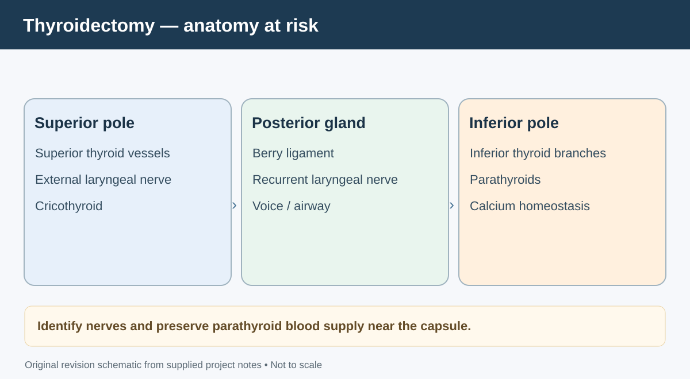
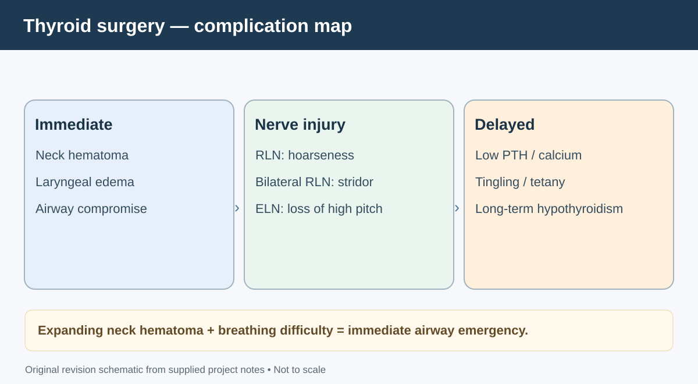
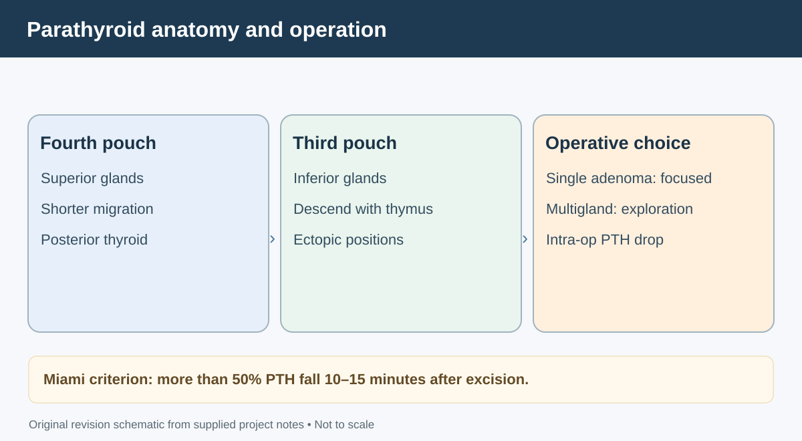
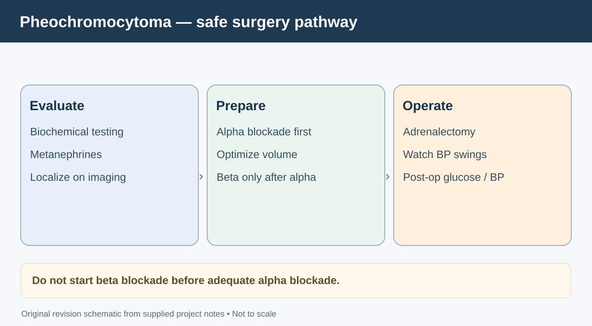

# 07 — Thyroid, Parathyroid and Adrenal Surgery

> [!abstract] Scope
> Thyroid surgical anatomy, nodule and goitre assessment, thyroidectomy, cancer-directed neck surgery, hyperparathyroidism and parathyroidectomy, adrenal incidentaloma, functioning adrenal tumors, adrenalectomy, and perioperative complications.
>
> **Study basis:** *World of Revision — Surgery*, printed pp. 36–50 (uploaded PDF pp. 2109–2123), with supporting endocrine pathology in the uploaded *Pocket Companion to Robbins* and *First Aid 2025*. Values and historical “rules” reproduced from the revision notes are not substitutes for updated guidelines.

## PART A — THYROID SURGERY

## 1. Thyroid anatomy for the operating surgeon

### Structures
- Two thyroid lobes connected by an isthmus; surgical surfaces include **upper pole, lower pole, posterior capsule and isthmus**.
- **Pretracheal fascia** forms a fibrous attachment; **Berry ligament** is especially important because the recurrent laryngeal nerve (RLN) is at risk there.
- **Parathyroid glands** usually lie near the posterior aspect of the thyroid; their arterial supply must be preserved.
- **Thyroglossal tract**: embryologic descent from foramen cecum to anterior neck explains lingual thyroid and midline thyroglossal duct cyst.

### Vessels and nerve-risk relationships

| Vessel/structure | Anatomy / source relation | Surgical lesson |
|---|---|---|
| Superior thyroid artery | Near upper thyroid pole | Ligate close to thyroid capsule to reduce **external laryngeal nerve** risk |
| Inferior thyroid artery and capsular branches | Related to RLN/parathyroid blood supply | Preserve parathyroid vascular supply; divide terminal branches carefully |
| Middle thyroid vein | Usually drains toward IJV | Often mobilized/controlled early for medial rotation |
| Inferior thyroid veins | Lower anterior neck drainage | Avoid bleeding during inferior pole/isthmus work |
| **Berry ligament** | Dense posterior thyroid attachment | RLN vulnerable at this attachment |
| **Beahr's triangle** | Used as anatomical clue to RLN | Recognize anatomical variation; identify nerve directly |

### Nerves: examination essentials
| Nerve | Motor supply | Injury manifestation |
|---|---|---|
| **External branch of superior laryngeal (ELN/EBSLN)** | Cricothyroid → increases vocal-cord tension | Poor high-pitch phonation, weak/prolonged voice, fatigability |
| **Recurrent laryngeal (RLN)** | All intrinsic laryngeal muscles **except cricothyroid** | Unilateral injury: hoarseness; bilateral injury: stridor/airway obstruction |
| Internal laryngeal | Sensory above vocal folds | Cough/aspiration-protection dysfunction |
| RLN sensory component | Below true vocal folds | Impaired subglottic sensation |

- Right RLN loops under **right subclavian artery**; left RLN under **aortic arch** before ascending.
- RLN commonly runs in/near **tracheoesophageal groove**, but variations matter.
- The **posterior cricoarytenoid** is the sole abductor of the vocal folds; bilateral denervation threatens airway patency.

## 2. Clinical evaluation of thyroid swelling

### History and examination
- Duration; rapid growth; pain; dysphagia, dyspnea, stridor; change in voice.
- Hyperthyroid symptoms: tachycardia, weight loss with appetite, heat intolerance, tremor, loose stools, anxiety.
- Hypothyroid symptoms: fatigue, cold intolerance, constipation, weight gain and bradycardia.
- Radiation exposure, family thyroid cancer/MEN syndromes; compressive symptoms when supine.
- **Thyroid moves with deglutition**; a thyroglossal cyst can move with **both deglutition and tongue protrusion**.
- **Pizzillo, Lahey and Crile methods** are named examination techniques in the source:
  - Pizzillo: patient extends/leans back with hands at occiput.
  - Lahey: facilitates palpation of gland margin.
  - Crile: thumb palpation of thyroid nodules.
- Palpate cervical nodes and assess for retrosternal extension; check voice and airway.

### Investigation approach
1. **TSH and thyroid function tests** are the first biochemical step.
2. **Neck ultrasound** characterizes nodules, cervical nodes and sonographic risk (**TI-RADS**).
3. **Ultrasound-guided FNAC** when risk/size criteria warrant it.
4. **Thyroid scintigraphy** (I-123 or Tc-99m) when suppressed TSH suggests autonomous function; not routine for an otherwise euthyroid suspicious nodule.
5. Additional imaging (e.g., **CT of neck/chest**) for large compressive or retrosternal goitre.

> [!warning] Diagnostic distinction
> FNAC diagnoses papillary malignancy and many other lesions well, but **follicular adenoma vs follicular carcinoma requires capsular/vascular invasion on histology**, which cytology cannot assess.

### Thyroid FNAC result — supplied UK Thy shorthand
| Thy category | Interpretation | Typical next step in source |
|---|---|---|
| Thy 1 / 1c | Nondiagnostic (or nondiagnostic cystic) | Repeat US-guided aspiration |
| Thy 2 | Non-neoplastic | Clinical/imaging follow-up |
| Thy 3 | Follicular / indeterminate | Diagnostic lobectomy in selected patients |
| Thy 4 | Suspicious malignancy | Surgical assessment |
| Thy 5 | Malignant | Cancer-directed management |

**Do not confuse** Thy reporting with the Bethesda numbering system; the source says similar but they are not identical.

### Functional scans
- **Graves:** diffuse increased uptake.
- **Toxic multinodular goitre:** patchy autonomous uptake.
- **Toxic solitary nodule:** focal hot uptake, with suppression of remaining tissue.
- **Thyroiditis:** low uptake despite a thyrotoxic presentation.
- A “cold” nodule requires ultrasound risk assessment, not the assumption that every cold nodule is cancer.

## 3. Major thyroid disorders with surgical implications

### Graves disease
- Autoimmune thyroid-stimulating antibodies; diffuse toxic goitre.
- **Classic clinical signs:** Stellwag (infrequent blinking), von Graefe (lid lag), Dalrymple (lid retraction), exophthalmos, pretibial myxedema.
- Pathology: **tall crowded follicular epithelium + scalloped colloid**.
- Treatment modalities: antithyroid therapy, radioiodine or surgery.
- Surgery is especially relevant when a significant goitre, compressive disease, selected eye disease, nodule or patient preference makes it suitable.

**Preoperative control of thyrotoxicosis**
- Achieve good control of thyroid hormone excess before elective surgery using antithyroid medication and rate control as appropriate.
- Beta blockade relieves adrenergic symptoms; iodide may be used in specialist protocols for some Graves operations.
- Ensure anesthesia team is aware of difficult airway/compression and thyroid storm risk.
- **Thyroid storm:** severe hyperthermia, tachycardia, agitation/organ dysfunction around uncontrolled disease or stress. This is a perioperative emergency.

### Multinodular and retrosternal goitre
- Long-standing nodular enlargement may cause tracheal deviation/compression, dysphagia or visible cervical swelling.
- **Retrosternal goitre:** dyspnea, stridor, pressure effects and **Pemberton sign** (facial congestion after raising arms).
- **CECT neck and thorax** helps map mediastinal extension.
- The supplied notes indicate most secondary retrosternal goitres can be approached through the neck; sternotomy may be required for selected primary mediastinal or very large/invasive disease.

### Thyroiditis comparison
| Disorder | Underlying process | Key clue |
|---|---|---|
| Hashimoto thyroiditis | Autoimmune lymphocytic thyroiditis | Painless gland; anti-TPO/anti-thyroglobulin; hypothyroidism |
| De Quervain subacute thyroiditis | Granulomatous, often postviral | **Painful** tender gland; transient thyrotoxic phase |
| Riedel thyroiditis | Fibrosing infiltrative process | **Woody-hard** thyroid, compressive signs, can mimic cancer |

## 4. Thyroidectomy — indications and techniques

### Common operations
| Operation | Extent |
|---|---|
| **Hemithyroidectomy / lobectomy + isthmusectomy** | One lobe and isthmus |
| **Total thyroidectomy** | Both lobes and isthmus |
| Near-total thyroidectomy | Minimal tissue may remain near crucial structures; usage varies |
| Subtotal thyroidectomy | Larger thyroid remnant; largely replaced by more definitive approaches |
| Total thyroidectomy + central neck dissection | For selected disease with central lymphatic involvement |
| Total thyroidectomy + lateral therapeutic neck dissection | For indicated lateral nodal metastases |

### Open thyroidectomy: examination sequence
1. **Position:** patient supine, neck extended (Rose position), often head elevated.
2. **Incision:** low transverse **collar/Kocher incision** in a neck crease.
3. Raise **subplatysmal flaps**.
4. Separate/retract strap muscles; if division needed, do it sufficiently high to protect ansa cervicalis supply.
5. Expose thyroid; ligate/divide relevant veins and vessels carefully.
6. Identify **ELN at upper pole** and **RLN** near tracheoesophageal groove/Berry ligament.
7. Identify and preserve **parathyroids and their vascular supply**; selectively autotransplant a devascularized gland when indicated.
8. Remove the planned thyroid tissue and any indicated nodes; inspect hemostasis and nerve integrity.
9. Close by layers; drains are **selective**, despite their presence in classic revision diagrams.

### Remote-access and endoscopic thyroid surgery
- The source illustrates transaxillary, transoral and retroauricular approaches, and **minimally invasive video-assisted thyroidectomy (MIVAT)**.
- Case selection depends on tumor size, extent, experience and available resources; not equivalent to a “scarless and risk-free” operation.

## 5. Complications of thyroid surgery

### Early: recognize airway emergencies
- **Postoperative neck hematoma:** expanding swelling, tight neck, respiratory distress and stridor → urgent operative/airway response.
- **Laryngeal edema**, tracheal compromise or bilateral RLN dysfunction can produce stridor.
- Hemorrhage, infection, rare injury to trachea/esophagus or chyle leak depending on extent of neck dissection.

### Neurologic and endocrine complications
| Complication | Recognition | Mechanism |
|---|---|---|
| ELN injury | Loss of high pitch, vocal fatigue | Cricothyroid denervation |
| Unilateral RLN injury | Hoarse/breathy voice | Ipsilateral vocal fold palsy |
| Bilateral RLN injury | **Stridor/respiratory obstruction** | Loss of abduction |
| Transient hypocalcemia | Paresthesia, perioral tingling, cramps | Parathyroid ischemia/stunning |
| Severe hypocalcemia | Carpopedal spasm, tetany, seizures, arrhythmia | Marked calcium fall |
| Permanent hypoparathyroidism | Persistent low calcium/PTH needing replacement | Loss of gland function |
| Hypothyroidism | Need for levothyroxine after total thyroidectomy | Absent thyroid tissue |

- **Chvostek** and **Trousseau** signs are examination clues to hypocalcemic neuromuscular excitability.
- Monitor **serum calcium and PTH** after high-risk thyroid/parathyroid surgery.
- Symptomatic/severe hypocalcemia may require **IV calcium gluconate**, monitoring and vitamin D/calcium maintenance as clinically indicated.

## 6. Thyroid cancer: surgical logic

| Carcinoma | Key histology / spread | Main operative concept |
|---|---|---|
| **Papillary (PTC)** | Orphan Annie-eye nuclei, nuclear grooves/inclusions, psammoma bodies; lymphatic spread | Lobectomy or total thyroidectomy according to risk, size, extent |
| **Follicular (FTC)** | Capsular/vascular invasion; **hematogenous spread**, often bone | Surgical histology required to prove invasion |
| Hürthle cell carcinoma | Oncocytic morphology; relatively less iodine avid | Resect and stage according to risk |
| **Medullary (MTC)** | Para­follicular C cell; calcitonin, amyloid; **RET/MEN2** association | Total thyroidectomy with indicated central/lateral dissection; no radioiodine |
| **Anaplastic** | Rapidly enlarging destructive tumor, elderly patient; poor prognosis | Urgent multidisciplinary airway, resectability and palliation assessment |

### Papillary and follicular carcinomas
- **PTC**: most common; regional lymphatic metastases; BRAF association.
- **FTC**: second common differentiated subtype in source; more hematogenous, especially **bone**.
- **Surgical selection:** low-risk small unilateral lesions may undergo lobectomy; larger, multifocal, invasive or otherwise high-risk disease may warrant total thyroidectomy.
- **RAI** is a postoperative option for selected differentiated cancers, **not automatically for every case**.
- **Thyroglobulin** is a follow-up marker *after appropriate thyroid surgery/ablation*, interpreted with antibodies, imaging and risk category.
- **Medullary tumor**: calcitonin ± CEA for monitoring. RAI is not effective because C cells are not follicular iodine-avid cells.
- **Before surgery for familial/MEN2-associated MTC**, assess for **pheochromocytoma**, because unrecognized catecholamine excess can make anesthesia dangerous.

### MEN associations
| Syndrome | Gene | Important components |
|---|---|---|
| MEN1 | MEN1 / menin | Parathyroid hyperplasia, pituitary adenoma, pancreatic neuroendocrine tumors |
| MEN2A | RET | Medullary thyroid cancer, pheochromocytoma, hyperparathyroidism |
| MEN2B | RET | Aggressive early MTC, pheochromocytoma, mucosal neuromas, marfanoid habitus |
| MEN4 | CDKN1B | MEN1-like endocrine associations |

## PART B — PARATHYROID SURGERY

## 7. Surgical anatomy and physiology

- Usually **four glands**, but number and position vary.
- **Superior parathyroids:** derived from **fourth pharyngeal pouch**.
- **Inferior parathyroids:** derived from **third pharyngeal pouch**; descend with thymus, making ectopic positions more likely.
- Main role of **PTH:** raise serum calcium through actions on bone/kidney and calcitriol generation; increase renal phosphate excretion.
- Parathyroid gland identification and preservation are pivotal to avoiding postoperative hypocalcemia.

## 8. Hyperparathyroidism

### Biochemical patterns
| Pattern | PTH | Calcium | Phosphate | Mechanism |
|---|---|---|---|---|
| **Primary HPT** | High/inappropriately normal | High | Often low | Autonomous gland secretion, commonly adenoma |
| **Secondary HPT** | High | Often low/normal | Variable; high in CKD | Physiologic compensation to chronic hypocalcemic stimulus |
| **Tertiary HPT** | High | High | Variable | Autonomous secretion after long-standing secondary HPT |
| **Hypercalcemia of malignancy (PTHrP)** | Suppressed intact PTH | High | Often low | Tumoral PTHrP or other mechanisms |

**Primary HPT classical clinical mnemonic:**
- **Bones:** subperiosteal resorption, osteitis fibrosa cystica, brown tumors, “salt-and-pepper skull.”
- **Stones:** recurrent renal calculi/nephrocalcinosis.
- **Abdominal groans:** abdominal pain, pancreatitis/constipation.
- **Psychiatric overtones:** altered mood, cognition and fatigue.

### Diagnosis and localization
1. **Biochemical diagnosis first:** appropriately repeated calcium (corrected/ionized as needed) with PTH; evaluate renal function, phosphate and vitamin D.
2. Exclude important mimics/secondary causes when indicated.
3. **Localization is for operative planning, not for making the biochemical diagnosis.**
4. **Ultrasonography** and **Tc-99m sestamibi (MIBI)/SPECT** are commonly shown in the source.
5. Further imaging used when first-line studies are discordant or reoperation is considered.

### Parathyroidectomy techniques
| Scenario | Typical approach |
|---|---|
| Localized single adenoma | **Focused/minimally invasive parathyroidectomy** |
| Uncertain localization or multigland disease | Bilateral four-gland exploration |
| Four-gland hyperplasia | Subtotal (often 3½-gland) resection or other planned approach |
| Selected extensive surgery | Autotransplant of a small gland portion, commonly into forearm muscle |

**Miami intraoperative PTH criterion**
- PTH has a short half-life.
- After removing the suspected hyperfunctioning gland, a **>50% fall from the relevant baseline around 10 minutes** supports adequate resection.
- Failure to fall appropriately prompts consideration of additional hyperfunctioning tissue.

### Indications and complications
- Surgery considered for symptomatic stones, fractures/osteoporosis, clinically significant hypercalcemia or renal involvement; selected asymptomatic patients also meet criteria.
- **Neck hematoma**, RLN injury, persistent/recurrent HPT, postoperative hypocalcemia.
- **Hungry bone syndrome:** prolonged sometimes profound hypocalcemia following surgery due to rapid bone remineralization in severe skeletal disease; requires calcium and active vitamin D replacement with monitoring.
- Secondary HPT in CKD is often initially treated with renal/metabolic management; refractory severe disease may require surgery.

## PART C — ADRENAL SURGERY

## 9. Adrenal evaluation and incidentaloma

- Adrenal cortex and medulla have very different hormonal syndromes and surgical risks.
- **Adrenal incidentaloma:** incidentally discovered mass not originally imaged for suspected adrenal disease.
- Major possibilities in the uploaded revision notes: nonfunctioning adenoma, cortisol-secreting lesion/Cushing syndrome, pheochromocytoma, metastasis.
- Two questions drive management:
  1. **Is it hormonally active?**
  2. **Is it radiologically suspicious for malignancy or locally invasive?**
- Functional workup guided by phenotype and imaging can include:
  - **Dexamethasone suppression test** for autonomous cortisol production.
  - **Plasma free or urine fractionated metanephrines** when pheochromocytoma needs exclusion.
  - Aldosterone/renin testing in appropriate hypertensive/hypokalemic patients.
- Imaging evaluates attenuation, homogeneity, size, growth, and local invasion; size **alone** is not a sufficient cancer diagnosis.

### Main cortical conditions
| Disorder | Hormone pattern / syndrome | Operative issue |
|---|---|---|
| Cortisol-producing adenoma | Cushing syndrome | Adrenalectomy in selected cases; postoperative adrenal suppression |
| Aldosterone-producing adenoma | Primary aldosteronism | Confirm unilateral functional source before unilateral surgery |
| Adrenocortical carcinoma | Possible steroid excess, invasive mass | Specialist oncologic resection; avoid tumor rupture |
| Bilateral adrenal disease | Function can be absent or excessive | Risk of permanent steroid dependence if both glands removed |

## 10. Pheochromocytoma and paraganglioma

### Recognition
- Catecholamine-producing neoplasm: adrenal medullary pheochromocytoma or extra-adrenal paraganglioma.
- **Classic triad:** episodic headache, sweating, palpitations; hypertension can be sustained or episodic.
- Familial associations include **MEN2, VHL, NF1** and paraganglioma syndromes.
- The old **“rule of 10s”** appears in revision resources but does **not** accurately describe current hereditary or malignant behavior; do not use it to rule out genetic disease.
- Extra-adrenal sympathetic lesions can occur around the **organ of Zuckerkandl**.

### Diagnostic sequence
1. Confirm biochemical excess with **plasma free metanephrines** or appropriately collected urine fractionated metanephrines.
2. Localize with cross-sectional imaging; MRI is featured in the revision notes.
3. Functional imaging is used for selected extra-adrenal/multifocal/metastatic disease.
4. Evaluate familial/genetic context and other MEN2 components.

### Pre-op preparation — most testable operative principle
- **First: alpha blockade** (e.g., phenoxybenzamine or selective alpha blocker under specialist care).
- Optimize intravascular volume and salt/fluid status.
- **Only after alpha blockade:** add beta blocker if required for tachyarrhythmia.
- Then perform an appropriately planned adrenalectomy with anesthesia prepared for major BP fluctuations.

> [!danger] Exam trap
> **Beta blockade before alpha blockade can trigger dangerous unopposed alpha-adrenergic vasoconstriction.**

## 11. Adrenalectomy

### Approach selection
- **Laparoscopic adrenalectomy:** often used for suitable localized benign functional/nonfunctional lesions.
- **Open adrenalectomy:** selected larger tumors, strong concern for adrenocortical carcinoma, local invasion or technically complex disease.
- Laparoscopic routes may be transperitoneal or retroperitoneal depending on expertise and anatomy.
- Key tasks: access to adrenal, control of adrenal vein, careful gland mobilization, intact specimen extraction and hemostasis.
- **Avoid rupture/spillage** when malignancy is suspected.

### Specific perioperative considerations
| Indication | Before surgery | After surgery |
|---|---|---|
| Pheochromocytoma | Adequate alpha blockade, volume optimization | Hypotension, hypoglycemia, residual hypertension |
| Cortisol-producing lesion | Endocrine assessment | Temporary glucocorticoid support may be required |
| Aldosterone-producing lesion | Manage BP and potassium | Reassess electrolytes, BP and renin–aldosterone axis |
| Bilateral adrenalectomy | Plan steroid replacement and education | **Lifelong glucocorticoid/mineralocorticoid support** as indicated |

### General surgical complications
- Hemorrhage and adrenal vein injury, injury to adjacent vessels/viscera.
- Intraoperative hypertensive crisis (catecholamine tumor) or postoperative severe hypotension.
- Postoperative adrenal insufficiency after cortisol-secreting lesions or bilateral gland removal.
- Recurrence/remaining tumor in incompletely treated disease.

## 12. Comparing the three operations

| Operation | Most important anatomy | Characteristic complication | Exam word |
|---|---|---|---|
| Thyroidectomy | RLN, ELN, parathyroids, Berry ligament | Hoarseness/stridor, hypocalcemia, neck hematoma | **Berry / RLN** |
| Parathyroidectomy | Variable parathyroid locations, blood supply | Hypocalcemia, hungry bone, persistent disease | **Miami criterion** |
| Adrenalectomy | Adrenal vessels, surrounding retroperitoneal structures | Hemorrhage, BP lability, adrenal crisis | **Alpha before beta** |

## 13. Rapid revision
- **Upper-pole thyroid risk:** ELN, cricothyroid, high-pitched voice.
- **Lower/posterior thyroid risk:** RLN, parathyroids, hoarseness and hypocalcemia.
- **Bilateral RLN injury** = stridor; treat as airway emergency.
- **Berry ligament** is a classic RLN injury site.
- **Pemberton sign** = thoracic inlet compression from goitre.
- **PTC:** lymphatic spread + psammoma bodies/nuclear grooves; **FTC:** hematogenous bone spread.
- **MTC:** calcitonin, amyloid, RET, **no radioiodine**.
- **MEN2/MTC:** check for pheochromocytoma before elective thyroid surgery.
- **Inferior parathyroids** = **third pouch**, descend with thymus.
- **Miami criterion** = intra-op PTH decrease by >50%.
- **Pheo:** biochemical metanephrines; **alpha blockade first**, beta later.
- Post-adrenalectomy **hypotension/hypoglycemia** are important in pheo; adrenal insufficiency in cortisol-producing or bilateral resection.

## 14. Completion checklist
- [ ] Relate ELN to superior thyroid vessels and RLN to Berry ligament.
- [ ] Interpret TSH, ultrasound/TI-RADS, FNAC and scintigraphy.
- [ ] Explain total vs hemithyroidectomy and their indications.
- [ ] Differentiate PTC, FTC, MTC and anaplastic disease.
- [ ] Recognize postoperative thyroid hematoma and bilateral RLN palsy.
- [ ] Explain first/second/tertiary HPT biochemical patterns.
- [ ] Describe focused vs four-gland parathyroid surgery and hungry bone syndrome.
- [ ] Work up adrenal incidentaloma for hormone activity and malignancy.
- [ ] Explain alpha/beta preoperative sequence in pheochromocytoma.
- [ ] List common complications of thyroidectomy, parathyroidectomy and adrenalectomy.

---
**Project sources:** *World of Revision* (Surgery/Endocrine Surgery, PDF pp. 2109–2123); *Pocket Companion to Robbins and Cotran* (Endocrine System); *First Aid for the USMLE Step 1* (2025 endocrine pathology). **Images:** original study schematics in adjacent assets folder.
