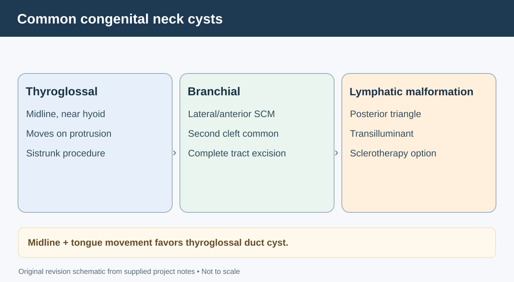
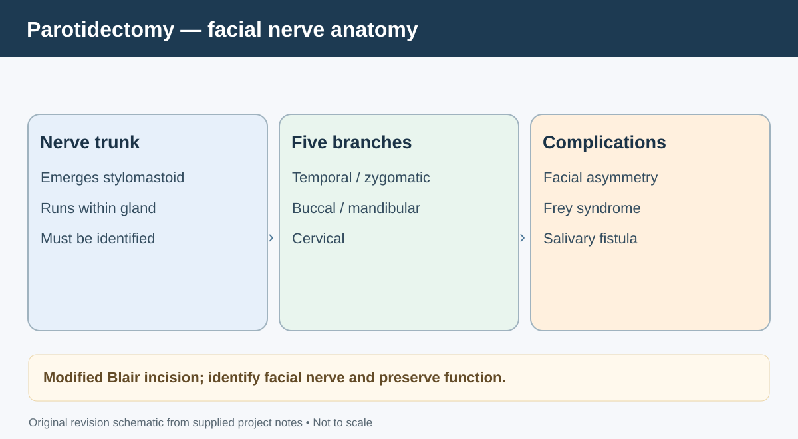
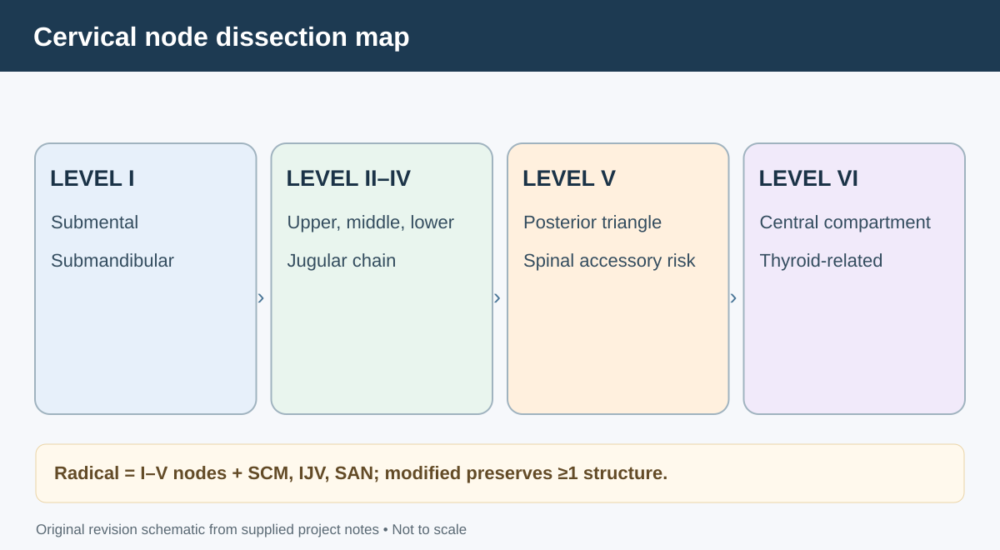

# 08 — Head, Neck and Salivary Gland Surgery

> [!abstract] Scope
> Approach to neck swelling; congenital and developmental neck lesions; cervical lymphadenopathy and carotid-body tumors; salivary anatomy and benign disease; parotid/submandibular neoplasms; oral cancer; cervical nodal levels, neck dissection and complications.
>
> **Study basis:** *World of Revision — Surgery*, printed pp. 51–58 (uploaded PDF pp. 2124–2131); *Pocket Companion to Robbins*, Head and Neck section (uploaded PDF pp. 713–717); supplementary neck-swelling descriptions from uploaded *Doctut Merged*.

## 1. Approach to a neck swelling

### Clinical questions
- **Age and course:** congenital/childhood lesion vs new persistent adult lump; acute tender vs chronic progressive.
- **Site:** midline, anterior border of sternocleidomastoid (SCM), posterior triangle, submandibular region, parotid region, carotid bifurcation.
- **Pain, fever, preceding URTI, TB exposure**, dental/oral symptoms, dysphagia, odynophagia, hoarseness or constitutional symptoms.
- **Change during swallowing or tongue protrusion; cough/straining; meals.**
- Risk factors for head-and-neck SCC: tobacco, alcohol, betel quid/areca nut; prior radiation and immunosuppression.
- Red flags: enlarging firm/fixed swelling, cranial nerve signs, persistent adult cystic neck mass, ulcerated oral lesion, unexplained unilateral ear symptoms or swallowing/voice disturbance.

### Focused examination
1. Inspect site, size, shape, scars, skin color, pulsation and movement.
2. Palpate tenderness, temperature, consistency, margins, fluctuation, fixity and multiplicity.
3. Ask patient to **swallow** and then **protrude tongue**.
4. Assess transillumination or cough impulse where indicated; **do not manipulate a pulsatile mass aggressively**.
5. Full oral cavity/oropharyngeal examination and dental assessment.
6. Examine parotid duct opening, submandibular floor of mouth, thyroid, regional nodes and cranial nerves (especially VII, X, XI, XII).
7. Consider flexible nasopharyngolaryngoscopy when malignancy or deep head-neck pathology is possible.

### Differential by clinical pattern
| Pattern | Classic examples | Distinguishing feature |
|---|---|---|
| Midline, moves on tongue protrusion | **Thyroglossal duct cyst** | Near hyoid / embryonic tract |
| Midline, moves with swallowing but not tongue | Thyroid enlargement | Thyroid gland |
| Lateral anterior SCM in younger patient | **Branchial cleft cyst** | Usually second cleft |
| Posterior triangle, soft/transilluminant | Lymphatic malformation (cystic hygroma) | Often early childhood |
| Floor-of-mouth fluctuant swelling | Ranula | Sublingual gland origin |
| Upper neck pulsatile mass | Carotid body paraganglioma | Vascular lesion |
| Neck swelling with cough impulse/air content | Laryngocele | Connected to laryngeal saccule |
| Firm multiple cervical nodes | TB, lymphoma, metastatic carcinoma | Require cause-directed workup |
| Submandibular swelling with meals | Sialolithiasis | Duct obstruction |
| Preauricular swelling lifting ear lobule | Parotid gland lesion | Facial nerve assessment |

## 2. Congenital and developmental neck lesions

### 2.1 Thyroglossal duct cyst
**Embryology and site**
- Persistent epithelial remnants of the tract along which the thyroid descends from the tongue base to the anterior neck.
- Often **midline**, frequently close to or just below the **hyoid bone**; ectopic lesions may occur along the descent pathway.
- Wall may be lined by squamous or respiratory epithelium; thyroid tissue can be found in wall (Robbins).

**Presentation**
- Soft/fluctuant midline mass, sometimes infected.
- **Moves with deglutition and protrusion of the tongue** because of attachment to the tongue base through the tract.
- Infection may cause pain, redness, discharge or fistula.

**Investigations and operation**
- Ultrasound to characterize lesion and confirm normal thyroid tissue in usual location when relevant.
- Evaluate atypical/solid nodules or malignant concern separately.
- **Sistrunk operation:** excision of cyst + tract + **central segment of hyoid bone**, with dissection toward base of tongue.
- Incision and drainage is reserved for managing acute suppuration when necessary; **definitive management is not simple cyst drainage** because recurrence/fistula may result.
- Rare malignancy: typically papillary thyroid carcinoma arising in thyroglossal remnant.

### 2.2 Branchial cleft cyst, sinus and fistula
**Embryology**
- Failure of normal obliteration of part of the branchial apparatus.
- **Second branchial cleft anomaly** is the common classic lesion.

**Clinical presentation**
- Smooth, usually painless **lateral neck swelling near anterior border of SCM**, often more apparent after URTI.
- Can become infected; a sinus has an external or internal opening, and a complete fistula communicates between surfaces.
- The classic second cleft tract courses toward the tonsillar fossa in relation to the carotid bifurcation and pharyngeal wall.
- Robbins: wall lined by **stratified squamous or pseudostratified respiratory-type epithelium** with lymphoid tissue.

**Evaluation**
- Ultrasound; CT/MRI where tract anatomy, deep extension, recurrence or malignancy is a concern.
- In adults, a cystic lateral neck mass must not automatically be labeled congenital: **cystic metastatic nodal disease** is an essential differential.
- Control infection before elective definitive excision when feasible.

**Treatment**
- **Complete removal of cyst and tract** to reduce recurrence.
- Long fistulas may require **step-ladder incisions** along SCM to follow the tract safely.
- Protect carotid sheath structures, cranial nerves and pharynx.

| Feature | Thyroglossal cyst | Branchial cleft cyst |
|---|---|---|
| Site | Usually midline/hyoid region | Usually lateral, anterior SCM |
| Embryologic origin | Thyroid descent tract | Branchial remnant |
| Moves on swallowing | Often | Usually not characteristic |
| Moves on tongue protrusion | **Yes** | **No** |
| Operation | **Sistrunk** | Complete cyst/tract excision |

### 2.3 Lymphatic malformation / cystic hygroma
- Congenital abnormal lymphatic spaces; classically soft, compressible, multiloculated swelling in **posterior triangle**.
- Can be detected on antenatal imaging; associated with certain chromosomal syndromes.
- Large lesions can compromise airway/swallowing.
- **Sclerotherapy** (agent selection in specialist care; examples in source include OK-432/Picibanil and bleomycin) is important for selected lesions.
- Surgery considered when indicated, but infiltrative relationship to nerves/vessels can make complete resection difficult.

### 2.4 Dermoid cyst
- Developmental lesion associated with embryologic fusion lines; commonly soft/doughy/fluctuant.
- Depending on location, imaging may be needed to exclude deep or intracranial extension.
- **Complete excision** is typical definitive treatment.

### 2.5 Laryngocele
- Dilatation of the laryngeal saccule; can present as air-containing swelling in upper lateral neck, related to cough/straining.
- May increase in size with Valsalva/cough and show air on imaging.
- Differentiate from a cystic lymph node or branchial cyst.
- Management depends on size, symptoms, infection and internal/external component; address underlying laryngeal lesion where indicated.

### 2.6 Carotid body tumor (paraganglioma)
- Slow-growing vascular neuroendocrine lesion arising at **carotid bifurcation**.
- May displace internal and external carotid arteries; evaluation is vascular imaging, not blind needle biopsy.
- Robbins describes **zellballen** histologic pattern.
- Consider syndromic/multifocal disease and biochemical catecholamine evaluation where indicated.
- Management individualized by size, symptoms, operative risk and growth; surgery and/or surveillance in specialist centers.

### 2.7 Cervical tuberculous lymphadenitis
- Important cause of chronic cervical nodes in India in the uploaded surgery notes.
- May produce **cold abscess**, matted nodes and **collar-stud abscess**; inflammation may be minimal.
- Establish microbiologic/pathologic diagnosis where possible.
- Drug treatment is the core therapy for drug-susceptible TB; selected abscesses need drainage/aspiration according to location and diagnostic/therapeutic needs.
- Avoid indiscriminate incision that may lead to chronic sinus/fistula.

## 3. Salivary gland anatomy and examination

### Major glands and ducts
| Gland | Important anatomy | Main presentation |
|---|---|---|
| **Parotid** | Stensen duct; facial nerve traverses gland and divides superficial/deep surgical compartments | Preauricular/angle-of-mandible swelling; ear lobe lifted |
| **Submandibular** | Wharton duct; intimate relation to lingual and hypoglossal nerves | Submandibular or floor-of-mouth swelling, often meal-related |
| **Sublingual** | Multiple small ducts and proximity to floor-of-mouth structures | Ranula |
| Minor salivary glands | Throughout oral mucosa | Small local mass/ulceration; higher malignancy proportion |

### Examination
- **Parotid:** inspect preauricular region, angle of mandible and ear lobule; palpate for deep-lobe extension (tonsillar fossa displacement); examine facial nerve in all divisions.
- **Submandibular:** bimanual palpation (one hand in floor of mouth and one below mandible); examine Wharton duct for stone/pus.
- Look for discharge from duct orifice, pain with meals, trismus, fixation, cervical nodes or facial weakness.
- **Facial weakness accompanying parotid mass** is a high-risk finding for invasive malignancy.

## 4. Benign salivary gland conditions

### 4.1 Sialadenitis and parotitis
- Inflammation may be viral (e.g., mumps), bacterial, autoimmune or obstruction-related.
- Obstruction → decreased salivary flow → secondary infection, often with staphylococci or streptococci.
- Features: painful enlarged gland, erythema, ductal purulence and sometimes fever.
- Management depends on cause: hydration, oral hygiene, sialogogues/massage, analgesia, antibiotics when bacterial, and relieve obstruction.

### 4.2 Sialolithiasis
- **Submandibular** predominates in the uploaded notes.
- Why? Viscous secretion and ductal drainage against gravity favor stasis.
- Typical: **painful swelling during meals** with resolution afterward.
- Stones commonly contain calcium salts.
- Investigations: ultrasound/CT (source emphasizes noncontrast CT) or direct duct imaging/endoscopy.
- Treat with conservative measures, **sialendoscopy and stone retrieval**, duct incision for selected accessible stones, gland excision when required for refractory disease.

### 4.3 Mucocele and ranula
- **Mucocele:** mucus extravasation after minor salivary duct disruption, often lower lip.
- **Ranula:** mucocele arising in **sublingual gland**, appearing as bluish/translucent floor-of-mouth swelling.
- **Plunging ranula:** extends beyond floor of mouth into neck.
- Treatment options: marsupialization in selected cases; **excision of the responsible sublingual gland with management of ranula** is a definitive approach for recurrence.
- Risks: **lingual nerve**, **Wharton duct** and floor-of-mouth injury.

### 4.4 Other causes of xerostomia
- Sjögren syndrome, drugs, prior irradiation, dehydration and age-related changes.
- Chronic dry mouth can cause dental caries, oral candidiasis and swallowing/speech difficulty (Robbins).

## 5. Salivary gland tumors — first principles

### Incidence and malignant probability
- Most tumors occur in **parotid gland**.
- **Parotid tumors are more often benign**, while the relative chance of malignancy rises in smaller glands such as **sublingual and minor salivary glands**.
- **Milan system** categorizes salivary FNAC diagnoses.
- **FNAC** is the routine preoperative sampling modality emphasized by the source.
- Imaging (US/MRI/CT) defines extent, deep-lobe disease, adjacent structures and regional nodal disease.

### Clinical warning signs
- Fast growth, pain, **facial nerve palsy**, fixed mass, skin involvement, trismus, cervical nodes.
- Perineural pain may signal **adenoid cystic carcinoma**, even if the mass grows slowly.
- Avoid unplanned shelling-out of pleomorphic adenoma because microscopic extensions may increase recurrence.

## 6. Benign salivary tumors

### Pleomorphic adenoma (benign mixed tumor)
- **Most common parotid neoplasm**; usually painless, slow-growing and mobile.
- Histology: epithelial/myoepithelial components in variable **myxoid/chondroid/hyaline matrix** (a “mixed” appearance).
- Usually superficial lobe but can involve deep lobe.
- Risk of **local recurrence after inadequate excision**; rare long-term malignant transformation to **carcinoma ex pleomorphic adenoma**.
- **Surgery:** appropriate partial/superficial parotidectomy with facial nerve preservation; operation tailored to site/size.

### Warthin tumor
- **Second common benign parotid tumor** in the supplied revision notes.
- Often older male smoker; **bilateral or multifocal** lesions are characteristic possibilities.
- Histology: double layer of oncocytic epithelial cells over **lymphoid stroma**.
- Management individualized; selected cases can be observed or surgically removed based on diagnosis, symptoms and patient factors.

### Quick comparison
| Finding | Pleomorphic adenoma | Warthin tumor |
|---|---|---|
| Frequency | Commonest benign parotid | Second common benign parotid |
| Behavior | Slow, usually solitary | May be bilateral/multifocal |
| Histology | Mixed epithelial + myxochondroid | Oncocytic double epithelium + lymphoid stroma |
| Main issue | Recurrence/infrequent malignant transformation | Diagnosis and symptom-guided management |

## 7. Malignant salivary tumors

### Mucoepidermoid carcinoma
- **Most common primary malignant salivary gland tumor**.
- Histology: admixture of **mucous, squamoid and intermediate cells**.
- Clinical behavior depends strongly on grade: low-grade can be indolent, high-grade invasive/metastatic.
- Treatment: oncologic gland resection ± nodal management and adjuvant radiotherapy according to grade/stage/margins.

### Adenoid cystic carcinoma
- Characteristic **cribriform “Swiss cheese” histology**.
- **Perineural invasion (PNI)** accounts for pain, deep spread and local recurrence.
- May grow slowly but has potential for late recurrence/metastasis; long-term follow-up is important.

### Carcinoma ex pleomorphic adenoma
- Malignant change in pre-existing pleomorphic adenoma.
- Suggestive changes: **sudden accelerated growth, new pain, fixation, skin change, facial nerve palsy**.
- Requires oncologic evaluation and appropriate surgery ± postoperative radiotherapy.

| Tumor | Characteristic clue |
|---|---|
| Mucoepidermoid | Mucous + squamoid + intermediate cells |
| Adenoid cystic | **Swiss cheese + perineural invasion** |
| Carcinoma ex pleomorphic | Old stable lump becomes rapidly progressive/painful |
| Acinic cell carcinoma | Serous acinar differentiation; often parotid |

## 8. Parotidectomy

### Operative principles
- **Modified Blair / lazy-S incision** is illustrated in the source.
- Elevate flap, identify the facial nerve trunk and follow branches while dissecting tumor-bearing tissue.
- Parotid **superficial** and **total** operations describe extent of gland resection; facial nerve is preserved unless directly involved or oncologically necessary to sacrifice.
- Malignant cases may need **therapeutic neck dissection** and postoperative radiotherapy according to high-risk features (grade, nodes, margins, PNI/LVI, advanced stage).

### Facial nerve branches (terminal)
1. Temporal
2. Zygomatic
3. Buccal
4. Marginal mandibular
5. Cervical

### Major complications
| Complication | Bedside clue |
|---|---|
| Facial nerve injury | Facial asymmetry, eye closure difficulty, drooping mouth |
| Marginal mandibular branch injury | Lower lip asymmetry/drooping angle of mouth |
| Greater auricular nerve injury | Ear/parotid skin numbness |
| Hematoma / wound infection | Neck/facial swelling and wound symptoms |
| Salivary leak / parotid fistula | Salivary drainage from wound |
| **Frey syndrome** | **Gustatory sweating** over parotid region |
| First-bite syndrome | Sharp pain with first bite in some deep parotid/parapharyngeal surgery |

### Frey syndrome — pathophysiology
- Parotidectomy disrupts parasympathetic fibers associated with **auriculotemporal nerve**.
- Aberrant regeneration to sweat glands/skin vessels causes sweating/flushing during eating.
- **Starch–iodine test:** demonstrates gustatory sweating.
- The source lists **botulinum toxin** and historical tympanic neurectomy; botulinum toxin is an important symptomatic treatment option.
- Tissue interposition (e.g., SCM flap) can reduce direct contact between regenerating fibers and skin.

## 9. Submandibular gland excision
- Indications in source: selected gland tumors, recurrent refractory obstruction/infection, and other persistent pathology.
- Gland is palpated **bimanually**.
- Critical structures to preserve:
  - **Marginal mandibular branch of facial nerve**
  - **Lingual nerve**
  - **Hypoglossal nerve**
  - Facial artery and vein
- **Marginal mandibular nerve** is a commonly tested injury leading to lower lip droop.
- Additional risks: wound bleeding, salivary leak and sensory/tongue movement changes.

## 10. Head and neck squamous cell carcinoma

### Oral cavity malignancy and risk factors
- Most oral cavity malignancies are **squamous cell carcinoma**.
- The source emphasizes **gingivobuccal sulcus** as an important common site in India and the **lateral tongue** as a classic general site.
- Risk factors: tobacco, alcohol, betel quid/areca nut, immunosuppression, chronic local irritation.
- Distinguish **HPV-related oropharyngeal SCC** from oral cavity SCC; EBV is associated with nasopharyngeal carcinoma.

### Oral premalignant disease
| Lesion | Key finding |
|---|---|
| **Leukoplakia** | Persistent **white patch that cannot be rubbed off**; biopsy to grade changes |
| **Erythroplakia** | Red patch with particularly high dysplasia/cancer concern |
| Speckled erythroleukoplakia | Mixed red/white lesion, high suspicion |
| Oral submucous fibrosis | Areca/betel association; progressive fibrosis and **restricted mouth opening** |
| Oral lichen planus / chronic hyperplastic candidiasis | Selected variants need assessment for dysplasia |
| Plummer–Vinson syndrome | Iron deficiency + dysphagia + upper esophageal web; increased upper aerodigestive SCC risk |

**Persistent suspicious mucosal lesion → biopsy.**
- The source emphasizes **edge/wedge biopsy** rather than necrotic center.
- Record **depth of invasion (DOI)**; it affects oral cancer staging and management.

### Oral cavity TNM — high-yield T principles
| T | Size/DOI source summary |
|---|---|
| T1 | ≤2 cm and DOI ≤5 mm |
| T2 | ≤2 cm with DOI >5–10 mm, or >2–4 cm with DOI ≤10 mm |
| T3 | >4 cm or DOI >10 mm |
| T4 | Invasion of specified adjacent structures |

- Regional N staging evaluates size, number, laterality and **extranodal extension (ENE)**.
- Distant metastasis is **M1**.
- Definitive stage grouping must use appropriate current TNM edition and primary subsite.

### Primary management
- Surgery is common for resectable oral cancer: wide local resection, selective bony resection if involved, and cervical node management.
- **Composite/“commando” surgery:** resection of oral primary with mandible as needed plus neck dissection; reconstruction is planned to restore speech/swallowing.
- Reconstructive options from source:
  - **PMMC flap** (pectoralis major myocutaneous)
  - **Radial forearm free flap**; assess hand arterial collateral circulation.
  - **Free fibular flap** for mandibular reconstruction.
  - Deltopectoral flap in selected contexts.
- Adjuvant radiotherapy/chemoradiation depend on margin status, ENE, nodal burden, DOI, PNI/LVI and advanced stage.

## 11. Cervical node levels and neck dissection

### Levels
| Level | Principal nodal region | Typical associations |
|---|---|---|
| **I** | Submental (IA) / submandibular (IB) | Anterior oral cavity |
| **II** | Upper jugular chain | Oropharyngeal/oral and many upper neck tumors |
| **III** | Middle jugular chain | Regional spread from upper aerodigestive tract |
| **IV** | Lower jugular chain | Inferior jugular nodes |
| **V** | Posterior triangle | Head/neck and selected cutaneous/other sites |
| **VI** | Central neck compartment | Thyroid/laryngeal/central structures |

### Types of cervical dissection
| Procedure | Lymph nodes | SCM | Internal jugular vein | Spinal accessory nerve (SAN) |
|---|---|---|---|---|
| **Radical neck dissection (RND; Crile)** | Levels I–V | Removed | Removed | Removed |
| **Modified radical I** | Levels I–V | Removed | Removed | **Preserved** |
| **Modified radical II** | Levels I–V | Removed | **Preserved** | **Preserved** |
| **Modified radical III / functional** | Levels I–V | **Preserved** | **Preserved** | **Preserved** |
| **Selective neck dissection** | Only specified levels | Usually preserved | Usually preserved | Usually preserved |
| **Central neck dissection** | Level VI | Preserved when possible | Preserved | Preserved |

- **Supraomohyoid dissection (SOHND):** classically levels **I–III**; extended version may include IV.
- The source shows **modified Schobinger incision** for larger dissections.
- **Therapeutic dissection** treats evident nodes; **elective/selective dissection** is performed in selected clinically N0 at-risk regions.
- The selected levels depend on the **primary cancer and its lymphatic drainage**; avoid equating “neck dissection” with mandatory removal of I–V in every patient.

### Non-nodal structures and practical operative concerns
- Marginal mandibular nerve, hypoglossal nerve, lingual nerve, spinal accessory nerve.
- IJV/carotid sheath, vagus, phrenic nerve, brachial plexus.
- Thoracic duct in lower left neck; lymphatic/chyle leak risk.
- Preservation of SAN substantially reduces shoulder morbidity when oncologically possible.

### Complications
| Structure affected | Clinical clue |
|---|---|
| **Marginal mandibular nerve** | Asymmetric lower lip/drooping angle |
| **Spinal accessory nerve** | Shoulder droop, impaired shrug/abduction, trapezius dysfunction |
| Hypoglossal nerve | Tongue deviation to affected side on protrusion |
| Vagus/RLN | Hoarseness, swallowing/airway problems |
| Thoracic duct | **Chylous leak**, especially left lower neck |
| IJV/carotid vessel | Major hemorrhage, rare catastrophic carotid blowout |
| Skin flap | Necrosis/infection |
| Lymphatic obstruction | Neck/facial lymphedema |

## 12. Quick comparison tables

### Characteristic clinical presentations
| Question stem | Strong association |
|---|---|
| Child, central neck swelling that moves on protruding tongue | Thyroglossal duct cyst |
| Young person, painless cyst anterior SCM | Branchial cleft cyst |
| Neonatal posterior triangle transilluminant swelling | Lymphatic malformation |
| Painful gland when eating | Sialolithiasis |
| Painless slow parotid mass | Pleomorphic adenoma |
| Bilateral parotid masses in smoker | Warthin tumor |
| Parotid mass + pain + nerve palsy | Malignancy concern |
| Swiss-cheese histology + perineural invasion | Adenoid cystic carcinoma |
| Salivary tumor with mucus/squamous/intermediate cells | Mucoepidermoid carcinoma |
| Sweating over parotid when eating | Frey syndrome |
| Post-neck dissection shoulder droop | SAN injury |
| Post-submandibular excision lower lip weakness | Marginal mandibular injury |

### Operations and surgical “magic words”
| Operation | Essential identifying feature |
|---|---|
| **Sistrunk** | Cyst/tract + central hyoid |
| Branchial tract excision | Complete cyst/sinus/fistula tract; step-ladder if needed |
| Superficial parotidectomy | Preserve facial nerve branches |
| Total parotidectomy | Entire gland (facial nerve sacrificed only when needed) |
| Submandibular excision | Protect marginal mandibular, lingual, hypoglossal |
| RND | I–V LN + SCM + IJV + SAN |
| Functional neck dissection | I–V nodal clearance while preserving SCM/IJV/SAN |
| SOHND | Levels I–III |
| Central neck dissection | Level VI |
| Free fibular flap | Mandibular defect reconstruction |

## 13. Exam traps and clinical cautions
- **Not every adult lateral cystic neck mass is a benign branchial cyst**; exclude occult metastatic disease.
- **A thyroglossal cyst moves on tongue protrusion**; a thyroid mass typically does not.
- **Branchial cyst** and **branchial fistula** are different; complete fistula may have tract to pharynx.
- **Pulsatile neck mass** needs vascular evaluation; avoid blind aspiration.
- **Sialolithiasis = meal-time pain**; **salivary tumor = persistent mass**.
- **Parotid tumor + facial nerve weakness** is concerning for invasive malignant disease.
- **Warthin** can be bilateral; **pleomorphic adenoma** most common benign tumor.
- **Adenoid cystic** has marked **perineural invasion** and often late recurrence.
- **Frey syndrome** = auriculotemporal autonomic misdirection, not primary facial-nerve paralysis.
- **SAN loss** results in marked shoulder disability after RND; preservation is central to MRND.
- **ENE** is a key adverse pathologic feature guiding postoperative oncologic treatment.

## 14. Completion checklist
- [ ] Classify a neck swelling by location and movement.
- [ ] Explain embryology and operative differences of thyroglossal vs branchial cyst.
- [ ] Recognize lymphatic malformation, dermoid, laryngocele and carotid body tumor.
- [ ] Differentiate TB nodes from cystic metastatic nodes.
- [ ] Localize Stensen and Wharton ducts; examine parotid and submandibular glands.
- [ ] Distinguish sialadenitis, stone, mucocele and ranula.
- [ ] Compare pleomorphic adenoma, Warthin, mucoepidermoid, adenoid cystic and carcinoma ex pleomorphic.
- [ ] Describe parotidectomy incision, facial nerve branches and Frey syndrome.
- [ ] Identify the three major nerves at risk in submandibular excision.
- [ ] Define oral SCC risk factors and DOI-based T staging.
- [ ] Locate levels I–VI and compare radical, modified radical, selective and central neck dissections.
- [ ] Recognize marginal mandibular, spinal accessory and thoracic duct injuries.

---
**Project sources:** *World of Revision* (Surgery/Oral Cancer and Salivary Glands, PDF pp. 2124–2131); *Pocket Companion to Robbins and Cotran* (Head and Neck, PDF pp. 713–717); *Doctut Merged* (Branchial cysts/neck dissection sections). **Images:** original study schematics in adjacent assets folder.
