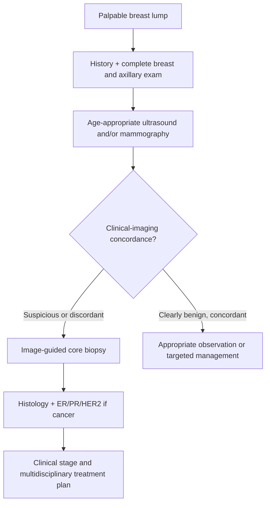
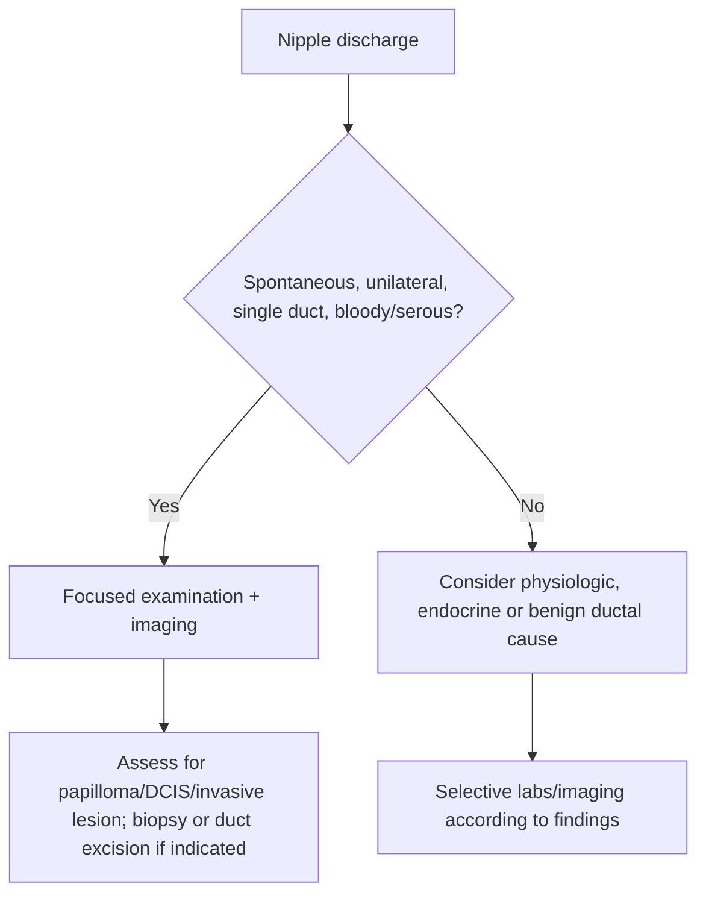

# 08. Breast Surgery

> [!abstract] Scope
> Surgical anatomy → triple assessment → breast imaging/cytology → benign breast conditions → breast cancer pathology and molecular subtypes → staging → breast/axillary surgery → systemic and radiotherapy → special situations. **Source-consolidated exam notes**; clinical guidelines and drug regimens may change.

## 1. Surgical anatomy and examination

### Development and topography
- Mammary gland: modified sweat gland with **15–20 lobes** drained by major lactiferous ducts; lobes contain terminal duct–lobular units (TDLUs), where many proliferative lesions and carcinomas arise.
- Extends approximately **2nd–6th ribs**, from sternum toward midaxillary line; superolateral extension = **axillary tail of Spence**.
- **Cooper suspensory ligaments** tether skin to supporting fascia; shortening by fibrosis/tumor produces **dimpling**.
- **Retromammary space** separates breast from pectoral fascia; fixation to chest wall suggests locally advanced extension.
- **Lymphatic drainage:** axillary nodes (predominant), internal mammary/parasternal nodes and other regional pathways. Upper outer quadrant is frequently affected because of greater tissue volume.
- Axillary nodal levels relative to **pectoralis minor**: **I lateral**, **II posterior**, **III medial**.
- Chest-wall muscles and nerves relevant to dissection: pectoralis major/minor; **long thoracic nerve** (serratus anterior → winged scapula), **thoracodorsal nerve** (latissimus dorsi), **intercostobrachial nerve** (medial upper-arm sensation), medial/lateral pectoral nerves.

### Clinical examination
1. **History:** age, duration, growth, pain and menstrual variation, pregnancy/lactation, trauma/infection, nipple discharge (spontaneous/expressed, single/multiple ducts, color), previous irradiation/biopsy, cancer family history (both maternal and paternal branches).
2. **Inspection:** sitting and arms at sides/raised/pressed to hips; asymmetry, contour changes, scars, nipple deviation or retraction, skin erythema/ulceration, edema.
3. **Palpation:** all quadrants and axillary tail systematically; record size, quadrant or clock-face position and distance from nipple, margins, surface, mobility, consistency, tenderness, skin/deep fixation.
4. **Nodes:** axillary, supraclavicular, infraclavicular; examine contralateral breast.
5. **Special:** nipple expression only when clinically appropriate; inspect nipple–areolar complex for eczema-like lesion.

| Sign | Mechanism | Examination association |
|---|---|---|
| Skin dimpling | Cooper ligament tethering | Underlying desmoplastic carcinoma |
| Nipple retraction | Shortening of involved lactiferous ducts | Carcinoma; can occur with chronic duct disease |
| **Peau d’orange** | Dermal lymphatic obstruction → skin edema around follicles | Locally advanced/inflammatory breast cancer |
| New acquired nipple inversion | Fibrosis, malignancy or inflammatory process | Needs evaluation |
| Fixation to chest wall | Invasion of deep structures | T4a when actual chest-wall involvement |
| Inflamed red breast without lactation | May simulate mastitis | Exclude inflammatory carcinoma |

> [!tip] Dimpling ≠ retraction ≠ peau d’orange
> The **structure involved** differs: Cooper ligament / duct / subdermal lymphatic respectively.

## 2. Triple assessment: clinical + imaging + tissue

**Triple assessment** means:
1. Clinical assessment.
2. Breast imaging suited to age, density and clinical setting.
3. Pathological assessment when indicated.

Concordance matters. A suspicious physical mass must be investigated even if imaging appears benign.

### Imaging

| Modality | Role and classic exam findings |
|---|---|
| **Ultrasound** | Frequently initial imaging in younger/pregnant patients; distinguishes cystic from solid; guides aspiration/biopsy; surveys axilla |
| **Mammography** | Standard craniocaudal (**CC**) and mediolateral oblique (**MLO**); MLO includes more axillary tail; spiculated mass/architectural distortion and suspicious microcalcifications |
| **Breast MRI** | High-risk evaluation, implants, selected extent-of-disease questions, assessing treated breast where indicated; source associates intracapsular rupture with **linguine sign** |
| **Image-guided core biopsy** | Preferred for tissue architecture and receptor studies; stereotactic biopsy often used for calcifications visible only on mammography |
| **PET/CT or cross-sectional staging** | Selected higher-stage or symptomatic disease, **not routine for every early breast lump** |

**Characteristic images** in source:
- **Popcorn calcification** → involuting/calcified fibroadenoma.
- **Spiculation** → high suspicion for malignancy.
- Fine pleomorphic/clustered microcalcifications → consider **DCIS**.
- Implant rupture: intracapsular = **stepladder** appearance by US and **linguine** on MRI; extracapsular silicone can produce **snowstorm** appearance on US.

### BI-RADS

| BI-RADS | Meaning | Next step (general) |
|---|---|---|
| 0 | Incomplete | Additional imaging or comparison |
| 1 | Negative | Routine indicated screening |
| 2 | Benign | Routine indicated screening |
| 3 | Probably benign, malignancy <2% | Short-interval imaging follow-up, often ~6 months |
| 4A | Low suspicion | Tissue diagnosis; risk >2–10% |
| 4B | Moderate suspicion | Tissue diagnosis; risk >10–50% |
| 4C | High suspicion | Tissue diagnosis; risk >50–<95% |
| 5 | Highly suggestive of malignancy (≥95%) | Tissue diagnosis |
| 6 | Known biopsy-proven malignancy | Treatment planning/response assessment |

**Biopsy techniques**
- **FNAC:** cytology; useful in selected circumstances, but cannot reliably establish invasion versus in-situ disease and lacks full architectural information.
- **Core (Tru-cut) needle biopsy:** preserves architecture and usually supports **ER, PR, HER2**, grade and other markers.
- **Vacuum-assisted biopsy/excision:** percutaneous sampling/removal of selected small lesions.
- **Stereotactic core biopsy:** useful for mammographic microcalcifications.
- **Punch biopsy:** skin/nipple involvement, including suspected Paget disease.
- Incisional/excisional biopsy: selected situations; biopsy tract planning matters.

### Screening note
Marrow's Breast section describes annual mammography at 40 for average risk and additional MRI for high-risk groups. **Screening age and frequency are society- and country-dependent**; do not interpret an American exam-source threshold as a universal Indian clinical mandate.

## 3. Benign breast disorders

### Developmental and physiologic
- **Accessory breast/nipple:** persistence along embryonic milk line; may swell with hormonal changes and can develop ordinary breast pathology.
- **Mastalgia:** cyclic/bilateral/diffuse often hormonal; focal noncyclic pain can reflect cyst, infection, trauma, chest wall cause.
- **Gynecomastia:** concentric, rubbery subareolar enlargement in men due to altered estrogen-androgen balance; physiologic in puberty, associated with cirrhosis, Klinefelter syndrome, medications or endocrine tumors. Differentiate from eccentric hard male breast carcinoma.

### Fibroadenoma
- Common benign **fibroepithelial** tumor in younger women; **breast mouse**: smooth, rubbery, highly mobile.
- Arises from intralobular stroma with accompanying ductal epithelium.
- **Pericanalicular:** stromal proliferation around patent round ducts.
- **Intracanalicular:** proliferating stroma compresses ducts into slit-like spaces.
- US frequently shows well-circumscribed oval solid mass; old involuting lesions may develop **popcorn calcifications**.
- Management depends on imaging-pathology concordance, size, growth, symptoms and concern for phyllodes; observation or excision/vacuum-assisted removal as selected.

### Phyllodes tumor
- Another fibroepithelial tumor, with **leaf-like architecture** and increased stromal cellularity.
- Usually presents at older age than fibroadenoma, with **rapid enlargement**, occasionally prominent surface veins.
- Graded **benign, borderline or malignant** by stromal cellularity/atypia, mitoses, overgrowth and margins.
- Malignant phyllodes tends to spread **hematogenously**, classically to lung; nodal spread uncommon.
- Primary treatment: **surgical excision with adequate clear margins**, with mastectomy when necessary for control; routine axillary dissection is generally not part of the approach.
- **Distinction:** fibroadenoma = circumscribed young woman's mobile mass; phyllodes = growing larger stromal lesion requiring margin-conscious surgery.

### Fibrocystic and proliferative changes

| Pathology category (Robbins) | Examples | Subsequent cancer-risk association |
|---|---|---|
| Nonproliferative | Simple cysts, fibrosis, apocrine changes | Little/no elevation |
| Proliferative without atypia | Usual ductal hyperplasia, papilloma, sclerosing adenosis | About **1.5–2×** |
| Proliferative with atypia | Atypical ductal or lobular hyperplasia | About **4–5×** |

- **Fibrocystic change:** cyclic mastalgia and nodularity; common and usually benign.
- Cysts: simple (thin wall, fluid, no solid component) versus complicated (internal debris) versus complex cystic-solid lesion (solid component requiring evaluation).
- **Sclerosing adenosis** can mimic carcinoma radiologically/pathologically.
- **Fat necrosis:** after trauma/surgery; palpable mass, skin changes and calcification may mimic cancer; histology evolves through fat-cell destruction and chronic macrophage/giant-cell response.
- **Mondor disease:** superficial thrombophlebitis of chest-wall/breast veins → tender cord; generally self-limited, evaluate for an underlying cause where appropriate.

### Mastitis, abscess and periductal disease
- **Lactational mastitis:** milk stasis/nipple fissuring and bacterial infection, commonly *Staphylococcus aureus*; pain, erythema, fever. Antimicrobial therapy when bacterial, continued effective breast emptying and analgesia.
- **Breast abscess:** fluctuant painful focus or image-confirmed pus; ultrasound-guided aspiration/drainage, antibiotics and follow-up; formal incision/drainage in selected refractory/large/complex cases.
- **Periductal mastitis / recurrent subareolar abscess (Zuska disease):** smoking association; squamous metaplasia → keratin plug → duct rupture → inflammation/fistula; recurrent disease may require duct/fistula excision.
- **Mammary duct ectasia:** dilated large ducts with inspissated secretion and chronic inflammation, often green/brown/sticky discharge; can produce subareolar mass and nipple inversion. Robbins differentiates duct ectasia from smoking-associated squamous metaplasia/abscess.
- **Granulomatous mastitis:** consider infection (TB), systemic inflammation and idiopathic granulomatous lobular mastitis; tissue diagnosis and infectious exclusion before immunosuppression.
- **Inflammatory breast cancer:** can mimic mastitis; consider particularly in a nonlactating patient with diffuse red edematous breast, no resolution or rapid progression.

### Nipple discharge: approach

| Discharge | Key possibilities | Next step |
|---|---|---|
| Bilateral, multiduct, milky | Physiologic, pregnancy/lactation, hyperprolactinemia, drugs, hypothyroidism | Pregnancy test/endocrine workup as indicated |
| Green/brown, sticky, multiduct | Duct ectasia | Examine and image if pathological features |
| **Unilateral spontaneous single-duct bloody/serous** | Intraductal papilloma, DCIS/carcinoma | Triple assessment and targeted biopsy |
| Eczematous, eroded nipple | Paget disease versus dermatitis | Nipple/skin biopsy when suspicious |

- **Solitary central intraductal papilloma:** fibrovascular core in major duct; classic **bloody nipple discharge**; localized duct excision (**microdochectomy**) may be used.
- **Multiple/peripheral papillomas:** greater association with atypia and other proliferative lesions.
- **Hadfield operation:** major duct excision for selected extensive/recurrent central duct disease.
- **Paget disease**: eczema-like unilateral nipple change; large pale malignant Paget cells in epidermis; investigate underlying DCIS/invasive cancer.

## 4. Breast cancer: pathogenesis, genetics, morphology

### Risk factors
- Increasing age, prolonged cumulative estrogen exposure (early menarche, late menopause), nulliparity/late first birth, certain menopausal hormone therapy, alcohol, radiation, personal proliferative atypia and prior breast cancer.
- Inherited susceptibility: **BRCA1, BRCA2**, also **TP53, PTEN, CHEK2** and others. Paternal family history matters.
- Breastfeeding and physical activity are protective associations.
- Risk may differ by menopausal status and tumor receptor class.

### Histologic entities

| Lesion | Key characteristic |
|---|---|
| **DCIS** | Neoplastic ductal epithelium **confined by basement membrane** with myoepithelial layer preserved; mammographic microcalcifications common; comedo-type central necrosis possible |
| **LCIS** | Lobular neoplasia, **E-cadherin loss**, frequently incidental, can be bilateral/multicentric; marker of increased risk and non-obligate precursor |
| **Invasive ductal carcinoma / NST** | Most common invasive form; desmoplastic stroma, variable grade |
| **Invasive lobular carcinoma** | Discohesive **single-file (Indian file)** cells; loss of E-cadherin; may be multifocal |
| **Paget disease** | Malignant cells infiltrating nipple epidermis, usually associated with underlying duct carcinoma |
| **Inflammatory breast carcinoma** | Rapid red swollen breast with **dermal lymphatic tumor emboli**; clinically T4d |
| Tubular, mucinous, medullary-pattern and other special subtypes | Characteristic histology and prognostic differences; context-specific |

**Pathology mechanism:** in situ carcinoma retains the basement membrane / peripheral myoepithelial cell barrier; invasive carcinoma breaches it and infiltrates stroma, opening routes for lymphovascular spread.

### Receptor testing and molecular patterns
- **ER/PR:** nuclear immunostaining. The Marrow source refers to an **Allred score 0–8**.
- **HER2 IHC:** 0/1+ negative; 2+ equivocal → assess amplification using ISH/FISH; 3+ positive.
- **Ki-67:** proliferative index; thresholds and subtype definitions vary by context.

| Approximate clinical surrogate | ER | PR | HER2 | Proliferation | Key implication |
|---|---|---|---|---|---|
| Luminal A-like | + | Usually + | − | Lower | Endocrine-responsive; generally favorable |
| Luminal B-like | + | Variable | − or + | Higher | More proliferative; systemic therapy decisions individualized |
| HER2-enriched phenotype | Usually − | Usually − | + | Variable | HER2-targeted treatment relevant |
| **Triple-negative** | − | − | − | Often high | Chemotherapy central; often aggressive biology |
| Basal-like molecular class | Often triple-negative | — | — | Variable | Overlaps but is **not identical** to clinical TNBC |

> [!important] Source reconciliation
> The older quick-review table pairs "basal-like = triple-negative", but these are **overlapping, not interchangeable** classifications. The labels are retained as exam terminology.

### Hereditary syndromes
- **BRCA1:** often associated with triple-negative phenotype and hereditary breast/ovarian cancer.
- **BRCA2:** breast/ovarian risk plus notable male breast, pancreatic and prostate cancer associations.
- **Li–Fraumeni:** TP53, early varied cancers.
- **Cowden:** PTEN, breast/thyroid/endometrial manifestations.
- Consider genetic counseling/testing in strong family patterns, unusually young breast cancer, bilateral disease, TNBC, male breast cancer, and relevant ovarian/pancreatic/prostate histories.

## 5. Breast cancer staging — surgical essentials

### T category (core examination framework)
- **Tis:** in-situ disease (DCIS; Paget without invasive component).
- **T1:** ≤2 cm.
- **T2:** >2 to ≤5 cm.
- **T3:** >5 cm.
- **T4a:** chest-wall invasion.
- **T4b:** skin ulceration, ipsilateral satellite skin nodules or edema including peau d'orange.
- **T4c:** T4a + T4b.
- **T4d:** inflammatory breast carcinoma.

**Important:** skin dimpling or nipple retraction alone is not sufficient to classify T4. Breast size does not by itself change staging unless T threshold or qualifying extension is present.

### Regional nodal overview
- **N0:** no regional metastasis.
- **N1:** classically movable ipsilateral axillary nodes.
- **N2:** fixed/matted ipsilateral axillary nodes or designated internal mammary involvement.
- **N3:** more extensive regional nodes including infraclavicular or supraclavicular nodes and combinations.
- **M1:** distant metastasis.

Clinical versus pathological N categories and treatment-response notation differ: **cTNM, pTNM and yc/ypTNM**.

**Routes of distant spread:** skeleton (vertebrae), liver, lungs, brain; histologic subtype influences patterns.

## 6. Operative management of primary breast cancer

### Breast-conserving surgery (BCS)
- Also termed **wide local excision / lumpectomy**, with histologic margin assessment.
- Frequently followed by **whole-breast irradiation** where indicated.
- When properly selected with indicated adjuvant therapy, long-term survival is broadly comparable with mastectomy.
- **Technical concerns/contraindications:** diffuse malignant calcification/multicentric disease not amenable to acceptable excision, persistently involved margins, inability to receive indicated RT, unfavorable tumor-to-breast size ratio, selected pregnancy timing and patient preference.
- **Oncoplastic surgery:** volume displacement or replacement using nearby tissue/flaps to preserve contour.

> [!warning] Margin wording discrepancy
> Marrow's notes say a "1-mm margin". That should not be applied indiscriminately to every invasive cancer, DCIS, or neoadjuvant setting: definitions depend on histology and multidisciplinary guidance.

### Mastectomy types

| Operation | Breast | Pectoral muscles | Axilla |
|---|---|---|---|
| Simple/total | Breast ± nipple–areolar complex as planned | Preserve | No formal clearance unless separately indicated |
| **Modified radical (MRM)** | Breast and nipple–areolar complex | Major preserved; minor may be preserved/retracted depending technique | Axillary dissection |
| Classical radical (Halsted) | Breast | Pectoralis major and minor removed | Full axillary clearance |
| Skin-sparing / nipple-sparing | Selected skin/NAC preservation | Preserve | Nodal surgery separately based on indication |

Routine radical Halsted operation is historically important but largely replaced by less mutilating approaches.

### Sentinel lymph-node biopsy (SLNB)
- **Sentinel node:** first node(s) draining the primary tumor region; nodal status helps determine further treatment.
- Mapping: **blue dye**, **Tc-99m radiocolloid with gamma probe**, **indocyanine green (ICG)** and combinations.
- Selected clinically node-negative breast cancers undergo SLNB; indications after neoadjuvant therapy depend on pretreatment nodal stage, response and technique.
- Axillary dissection is not automatic after every positive sentinel node; tumor burden, surgery type, irradiation and systemic therapy affect decisions.

### Axillary lymph-node dissection
- Levels I/II typical therapeutic targets, level III in selected extensive disease.
- Preserve long thoracic and thoracodorsal nerves, assess intercostobrachial nerve where feasible.
- Complications:
  - **Seroma** (frequent early).
  - **Lymphedema** of arm (risk rises with more extensive nodal surgery/RT).
  - Intercostobrachial neuropathy → sensory loss medial upper arm.
  - Long thoracic injury → winging scapula.
  - Thoracodorsal injury → impaired latissimus dorsi function.
  - Infection, hematoma, restricted shoulder movement.
- Long-standing post-therapy lymphedema rarely predisposes to lymphangiosarcoma (**Stewart–Treves syndrome**).

### Reconstruction
- Immediate or delayed, with implants or autologous tissue.
- **TRAM flap:** transverse rectus abdominis myocutaneous; possible abdominal-wall morbidity.
- **DIEP flap:** deep inferior epigastric perforator; generally spares rectus muscle.
- **Latissimus dorsi flap:** useful regional flap in selected reconstruction.
- Consider prior/planned radiotherapy, perfusion, body habitus and patient preference.

## 7. Systemic treatment and radiotherapy

### Neoadjuvant therapy
- Preoperative systemic treatment can downstage primary and nodal disease, assess biologic response and increase feasibility of conservation.
- Source indications include **locally advanced disease**, sizable HER2-positive/TNBC, and desire for downstaging.
- Response can be followed clinically and by imaging; pathology determines residual disease and complete response.
- Surgical and systemic plans depend heavily on receptor status and stage.

### Adjuvant therapies

| Modality | Common basis | Examples/source concepts |
|---|---|---|
| Chemotherapy | Higher recurrence risk, subtype, stage and molecular test result | Anthracycline/taxane-based approaches described in broader sources |
| HER2-targeted | Confirmed HER2-positive disease | Trastuzumab mentioned in Doctut notes |
| Endocrine | **ER-positive** tumor | Tamoxifen (SERM) or aromatase inhibitor such as letrozole/anastrozole in appropriate menopausal setting |
| Radiotherapy | Usually after BCS; selected postmastectomy/regional-node situations | Reduces local/regional recurrence |

**Endocrine therapy effects:** tamoxifen can produce hot flashes, venous thrombosis and endometrial effects; aromatase inhibitors produce bone loss/arthralgia → assess skeletal health. Duration is individualized rather than one universal number.

**Gene expression tests** in selected ER+/HER2− early breast cancer: **Oncotype DX**, **MammaPrint** and other available assays help chemotherapy decisions in a defined clinical context.

## 8. Special breast cancer situations

### Ductal carcinoma in situ (DCIS)
- Noninvasive duct-confined lesion, frequently detected as **microcalcifications**.
- Morphologic variants include comedo, cribriform, micropapillary, papillary and solid forms.
- Management may include BCS plus irradiation or mastectomy for extensive/diffuse disease; sentinel biopsy may be considered when mastectomy is planned or invasion suspected.
- **Van Nuys index:** age, size, margin and grade/necrosis, historically used for local risk stratification.

### Lobular neoplasia / LCIS
- Frequently incidental, bilateral and multicentric; **loss of E-cadherin**.
- Classic LCIS functions as a risk marker and non-obligate precursor; management and excision depend on subtype, extent and imaging-pathology concordance.
- Do not equate classic LCIS with invasive cancer.

### Paget disease of nipple
- Unilateral stubborn eczematous/erosive nipple; **biopsy** demonstrates large pale Paget cells in epidermis.
- Evaluate entire breast for occult DCIS or invasive carcinoma.
- Surgery based on extent and associated tumor, with appropriate RT/axillary assessment.

### Inflammatory breast cancer
- Rapid erythema, diffuse edema, warmth and peau d'orange; dermal lymphatic involvement; **T4d**.
- **Systemic therapy generally precedes surgery**, followed by appropriate local-regional therapy.

### Male breast cancer
- Around **1%** of breast cancers; BRCA2, Klinefelter syndrome, liver disease, radiation and family history are associations.
- Usually subareolar mass, nipple changes/discharge; assess with imaging and core biopsy.
- Frequently ER-positive; management uses surgery and receptor-driven systemic treatment.

### Breast cancer during pregnancy
- Imaging with targeted US and biopsy when indicated.
- Timing of surgery, chemotherapy and RT depends on trimester, fetal safety and stage; radiotherapy and endocrine treatment are generally deferred until after pregnancy. Multidisciplinary approach is mandatory.

## 9. Clinical problem-solving algorithms

### New palpable breast lump

### Spontaneous nipple discharge

## 10. Rapid revision: classic examination clues
- **Breast mouse** → fibroadenoma.
- **Popcorn calcification** → involuting fibroadenoma.
- **Rapid large leaf-like stromal lesion** → phyllodes tumor.
- **Bloody spontaneous single-duct discharge** → intraductal papilloma until appropriately evaluated.
- **Green sticky multiduct discharge** → duct ectasia.
- **Recurrent periareolar abscess + smoker** → squamous metaplasia / Zuska disease.
- **Peau d'orange** → subdermal lymphatic obstruction.
- **Orphan...?** Not a breast sign: reserve for papillary thyroid carcinoma.
- **Single-file invasive cells + E-cadherin loss** → invasive lobular carcinoma.
- **Pleomorphic microcalcifications** → suspect DCIS.
- **Serratus anterior paralysis** → long thoracic nerve injury.
- **Medial arm numbness after axillary surgery** → intercostobrachial nerve injury.
- **Chronic upper-limb lymphedema + violaceous nodules** → Stewart–Treves.
- **Unilateral nipple eczema refractory to treatment** → biopsy for Paget disease.

## Source map
- *World of Revision (Marrow, Surgery, 2025)*, breast printed pp. **23–35** (PDF pp. 2096–2108).
- *Pocket Companion to Robbins and Cotran, 9th ed.*, Breast: **book pp. 1044 onward** (uploaded PDF pp. ~960–979); used particularly for pathogenesis, fibrocystic categories, inflammation and histologic distinctions.
- *Doctut Merged* and *First Aid for USMLE Step 1 (2025)*: cross-checking of histology, genes, classic clues and management terminology.
- See [Source Concordance and Corrections](12_Source_Concordance.md).
