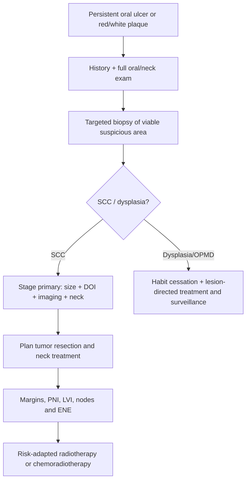
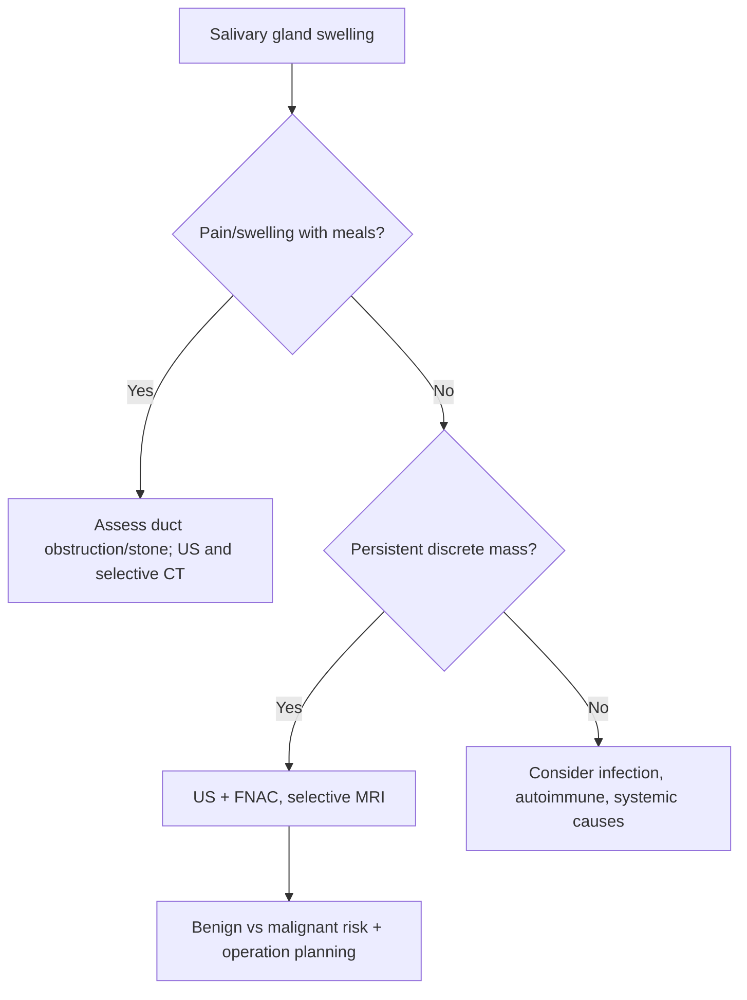

# 11. Oral Cancer, Salivary Gland and Neck Surgery

> [!abstract] Scope
> Oral cavity surgical anatomy, potentially malignant disorders, SCC diagnosis/staging, neck dissection, reconstruction; salivary anatomy and infections, stones, cysts, tumors, parotid/submandibular surgery and neck-swelling differential. This is **not** the gastrointestinal surgery section.

## 1. Oral cavity anatomy and lymphatic drainage

### Regions
- **Oral cavity:** lips, anterior two thirds of tongue, floor of mouth, buccal mucosa, alveolar ridge/gingiva, retromolar trigone, hard palate.
- **Oropharynx is distinct**: tonsil, base of tongue/posterior third, soft palate and posterior pharyngeal wall.
- This matters because **HPV-related oropharyngeal SCC** has different epidemiology and staging from most tobacco/betel-associated **oral cavity SCC**.
- Indian oral cavity cancer patterns often involve **gingivobuccal sulcus/buccal mucosa** due to smokeless tobacco/areca nut exposure; lateral tongue is a classic high-frequency site in many broader series.
- Oral tongue intrinsic muscles shape tongue; **hypoglossal nerve (XII)** supplies most tongue motor function; lingual nerve carries anterior-tongue general sensation and chorda tympani carries taste.
- Floor of mouth anatomy links surgical resection to **Wharton duct**, **lingual nerve**, **sublingual gland** and **submandibular gland**.

### Regional nodes
- Oral cavity primarily drains to **level I** (submental IA/submandibular IB), **level II**, **level III**, with deeper/more posterior drainage as site and stage warrant.
- Anterior tongue and floor-of-mouth lesions can drain bilaterally, especially when close to midline.

### Neck-node levels

| Level | Anatomical group | Clinical relevance |
|---|---|---|
| IA | Submental | Anterior floor of mouth/lip |
| IB | Submandibular | Oral cavity |
| II | Upper jugular | Oral/oropharyngeal and other head–neck primaries |
| III | Mid-jugular | Progressive cervical nodal spread |
| IV | Lower jugular | More inferior cervical drainage |
| V | Posterior triangle | Selected advanced lateral neck disease |
| VI | Central compartment | Thyroid, laryngeal/tracheoesophageal area |

**Extranodal extension (ENE):** cancer penetrating lymph-node capsule into surrounding soft tissue; adverse prognostic feature influencing adjuvant therapy.

## 2. Oral lesions and malignant transformation

### Oral ulcer: clinical approach
1. History of duration, pain, trauma/ill-fitting denture, tobacco/areca/alcohol, immunosuppression, dysphagia/odynophagia, bleeding, weight loss and neck mass.
2. Inspect whole mucosa, tongue sides/base accessible to exam, gingivobuccal sulcus, floor and palate.
3. Palpate for **induration**, fixation, depth and regional cervical lymphadenopathy.
4. **Persistent nonhealing ulcer, induration or abnormal red/white plaque requires biopsy**, even if painless.
5. Do not mistake traumatic/aphthous candidal lesions for proof of benignity when the course is atypical.

**Other differential diagnoses:** trauma, aphthae, TB, syphilis, fungal lesions, lichen planus, immune lesions and squamous malignancy.

### Oral potentially malignant disorders (OPMD)

| Lesion | Appearance/pathogenesis | Cancer association | Workup |
|---|---|---|---|
| **Leukoplakia** | Persistent **white plaque that cannot be characterized as another disease**, often not scrapable | Dysplasia may be present; risk varies by type/site | **Biopsy**, especially nonhomogeneous/speckled/indurated |
| **Erythroplakia** | Persistent velvety **red plaque** not attributable to another condition | Often high-grade dysplasia or carcinoma | **Urgent biopsy** |
| **Erythroleukoplakia** | Mixed red/white (speckled) plaque | High-risk appearance | Biopsy targeted to suspicious red/indurated area |
| **Oral submucous fibrosis (OSMF)** | Areca nut/betel quid-associated progressive fibrosis | Malignant transformation risk | Biopsy abnormal areas, assess restriction |
| Oral lichen planus | Chronic immune-mediated mucosal inflammation, reticular/erosive forms | Modest but recognized association in selected forms | Confirmation/monitoring, exclude dysplasia |
| Chronic hyperplastic candidiasis | Non-scrapable candidal white lesion | May coexist with epithelial dysplasia | Histology and treat infection |
| Plummer–Vinson syndrome | Iron deficiency + dysphagia + esophageal webs | Upper aerodigestive SCC risk | Treat iron deficiency, investigate dysphagia |

**Candida nuance:** uncomplicated thrush often **scrapes off**, leaving an erythematous base; true leukoplakia is not simply "any white patch".

### Oral submucous fibrosis
- Exposure to **areca nut** induces fibroblast activation and abnormal collagen deposition in lamina propria/submucosa.
- Symptoms: oral burning (spicy food), restricted mouth opening (**trismus**), stiffness, blanching, palpable fibrous bands, poor tongue mobility.
- Complications: difficulty eating/hygiene and increased risk of oral carcinoma.
- Management involves **habit cessation**, nutrition/symptom support, physiotherapy/mouth-opening exercises and selected anti-inflammatory/intralesional therapy or surgical release for severe disease; biopsy suspicious mucosa.
- Examination clue: young or middle-aged areca user with progressive inability to open mouth.

### Oral SCC risk and pathology
- Main associations: tobacco smoked/smokeless, alcohol, areca/betel products, chronic exposure and selected immune factors.
- **HPV-16** is a major causal factor for **oropharyngeal SCC** rather than a dominant cause of classical oral cavity SCC.
- **EBV** is associated with **nasopharyngeal carcinoma**, a different region.
- Molecular changes include **TP53** alterations; multiple pathways of dysplasia → carcinoma.
- Gross: indurated nonhealing ulcer, exophytic/fungating growth or infiltrative submucosal mass.
- Histology: invasive squamous nests, **keratin pearls**, intercellular bridges in well-differentiated tumors; **perineural and lymphovascular invasion** are adverse findings.
- Tumor may spread to tongue muscle, floor of mouth, mandible and regional lymph nodes.

## 3. Diagnosis and staging of oral SCC

### Diagnostic steps
1. Full head/neck examination including oral cavity, cranial nerves and neck levels.
2. **Biopsy** of suspicious lesion (adequate incisional/wedge specimen at **active viable edge** rather than necrotic center); determine histology and differentiation.
3. Imaging **contrast-enhanced CT and/or MRI** of primary and neck to define deep invasion, bone involvement and nodes.
4. Evaluate for additional synchronous aerodigestive primaries in appropriate exposure histories.
5. Determine **tumor depth of invasion (DOI)** histologically/imaging as appropriate; it is not identical to gross tumor thickness.
6. Clinical staging (cTNM), then pathology after surgery (pTNM), including margin status, DOI, PNI, LVI and ENE.

### DOI — key conceptual distinction
- **Tumor thickness:** surface of visible lesion to deepest tumor point.
- **Depth of invasion:** standardized distance from expected basement membrane level of adjacent normal mucosa to the deepest tumor front.
- A flat lesion and an exophytic lesion of equal visible thickness can have **different DOI**.
- DOI contributes to T staging in oral cavity SCC and strongly informs occult nodal metastasis risk.

### Simplified AJCC-style oral cavity T stage (source framework)

| T category | Size / DOI summary |
|---|---|
| **T1** | Tumor ≤2 cm **and DOI ≤5 mm** |
| **T2** | ≤2 cm with DOI >5–10 mm **OR** >2–4 cm with DOI ≤10 mm |
| **T3** | Tumor >4 cm **OR DOI >10 mm** |
| **T4** | Invades qualifying adjacent structures / extensive local disease |

The detailed current T4a/T4b criteria depend on exact structures and staging manual edition. Superficial tooth-socket erosion alone is not equivalent to major mandibular invasion.

### Simplified clinical nodal categories
- **N0:** no regional nodes.
- **N1:** single ipsilateral node ≤3 cm without ENE.
- **N2a:** single ipsilateral node >3–6 cm without ENE.
- **N2b:** multiple ipsilateral nodes ≤6 cm without ENE.
- **N2c:** bilateral/contralateral nodes ≤6 cm without ENE.
- **N3:** large >6 cm node and/or clinically/radiologically overt **ENE**, with appropriate N3a/b distinctions.

> [!important] Staging caveat
> ENE-positive N classification varies with **clinical versus pathological staging**, nodal size and number. Use full AJCC definitions for formal stage assignment; the above is a quick revision summary from the source.

## 4. Treatment of oral squamous carcinoma

### Multidisciplinary goals
- **Clear primary tumor** while conserving speech, swallowing, airway and facial form.
- **Treat regional neck** according to stage and occult spread probability.
- Select **adjuvant radiotherapy or chemoradiotherapy** according to pathologic risks.
- Rehabilitate nutrition, dentition, swallowing, speech and psychosocial function; manage tobacco/areca dependence.

### Primary surgery
- **Wide local excision** with a planned gross surgical margin; final adequacy determined by histopathologic clearance.
- **Partial glossectomy** for resectable oral tongue lesion with appropriate depth/margins.
- **Mandibular resection**:
  - Marginal mandibulectomy when oncologically adequate and mandibular continuity can be preserved.
  - Segmental mandibulectomy when substantial bone invasion requires continuity-defect resection.
- **COMmando procedure** (classic composite en bloc resection of oral primary, mandible when needed and neck tissues) is a historical exam term for advanced composite surgery.
- Reconstruct defect with appropriate local, regional or free flap.

**Margin nuance:** Marrow's quick revision lists **0.5 cm**. Distinguish the **planned gross surgical margin** from final histological clearance; specimen shrinkage and tumor biology affect the microscopic report.

### Neck dissection classification

| Surgery | Lymph nodes removed | Extra-lymphatic structures |
|---|---|---|
| **Radical neck dissection (Crile)** | Classically levels I–V | Removes **SCM + internal jugular vein (IJV) + spinal accessory nerve (SAN)** |
| **Modified radical neck dissection (MRND)** | Levels I–V | Preserves at least one of SCM, IJV, SAN |
| MRND type I | I–V | Preserves SAN |
| MRND type II | I–V | Preserves SAN and IJV |
| MRND type III / functional | I–V | Preserves all three structures |
| **Selective neck dissection** | Only relevant levels | Preserves nonessential levels and key structures |
| **Supraomohyoid (SOHND)** | Typically **I–III** | Used in selected oral cavity node-negative neck |
| Extended SOHND | **I–IV** | Extends lower |
| Central compartment dissection | **VI** | Mainly thyroid-central neck context |

**Why selective neck dissection?** Predictable lymphatic drainage means node-negative early tumors can have occult disease in a limited number of levels. Indications depend on DOI, primary site, stage, imaging and sentinel-node practices.

### Neck dissection complications
- Hemorrhage/hematoma.
- **Spinal accessory nerve** injury → trapezius weakness, shoulder droop, limited shoulder abduction, chronic pain.
- **Marginal mandibular branch of VII** injury → lower lip asymmetry/drooping during smiling (oral angle).
- IJV/vascular injury; carotid blowout in selected heavily treated/advanced settings.
- **Chyle leak** from thoracic duct (especially left low neck).
- Hypoglossal/lingual nerve injury depending on operation.
- Shoulder dysfunction, flap compromise, infection, seroma and neck fibrosis.

### Adjuvant treatment after surgery
- **Positive margin** and **extranodal extension (ENE)** are major adverse features; may warrant combined postoperative chemoradiotherapy in fit patients.
- Other risk factors: advanced T stage, multiple nodes, close margins, **perineural invasion (PNI)**, **lymphovascular invasion (LVI)**, nodal size/burden.
- The source uses "**one major or two minor**" as a memory aid for radiotherapy. Treatment depends on multidisciplinary pathological staging; it is not an absolute universal rule.

### Reconstruction choices

| Flap | Tissue | Classic use / limitation |
|---|---|---|
| **Radial forearm free flap** | Thin pliable soft tissue | Tongue/oral floor lining; radial artery and hand perfusion assessment |
| **Fibular free flap** | Vascularized bone ± skin | **Mandibular reconstruction** |
| **Pectoralis major myocutaneous (PMMC)** | Regional muscle + skin | Reliable pedicled flap for large head-neck soft-tissue defects |
| **Deltopectoral** | Regional fasciocutaneous | Selected cutaneous/head-neck defects |
| Other free flaps | Variable | Tailored to bone, mucosa, tongue bulk and vessels |

## 5. Salivary gland anatomy and physiology

### The major glands

| Gland | Secretion | Duct | Clinically important relation |
|---|---|---|---|
| **Parotid** | Mostly **serous** | **Stensen duct**, opening opposite upper second molar | Facial nerve **VII** traverses gland; external carotid and retromandibular vein |
| **Submandibular** | Mixed, predominantly serous | **Wharton duct**, to sublingual caruncle | Lingual and hypoglossal nerves; long ascending duct predisposes to stones |
| **Sublingual** | Mixed, predominantly mucous | Multiple **Rivinus ducts**, sometimes major Bartholin duct | Floor-of-mouth mucous extravasation = **ranula** |
| Minor salivary glands | Mostly mucous, except some serous groups | Numerous small ducts | Palate is important site for minor-gland tumors |

- Saliva lubricates oral mucosa and contains antimicrobial factors and digestive enzymes.
- Parotid superficial versus deep lobe is a **surgical relationship to facial nerve**, not an isolated gland duct division.
- **Stafne bone cavity** = lingual mandibular bony depression often associated with salivary tissue near mandibular angle; radiologic mimic of cyst.

### Duct physiology and histology
- **Acini** produce primary secretion → intercalated ducts → striated ducts → excretory ducts.
- **Myoepithelial cells** assist expulsion of secretions.
- Serous acini stain darker on H&E due to enzyme granules; mucous acini appear pale, highlighting mucin with PAS/Alcian blue in relevant context.
- Parotid secretory epithelium: largely serous; submandibular mixed; sublingual more mucous.

## 6. Non-neoplastic salivary gland disease

### Sialolithiasis
- Most commonly affects **submandibular/Wharton duct** because of thicker secretions, longer tortuous duct and upward drainage against gravity.
- Stones composed largely of calcium salts, often radiopaque.
- **Clinical:** recurrent **meal-time pain and swelling** in gland, may subside after eating.
- **Examination:** palpate duct along floor of mouth; assess purulent discharge from orifice, tenderness and trismus.
- **Investigations:** ultrasound, noncontrast CT when needed to localize stones; sialendoscopy can diagnose and treat; image selection depends on question.
- **Treatment:** hydration, massage and sialogogues for selected small stones; sialendoscopic retrieval/fragmentation or transoral duct procedure; gland excision for refractory intraglandular disease.

### Acute bacterial sialadenitis
- Usually salivary stasis with ascending bacterial infection (**Staph aureus**, oral flora).
- Painful tender enlarged gland, fever, possible pus at duct orifice; can occur with dehydration, postoperative fasting, frailty or ductal stone.
- **Management:** correct hydration/stasis, oral care, appropriate antibiotics, drainage of abscess and address obstruction.

### Viral/autoimmune
- **Mumps parotitis:** often bilateral painful parotid swelling; systemic viral features.
- **Sjögren syndrome:** autoimmune dry mouth/eyes with chronic gland inflammation, increased dental caries/infections and lymphoma risk.
- **Xerostomia:** caused by drugs, radiation, autoimmune inflammation and systemic conditions; predisposes to candidiasis, dental decay, dysphagia.

### Mucocele and ranula
- **Mucocele:** leakage/retention of mucus from salivary duct damage; common on lower lip after trauma.
- **Ranula:** mucus extravasation lesion arising in **sublingual gland**, presenting as bluish, fluctuant swelling on floor of mouth.
- **Plunging ranula:** mucus tracks through/around mylohyoid into submandibular/neck spaces, producing neck swelling.
- Treatment in recurrent/persistent cases often includes removal of **source sublingual gland**, with management of cyst/neck component; simple aspiration alone can recur.
- Surgical structures at risk: **lingual nerve** and **Wharton duct**.

### Recurrent juvenile parotitis
- Repeated episodes of painful parotid swelling in children, separated by asymptomatic intervals; often improves with age.
- Sialography classically described as **snowstorm appearance** from punctate sialectasis.
- Management is often conservative with hydration, oral care and analgesia; sialendoscopic irrigation in selected recurrent severe cases; antibiotics when bacterial infection is suspected rather than automatically for every episode.

### Frey syndrome (gustatory sweating)
- **Mechanism:** after parotid surgery, regenerating parasympathetic auriculotemporal fibers aberrantly innervate adjacent skin sweat glands.
- **Presentation:** sweating/flushing over preauricular area while chewing.
- **Diagnosis:** **Minor starch–iodine test** showing sweating distribution.
- **Management:** topical agents or **botulinum toxin injection** for symptoms; surgical barrier flaps (e.g., SCM) help reduce occurrence in selected procedures.
- Source notes tympanic neurectomy historically; modern practical care frequently favors less invasive treatment.

## 7. Salivary gland tumors

### Patterns and workup
- **Parotid** is the most common overall site of salivary tumors, most benign.
- **Relative likelihood of malignancy increases** in submandibular, sublingual and minor salivary glands compared with parotid.
- Presentation: persistent usually painless swelling; red flags are **rapid enlargement, pain, facial nerve weakness, fixation, skin ulceration and cervical nodes**.
- Evaluation:
  - Complete examination, facial nerve function, intraoral and neck exam.
  - Ultrasound for superficial lesion and nodal assessment.
  - **FNAC** or selected core biopsy; avoid open incision into parotid without surgical plan.
  - MRI for deep lobe, perineural extension and complex malignant disease.
- **Milan System for Reporting Salivary Gland Cytopathology** includes nondiagnostic, nonneoplastic, AUS, benign neoplasm, **SUMP**, suspicious and malignant categories; guides risk assessment, not a substitute for histology.

### Common histologic tumors

| Tumor | Malignancy | Histology or clinical clue | Classic management |
|---|---|---|---|
| **Pleomorphic adenoma** | Benign | Slow mobile mass, epithelial + myoepithelial elements in **chondromyxoid** stroma | Complete surgical excision/parotidectomy when indicated; avoid capsule rupture |
| **Warthin tumor** | Benign | Parotid, smoker, may be bilateral; **bilayer oncocytic epithelium + lymphoid stroma** | Observation or surgery according to setting |
| **Mucoepidermoid carcinoma** | Malignant | **Mucous + intermediate + squamoid** cells; low vs high grade | Grade/stage-based excision ± nodes/RT |
| **Adenoid cystic carcinoma** | Malignant | **Cribriform "Swiss cheese"** pattern, marked **perineural invasion** | Wide excision and often adjuvant therapy |
| **Acinic cell carcinoma** | Malignant | Serous acinar differentiation | Surgical excision, stage/grade-directed |
| **Carcinoma ex pleomorphic adenoma** | Malignant | New rapid growth/pain/facial paralysis in old benign mass | Oncologic surgery ± adjuvant treatment |
| Other adenomas/oncocytoma | Mostly benign | Histology-specific | Selective surgery |

### Pleomorphic adenoma
- Most common benign salivary neoplasm, commonly parotid superficial lobe.
- Microscopically **ductal epithelial + myoepithelial cells** in myxoid/chondroid/hyaline stroma.
- Usually slowly enlarging painless mass; it can extend beyond apparent capsule as microscopic **pseudopodia/satellite nodules**, increasing recurrence if simply shelled out.
- **Enucleation alone should be avoided** for typical parotid pleomorphic adenoma due to recurrence risk.
- Long-standing lesions may rarely transform into carcinoma ex pleomorphic adenoma.

### Warthin tumor
- Benign papillary cystadenoma lymphomatosum, almost exclusively parotid, strong **smoking** association.
- Multifocal/bilateral cases more likely than with many other salivary tumors.
- Histology: **two layers of oncocytic cells** lining cystic/papillary structures atop lymphoid stroma.

### Mucoepidermoid carcinoma
- Most common primary malignant major salivary-gland tumor in many classic histologic datasets.
- Mixture of **mucous, squamous and intermediate** cells.
- Lower grades often more cystic/mucin-rich; high grade more solid and atypical.
- Genetics can include **CRTC1–MAML2 fusion**, as covered in pathology notes.
- Requires histologic grade, margins, nodal status and local invasion assessment.

### Adenoid cystic carcinoma
- Strong tendency to **perineural invasion** → pain/nerve dysfunction and recurrence.
- Histology: **cribriform "Swiss-cheese" spaces**, with tubular and solid patterns; solid pattern can carry worse behavior.
- Commonly in minor salivary glands (including palate), also major glands.
- Can recur late and metastasize hematogenously; long-term surveillance important.

### Carcinoma ex pleomorphic adenoma
- Transformation of a preexisting pleomorphic adenoma.
- Clues: sudden growth of long-standing lump, new pain, facial weakness, fixation, ulceration or node involvement.
- Requires appropriately staged oncologic surgery and consideration of adjuvant radiotherapy.

## 8. Parotid surgery

### Clinical signs
- Superficial lobe tumor → parotid/preauricular swelling that can **lift ear lobule**.
- Deep lobe tumor may cause medial bulging of tonsillar fossa/oropharynx.
- Facial-nerve weakness in new parotid mass is alarming for malignancy.
- Parotid "lobe" anatomy relies on nerve relationship.

### Procedure
- **Superficial parotidectomy** for suitable benign superficial lobe lesions; alternative extracapsular dissection may be selected in expert settings.
- **Total parotidectomy** when deep lobe or extensive malignancy requires.
- Incision: **modified Blair/lazy-S** preauricular and cervical extension.
- Identify facial-nerve trunk and branches, preserve where oncologically possible; reconstruct nerve in selected sacrificed/injured scenarios (e.g., sural nerve graft).

### Complications
- **Transient/permanent facial nerve paresis**.
- Sensory loss over auricle from **greater auricular nerve** injury.
- Salivary leak/fistula or sialocele.
- **Frey syndrome** (gustatory sweating).
- Hematoma, infection, contour defect.
- Marginal mandibular branch injury → lower-lip asymmetry.
- Facial nerve branches can be remembered as temporal, zygomatic, buccal, marginal mandibular, cervical.

### Malignant parotid treatment
- Pathology/grade/extent determine gland surgery and nodal treatment.
- **Therapeutic neck dissection** for proven nodal metastases; elective neck treatment considered in higher-risk/high-grade/advanced primary.
- Adjuvant radiation considered for advanced/high-grade, positive/close margins, PNI, nodal disease or ENE according to risk.

## 9. Submandibular gland surgery

### Examination
- **Bimanual palpation**: one finger inside floor of mouth and other under mandible helps distinguish gland/duct/stone from adjacent nodes.
- **Wharton duct** stones may be palpable as hard structure along floor of mouth.
- Assess lingual sensation, tongue movement and lower lip function before surgery.

### Gland excision: anatomical hazards
- Incision below mandibular border to protect **marginal mandibular branch of VII**.
- Structures at risk:
  - **Marginal mandibular nerve** → lower lip droop.
  - **Lingual nerve** → anterior tongue general sensory loss; chorda tympani fibers affect taste.
  - **Hypoglossal XII** → tongue weakness/deviation.
  - Facial artery/vein.
  - Wharton duct and sublingual gland structures.

## 10. Neck swelling: diagnostic framework

### Age, site, consistency and movement
- **Midline**, moves tongue protrusion → thyroglossal duct cyst (see [Chapter 09](09_Thyroid_and_Parathyroid_Surgery.md)).
- **Submental midline doughy** → dermoid.
- **Upper anterior neck at sternocleidomastoid border** → branchial cleft cyst / lymph node / carotid lesions depending location.
- **Posterior triangle** → lymphadenopathy/cystic lymphatic malformation.
- **Pulsatile lateral upper neck**, splaying carotid bifurcation → carotid body paraganglioma (requires vascular imaging; avoid blind biopsy).
- **Cold fluctuant node/matted nodes** → tuberculous lymphadenitis; evaluate infectious and malignant causes.
- **Hard fixed node in adult** → metastatic head-neck SCC or other malignancy until adequately investigated.
- **Recurrent swelling with meals in submandibular area** → duct stone.

### Neck swellings table

| Condition | Typical clue | Investigation / treatment concept |
|---|---|---|
| **Dermoid cyst** | Doughy midline/submental mass, embryonic fusion | Imaging to define extent; surgical excision |
| **Second branchial cleft cyst** | Painless lateral upper-neck cyst along anterior SCM | Imaging, assess unusual adult cystic node for metastatic SCC; excision when confirmed |
| **Cystic hygroma / lymphatic malformation** | Transilluminant soft mass, often childhood/posterior triangle | US/MRI, sclerotherapy or excision depending extent |
| **Thyroglossal duct cyst** | Moves with swallowing and tongue protrusion | US, appropriate thyroid assessment, Sistrunk |
| **Carotid body paraganglioma** | Pulsatile mass near carotid bifurcation; lateral mobility | Doppler/contrast CT/MRI; vascular/operative planning |
| **TB lymphadenitis** | Matted nodes, cold abscess, sinus possible | Targeted aspirate for microscopy/NAAT/culture and pathology; appropriate anti-TB therapy |
| **Metastatic cervical node** | Hard/fixed, adult, mucosal risk factors | Imaging + FNA/core, directed search for primary |
| **Parotid/submandibular tumor** | Gland-centered swelling | US + FNAC, selective MRI |

**TB cold abscess:** minimal classical warmth/erythema because of indolent granulomatous inflammation; aspirated material may be caseous. Histology can show caseating granulomas, but microbiologic confirmation supports diagnosis and drug-resistance testing.

## 11. High-yield histology recognition

| Histologic image | Identification |
|---|---|
| Squamous nests with **keratin pearls** | Oral SCC |
| Benign ductal + myoepithelial elements in **chondromyxoid stroma** | Pleomorphic adenoma |
| **Two layers of oncocytes** over **lymphoid stroma** | Warthin tumor |
| **Mucin-producing + squamoid + intermediate** cells | Mucoepidermoid carcinoma |
| **Cribriform Swiss-cheese** spaces and PNI | Adenoid cystic carcinoma |
| Granulomas with caseation in node | Consider TB (confirm as appropriate) |
| Pale mucous acini highlighted by mucin stains | Mucous salivary gland component |

## 12. Algorithms

### Persistent oral ulcer

### Salivary gland swelling

## 13. One-line NEET-PG / INI-CET recall
- **India, oral SCC** → gingivobuccal sulcus/buccal mucosa emphasized; **tongue lateral border** classically common overall.
- **Red plaque** → erythroplakia, higher dysplasia risk than ordinary homogeneous leukoplakia.
- **Areca chewing + trismus** → oral submucous fibrosis.
- **Persistent indurated ulcer** → **biopsy**, do not delay.
- **DOI** changes oral cavity T stage and influences elective neck decisions.
- **SOHND** → levels **I–III**.
- **Radical neck dissection** → I–V + **SCM, IJV, SAN**.
- **SAN injury** → shoulder droop/weakness.
- **Marginal mandibular injury** → lower lip droop.
- **Fibular flap** → mandibular reconstruction.
- **Meal-time submandibular swelling** → sialolithiasis.
- **Bluish floor-of-mouth cyst** → ranula.
- **Smoking + bilateral parotid masses** → Warthin tumor.
- **Slow mobile parotid tumor** → pleomorphic adenoma.
- **Parotid malignancy** → mucoepidermoid carcinoma (classic).
- **PNI + Swiss-cheese pattern** → adenoid cystic carcinoma.
- **Sweating while chewing post-parotidectomy** → Frey syndrome.
- **Starch–iodine test** → gustatory sweating distribution.
- **New facial weakness with parotid mass** → suspect malignancy.
- **Bimanual palpation floor of mouth** → submandibular gland/Wharton duct.
- **Pulsatile carotid-bifurcation mass** → evaluate as paraganglioma; **do not blindly aspirate**.

## Source map
- *World of Revision (Marrow 2025), Oral Cancer and Salivary Glands*, printed pp. **51–58** (PDF pp. 2124–2131).
- *Pocket Companion Robbins and Cotran 9th*, Head and Neck: oral cavity, salivary glands, pleomorphic adenoma, Warthin, mucoepidermoid tumors (uploaded PDF around pp. 713–717).
- *Doctut Merged*: surgical anatomy, salivary gland operations, oral OPMD and neck dissection.
- *05-Pathology part 1*: salivary cell types, tumor histology, molecular details.
- *First Aid USMLE Step 1 2025*: oral pathologies, salivary gland disorders and tumor associations.
- See [Source Concordance](12_Source_Concordance.md).
