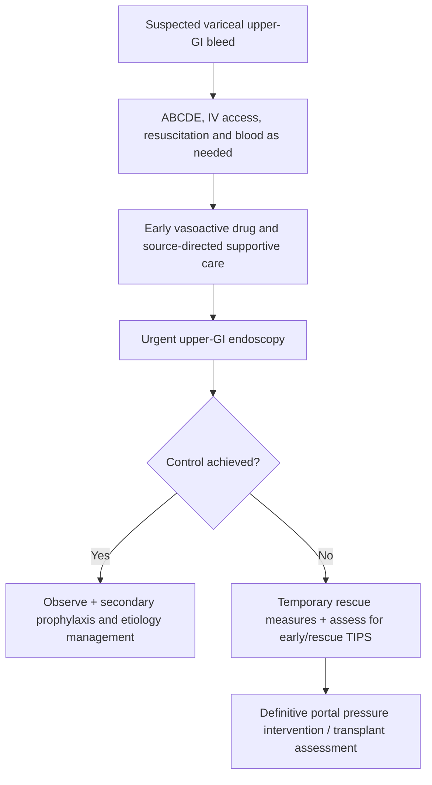

# 16 — Liver Surgery and Portal Hypertension

> [!info] Sources and scope
> Main synthesis: **World of Revision (WOR), Surgery—Hepatobiliary & Minimally Invasive Surgery, beginning p. 109; GI Surgery Part 2—Portal Hypertension; Specialty Surgery—Liver Transplant; Trauma—Liver/Splenic Injury**; **Doctut Merged—Couinaud segments, Liver Infections, Liver Tumors, Portal Hypertension, Budd–Chiari and Transplant**; **Pocket Robbins 9e, Chapter 18—Liver and Gallbladder, printed pp. 821–875**; **First Aid 2025, Gastrointestinal**. Content below is an original study synthesis. Historical numerical cutoffs and source inconsistencies are identified in the companion appendix.

## 1. Liver anatomy for the surgeon

### Surgical anatomy differs from surface anatomy
- **Anatomical lobes** are separated superficially by the falciform ligament; **functional halves** follow hepatic vascular inflow/outflow and biliary drainage.
- **Cantlie line / principal plane:** a plane from the **gallbladder fossa to the inferior vena cava** that approximates the course of the **middle hepatic vein** and divides the functional right and left liver.
- **Dual blood supply:** portal vein supplies most hepatic blood flow; hepatic artery supplies oxygenated arterial blood. Both branch within the **portal triad**, together with a bile duct.
- **Hepatic veins:** right, middle and left hepatic veins drain to IVC; their planes divide sectors; the portal veins provide an approximate transverse division into superior/inferior segments.
- **Caudate lobe (segment I)** is functionally relatively independent and drains directly into the IVC; it may enlarge in hepatic venous outflow obstruction (**Budd–Chiari**).
- **Portal pedicle on ultrasound:** the familiar **Mickey Mouse sign** in the transverse porta-hepatis view represents the portal vein with adjacent hepatic artery and bile duct.

### Couinaud segmental anatomy

| Segment | Surgical location | Important correlation |
|---|---|---|
| **I** | Caudate lobe | Independent venous drainage to IVC; hypertrophy in Budd–Chiari |
| **II** | Left lateral superior | Part of left lateral section; common living-donor pediatric graft |
| **III** | Left lateral inferior | With II forms left lateral section |
| **IVa** | Left medial superior | Left hemiliver |
| **IVb** | Left medial inferior | **Gallbladder bed** (together with V); relevant in radical GB-cancer surgery |
| **V** | Right anterior inferior | Gallbladder bed; right anterior section |
| **VI** | Right posterior inferior | Right posterior section |
| **VII** | Right posterior superior | Subdiaphragmatic/right posterior location; WOR highlights amoebic liver abscess |
| **VIII** | Right anterior superior | Right anterior section |

**Sector map:** left lateral = II–III; left medial = IVa–IVb; right anterior = V–VIII; right posterior = VI–VII. Segment I is separate.

| Brisbane 2000 operation | Resected segments | Rationale / typical situation |
|---|---|---|
| **Left hepatectomy / left hemihepatectomy** | II, III, IV | Left-sided lesion |
| **Right hepatectomy / right hemihepatectomy** | V, VI, VII, VIII | Right-sided lesion |
| **Left lateral sectionectomy** | II, III | Localized left-lateral lesion; pediatric donor graft |
| **Extended left hepatectomy / left trisectionectomy** | II, III, IV, V, VIII | Additional right anterior section |
| **Extended right hepatectomy / right trisectionectomy** | IV, V, VI, VII, VIII | Additional left medial segment |
| **Central hepatectomy (“Taj Mahal”)** | Central segments including IVb, V and often VIII, depending on exact operation | Selected centrally placed disease |
| **Radical gallbladder cancer resection** | Gallbladder with liver bed, classically IVb and V, plus lymphadenectomy | Selected T1b/T2 and other resectable lesions |

> [!tip] Exam mechanism
> The **portal inflow anatomy makes segmental resections possible**. Hepatic veins mark intersectoral boundaries. Always distinguish **anatomic lobe** from **functional hemiliver**.

### Surgical pedicle and Pringle maneuver
- **Portal triad:** portal vein, proper hepatic artery and common bile duct within the hepatoduodenal ligament.
- **Pringle maneuver:** temporarily occludes vascular inflow by compressing/clamping the hepatoduodenal ligament at the free margin near the foramen of Winslow.
- **Interpretation:** hepatic bleeding that decreases suggests an **inflow-source** (hepatic artery/portal vein); persistent major hemorrhage raises concern for **hepatic venous/retrohepatic IVC** injury or another source.
- **Use in trauma/hepatectomy:** a temporizing hemostatic maneuver; control, ischemic tolerance, and definitive vascular techniques require specialist judgment.

## 2. Liver function and surgical assessment

### Laboratory pattern
| Investigation | Interpretation and limits |
|---|---|
| **ALT/AST** | Hepatocyte injury; do **not** directly measure remaining liver synthetic function |
| **ALP, GGT** | Cholestatic/biliary obstruction pattern; GGT supports hepatic source of ALP |
| **Direct bilirubin** | Can increase in cholestasis/obstruction; a purely “direct = surgical, indirect = medical” rule is oversimplified |
| **Albumin** | Chronic synthetic function but also affected by inflammation, nutrition and other losses |
| **PT/INR** | Reflect synthesis of vitamin-K-dependent coagulation factors and anticoagulant use; central in CTP/MELD |
| **Creatinine/Na** | Severity of decompensation, renal and circulatory compromise; used in MELD-based prioritization |

### Child–Turcotte–Pugh (CTP) score
Five domains are assigned 1–3 points each; **total 5–15**.

| Parameter | 1 point | 2 points | 3 points |
|---|---|---|---|
| **Ascites** | None | Mild / controlled | Moderate–severe / refractory |
| **Encephalopathy** | None | Grade I–II | Grade III–IV |
| **Bilirubin, mg/dL** | <2 | 2–3 | >3 |
| **Albumin, g/dL** | >3.5 | 2.8–3.5 | <2.8 |
| **INR** | <1.7 | 1.7–2.3 | >2.3 |

- **Class A:** 5–6; **B:** 7–9; **C:** 10–15.
- Used as a measure of **cirrhotic hepatic functional reserve** and to contextualize surgical and HCC treatment decisions.
- Doctut has several transcription errors for the score (such as maximum “25” and “Child C 20–25”); WOR explicitly supplies the internally consistent **5–15** range.

### MELD and PELD
- **MELD (Model for End-stage Liver Disease):** the uploaded older score uses **bilirubin, INR, creatinine**; a revision includes **sodium**. Used to estimate severity/prioritize transplantation.
- **PELD:** pediatric version adds **albumin, total bilirubin, INR, age and growth failure**.
- **King’s College criteria:** source tables distinguish acetaminophen-induced vs nonacetaminophen acute liver failure and use **pH, PT/INR, creatinine, encephalopathy, age, bilirubin and jaundice-to-encephalopathy interval** to assess urgency of transplantation.
- Do **not** treat a single MELD or CTP cutoff in the review sources as an absolute operative permission/prohibition.

## 3. Liver imaging and evaluation of a focal lesion

| Modality | Main surgical role |
|---|---|
| **Ultrasound + Doppler** | First look for cyst, abscess, biliary dilatation, vascular patency and portal flow |
| **Triple-/multiphase contrast CT** | Characterize arterial vs portal/delayed enhancement, map HCC/metastases, plan resection; highlighted as investigation of choice (IOC) in WOR |
| **MRI / liver-specific sequences** | Further characterize indeterminate benign/malignant nodules and biliary anatomy |
| **MRCP** | Noninvasive map of biliary tree; crucial for suspected cystobiliary communication, bile duct injury or strictures |
| **HIDA/hepatobiliary scan** | Traces hepatocyte excretion and bile movement; functional evaluation of biliary transit/leak/acute cholecystitis |
| **Tc-99m sulfur colloid** | Reticuloendothelial/Kupffer-cell uptake; **FNH often demonstrates uptake** unlike many lesions |
| **Angiography / interventional radiology** | Map or manage vascular bleeding, embolize liver lesions or perform TACE/TARE |

**Triphasic HCC pattern (WOR/Robbins):** **arterial-phase hyperenhancement** followed by **washout** in portal or delayed phase in an appropriate at-risk liver. **LI-RADS** provides structured categorization of imaging findings; AFP supports evaluation but does not independently prove or exclude HCC.

## 4. Liver abscesses

### Amoebic versus pyogenic liver abscess

| Feature | **Amoebic** | **Pyogenic** |
|---|---|---|
| Agent | ***Entamoeba histolytica*** | Enteric Gram-negative bacteria (*E. coli*, *Klebsiella*) and mixed biliary organisms; hematogenous infections may involve *S. aureus* |
| Route | Bowel → **portal vein** → liver | **Biliary ascending infection** common; portal, arterial, direct or cryptogenic |
| Pattern | Classically **solitary**, right/posterosuperior liver; often segment VII in WOR | Single or **multiple**, especially with biliary spread |
| Clinical | RUQ pain, tender hepatomegaly, ± fever, history of dysentery may be absent | Fever/rigors, toxicity, RUQ pain, sepsis ± jaundice |
| Aspirate | Classically **anchovy-sauce** necrotic contents (not always diagnostic) | Frank pus; culture important |
| Bloodwork | May show ↑INR, inflammatory response | Leukocytosis/CRP, cholestatic LFT rise, cultures may be positive |
| Imaging | US/CECT shows abscess | US/CECT shows collection(s); CT maps extent and source |
| Specific studies | Serology/antigen evaluation when useful | Blood and/or drainage cultures; look for biliary source |
| First treatment concept | **Tissue amoebicide + luminal amoebicide** | **IV antibiotics + drainage/source control** when indicated |

### Amoebic abscess: pathophysiology
1. Ingested cysts → trophozoites invade colon.
2. Portal venous spread carries trophozoites to liver.
3. Hepatocyte necrosis produces liquefied, reddish-brown cavity contents.
4. Complications: rupture into **pleura/lung**, peritoneum or rarely pericardium; cholestasis; secondary infection.

**Management in uploaded notes:** metronidazole, then **diloxanide furoate** or another indicated luminal agent to eradicate intestinal colonization. Consider image-guided drainage for **nonresponse, diagnostic uncertainty, large/left-lobe, superficial or rupture-prone lesions**. WOR lists **>5 cm, left lobe, pregnancy, impending rupture**; Doctut also emphasizes response over 2–3 days. Exact courses/doses in these older sources are not universally prescriptive.

### Pyogenic liver abscess
- Ascending cholangitis, diabetes, impaired immune function, abdominal infection and portal pylephlebitis are important contexts.
- **CECT** clarifies multiplicity, liver location and associated biliary disease; US is useful for access and follow-up.
- **Treatment:** promptly treat sepsis, cover plausible biliary/enteric organisms with antibiotics and drain a significant accessible abscess using **percutaneous catheter** or selected operative drainage.
- **Special association from Doctut:** invasive *Klebsiella* abscess may be associated with **endophthalmitis** and distant metastatic infection.

### Emergency differential
- **Fever + RUQ pain + jaundice:** consider **ascending cholangitis, pyogenic abscess, cholecystitis and biliary obstruction**; evaluate urgently for sepsis and source control.

## 5. Hepatic hydatid disease

### Biology and structure
- Cause: ***Echinococcus granulosus***; **dog definitive host**, sheep usual intermediate host, humans accidental intermediate hosts.
- Ingested eggs → oncospheres penetrate gut → reach liver via portal circulation → **hydatid cyst**; lungs and other organs may be involved.
- Layers: **host fibrous pericyst**, **acellular laminated membrane**, **inner germinal layer** generating brood capsules/protoscolices and daughter cysts. **Hydatid sand** contains cyst contents/scolices.
- Symptoms: RUQ discomfort/mass, hepatomegaly; complicated disease can cause **obstructive jaundice/cholangitis from cystobiliary communication**, secondary infection, rupture and anaphylactic phenomena.

### WHO-IWGE ultrasound classification (with older Gharbi descriptions)

| WHO type | Characteristic image | Typical activity concept | Important note |
|---|---|---|---|
| **CE1** | Unilocular, fluid-filled cyst with **double wall/line** | Active | May be appropriate for selected PAIR strategies |
| **CE2** | Multivesicular **honeycomb/rosette** daughter cysts | Active | Simple PAIR often unsuitable to clear all daughters |
| **CE3a** | Detached membrane, **water-lily sign** | Transitional | Stage-specific treatment selection |
| **CE3b** | Daughter cysts embedded in partly solid matrix | Transitional/active viable components | More complex than simple fluid cyst |
| **CE4** | Heterogeneous solid-looking contents, no daughter cysts | Often inactive | Follow-up rather than intervention in selected patients |
| **CE5** | Calcified wall (partially/completely) | Usually inactive | Calcification alone should be interpreted with all imaging features |

### Investigations
- **Ultrasound** establishes morphology/staging; **CECT** defines size, number, adjacent organs and complex disease; **MRCP** when duct communication suspected.
- Serology can support diagnosis but may vary with cyst activity/location. Doctut discusses ELISA, immunoblot and historical Casoni test (not a contemporary primary test).

### Therapeutic options in the sources
| Option | Logic | Source-described indication/caution |
|---|---|---|
| **Albendazole** | Antihelminthic to reduce cyst viability | Medical therapy or peri-intervention use; check hepatic function/blood counts as appropriate |
| **PAIR** | **P**uncture → **A**spiration → **I**njection of scolicidal agent → **R**easpiration | Selected fluid cysts (e.g., CE1, CE3a); must exclude important cystobiliary communication |
| **Catheter-based evacuation** | Longer drainage/evacuation of contents | Larger/complex lesions in expert hands |
| **Pericystectomy / partial cystectomy** | Remove parasite contents and affected wall safely | Large, symptomatic, complex, complicated or unsuitable percutaneous lesions |
| **Anatomic hepatectomy** | Remove involved hepatic segments | Selected anatomically suitable lesions/multilocular alveolar disease |

- **Scolicidal agent** in WOR: hypertonic saline; Doctut lists additional historical substances. **Formalin is specifically warned against** in WOR.
- **Important contraindication:** scolicidal injection into a cyst with **communication to bile duct** risks serious chemical injury to biliary tree; multiple-daughter, calcified/inactive and ruptured cysts may not suit simple PAIR.
- **E. multilocularis** (alveolar hydatid) behaves infiltratively and is distinct from ordinary cystic hydatid disease; requires different treatment planning.
- **Avoid routine blind aspiration** of an uncharacterized suspected echinococcal cyst.

## 6. Benign and cystic liver lesions

### Compare hemangioma, focal nodular hyperplasia (FNH), hepatocellular adenoma

| Feature | **Cavernous hemangioma** | **FNH** | **Hepatocellular adenoma** |
|---|---|---|---|
| Tissue | Benign vascular channels | Hyperplastic response to local vascular changes | True benign hepatocellular neoplasm |
| Epidemiology | Most common benign liver tumor; often incidental | Young–middle-aged adults; frequently women | Often young women; association with **OCPs**, anabolic steroids/other factors |
| Imaging clue | Peripheral nodular enhancement with **centripetal fill-in**; T2-bright on MRI | **Central stellate scar**, characteristic enhancement; sulfur-colloid uptake possible | Variable arterial enhancement; no normal bile ducts/Kupffer cells |
| Histology | Cavernous vessels | Hepatocytes, abnormal vessels, ductular reaction and fibrous scar | Sheets of hepatocytes; absent normal portal tracts/bile ducts |
| Main complication | Large symptomatic vascular lesion, rare rupture | Usually minimal | **Hemorrhage/rupture** and subtype-dependent **malignancy risk** |
| Usual approach | Observation if typical/asymptomatic | Observation if secure diagnosis/asymptomatic | Stop hormonal exposure where relevant; resection considered by **size, sex, growth, bleeding and β-catenin risk** |

**Hepatic adenoma subtypes (Robbins/WOR):**
- **HNF1A-inactivated:** often associated with fatty change; primarily women.
- **Inflammatory:** linked to inflammatory/JAK-STAT biology and metabolic disease; can bleed.
- **β-catenin-activated:** particularly important **malignant transformation risk**, especially with exon-specific alterations; management is more aggressive.
- Doctut also mentions a **sonic-hedgehog–activated** subgroup with hemorrhage associations.

**Other cystic lesions:** simple hepatic cyst (fenestration if symptomatic), polycystic liver disease, and biliary cystic neoplasms. **Enhancing septations/mural nodules** increase concern for neoplasm rather than a simple cyst.

## 7. Hepatocellular carcinoma (HCC)

### Why it occurs
- **Most common primary malignant liver tumor**; metastatic tumors are overall more common in the liver.
- **Risk:** HBV, HCV, cirrhosis from any cause, alcohol, metabolic steatohepatitis, aflatoxin exposure, hemochromatosis, α1-antitrypsin deficiency and other chronic liver injuries. **HBV-related HCC may occur without established cirrhosis** (Robbins).
- Continuous injury/regeneration with inflammation and mutations in **β-catenin, p53** and other pathways promotes carcinogenesis.
- **Clinical presentation:** often silent until liver function worsens; new RUQ discomfort, hepatomegaly, mass, weight loss, ascites or unexpected decompensation in known cirrhosis.
- **Paraneoplastic:** hypoglycemia, hypercholesterolemia/hyperlipidemia, polycythemia and hypercalcemia are named in the sources; which is “most common” differs by book and measurement.

### Evaluation and imaging
- **Multiphase liver CT/MRI:** in at-risk patients, arterial-phase hyperenhancement and portal/delayed washout may establish imaging diagnosis in classic scenarios; **LI-RADS** provides standardized description.
- **AFP** is supportive and can be normal in HCC or increased in other hepatic diseases; **not an absolute diagnostic rule**.
- Need to characterize **tumor burden, portal vein invasion, extrahepatic spread and hepatic reserve** before choosing therapy.
- **Fibrolamellar HCC:** often younger patients without cirrhosis; characteristic fibrous stroma, **AFP often not raised**, and distinct clinical behavior; Doctut/WOR include **neurotensin** as a historical tumor-marker association.

### Barcelona Clinic Liver Cancer (BCLC) teaching stages

| Stage | Typical source description | Main treatment direction discussed |
|---|---|---|
| **0: very early** | Solitary **≤2 cm**, preserved function/performance | Resection or local ablation depending on context |
| **A: early** | Solitary lesion or limited small nodules, preserved function | Resection, local ablation, or transplant selection |
| **B: intermediate** | Multinodular without major vascular invasion/extrahepatic disease | **TACE** (transarterial chemoembolization), selected approaches |
| **C: advanced** | Vascular invasion or extrahepatic spread with suitable performance | Systemic treatments; WOR specifically lists **sorafenib** as an older example |
| **D: terminal** | Poor performance/liver reserve | Symptom-directed supportive care |

> [!warning] Stage ≠ fixed prescription
> The source BCLC chart is an exam-era simplification. It should not be interpreted as an exhaustive contemporary oncology algorithm or as an instruction to give sorafenib to every stage-C patient.

### Resection vs transplant vs local therapy
- **Anatomic resection:** localized tumor, acceptable future remnant and **adequate liver reserve**, especially without prohibitive portal hypertension.
- **Liver transplantation:** treats both the tumor and the failing cirrhotic organ in selected candidates.
- **Milan criteria (WOR):** **single HCC ≤5 cm OR up to three lesions each ≤3 cm**, with **no macrovascular invasion or extrahepatic spread**.
- **Ablation:** radiofrequency/microwave or selected chemical methods for suitable small lesions.
- **TACE/TARE:** liver-directed treatment when surgery/ablation unsuitable in selected intermediate or bridge-to-transplant situations.
- **Locoregional and systemic treatments** depend on disease stage, vascular invasion, hepatic reserve and availability.

### Hepatic metastases
- Overall, metastases are commoner than primary malignant liver tumors. **Colorectal carcinoma** is a key source of potentially resectable hepatic secondaries; neuroendocrine tumors may also be considered in select contexts.
- **Hypovascular metastases** (e.g., many colorectal lesions) often show best in **portal venous phase**; **hypervascular metastases** (e.g., RCC/NET/thyroid in source lists) often show in **arterial phase**.
- **Fong clinical risk score** in Doctut considers primary nodal status, disease-free interval, number of lesions, largest size and CEA; **a prognostic score, not a stand-alone operation rule**.
- Surgery considers complete clearance, distribution, vascular anatomy and safe **future liver remnant**; selected disease may require systemic and/or liver-directed therapy.

## 8. Portal hypertension — essential hemodynamics

### Definition and measurements
- **Portal pressure reflects blood flow × resistance.** Portal hypertension can result from **increased resistance**, increased splanchnic flow, or both.
- **Hepatic venous pressure gradient (HVPG) = wedged hepatic venous pressure − free hepatic venous pressure.**
- **WOR GI teaching levels:** **1–5 mmHg normal; 6–9 subclinical increase; ≥10 clinically significant portal hypertension; ≥12 increased variceal bleeding risk**. HVPG particularly reflects **sinusoidal** portal hypertension; presinusoidal disease can yield misleadingly low HVPG.
- Cirrhosis → distortion by fibrosis/regenerative nodules + endothelial changes; systemic vasodilation and neurohormonal sodium/water retention then promote ascites.

### Classification by site of resistance

| Level | Examples | Main physiologic pattern |
|---|---|---|
| **Prehepatic** | Extrahepatic portal vein obstruction/thrombosis; **isolated splenic vein thrombosis** | Obstruction before hepatic sinusoids |
| **Intrahepatic, presinusoidal** | **Schistosomiasis**, noncirrhotic portal fibrosis, some biliary/granulomatous disease | High portal pressure with relatively preserved hepatocellular function in some patients |
| **Intrahepatic, sinusoidal** | **Cirrhosis (most common)**, infiltration/fibrosis | Impaired sinusoidal flow; hepatic dysfunction often accompanies |
| **Intrahepatic, postsinusoidal** | Sinusoidal obstruction syndrome/veno-occlusive disease | Outflow restriction in small hepatic venules |
| **Posthepatic** | **Budd–Chiari**, IVC obstruction, right heart failure, constrictive pericarditis | Hepatic venous drainage impeded |

### Portosystemic collateral sites

| Portal-side vessel | Systemic-side connection | Clinical sign |
|---|---|---|
| Left gastric/short gastric veins | Esophageal/submucosal veins → azygos system | **Esophageal/gastric varices** |
| Paraumbilical veins | Superficial abdominal wall veins | **Caput medusae** |
| Superior rectal veins | Middle/inferior rectal veins | Rectal varices (not identical to ordinary hemorrhoids) |
| Retroperitoneal veins | Systemic posterior abdominal veins | Retroperitoneal collaterals |
| Bare area of liver | Diaphragmatic/systemic channels | Less visible collaterals |

### Major consequences
- **Variceal hemorrhage** (massive hematemesis/melena).
- **Ascites** due to portal/splanchnic pressures, lymph overflow, sodium retention and hypoalbuminemia.
- **Congestive splenomegaly → hypersplenism**, thrombocytopenia/pancytopenia.
- **Hepatic encephalopathy** from reduced detoxification and shunting of gut-derived substances.
- **Hepatopulmonary syndrome (HPS)** and **portopulmonary hypertension (PoPH)**; renal dysfunction, infections and decompensated cirrhosis.

### Ascites: SAAG
- **SAAG = serum albumin − ascitic albumin**, measured in matching samples.
- **≥1.1 g/dL** supports portal-hypertensive physiology; **<1.1** suggests many nonportal causes (peritoneal malignancy, TB, pancreatitis etc.).
- Interpret together with **total ascitic protein** and clinical context; Doctut explicitly compares portal-hypertensive versus nonportal ascites.

## 9. Portal-hypertensive bleeding: source-based management

### Specific methods
- **Airway and circulation first:** large-volume hematemesis risks aspiration and hemorrhagic shock. Correct ongoing bleeding, check blood counts/coagulation and recognize liver dysfunction.
- **Vasoactive treatment:** sources discuss **terlipressin** and **octreotide** to reduce portal/splanchnic inflow while preparing for endoscopic source control.
- **Endoscopic variceal ligation (banding):** most common definitive endoscopic therapy for esophageal varices in WOR; sclerotherapy is an alternative in some settings.
- **Gastric varices:** cyanoacrylate/glue methods discussed in Doctut.
- **Balloon tamponade:** **Sengstaken–Blakemore** (3 lumens, gastric and esophageal balloons), **Minnesota** (4 lumens, 2 balloons), **Linton** (one balloon, 3 lumens); **temporary bridge only** with major aspiration/ulceration/perforation risk.
- **TIPS:** transjugular intrahepatic portosystemic shunt creates a tract between **portal and hepatic venous systems**, often using a covered stent. Used for refractory/recurrent variceal bleed or selected refractory ascites, frequently as a bridge to transplant.
- **TIPS risks:** hepatic encephalopathy (blood bypasses liver), stent dysfunction/thrombosis/stenosis, hepatic decompensation, procedural bleeding.
- **TIPS cautions in Doctut:** right-heart failure, severe cardiopulmonary disease and selected liver tumors/ductal anatomy, among others; formal contraindications require individualized evaluation.
- **Nonselective beta-blocker** prophylaxis (e.g., propranolol) is a **prevention strategy** for appropriate patients, **not an acute hemorrhage resuscitation drug**.

### Named surgical portal decompression procedures

| Procedure | Connection/operation | Characteristic distinction |
|---|---|---|
| **Eck portocaval shunt** | End-to-end portal vein → IVC | **Nonselective**; diverts portal inflow |
| **Side-to-side portocaval** | Portal vein ↔ IVC | Nonselective decompression |
| **Proximal splenorenal / Linton** | Splenectomy with proximal splenic vein → left renal vein | Decompresses portal bed; historical option |
| **Distal splenorenal / Warren** | Distal splenic vein → left renal vein, spleen preserved | **Selective** decompression of gastroesophageal variceal bed |
| **Inokuchi shunt** | Left gastric vein–systemic outflow anastomosis | Selective approach in older surgical teaching |
| **Sugiura procedure** | Esophagogastric devascularization ± transection and splenectomy | **Devascularization** rather than direct portosystemic shunting |
| **Rex shunt (meso-Rex bypass)** | Reconnects SMV flow to left intrahepatic portal vein | **Physiologic restoration** in selected pediatric EHPVO |

**Why less common now:** modern endoscopy, radiologic shunts and transplantation have changed indications for classical open shunts; learn the **anatomical distinctions** for NEET-PG/INI-CET.

## 10. Special portal hypertension syndromes

### Sinistral (left-sided) portal hypertension
- Usually **splenic vein thrombosis**, classically due to **pancreatitis/pancreatic disease**.
- Portal vein and liver may be otherwise preserved; blood diverts through **short gastric veins** → **isolated gastric varices** and splenomegaly.
- **Splenectomy** or other specialist vascular management may be considered depending on bleeding and pancreatic cause.

### EHPVO vs NCPF
| Feature | **Extrahepatic portal vein obstruction** | **Noncirrhotic portal fibrosis** |
|---|---|---|
| Lesion | Main portal vein/major extrahepatic branches, often thrombosis/cavernoma | Intrahepatic presinusoidal portal resistance |
| Typical source patient | Children/adolescents, historical umbilical sepsis | Young adults in affected regions |
| Liver function | Often preserved relative to cirrhosis | Often preserved |
| Signs | Massive splenomegaly, variceal bleed ± growth impairment | Splenomegaly, variceal bleed |
| Possible intervention | Endoscopic control, **Rex shunt** in selected children, shunts | Endoscopy/shunt choice by anatomy |

### Budd–Chiari syndrome
- **Hepatic vein outflow obstruction**, from thrombosis or IVC venous webs.
- Associated with myeloproliferative disease (e.g., **polycythemia vera**) and prothrombotic states; Doctut emphasizes Indian venous-web presentations.
- **Pain, hepatomegaly, ascites**; chronic abdominal-wall collateral veins may ascend from below (source **Harvey sign**).
- **Caudate lobe hypertrophy** from direct IVC drainage is a classic anatomical clue.
- Doppler/CT/MR venography and specialist hepatic venography define obstruction; interventions depend on thrombus, webs, liver reserve and transplant requirement.

### Sinusoidal obstruction syndrome (veno-occlusive disease)
- Damage/obstruction in small hepatic venules, particularly after hematopoietic stem-cell transplantation or toxic exposure.
- Hepatomegaly, weight gain/fluid retention, jaundice and ascites may occur; Doctut highlights **defibrotide** in selected cases.

### HPS vs PoPH
| Feature | Hepatopulmonary syndrome | Portopulmonary hypertension |
|---|---|---|
| Central mechanism | **Intrapulmonary vascular dilatation**, impaired oxygenation | **Pulmonary arterial vascular resistance/pressure increase** |
| Typical clue | Hypoxemia, **platypnea/orthodeoxia** | Dyspnea, raised pulmonary arterial pressure, right-heart burden |
| Source investigation | Contrast echocardiography and oxygenation | Echo and hemodynamic evaluation |
| Transplant issue | Can improve after transplant in selected patients | Severe uncontrolled pulmonary hypertension increases transplant risk |

## 11. Liver transplantation

### Indications and graft choices
- **Adults:** advanced decompensated cirrhosis, acute liver failure and selected HCC; **children:** **biliary atresia** is a leading cause (WOR).
- **Deceased donor liver transplant (DDLT)**; **living donor liver transplant (LDLT)**; **split liver**; **auxiliary graft** without removal of all native liver; **domino transplant** in selected settings.
- Source graft mapping: **segments II–III** commonly supply a pediatric left lateral graft; a **right liver graft** may be used for a larger recipient.
- **Milan criteria** define classic transplant selection in HCC (above).
- Unlike kidney transplantation, **strict HLA matching is not routinely required** for liver transplantation in WOR.

### Key complications
- **Hepatic artery thrombosis:** critical early vascular event; threatens graft and biliary tree.
- **Biliary leak and anastomotic/ischemic stricture**; portal/hepatic vein problems; graft dysfunction.
- **Acute or chronic rejection**; chronic **vanishing bile duct syndrome**.
- **Infections**, treatment-related toxicity and **post-transplant lymphoproliferative disorder** (EBV-associated) or malignancy.
- Graft surveillance uses liver tests and Doppler/imaging when indicated.

## 12. Liver trauma and damage-control hepatic surgery

| Patient status | Approach from WOR Trauma |
|---|---|
| **Stable** | Contrast CT to characterize injury; monitor/consider selective angioembolization or nonoperative management |
| **Unstable or uncontrolled hemorrhage** | **Immediate hemorrhage control** (operative/interventional as feasible) with damage-control resuscitation |

- AAST injury grades escalate from limited hematoma/laceration to major parenchymal disruption, venous injury or devascularization.
- **Packing** applies tamponade; **Pringle** tests/controls hepatic inflow. Liver venous and IVC injuries are harder to control by inflow clamp.
- Complications include **delayed hemorrhage, bile leak/biloma, abscess and vascular injury**.
- **Damage-control surgery:** pack/control bleeding and contamination, temporarily close, restore physiology in ICU, then return for definitive repair.

## 13. Liver surgery: high-yield exam table

| Clue | Likely diagnosis / significance |
|---|---|
| Segment I hypertrophy + hepatic venous outflow obstruction | **Budd–Chiari** |
| Segment IVb + V involved in operation | **Radical GB cancer surgery** liver-bed resection |
| RUQ pain, right VII solitary abscess, “anchovy-sauce” | **Amoebic liver abscess** |
| Fever/rigors + multiple rim-enhancing abscesses with bile-duct disease | **Pyogenic liver abscess** |
| Water-lily membrane in liver cyst | **Hydatid CE3a** |
| Enhancing central stellate scar, sulfur-colloid uptake | **FNH** |
| OCP exposure, painful/bleeding lesion; β-catenin subtype | **Hepatic adenoma** |
| Arterial enhancement → delayed washout in high-risk liver | **HCC imaging signature** |
| ≤5-cm solitary HCC or ≤3 nodules each ≤3 cm | **Milan criteria** |
| HVPG ≥10 mmHg | **Clinically significant sinusoidal portal HTN** |
| Isolated gastric varices + splenic vein thrombosis | **Sinistral portal HTN** |
| Varices + splenomegaly with relatively preserved liver | **EHPVO/NCPF** differential |
| Hypoxemia + platypnea with cirrhosis | **Hepatopulmonary syndrome** |
| Portal-to-hepatic vein stent | **TIPS** |
| Left gastric/splenic vein to renal/IVC named shunts | Portal decompression anatomy |

### Source notes for Chapter 16
- **WOR Surgery:** *Surgical Anatomy of Liver, Liver Abscess, Hydatid Disease, Benign Liver Tumours, HCC*; *GI Surgery Part 2—Portal Hypertension*; *Specialty Surgery—Liver Transplant*; *Trauma—Liver and Splenic Injury*.
- **Doctut Merged:** *Couinaud’s Segments; Infections in Liver; Liver Tumors; Portal Hypertension; Budd–Chiari*.
- **Robbins Pocket Companion 9e:** Chapter 18 *Liver and Gallbladder*, printed pp. 821–875, particularly cirrhosis/portal HTN pp. 827–830 and liver tumors pp. 867–874.
- **First Aid 2025:** Gastrointestinal pathology/physiology, liver and portal hypertension material. See concordance appendix for places where older source choices differ.
