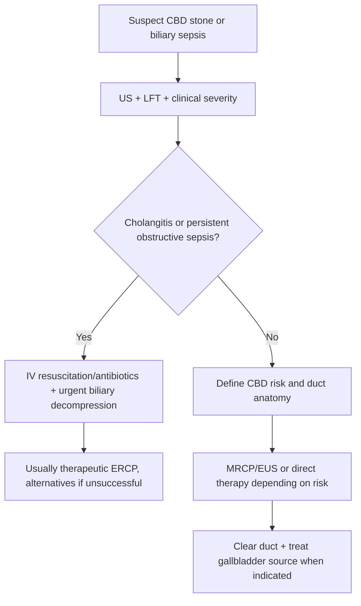

# 17 — Gallbladder and Biliary Surgery

> [!info] Sources and scope
> Principal sources: **World of Revision, Surgery—Hepatobiliary & Minimally Invasive Surgery, pp. 109 onward**; **Doctut Merged—Gallbladder and Bile Duct; Gall Stones; Bile Duct Injury; CBD Stones; Miscellaneous Disorders; Biliary Malignancy**; **Robbins Pocket Companion 9e, Chapter 18—Gallbladder pp. 875–882**; **First Aid 2025, GI pathology/anatomy**. Older blanket prophylactic indications and historical procedural pathways are identified in the appendix.

## 1. Surgical anatomy of the biliary system

### Ductal anatomy
- **Hepatocytes → bile canaliculi → intrahepatic ducts → right/left hepatic ducts → common hepatic duct (CHD).**
- CHD + **cystic duct** → **common bile duct (CBD)**. CBD commonly joins the **main pancreatic duct (Wirsung)** near the ampulla of Vater before entering **second part of duodenum**.
- **Cystic duct:** spiral mucosal folds known as **valves of Heister**; can complicate cannulation.
- **Sphincter of Oddi complex** controls flow at distal CBD/pancreatic duct/ampulla and relaxes with appropriate postprandial signals.
- **CCK:** duodenal response to fat → **gallbladder contraction**, sphincter relaxation and bile delivery to digest fat.
- **Gallbladder:** fundus, body, infundibulum/Hartmann pouch and neck; lies adjacent to liver segments **IVb and V**.
- **Cystic artery** usually arises from **right hepatic artery**; many vascular/biliary variants create injury risk.

### Hepatocystic vs classical Calot triangle
| Structure | Boundaries | Contents/importance |
|---|---|---|
| **Hepatocystic triangle** | **CHD medially + cystic duct inferiorly/laterally + inferior liver edge superiorly** | Cystic artery, nodes and variable ducts; field for safe dissection |
| **Original Calot triangle** | **CHD + cystic duct + cystic artery** | Different superior boundary; sources distinguish both |

**Named anatomical clues**
- **Moynihan hump/caterpillar turn:** tortuous right hepatic artery near Calot region; falsely identified as cystic artery → hemorrhage/ductal injury.
- **Rouvière sulcus:** groove on lower right liver indicating right posterior pedicle plane; valuable **landmark for staying above/before unsafe ductal structures**.
- **R4U line (WOR):** connecting Rouvière sulcus–segment IVb–umbilical fissure; a spatial safety reference for cholecystectomy.
- **Cystic plate:** fibrous liver-bed plate beneath GB; correct dissection plane limits liver bleeding and biliary injury.
- **Phrygian cap:** fold of gallbladder fundus; common benign anatomical variation **not itself an indication for surgery**.
- **Ducts of Luschka:** small subvesical/accessory bile ducts near gallbladder bed; injury causes postoperative bile leak.

## 2. How stones form

### Bile chemistry
- Normally bile acids and phospholipids maintain cholesterol in soluble micelles.
- **Cholesterol supersaturation + nucleation + gallbladder hypomotility/stasis** → cholesterol crystallization and stone formation.
- Pigment stones result from bilirubin breakdown/precipitation; **infection** favors brown pigment stones, while **chronic hemolysis** favors black pigment stones.

| Type | Composition / mechanism | Classic associations | Typical appearance |
|---|---|---|---|
| **Cholesterol** | Cholesterol monohydrate crystals, low relative bile salts, stasis | Female hormones, obesity, pregnancy, ileal disease/resection, rapid weight change, TPN | Pale/yellow, usually radiolucent |
| **Mixed** | Cholesterol mixed with pigment/calcium | Common overall in WOR | Variable radiopacity; multiple/faceted |
| **Black pigment** | Calcium bilirubinate and other insoluble bilirubin polymers | **Hemolytic anemia**, sickle cell disease, hereditary spherocytosis, cirrhosis | Hard dark stones, gallbladder bile |
| **Brown pigment** | Calcium bilirubinate + fatty acid salts; bacterial deconjugation | **Bile duct infection/stasis**, parasites, foreign body/clips | Soft earthy brown, intra-/extrahepatic ducts |

- Doctut discusses the **“5 Fs”** as a memory aid for some cholesterol-stone associations; they are not valid diagnostic criteria.
- **Black vs brown:** hemolysis/sterile bile **versus** ascending infected bile; brown stones are particularly associated with recurrent CBD stones.

## 3. Clinical spectrum of gallstone disease

| Syndrome | What happens | Major presentation / diagnostic clue |
|---|---|---|
| **Asymptomatic cholelithiasis** | Stones in GB without symptoms | Incidentally found on US |
| **Biliary pain/colic** | Transient cystic duct obstruction during GB contraction | Episodic steady RUQ/epigastric pain often after food, without sustained systemic inflammation |
| **Acute calculous cholecystitis** | Persistent cystic duct obstruction → inflammation | **RUQ tenderness, Murphy sign, fever**, leukocytosis/CRP, US inflammatory features |
| **Chronic cholecystitis** | Recurrent irritation and fibrosis | Chronic pain/dyspepsia; thickened fibrotic GB |
| **Mucocele / hydrops** | Cystic duct obstruction, bile resorbed and mucous secretion retained | Distended mucus-filled GB |
| **Empyema** | Pus in obstructed GB | Sepsis, severe RUQ pain; drainage/source control needed |
| **Gangrene/perforation** | Ischemia of inflamed GB | Severe sepsis, peritonitis, abscess; urgent management |
| **Choledocholithiasis** | Stone in CBD | Obstructive jaundice, ↑ALP/γGT ± pancreatitis/cholangitis |
| **Acute cholangitis** | Infected obstructed biliary tree | **Charcot triad: fever + RUQ pain + jaundice** |
| **Gallstone pancreatitis** | Ampullary obstruction triggers pancreatic enzyme activation | Epigastric pain radiating to back, raised lipase |
| **Mirizzi syndrome** | Impacted neck/Hartmann/cystic duct stone compresses CHD/CBD | Obstructive jaundice, severe inflammation; possible fistula |
| **Gallstone ileus** | Cholecystoenteric fistula allows large stone into bowel | Mechanical SBO, **Rigler triad** |

### First-line investigations
- **USG abdomen:** mobile echogenic calculi with **posterior acoustic shadow**; may show thickened GB wall, pericholecystic fluid, distension, duct size and sonographic Murphy sign.
- **GB polyp:** attached/nonmobile intraluminal focus, often **no acoustic shadow**; size and other risk factors matter.
- **HIDA scan:** assesses cystic duct patency/function; **failure to visualize GB** supports acute cholecystitis in a fitting clinical setting. WOR/Doctut call it a “gold-standard” functional test; **US is first-line** in routine assessment.
- **MRCP:** noninvasive map of suspected CBD stones, stricture, cancer and variants.
- **ERCP:** endoscopic cholangiography with **therapeutic** capability: sphincterotomy, stone extraction, stent, brushings and treatment of selected leaks/strictures.
- **CECT:** complicated inflammation, gallstone ileus, suspected malignancy or differential diagnosis.

## 4. Acute calculous cholecystitis (Tokyo grading in WOR)

### Mechanism
1. Stone impacts neck/cystic duct.
2. GB distends → pressure rises, perfusion impaired and chemical inflammation develops.
3. Secondary infection may contribute; unchecked disease can cause **gangrene, emphysematous infection, empyema, perforation or pericholecystic abscess**.

**Diagnostic domains:** (A) local signs—RUQ pain/mass/Murphy; (B) systemic inflammation—fever, WBC/CRP; (C) compatible imaging; combination supports definitive diagnosis in source Tokyo classification.

| Grade | Description in WOR | Typical source management direction |
|---|---|---|
| **I — Mild** | No criteria for moderate/severe | Supportive care/antibiotics as appropriate and **early laparoscopic cholecystectomy** |
| **II — Moderate** | WBC >18,000/µL, tender RUQ mass, symptoms >72 h, or marked local inflammation | Early surgery by experienced team when feasible; may require drainage/bailout |
| **III — Severe** | **Organ dysfunction**—circulatory, respiratory, renal, neurologic etc. | Resuscitation/sepsis treatment; carefully select early surgery vs **percutaneous cholecystostomy** followed by definitive care |

**Exam:** A patient with acute cholecystitis + **shock/organ dysfunction = severe (Grade III)**, irrespective of merely a 72-hour duration.

### Acute acalculous cholecystitis
- GB inflammation **without stones**, associated in Doctut with **critical illness, burns, sepsis, trauma, surgery, TPN and systemic vascular compromise**.
- Hypoperfusion and bile stasis contribute; may progress rapidly and has a high complication burden.
- Diagnosis: clinical suspicion plus US/HIDA/CT as appropriate.
- **Treatment:** resuscitation, antibiotics when indicated, cholecystectomy in suitable patients or **percutaneous cholecystostomy** in unstable/unfit patients.

## 5. When is cholecystectomy indicated?
- **Symptomatic stones** and gallstone complications are major indications.
- **Asymptomatic** gallstones: source lists mention some selected high-risk contexts (large stone, porcelain GB, suspicious **polyp >1 cm**, particular hemolytic/immune/typhoid-carrier circumstances), but routine prophylactic cholecystectomy is **not automatic** for all asymptomatic stones.
- **Older review conflict:** WOR/Doctut sometimes list **diabetes alone** as prophylactic indication; both also list stone-size thresholds (2 cm vs 2.5 cm) and differing absolute risk values. These require modern individualized decision-making; do not memorize them as universal current surgical orders.
- **GB polyps:** consider malignancy risk when **≥10 mm**, enlarging, associated with other imaging/risk features; most small cholesterol polyps are benign.
- **Porcelain GB:** wall calcification is a risk marker, but source statements about a fixed 10% cancer risk should not be generalized to all calcification patterns.

### Laparoscopic cholecystectomy (LC): operative principles
1. Safe access and creation of **CO₂ pneumoperitoneum**.
2. Expose GB neck/cystic plate and identify stable landmarks.
3. Obtain **Critical View of Safety (CVS)** before dividing structures.
4. Control **cystic duct and cystic artery**; remove gallbladder from liver bed.
5. Inspect for bleeding and bile leak; recover specimen.

### Critical View of Safety (Strasberg)
All three are required:
- Clear **hepatocystic triangle** of fat/fibrous tissue.
- Separate **lower third of GB** from liver so cystic plate is visible.
- Demonstrate **only two structures** entering gallbladder: cystic duct and cystic artery.

> [!warning] Bile duct safety
> If anatomy remains uncertain, **do not clip or divide an unidentified “duct.”** Bailout options in WOR include **subtotal cholecystectomy, fundus-first dissection, conversion, cholecystostomy or abort/refer** depending on circumstances. Conversion does not by itself guarantee safety without anatomic clarity.

### Complications of LC
- Hemorrhage (cystic/right hepatic artery, liver bed), **bile duct injury/leak**, retained CBD stone, infection/biloma, bowel/vascular entry injury, postoperative pain and thromboembolic complications.
- **Fundus-first** and **subtotal** approaches are potential bailout techniques in severely inflamed Calot anatomy.
- During pregnancy, older WOR trimester-by-trimester blanket prohibitions reflect simplified source teaching; operative timing is a specialist risk-benefit decision.

## 6. Mirizzi syndrome, cholecystoenteric fistula and gallstone ileus

### Mirizzi syndrome
- Large stone at **Hartmann pouch/cystic duct** compresses adjacent CHD/CBD → obstructive jaundice; chronic inflammation may erode a **cholecystocholedochal fistula**.
- **Csendes classification (Doctut):**
  - **I:** external bile duct compression only.
  - **II:** fistula erodes **<1/3** duct circumference.
  - **III:** erosion **up to ~2/3** circumference.
  - **IV:** near-complete destruction of bile duct wall.
- **MRCP** helps map duct before surgery. Subtotal cholecystectomy, fistula closure or biliary reconstruction may be needed; duct injury risk is especially high.

### Cholecystoenteric fistula and gallstone ileus
- Chronic GB inflammation erodes into **duodenum** (most common) or adjacent colon → large stone enters bowel.
- Often lodges near **terminal ileum** → intermittent/tumbling mechanical obstruction.
- **Rigler triad:** **small-bowel obstruction + pneumobilia + ectopic gallstone** (radiopaque stone may not be visible on plain film).
- **CT** best characterizes the pathology in the sources.
- **Bouveret syndrome:** a large gallstone obstructs **proximal duodenum/gastric outlet** through a cholecystoenteric fistula.
- Operative principles: remove obstructing stone via enterotomy; fistula/GB repair may be immediate or staged in selected stable patients (Doctut/WOR).

## 7. Choledocholithiasis and acute cholangitis

### CBD stones
- **Secondary:** migrate from gallbladder. **Primary:** develop in duct, often **brown pigment** stones with infection/stasis.
- Review convention: **<2 years** after cholecystectomy = retained/residual stone; **>2 years** = recurrent stone (a useful exam heuristic, not a biological absolute).
- Presentation: cholestatic LFTs, jaundice, biliary pain, fever when infected; may precipitate **pancreatitis**.

### Cholangitis
- Obstructed duct + bacterial growth and increased intrabiliary pressure → bacteremia/sepsis.
- **Charcot triad:** RUQ pain + fever + jaundice.
- **Reynolds pentad:** Charcot triad + **shock + altered mentation**.
- Management: **resuscitation, antibiotics, monitoring and urgent biliary drainage/source control** in significant or deteriorating infection, generally by **therapeutic ERCP** when feasible; alternate drainage/surgery if ERCP fails or inaccessible.

### ERCP vs MRCP vs CBD exploration
| Intervention | Main role | Important trade-off |
|---|---|---|
| **MRCP** | Noninvasive diagnostic duct mapping | No direct therapy |
| **Endoscopic ultrasound (EUS)** | Evaluates small/occult CBD stones where available | Diagnostic; selected therapeutic extensions not detailed in sources |
| **ERCP ± sphincterotomy/extraction** | **Therapeutic stone clearance**, stenting, leak treatment | Post-ERCP **pancreatitis**, bleeding, cholangitis, perforation |
| **Laparoscopic/open CBD exploration** | Operative removal of duct stones | Requires skill and selected anatomy |
| **T-tube (Kehr)** | Drains CBD after selected exploration, enables cholangiogram and tract access | Leakage/infection/retained stone; not mandatory after every CBD exploration |
| **Percutaneous transhepatic drainage** | Access/decompress biliary tree when endoscopy unsuitable/failed | Percutaneous bleeding/leak risk |

**Post-ERCP pancreatitis is the most emphasized complication in WOR/Doctut.** MRCP has displaced many purely diagnostic ERCP indications.

## 8. Bile duct injury (BDI) after cholecystectomy

### Mechanisms and recognition
- **Misidentification** of CBD/CHD as cystic duct, anomalous right hepatic duct, thermal injury, excessive traction or deep dissection below safe plane.
- **Early:** bile in operative field/drain, bilious collection, abdominal pain, fever, peritonitis and sepsis.
- **Late:** duct stricture → obstructive jaundice, recurrent cholangitis and secondary biliary cirrhosis.
- **Investigations:** US/CT for biloma, **MRCP** for duct mapping, **ERCP** for selected communicating leaks/stenting, and percutaneous cholangiography for proximally disconnected ducts when indicated.

### Strasberg and Bismuth classifications
| Strasberg | Typical injury | Bismuth relationship |
|---|---|---|
| **A** | Leak from **cystic duct stump** or small gallbladder-bed duct | Not primarily a major CHD transection |
| **B** | Occluded anomalous/aberrant right sectoral duct | — |
| **C** | Transection/leak of aberrant right sectoral duct | — |
| **D** | **Lateral** injury to major bile duct | — |
| **E1** | Main duct stricture/injury >2 cm below confluence | **Bismuth I** |
| **E2** | Main duct injury ≤2 cm below confluence | **Bismuth II** |
| **E3** | Hilar injury, confluence preserved | **Bismuth III** |
| **E4** | Hilar confluence disrupted | **Bismuth IV** |
| **E5** | Main duct injury plus aberrant right sectoral duct | **Bismuth V** |

**Hannover classification** (WOR) can incorporate concomitant vascular injury.

### Management principles
- **Recognized intraoperatively:** stop further injurious dissection; determine ductal/vascular anatomy; involve **experienced HPB surgeon**; appropriate controlled repair/reconstruction when feasible.
- **Postoperative stable leak:** drain biloma, treat infection; **ERCP sphincterotomy/stenting** for many type-A or communicating leaks where indicated.
- **Major duct injury/transection:** specialist reconstruction, commonly **Roux-en-Y hepaticojejunostomy**, after stabilization, source control and full delineation. Timing is individualized, not a universal “24–48 h vs after 48 h” rule.
- **Doctut caution:** inexperienced teams should **drain and refer** rather than attempt uncertain complex repair.

## 9. Congenital biliary disorders

### Extrahepatic biliary atresia (EHBA)
- Progressive fibro-obliteration of extrahepatic bile ducts in infancy → **persistent conjugated jaundice**, pale stool/dark urine, hepatomegaly and progressive **secondary biliary cirrhosis**.
- **Type I:** lower CBD atresia. **Type II:** CHD-level atresia. **Type III:** hilar/right-left extrahepatic system atresia (**most common** in sources).
- Associated anomalies in WOR: **polysplenia, situs inversus, cardiac lesions, interrupted IVC, preduodenal portal vein**.
- Evaluation: fractionated bilirubin, **US (triangular cord sign)**, selected hepatobiliary imaging and **liver biopsy**; cholangiography may establish anatomy in surgical assessment. Source claims about one absolute “gold-standard” test vary.
- **Kasai portoenterostomy:** remove fibrosed extrahepatic duct remnant, anastomose **Roux-en-Y jejunal limb** to porta hepatis to restore microscopic ductular drainage.
- Better outcome with **earlier operation**; Doctut highlights **<6 weeks** as a favorable timing clue, not a guarantee.
- **Liver transplantation:** definitive option for failed Kasai/progressive cirrhosis and a leading pediatric transplant indication.

### Choledochal cyst: Todani classification

| Type | Anatomy | Source treatment principle |
|---|---|---|
| **I (most common)** | Fusiform/cystic **extrahepatic CBD dilatation** | Excision + **Roux-en-Y hepaticojejunostomy** |
| **II** | Extrahepatic CBD diverticulum | Excision and repair of duct |
| **III** | Intraduodenal CBD cyst (**choledochocele**) | Endoscopic/surgical therapy selected by size, mucosa and anatomy |
| **IVa** | Both **intrahepatic and extrahepatic** dilatations | Complex management: extrahepatic excision; selected hepatic resection/transplant when extensive |
| **IVb** | Multiple **extrahepatic** dilatations | Extrahepatic excision and reconstruction in suitable cases |
| **V** | **Caroli disease:** intrahepatic duct ectasia only | Local liver resection for segmental disease or transplant in diffuse severe disease |

- **Anomalous pancreaticobiliary junction** can expose bile duct to reflux of pancreatic enzymes → duct injury and malignancy risk.
- Classical symptom triad: **pain + jaundice + palpable mass**, though not all are present.
- Complications: **cholangitis, stones, pancreatitis, stricture, cholangiocarcinoma**.
- **MRCP** is central for anatomy. **Central dot sign** supports Caroli disease on cross-sectional imaging (portal radicle within a dilated duct).
- WOR’s blanket “Kasai for type IVb” is inconsistent with the anatomical goal of choledochal cyst excision; do not automatically adopt that table as a treatment algorithm (see appendix).

## 10. Sclerosing cholangitis and other duct strictures
- **Primary sclerosing cholangitis (PSC):** chronic inflammatory/fibrosing injury of bile ducts, characteristic **multifocal strictures and intervening dilatations** on MRCP/ERCP (“**beaded/pruned-tree**” appearance); strong association with inflammatory bowel disease, especially UC.
- Clinical course: pruritus, cholestatic enzymes, jaundice, recurrent cholangitis, biliary cirrhosis and increased risk of **cholangiocarcinoma**.
- Important distinction: do not mix PSC with **primary biliary cholangitis (PBC)** (different duct size, autoimmune profile and pathology).
- Doctut lists transplantation for severe end-stage disease and states some excessively simplified malignancy rates; use source statements as exam context only.
- **Benign strictures:** postprocedural/ischemic/inflammatory lesions; ERCP-based intervention vs surgical biliary reconstruction depends on site, ductal continuity and severity.

## 11. Gallbladder carcinoma (GBC)

### Pathology and risk factors
- Predominantly **adenocarcinoma**; often arises in **fundus** in older reviews.
- Risks in WOR/Doctut: long-standing cholelithiasis, suspicious large polyps, porcelain GB, chronic typhoid-carrier state, anomalous pancreatobiliary junction, chronic inflammation.
- **Clinical:** early cancer may mimic gallstone disease or be discovered incidentally after LC; late disease causes weight loss, mass, obstructive jaundice and locally invasive symptoms.
- Workup: **CECT** for anatomy/resectability; further liver/duct imaging when needed; tumor markers (e.g. **CA19-9**) are supportive, not diagnostic in isolation.

### Staging-based operative concept
| Stage | Layer/spread | Surgery described in sources |
|---|---|---|
| **Tis/T1a** | Limited to mucosa/lamina propria | **Simple cholecystectomy** may be adequate if fully excised |
| **T1b** | Into **muscular layer** | Consider **extended/radical resection** for appropriate candidates |
| **T2** | Into perimuscular connective tissue, without serosal perforation | **Radical cholecystectomy** with liver-bed (IVb/V) and regional nodes in suitable cases |
| **T3** | Perforates serosa/invades liver or one adjacent organ | Selected complex en-bloc resection if technically/oncologically feasible |
| **T4 / disseminated** | Major vascular/multiple organ invasion or distant spread | Usually palliative systemic/endoscopic approaches |

- **Radical cholecystectomy:** GB + adjacent liver bed (classically **segments IVb and V**) and regional lymphadenectomy.
- **Incidental post-LC carcinoma:** review histology and operative details; T1a versus T1b/T2 determines whether **completion resection** should be discussed.
- Doctut notes bile duct removal is **not routine solely for lymph-node dissection** unless directly involved or needed for margin.

## 12. Cholangiocarcinoma

### Sites and named tumor
- **Intrahepatic**, **perihilar** or **distal extrahepatic** duct cancer.
- **Klatskin tumor = perihilar cholangiocarcinoma** at right/left hepatic duct confluence.
- Risk contexts: PSC, choledochal cyst, Caroli disease and certain **liver flukes** (*Clonorchis sinensis*, *Opisthorchis viverrini*) in source materials.
- Presentation: progressive **obstructive jaundice**, pale stool/dark urine/pruritus, cholestatic tests, weight loss; cholangitis may occur.
- **Courvoisier sign/law:** palpable distended nontender GB with jaundice suggests **distal malignant obstruction** over longstanding gallstones; important exceptions exist, especially **hilar obstruction** (GB may not distend).

### Bismuth–Corlette (hilar tumor)
| Type | Extent | Operative significance in review texts |
|---|---|---|
| **I** | Below duct confluence | Possible bile duct resection/reconstruction |
| **II** | Involves confluence, not secondary ducts | Complex hilar duct resection |
| **IIIa** | Extends into **right** hepatic duct system | May require extended right-sided hepatectomy |
| **IIIb** | Extends into **left** hepatic duct system | May require extended left-sided hepatectomy |
| **IV** | Bilateral secondary duct involvement/multifocal | Often complex/unresectable in older sources; individualized staging essential |

- **MRCP** demonstrates longitudinal duct extent; CT/angiographic assessment checks **portal vein/hepatic artery**, lobar atrophy and metastatic spread.
- **Distal duct cholangiocarcinoma** may require **pancreaticoduodenectomy (Whipple)** if resectable.
- **Unresectable obstruction:** biliary **SEMS stenting** or percutaneous drainage, symptom control and oncologic treatment.

## 13. Rapid-revision grid

| Classic clue | Answer |
|---|---|
| Tortuous right hepatic artery near Calot region | **Moynihan hump** |
| GB fundus folded on itself | **Phrygian cap** |
| Only two structures into GB after clearing triangle and lower GB | **Critical View of Safety** |
| RUQ pain + fever + Murphy sign | **Acute cholecystitis** |
| RUQ pain + fever + jaundice | **Charcot triad / cholangitis** |
| Add hypotension and confusion | **Reynolds pentad** |
| Hyperresonant? No—ductal stone on ultrasound | **Echogenic mobile focus with posterior shadow** |
| Hard black stones + hemolysis | **Black pigment stones** |
| Brown duct stones + infection | **Brown pigment stones** |
| Hartmann pouch stone compressing CHD/CBD | **Mirizzi** |
| Obstruction + pneumobilia + ectopic stone | **Rigler triad** |
| Gallstone at duodenum causing GOO | **Bouveret syndrome** |
| Post-LC cystic stump leak | **Strasberg A** |
| CHD injury just below confluence | **Bismuth II / Strasberg E2** |
| Neonatal conjugated jaundice + acholic stool | **Biliary atresia → Kasai/transplant assessment** |
| Intrahepatic bile duct dilatation + central dot | **Caroli disease, Todani V** |
| Pruned-tree/beaded cholangiogram, UC | **PSC** |
| T1a gallbladder carcinoma | **Usually simple cholecystectomy** |
| Gallbladder T1b/T2 operative source pattern | **Extended/radical resection** |
| Perihilar tumor at right-left duct confluence | **Klatskin tumor** |

### Source notes for Chapter 17
- **World of Revision, Surgery**: *Surgical Anatomy of Gall Bladder, Gall Stones, LC, Bile Duct Injury, Gall Stones in Pregnancy, EHBA, Choledochal Cysts, Gall Bladder Cancer*.
- **Doctut Merged**: *Gall Bladder and Bile Duct, ERCP, Stones, Bile Duct Injury, Choledochal Cyst, EHBA, Biliary Malignancy*.
- **Robbins Pocket Companion 9e**, printed pp. 875–882, gallstone pathogenesis, cholecystitis and gallbladder carcinoma.
- **First Aid 2025**, GI anatomy and pathology. Consult cross-source caution table before interpreting any one absolute numerical threshold.
