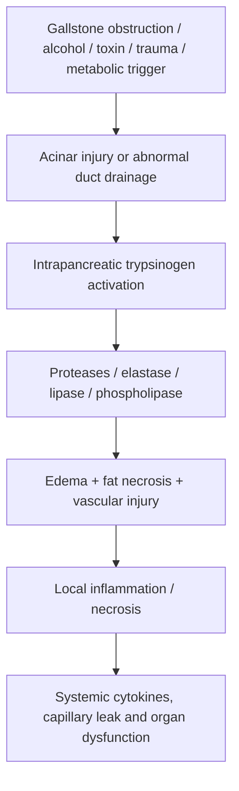
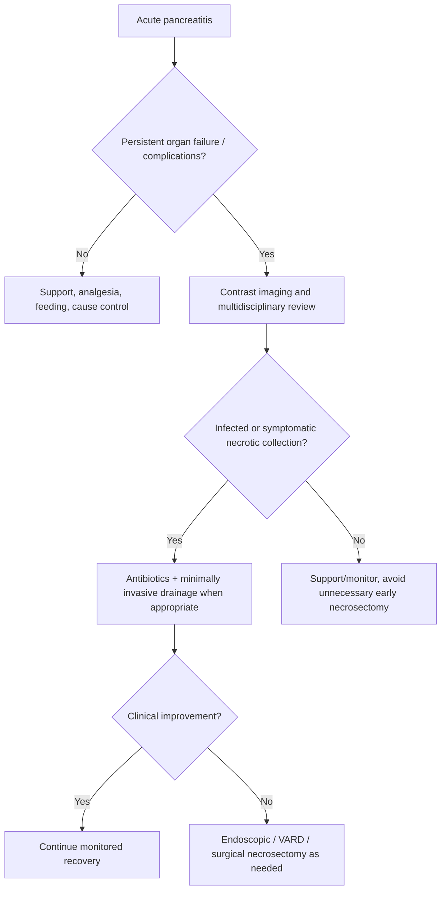
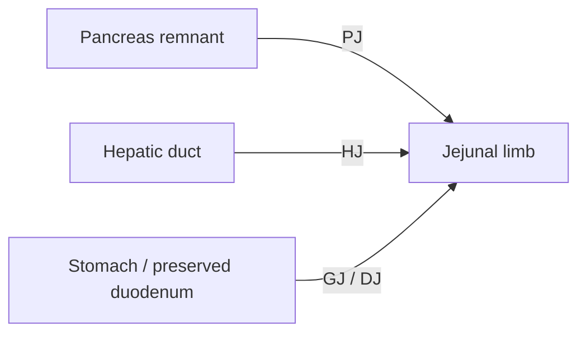
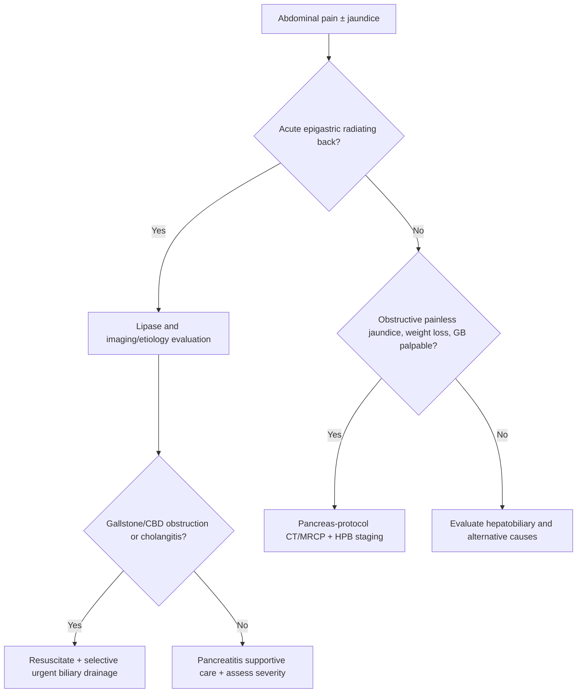
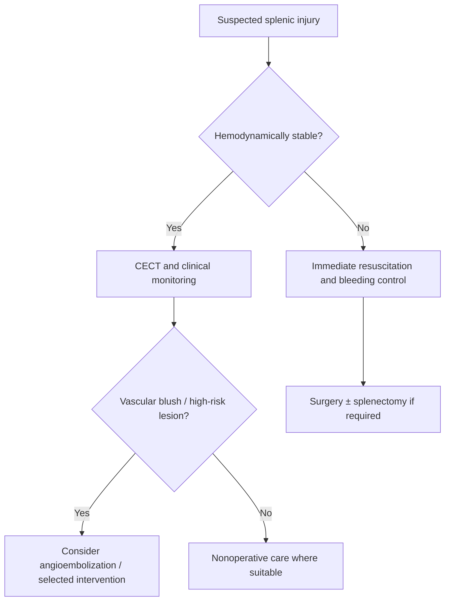

# 18 — Pancreatic and Splenic Surgery

> [!info] Source map
> **World of Revision (WOR), Surgery—Hepatobiliary & Minimally Invasive Surgery pp. 109–131; Trauma and Burns—Splenic/Liver Injury; Transplant**; **Doctut Merged—Pancreas Basics, Acute/Chronic Pancreatitis, Pancreatic Tumors, Spleen, Splenectomy and Complications**; **Robbins Pocket Companion 9e, Chapter 19—The Pancreas pp. 883–897 and Chapter 13—Spleen pp. 623–625**; **First Aid 2025, Gastrointestinal pp. 363–408 and corresponding endocrine topics**. Clinical algorithms are educational reconstructions of source principles. Some older operative thresholds and cancer staging conventions are not universally applicable; see appendix.

# Part A — Pancreatic Surgery

## 1. Surgical anatomy and pancreatic development

### Normal anatomy
- **Retroperitoneal gland**, except tail in **splenorenal ligament** adjacent to splenic hilum; head lies in duodenal C-loop, **uncinate process** is related posteriorly to superior mesenteric vessels, neck overlies **SMV–portal vein confluence**, and body/tail extend toward spleen.
- **Main duct (Wirsung)** commonly joins distal CBD at ampulla of Vater; accessory duct (**Santorini**) may drain through **minor duodenal papilla**.
- **Pancreatic head** shares blood supply and lymphatic relationships with duodenum, explaining why **pancreaticoduodenectomy** removes both together.
- **Splenic artery/vein** run along pancreas toward hilum; pancreatic surgery can damage splenic vessels, produce splenic vein thrombosis or result in **left-sided portal hypertension**.
- Surgical relevance: major peripancreatic vessel relationships—**SMA, SMV, portal vein, celiac axis, common hepatic artery**—largely determine tumor resectability.

### Embryologic buds and defects
- **Dorsal + ventral endodermal buds** normally rotate/fuse. Ventral bud forms the lower head/uncinate region; dorsal bud contributes most other pancreatic tissue.

| Anomaly | Developmental mechanism | Clinical presentation | Source treatment principle |
|---|---|---|---|
| **Pancreas divisum** | Failure of ductal fusion → most secretions drain via **minor papilla** | Often asymptomatic; recurrent pancreatitis in some | MRCP/ERCP for anatomy; selected minor papillotomy/stent (WOR/Doctut) |
| **Annular pancreas** | Abnormal rotation creates pancreatic ring around **second duodenum** | Congenital obstruction, often **nonbilious vomiting** if proximal | **Duodenoduodenostomy** or bypass; avoid simple pancreatic division |
| **Ectopic pancreas** | Pancreatic tissue in stomach, duodenum, jejunum, Meckel diverticulum, etc. | Usually incidental; can cause pain or bleeding | Treat only selected symptomatic lesions |
| **Pancreatic agenesis/hypoplasia** | Developmental failure (PDX1-associated forms in Robbins) | Diabetes/exocrine effects depending on extent | Individual management |

> [!tip] One-liner
> **Pancreas divisum = dorsal duct dominance and minor papilla drainage; annular pancreas = encircles D2 causing duodenal obstruction.**

## 2. Why the pancreas does not normally autodigest itself

### Protective mechanisms (Robbins)
1. **Inactive zymogens** made in acinar cells, packed in granules.
2. **Trypsinogen** normally activated in duodenum by **enteropeptidase**, and active trypsin activates other pancreatic proenzymes.
3. Endogenous **SPINK1** inhibits premature trypsin activity.
4. Proper organelle trafficking separates zymogens from lysosomal hydrolases.
5. Protease/autodegradation mechanisms help limit accidental intrapancreatic enzyme activation.

### Acute pancreatitis cascade

- **Trypsin** amplifies activation cascades, inflammatory pathways, kinin and coagulation systems.
- **Lipase** → adipose breakdown → **fat necrosis** and calcium-fatty acid **saponification** (hypocalcemia in severe disease).
- **Elastase and proteases** → vessel injury, tissue digestion and bleeding.
- Severe systemic inflammation → shock, **ARDS**, AKI, coagulopathy, metabolic derangement.

## 3. Acute pancreatitis: etiologies and diagnosis

### Etiologies
| Category | Common examples mentioned across sources |
|---|---|
| Biliary | **Gallstones (most frequent overall)**, CBD/ampullary obstruction |
| Toxic | **Alcohol**, selected drugs (azathioprine, thiazides, antiretrovirals, chemotherapy), scorpion envenomation |
| Metabolic | **Hypertriglyceridemia** (First Aid highlights >1000 mg/dL), **hypercalcemia/hyperparathyroidism** |
| Mechanical | Trauma (important in children), ERCP, pancreas divisum, periampullary obstruction |
| Infectious | **Mumps** and some other infections |
| Genetic | **PRSS1**, **SPINK1**, CFTR-related susceptibility |
| Other | Autoimmune pancreatitis, ischemia/shock, idiopathic |

**First Aid mnemonic:** *I GET SMASHED*—Idiopathic, Gallstones, Ethanol, Trauma, Steroids, Mumps, Autoimmune, Scorpion sting, Hypercalcemia/hypertriglyceridemia, ERCP, Drugs. It is a memory aid, not a ranked epidemiologic list.

### Diagnosis: two of three criteria (First Aid)
- Typical **acute severe epigastric pain radiating to the back**;
- **Lipase or amylase ≥3 × upper limit of normal**;
- Compatible **cross-sectional imaging** if required.

**Important nuance:** an unequivocal case meeting pain + enzymes need not undergo early CT solely for confirmation. Imaging is valuable for uncertain diagnosis or complication assessment; source notes emphasize **delayed CT** for necrosis/severity assessment.

### Clinical and lab features
- Epigastric pain radiating to back, nausea/vomiting, abdominal tenderness/ileus, tachycardia.
- Severe hemorrhagic inflammation: **Cullen sign** (periumbilical ecchymosis) and **Grey Turner sign** (flank ecchymosis)—late, uncommon, not sensitive.
- **Serum lipase** more specific/longer-lasting than amylase in First Aid; amylase alone is not a reliable severity index.
- **Hypocalcemia**: calcium soaps in fat necrosis; metabolic acidosis/raised BUN/hemoconcentration can indicate worse illness.

### Classical radiographic findings
| Finding | Interpretation |
|---|---|
| **Sentinel loop** | Focal adynamic dilated proximal jejunal loop in upper abdomen |
| **Colon cut-off sign** | Colonic gas stops at splenic flexure from localized ileus/inflammation |
| **Gasless abdomen/ileus** | Diffuse bowel hypomotility in severe disease |
| **CECT** | Edema, collections, necrosis, vascular and other complications |

## 4. Severity assessment: Ranson, BISAP and revised Atlanta

### Ranson criteria (source classical admission set)
| Admission variable | Threshold |
|---|---|
| Age | **>55 years** |
| WBC | **>16,000/µL** |
| Glucose | **>200 mg/dL** |
| AST | **>250 IU/L** |
| LDH | **>350 IU/L** |

**At 48 h in WOR:** hematocrit fall >10%, BUN rise >5 mg/dL, serum calcium <8 mg/dL, PaO₂ <60 mmHg, base deficit >4 mEq/L and fluid sequestration >6 L (classic non-gallstone version). Higher score suggests worse course. Gallstone-specific variants exist; avoid rigidly mixing scores.

### Other indices
- **BISAP:** used for early bedside risk estimate; WOR uses **score ≥3** as a high-risk cue.
- **Glasgow-Imrie:** multi-factor severity scoring; **≥3** suggests severity in classic exam teaching.
- **Balthazar / CT severity index:** inflammation and necrosis grading; WOR lists **≥6** as important, but **organ failure duration** is central to revised Atlanta clinical severity.

### Revised Atlanta clinical classification
| Grade | Core definition |
|---|---|
| **Mild** | No organ failure, no major local/systemic complication |
| **Moderately severe** | Transient organ failure **<48 h**, local complications or exacerbation of coexisting disease |
| **Severe** | Persistent organ failure **>48 h** (one or multiple organs) |

- **Acute interstitial edematous pancreatitis** generally preserves parenchyma; **necrotizing pancreatitis** has parenchymal and/or peripancreatic necrosis.
- **Infected necrosis** is a major source of sepsis. Early mortality may come from organ failure; later from infected collections and complications.

## 5. Local pancreatic collections — a very high-yield comparison

| Collection | Usually before or after 4 weeks | Contents | Wall | Typical context |
|---|---|---|---|---|
| **Acute peripancreatic fluid collection (APFC)** | **<4 weeks** | Homogeneous fluid | No mature wall | **Interstitial** edematous pancreatitis |
| **Pancreatic pseudocyst** | **>4 weeks** | Mostly **fluid**, little/no solid necrosis | Well-demarcated fibrous/granulation wall | After interstitial pancreatitis/duct leak |
| **Acute necrotic collection (ANC)** | **<4 weeks** | **Fluid + necrotic debris**, heterogeneous | Immature wall | Necrotizing pancreatitis |
| **Walled-off necrosis (WON)** | **>4 weeks** | Encapsulated heterogeneous **necrotic** material | Mature inflammatory wall | Necrotizing pancreatitis |

**Pseudocyst = false cyst** because lining is **granulation/fibrous tissue, not epithelium** (Robbins). Its common location is **lesser sac** (WOR). Collections may resolve spontaneously or become infected, bleed, rupture, obstruct stomach/bile duct or cause pancreatic fistula.

### d’Egidio pseudocyst classification (WOR)
- **Type I:** after acute pancreatitis, generally no established chronic duct pathology.
- **Type II:** acute-on-chronic pancreatitis, duct communication variable.
- **Type III:** chronic pancreatitis-associated ductal change and established cyst–duct communication.

### Indications to intervene
- Do not intervene solely because a cyst exceeds a historical **6-cm / 6-week** rule. Those figures appear in WOR as exam cues, but the more useful considerations are **symptoms, infection, hemorrhage, obstruction, persistence/growth, suspected neoplasm, and ductal anatomy**.
- **Internal drainage:** endoscopic or operative **cystogastrostomy** / **cystojejunostomy** for appropriately mature symptomatic collections.
- **External drainage:** catheter for infected/inaccessible collections or selected emergencies, with caution when communicating with pancreatic duct because of **external pancreatic fistula** risk.
- **WON** may require necrosectomy, often after maturation when safe.

## 6. Acute pancreatitis management principles

### Initial care
1. Assess severity, fluid status, **oxygenation and organ function**; identify etiologic trigger.
2. Provide **analgesia**, careful IV fluid resuscitation and electrolyte monitoring; assess urine output, BUN/creatinine, calcium and respiratory status.
3. **Early enteral/oral nutrition when tolerated** rather than indefinite blanket NPO; use tube feeding if oral feeding not feasible and intestine usable.
4. Check biliary tree, triglycerides, calcium and medication triggers.
5. Antibiotics for **established/suspected infected necrosis or extrapancreatic infection**, not prophylactically for all sterile pancreatitis.

### Gallstone pancreatitis and ERCP
- For **concurrent cholangitis or significant ongoing biliary obstruction**, urgent biliary decompression/therapeutic **ERCP** may be required.
- When gallstone source is confirmed and patient recovers, **cholecystectomy** prevents recurrent attacks; timing varies with mild vs severe disease and local collections.
- A routine ERCP for every case of gallstone pancreatitis is **not** established by the sources.

### Infected necrosis: step-up approach

- **Step-up** in Doctut: **percutaneous catheter drainage → VARD (video-assisted retroperitoneal debridement) or other minimally invasive necrosectomy → open surgery if needed**.
- **Timing matters:** whenever clinically safe, waiting for organization of necrosis facilitates safer debridement.
- Recognize complications: infected collections, **splenic vein thrombosis**, pseudoaneurysm/hemorrhage, pancreatic ascites, duct disruption and fistula, organ failure.

## 7. Chronic pancreatitis

### Pathogenesis
- **Irreversible acinar destruction and fibrosis** from recurrent or sustained pancreatic injury.
- Mechanistic sequence (Robbins): repeated injury → inflammatory mediators, **TGF-β and PDGF** → pancreatic stellate/myofibroblast activation → collagen deposition and ductal distortion.
- Later there is loss of **exocrine enzymes** and **endocrine islets**; calcifications and protein plugs occur, particularly with alcohol-associated disease.

### TIGAR-O etiologic framework
| Letter | Category | Source examples |
|---|---|---|
| **T** | Toxic-metabolic | Alcohol, diet/metabolic factors |
| **I** | Idiopathic | Including tropical calcific presentations |
| **G** | Genetic | **PRSS1**, SPINK1, CFTR-related |
| **A** | Autoimmune | **IgG4-related** autoimmune pancreatitis |
| **R** | Recurrent acute | Recurrent attacks, gallstone-related injury |
| **O** | Obstructive | Duct stones, strictures, pancreas divisum |

### Clinical pattern and investigation
- **Chronic pain** (upper abdomen radiating back) from obstruction/fibrosis and neural inflammation.
- **Steatorrhea, malabsorption and fat-soluble vitamin deficiency** after marked exocrine loss.
- **Pancreatogenic/type 3c diabetes** due to endocrine insufficiency.
- **CT:** gland atrophy, **calcifications, duct dilation** and associated complications.
- **MRCP (often with secretin in selected cases):** duct obstruction/dilatation/strictures; **“chain of lakes”** appearance.
- **EUS** can assess early parenchymal/ductal changes (Doctut mentions Rosemont criteria); ERCP is now primarily therapeutic rather than routine diagnostic.
- **Fecal elastase** supports exocrine deficiency evaluation; Doctut quotes <200 µg/g stool as abnormal. Direct/other function tests are available in source headings.

### Management of pain, insufficiency and complications
- Avoid etiologic triggers (including alcohol where relevant), use stepwise analgesia, pancreatic enzyme replacement with meals for malabsorption and appropriate diabetes care.
- **Duct decompression** improves pain in selected obstructed/dilated ducts; intraductal stones/strictures may be managed endoscopically or surgically.
- **Celiac plexus block** may be a temporary option for selected refractory pain but does not correct anatomy.

### Named chronic pancreatitis operations
| Procedure | Primary technique | Main logic |
|---|---|---|
| **Modified Puestow / Partington–Rochelle** | Longitudinal pancreatic duct opening with **side-to-side pancreaticojejunostomy** | Drain **dilated** main duct; source thresholds often **>6–7 mm** |
| **Frey procedure** | **Core out inflammatory pancreatic head** + longitudinal duct drainage to jejunum | Hybrid **resection + drainage** for enlarged head with ductal changes |
| **Beger** | **Duodenum-preserving pancreatic head resection** | Inflammatory pancreatic head with desire to preserve duodenum |
| **Berne modification** | Limited duodenum-preserving head excavation | Variant of Beger |
| **Izbicki / V-shaped excision** | V-shaped ventral pancreatic excision and drainage | Small or nondilated ducts in selected cases |
| **Child–Duval** | Historical distal duct resection/terminojejunal drainage | Named procedure in source comparisons; not default modern surgery |
| **Distal pancreatectomy ± splenectomy** | Resect diseased body/tail | Localized tail pathology or complication |
| **Whipple / pancreaticoduodenectomy** | Resect head/duodenum | Suspicion/confirmation of cancer or selected complex head disease |

> [!tip] Distinguish operations
> **Puestow = drainage**, **Frey = head coring + drainage**, **Beger = duodenum-preserving head resection**, **Whipple = pancreatic head + duodenum resection**.

## 8. Pancreatic cystic lesions and neoplasms

### Four frequent entities to distinguish

| Entity | Typical patient/location | Cyst fluid / pathology | Cancer potential and operative logic |
|---|---|---|---|
| **Pseudocyst** | After pancreatitis/trauma, often **lesser sac** | **No epithelial lining**, granulation/fibrous wall, high pancreatic enzymes | Not a true neoplasm; intervene for complications |
| **Serous cystic neoplasm (SCN)** | Often older woman, frequently tail | Many small cysts/microcystic, **central scar**, VHL association (Robbins) | Usually benign; observe typical asymptomatic lesions, resect selected symptomatic/uncertain |
| **Mucinous cystic neoplasm (MCN)** | Typically middle-aged woman, **body/tail** | **Ovarian-type stroma**, mucin, ER/PR often positive; no main duct communication classically | Malignant potential → selected resection; source raises CEA and ovarian stroma |
| **Intraductal papillary mucinous neoplasm (IPMN)** | More often head, sometimes multifocal | **Duct-communicating mucin-producing papillary lesion**; fish-mouth ampulla with mucin | Main-duct vs branch-duct risk differs; assess high-risk features and resect selected cases |

- **Solid pseudopapillary neoplasm:** typically young women; encapsulated solid-cystic mass; **β-catenin/CTNNB1** pathway (Robbins), usually favorable after complete resection.
- **Pancreatic cyst workup:** CT/MRI/MRCP, **EUS** and fluid studies in appropriate circumstances; **CEA** helps support mucinous character, but **CEA level alone does not prove malignancy**.
- **Do not confuse a cystic tumor with a postpancreatitis pseudocyst**; an unrecognized MCN/IPMN can be mismanaged if treated as a simple pseudocyst.

## 9. Pancreatic neuroendocrine tumors (pNETs)

### Insulinoma, gastrinoma, glucagonoma

| Tumor | Hormone/source | Clinical hallmark | Main diagnostic clue |
|---|---|---|---|
| **Insulinoma** | β-cell insulin | **Whipple triad:** hypoglycemic symptoms, documented low glucose, relief with glucose | Supervised **72-hour fast**: inappropriate endogenous insulin, **C-peptide** and other biochemical findings during hypoglycemia; EUS/other imaging localizes |
| **Gastrinoma** | Gastrin-secreting pNET | **Zollinger–Ellison syndrome:** recurrent/refractory ulcers, distal duodenal/jejunal ulcers, diarrhea | Fasting **gastrin** (interpret with acid status/PPI use), **secretin stimulation** when appropriate; associated **MEN1** |
| **Glucagonoma** | α-cell glucagon | **4 Ds:** dermatitis (**necrolytic migratory erythema**), diabetes, **DVT**, depression | Hormonal evaluation + imaging |

- WOR emphasizes insulinomas often small and frequently benign; selected localized insulinomas may be treated by **enucleation** while others require resection.
- **Passaro gastrinoma triangle**: boundary region involving junction of cystic duct/CHD, 2nd/3rd duodenum junction, and pancreatic head/neck; explains common gastrinoma localization. Doctut specifies many are within the triangle.
- **Gastrinoma** often has multifocal lesions in MEN1; management combines acid control (**PPIs**), staging/localization, selected surgery and metastatic disease therapy.
- Pancreatic NET workup differs from exocrine ductal adenocarcinoma; pancreatic masses are not all PDAC.

## 10. Pancreatic ductal adenocarcinoma (PDAC)

### Risk, biology and clinical pattern
- **Most common pancreatic malignancy**; usually **infiltrating ductal adenocarcinoma** (Robbins/First Aid).
- Risk factors: **smoking**, chronic pancreatitis, age, diabetes, obesity and hereditary predisposition (source genes/syndromes include **PRSS1/SPINK1**, **BRCA2**, **Peutz–Jeghers/STK11**, Lynch-related disorders).
- **KRAS** activating mutation is especially frequent (First Aid/Doctut); other alterations in source chapters include tumor suppressors such as **CDKN2A, TP53 and SMAD4**.
- **Head cancer:** obstructive jaundice, pale stool, pruritus, weight loss, RUQ/epigastric pain radiating back; possible palpable distended nontender GB (**Courvoisier sign**).
- **Body/tail cancer:** often presents later with pain, weight loss and spread; may not obstruct CBD early.
- **Migratory thrombophlebitis (Trousseau syndrome)** is a paraneoplastic hypercoagulable clue (First Aid).

### Periampullary cancers (four structures)
1. **Pancreatic head** ductal adenocarcinoma.
2. **Ampullary** cancer at Vater (often early/intermittent painless jaundice; may bleed/melena).
3. **Distal CBD** cholangiocarcinoma.
4. **Duodenal** adenocarcinoma near ampulla.

**Shared symptoms:** biliary obstruction ± duodenal obstruction. **Clinical distinction:** ampullary tumors may intermittently obstruct when tumor sloughs, giving waxing/waning jaundice (WOR/Doctut).

### Investigation
- **Pancreas-protocol multiphase contrast CT** to identify lesion, map **vascular interface**, nodes, distant metastases and resectability.
- **MRCP:** pancreatic and bile duct relationship, **double duct sign** (both CBD and pancreatic duct dilated).
- **EUS ± biopsy:** source diagnostic tissue in appropriate contexts, especially if nonoperative/neoadjuvant systemic therapy is contemplated.
- **CA19-9** is a supportive **tumor marker**, affected by cholestasis and other conditions; **not** a stand-alone diagnostic screen.
- **Frostberg “reverse 3” sign:** classic contrast duodenography clue to external duodenal impression by pancreatic head mass, historical imaging association.

### Resectability framework
| Category | Central concept | Why it matters |
|---|---|---|
| **Resectable** | No distant spread and technically removable local tumor with acceptable vessel involvement | Consider surgery with oncology input |
| **Borderline resectable** | Close arterial interface and/or reconstructible portal/SMV involvement | Often requires multidisciplinary/neoadjuvant planning |
| **Locally advanced unresectable** | Extensive nonreconstructible vascular/arterial involvement | Usually nonsurgical upfront |
| **Metastatic** | Distant disease | Systemic/palliative treatment emphasis |

- WOR/Doctut describe **abutment vs encasement** using degrees of vessel contact. Particularly important: **SMA, common hepatic artery and celiac axis** compared with **SMV/portal vein**, which may sometimes be reconstructed.
- Historical exact cutoffs differ across their tables, so **do not equate one >180° threshold with an automatic operation order**; refer to an up-to-date institution-specific staging system for real care.

## 11. Pancreatic operations and postoperative complications

### Whipple pancreaticoduodenectomy
**Main indications from WOR/Doctut:** selected resectable **pancreatic head, periampullary, distal CBD and duodenal tumors**; occasionally complex nonmalignant head disease.

**Classical structures removed:** pancreatic **head + duodenum + distal stomach** (with pylorus-preserving modification where appropriate), **distal bile duct + gallbladder** and regional lymphatic tissue.

**Main reconstruction:**
1. **Pancreaticojejunostomy (PJ)** for pancreatic secretions.
2. **Hepaticojejunostomy (HJ)** for bile drainage.
3. **Gastrojejunostomy (GJ)** or **duodenojejunostomy** in pylorus-preserving operation.

**Complications:**
- **Postoperative pancreatic fistula / PJ anastomotic leak**—leakage of enzyme-rich juice, sepsis, hemorrhage; major concern in WOR.
- **Delayed gastric emptying**—very common functional complication emphasized in Doctut.
- Intra-abdominal abscess, hemorrhage, wound infection, biliary leak/stricture and endocrine/exocrine insufficiency.

**Head vs tail operation:** head → pancreaticoduodenectomy; body/tail → **distal pancreatectomy**, often with splenectomy when cancer/vascular anatomy requires, but spleen-preserving approaches may be considered in selected benign disease.

### Palliative treatment for unresectable obstructing PDAC
- **Biliary SEMS** by ERCP or percutaneous intervention for jaundice/cholangitis.
- **Duodenal stent/gastrojejunostomy** for gastric outlet obstruction.
- **Pain management** including selected celiac plexus procedures.
- **Systemic chemotherapy:** WOR mentions **FOLFIRINOX**; regimen depends on fitness, tumor extent and oncology assessment.
- Historical “triple bypass” includes biliary and gastric bypass procedures when endoscopic management unsuitable; not default for every patient.

## 12. Pancreatic trauma and selected complications
- Pancreatic injury may be **retroperitoneal and initially occult**. Assess mechanism, CT findings and especially **main pancreatic duct** involvement.
- **Minor injuries:** observation/drainage in selected cases; **disrupted main duct** can need operative or endoscopic management.
- **Distal pancreatic injury with duct transection:** distal pancreatectomy ± splenectomy discussed in Doctut.
- Head injury frequently coexists with major duodenal/vascular trauma and needs complex decision-making; damage-control drainage may precede reconstruction.
- **Splenic vein thrombosis from pancreatitis** → isolated gastric varices/left portal hypertension, connecting pancreas to the splenic chapter.

---

# Part B — Splenic Surgery

## 13. Spleen: surgical anatomy and physiology

### Anatomy
- **Largest lymphoid organ**, under left diaphragm, usually opposite ribs **9–11**, with long axis approximating **10th rib** (Doctut).
- Embryology: develops from **dorsal mesogastrium**.
- Relationships: stomach, left kidney, splenic flexure, diaphragm and pancreatic tail.

| Peritoneal attachment | Main contents/clinical point |
|---|---|
| **Gastrosplenic ligament** | **Short gastric vessels** and left gastroepiploic vessels; preserve/ligate appropriately during splenectomy |
| **Splenorenal (lienorenal) ligament** | **Splenic artery/vein and tail of pancreas**; pancreatic tail injury risk |
| **Splenocolic ligament** | Attachment near splenic flexure; risk to colon during mobilization |
| **Splenophrenic ligament** | Splenic attachment to diaphragm |

### White pulp, red pulp and marginal zone
- **White pulp:** lymphocytes around arterioles and follicles; immune surveillance and antibody responses.
- **Red pulp:** sinusoids and reticuloendothelial cords, filter aged/damaged RBCs and inclusions.
- **Open circulation** makes cells traverse splenic filtration cords/sinuses; rigid spherocytes and damaged erythrocytes are preferentially removed.
- **Marginal zone:** immune recognition, especially relevant to encapsulated bacteria and IgM responses.

### Major functions
1. **Filtration (“culling”)** of old/abnormal RBCs and removal (“pitting”) of inclusions.
2. **Immune defense**, especially against **encapsulated organisms**.
3. **Platelet pooling/sequestration**; approximately a substantial fraction of circulating platelets may reside in the spleen.
4. Phagocytic and antibody-related functions (Doctut mentions **tuftsin, properdin, IgM**).
5. Fetal/extramedullary hematopoiesis in selected disease states.

### Peripheral smear clues after splenectomy/hyposplenism
- **Howell–Jolly bodies:** nuclear DNA remnants, hallmark of impaired splenic filtration.
- **Pappenheimer bodies:** iron-containing inclusions; **Heinz bodies** may persist and require special stain; target cells and other altered RBC morphology may be more evident.
- Postsplenectomy transient **thrombocytosis/leukocytosis** is common; trends and thrombotic risk depend on underlying condition.

## 14. Splenic trauma

### Mechanisms and assessment
- Spleen is the most commonly injured solid abdominal organ in blunt trauma in WOR; left lower rib fractures, deceleration and LUQ impact raise suspicion.
- Examine hemodynamics, abdomen and associated chest injuries; eFAST detects fluid but **does not exclude splenic injury**.
- **Hemodynamically stable:** **CECT** grades injury and identifies vascular blush/pseudoaneurysm; select **nonoperative care** and/or **splenic artery embolization**.
- **Unstable with ongoing intra-abdominal hemorrhage:** immediate hemorrhage control, often operative; definitive splenectomy when preservation unsafe.

### AAST splenic injury grade: classical source framework
| Grade | Major finding from WOR | Broad approach |
|---|---|---|
| **I** | Subcapsular hematoma <10% surface or laceration <1 cm | Usually nonoperative if stable |
| **II** | Subcapsular 10–50%, small intraparenchymal hematoma, laceration 1–3 cm | Usually nonoperative if stable |
| **III** | Subcapsular >50%, larger intraparenchymal hematoma or laceration >3 cm | Observation/embolization if stable; higher failure risk |
| **IV** | Segmental/hilar vascular injury with major devascularization | Embolization/surgery depending on physiology |
| **V** | Shattered spleen or hilar vascular injury with major devascularization | Often splenectomy if unstable |

**Modern AAST detail and management may differ from the simplified source table**; above is a classic exam-recognition framework. **Hemodynamic stability is more important than grade alone**.

### Spleen-preserving methods
- Observation, serial vitals/hemoglobin, close clinical review and appropriate CT follow-up.
- **Angioembolization** for stable patients with vascular injury/high-risk imaging findings.
- Selected operative **splenorrhaphy, topical hemostasis, partial splenectomy** if anatomy allows.
- **Damage-control splenectomy** may be necessary with massive uncontrolled bleeding.

## 15. Elective splenectomy — indications and selection

### Major conditions from Doctut/Robbins
| Indication | Rationale | Critical distinction |
|---|---|---|
| **Immune thrombocytopenia (ITP)** | Splenic macrophages remove antibody-coated platelets; spleen contributes to autoantibody production | Surgery usually considered in **selected refractory/chronic** disease, not at first diagnosis |
| **Hereditary spherocytosis** | Deformed RBCs are destroyed in spleen | Improves anemia/hemolysis; consider age, disease severity, coexisting gallstones |
| **Thalassemia / selected hemolytic anemia** | Severe hypersplenism or transfusion requirement | Risk-benefit individualized; not all anemia requires splenectomy |
| **Hypersplenism** | Sequestration/destruction of blood cells | Treat underlying disorder; portal hypertension changes risk |
| **Splenic tumor/cyst/abscess** | Lesion removal when partial or medical/drainage strategy unsuitable | Preserve spleen when feasible |
| **Splenic trauma** | Uncontrolled bleeding, shattered spleen | Emergency rather than elective indication |
| **Some hematologic malignancies** | Diagnosis/treatment of selected complications/hypersplenism | Doctut notes reduced use with effective systemic therapies |

### ITP specifics
- Immune-mediated platelet destruction, often **IgG-coated platelets** removed by splenic macrophages; clinical **petechiae, purpura, mucosal bleeding**.
- Source treatments include **corticosteroids**, IVIG, rituximab and thrombopoietin receptor agonists; splenectomy is **second-line in selected patients** with persistent/refractory disease.
- **Assess accessory spleen if relapse** after surgery, since functional splenic tissue can sustain platelet sequestration.
- Very low platelet counts and medication thresholds in the OCR'd Doctut pages are inconsistent; do not import them directly into a treatment order.

### Hereditary spherocytosis
- Membrane defects, especially **spectrin/ankyrin/band-3-related** instability → spherical RBCs cannot deform through splenic cords → **extravascular hemolysis**.
- Features: anemia, jaundice, splenomegaly, reticulocytosis, indirect hyperbilirubinemia and **black pigment gallstones**; **Coombs test negative**.
- Splenectomy reduces hemolysis but carries permanent infection risk. Doctut emphasizes combining **cholecystectomy** when indicated for gallstones in affected patients and timing in childhood.

### Operations
- **Laparoscopic splenectomy** for selected elective disease; **hand-assisted/open** approaches in massive splenomegaly, complex adhesions or hemorrhage.
- Identify **accessory spleens**; protect **pancreatic tail**; control hilar and short gastric vessels.
- The source's claims that portal hypertension or a precise spleen weight are universal laparoscopic contraindications are older shorthand: operative approach depends on surgical expertise, anatomy and risk.

## 16. Other surgical spleen diseases

### Accessory spleen vs splenosis
| Feature | Accessory spleen | Splenosis |
|---|---|---|
| Origin | Congenital persistent separate splenic primordium | Acquired implantation of splenic tissue after trauma/surgery |
| Common locations | **Splenic hilum**, pancreatic tail, splenic ligaments | Multiple serosal/peritoneal locations after rupture |
| Structure | Organized capsule and red/white pulp | Implants can function but vascular architecture differs |
| Why important | Failure of splenectomy for ITP if missed | Can simulate metastases or nodules on imaging |

### Splenic abscess
- Risk: bacteremia/endocarditis, immunosuppression, trauma/infarction, hemoglobinopathy and fungal disease in selected hosts.
- Symptoms: fever, LUQ pain, tender splenomegaly; US/CECT locate collections.
- **Antibiotics + percutaneous drainage** in appropriate solitary accessible collections; **splenectomy** for multiple, complex or failed drainage cases (Doctut).

### Splenic cyst
- **True/epidermoid cyst:** epithelial lining; may contain keratinous contents; often congenital.
- **Pseudocyst:** no epithelial lining, often posttraumatic.
- **Hydatid cyst:** parasitic, requires specific antihelminthic/procedural precautions.
- Surgical choices include **observation, fenestration or partial splenectomy**, aiming to preserve meaningful splenic tissue for suitable benign disease.

### Wandering spleen
- Lax/absent splenic suspensory ligaments → mobile spleen and long vascular pedicle → intermittent pain and **torsion**.
- **Whirl/whorled pedicle** on CT suggests torsion.
- **Splenopexy** if viable and preserveable; splenectomy if infarcted/nonviable.

### Splenic artery aneurysm and pseudoaneurysm
- True aneurysm can be associated with vascular/arteriosclerotic conditions and pregnancy; **rupture risk particularly important in pregnancy** in Doctut.
- **Pancreatitis** can erode splenic vessels to form **pseudoaneurysm** and cause catastrophic bleeding.
- Assess by arterial-phase CT/angiography; treatment options include embolization, ligation/resection, or splenectomy when required.
- Doctut gives variable older size thresholds (~1.5–2 cm); avoid a one-size-fits-all procedural rule.

### Splenic neoplasms
- **Lymphoma** commonly involves spleen; primary tumor types include **hemangioma** (benign) and rare vascular malignancy.
- Splenic **metastases are uncommon** compared with hepatic secondaries.
- Modern systemic therapy often reduces the role of staging/therapeutic splenectomy for many hematologic cancers (Doctut).

## 17. Splenectomy complications and OPSI

### Immediate and delayed problems
| Timing | Complication | Mechanism |
|---|---|---|
| Intraoperative/early | **Bleeding** | Splenic hilar or short gastric vessel injury |
| Early | **Pancreatic tail injury, fistula, pancreatitis** | Tail lies in splenorenal region near hilum |
| Early | Left basal atelectasis/pleural injury | Left subdiaphragmatic surgery |
| Early/intermediate | **Subphrenic abscess / infected collection** | Contamination or residual collection |
| Delayed | **Portal/splenic/mesenteric venous thrombosis** | Postsurgical vascular flow and thrombocytosis/underlying disease |
| Long term | **Overwhelming postsplenectomy infection (OPSI)** | Impaired clearance of encapsulated organisms |

### OPSI: pathophysiology
- Loss of splenic macrophage filtration, marginal-zone B-cell response and effective opsonization predisposes to **rapid invasive infection**.
- Principal source organisms: ***Streptococcus pneumoniae***, ***Neisseria meningitidis*** and ***Haemophilus influenzae* type b**; other infections (including certain parasites) may become more severe.
- **Can occur years after splenectomy**, not only during the first 2 years. Fever in an asplenic patient deserves prompt assessment because deterioration may be rapid.

### Prevention strategy (source-derived principles)
- Provide appropriate **pneumococcal, meningococcal and Hib vaccination** and standard additional recommended vaccines per clinical schedule.
- Ideally vaccinate **before elective splenectomy** when practical; emergency splenectomy requires later postoperative immunization planning.
- Educate patient to seek **immediate medical assessment for fever**, travel/bite-related risks and infection prevention; some patients need antibiotics according to risk profile.
- Document asplenia in medical record and follow up vaccine scheduling/boosters.
- Exact schedules and Doctut’s figures for mortality/timing are old and **not used as fixed current clinical advice** here.

## 18. Integrated clinical approaches

### Pain + jaundice + pancreatic/liver lesion

### Splenic injury decision concept

## 19. Rapid revision: pancreatic vs splenic magic words

| Vignette clue | Most useful diagnosis/procedure |
|---|---|
| Recurrent pancreatitis + majority pancreatic juice through minor papilla | **Pancreas divisum** |
| Duodenal obstruction with ring of pancreas around D2 | **Annular pancreas** |
| Epigastric pain to back + lipase ≥3× ULN | **Acute pancreatitis** |
| Flank bruising in severe pancreatitis | **Grey Turner sign** |
| Periumbilical bruising in hemorrhagic pancreatitis | **Cullen sign** |
| Focal LUQ ileus on abdominal X-ray | **Sentinel loop** |
| Distended colon ending at splenic flexure | **Colon cut-off sign** |
| Fluid-only mature cyst after pancreatitis without epithelium | **Pseudocyst** |
| Mature encapsulated heterogeneous necrotic collection | **Walled-off necrosis** |
| Multiple pancreatic duct strictures/stones, “chain of lakes” | **Chronic pancreatitis** |
| Longitudinal pancreaticojejunostomy for dilated duct | **Modified Puestow** |
| Head excavation + longitudinal drainage | **Frey** |
| Duodenum-preserving head resection | **Beger** |
| Fasting hypoglycemia, glucose relief, endogenous insulin/C-peptide | **Insulinoma** |
| Refractory ulcers in atypical distal sites + diarrhea | **Gastrinoma** |
| Necrolytic migratory erythema + diabetes | **Glucagonoma** |
| Mucin from patulous fish-mouth ampulla | **IPMN** |
| Middle-aged woman, body/tail cyst with ovarian stroma | **MCN** |
| Young woman, solid-cystic neoplasm with β-catenin activation | **Solid pseudopapillary tumor** |
| Obstructive jaundice, double-duct sign, CA19-9 association | **PDAC head** |
| PJ + HJ + GJ reconstruction | **Whipple** |
| Left upper-quadrant trauma, stable CT splenic tear | **Nonoperative splenic injury management** |
| Spleen hilum/tail of pancreas nodule after splenectomy, recurrent ITP | **Accessory spleen** |
| Old splenic trauma + multiple implants | **Splenosis** |
| Sickle cell anemia or asplenia + Howell–Jolly bodies | **Hyposplenism** |
| Pancreatitis + isolated gastric varices | **Splenic vein thrombosis / sinistral portal HTN** |
| Fever years after splenectomy, rapidly ill | **OPSI** |

### Chapter 18 source locations
- **WOR Surgery—Hepatobiliary & Minimally Invasive Surgery:** *Pancreatic Malformations; Acute Pancreatitis; Pseudocyst; Chronic Pancreatitis; Endocrine Tumors of Pancreas; Pancreatic Ductal Adenocarcinoma; IPMN; Mucinous Neoplasm*.
- **WOR Surgery—Trauma:** *Splenic and Liver Trauma*; **WOR Specialty Surgery** for relevant transplant principles.
- **Doctut Merged:** *Pancreas Basics, Acute Pancreatitis, Chronic Pancreatitis, Pancreatic Tumors, Spleen, Splenectomy and its Complications*.
- **Robbins Pocket Companion 9e:** Ch. 19 printed pp. **883–897** (acute/chronic pancreatitis, cystic and solid neoplasms), and Ch. 13 *Spleen* pp. **623–625**.
- **First Aid 2025:** GI sections on acute and chronic pancreatitis and pancreatic adenocarcinoma (printed pp. **404–405**).
