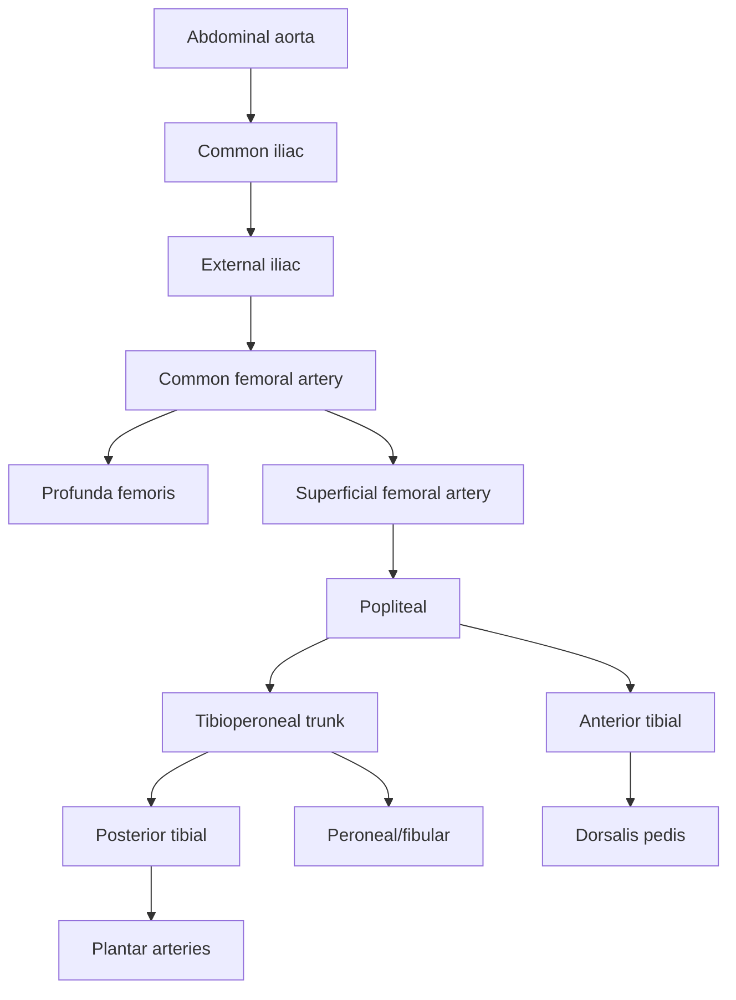
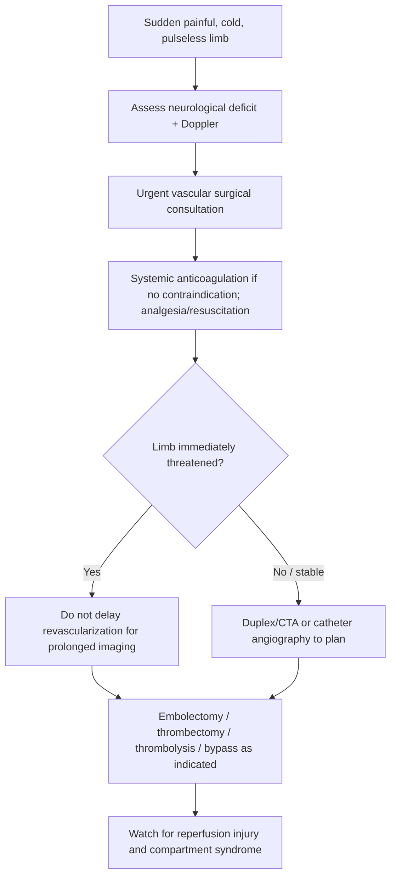
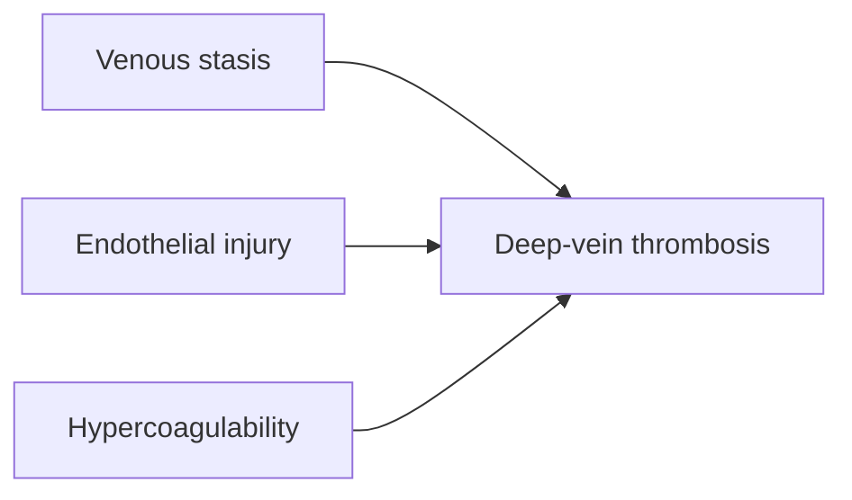

# 20 — Arterial, Venous and Lymphatic Surgery

> [!info] Sources and approach
> Synthesized **only from project documents**, chiefly *World of Revision*, Surgery, **Vascular Surgery pp. 192–206**; *Doctut Merged.md*, `ARTERIAL SYSTEM`, `VENOUS SYSTEM` and allied vascular notes; *Pocket Companion to Robbins*, **Blood Vessels**, and **Hemodynamic Disorders**; *First Aid 2025*, cardiovascular, renal, hematology and pathology; and relevant Bootcamp material in *Combined (reduced).pdf*. This chapter distinguishes verbatim **exam-source conventions** from limitations/contradictions. It is **not a claim that every older source recommendation remains current**.

## 1. Surgical vascular anatomy and physiology

### Arterial supply of the lower limb

- **Aortoiliac disease:** buttock/thigh claudication; **Leriche syndrome** = aortoiliac occlusive disease with buttock claudication, erectile dysfunction and diminished femoral pulses.
- **Superficial femoral/popliteal disease:** calf claudication; **infrapopliteal disease** often affects foot perfusion and tissue loss.
- **Dorsalis pedis** lies lateral to extensor hallucis longus tendon; **posterior tibial pulse** is palpated posterior/inferior to medial malleolus.
- **Collateral flow:** builds gradually in chronic occlusion; absent/insufficient in an acute embolus. Therefore sudden occlusion is often more symptomatic than the same level of chronic stenosis.
- **Watershed tissue:** distal digits and pressure points develop ischemic injury first because of poor reserve.

### Venous drainage
- **Deep veins:** anterior/posterior tibial, fibular, popliteal, femoral, profunda femoris, common femoral and iliac.
- **Superficial veins:** great saphenous vein (**GSV**, medial leg/thigh → femoral vein via **saphenofemoral junction**, SFJ); small/short saphenous vein (**SSV**, posterior calf → popliteal via saphenopopliteal junction, SPJ).
- **Vein of Giacomini:** communication between SSV territory and GSV/posterior thigh.
- **Perforators:** normally conduct blood superficial → deep through the fascia; valves and muscle pump oppose gravitational reflux.
- Source named perforators: **Hunterian** (adductor canal/thigh), **Dodd** (above knee), **Boyd** (below knee), **Cockett** (medial distal leg), **May/Kuster** (heel region).
- **Sural nerve runs close to SSV**: stripping/distal ablation risks sensory nerve injury. **Saphenous nerve accompanies GSV** along medial leg.

### Vascular assessment in a clinical case
1. **Symptoms:** acute vs chronic; claudication distance; rest pain; ulcers/gangrene; unilateral/bilateral swelling; skin change; sudden neurological deficit; chest/back pain.
2. **Risks:** smoking, diabetes, dyslipidemia, hypertension, CKD, atrial fibrillation, immobility, prior DVT, malignancy, pregnancy, family history.
3. **Exam:** color/temperature, capillary refill, hair/nail/trophic changes, edema, pulses **bilaterally** from femoral to pedal, bruits, ulcer site/edge/depth, distal sensation and motor function.
4. **Bedside investigations:** Doppler waveform, **ABI/ABPI**; consider **TBI** in calcified arteries; venous duplex for reflux/DVT; CTA/angiography when intervention planning.
5. **Urgency:** acute limb ischemia with motor/sensory dysfunction, rupturing aneurysm, severe DVT with threatened venous outflow, necrotizing infected foot, acute chest/back pain with vascular instability.

## 2. Peripheral arterial disease (PAD) and chronic limb ischemia

### Pathogenesis
- **Atherosclerosis** causes intimal plaque, progressive luminal stenosis, reduced perfusion pressure and limited flow augmentation during exertion.
- Plaque rupture/erosion can superimpose **thrombosis**; endothelial dysfunction and inflammation contribute to narrowing.
- **Intermittent claudication:** muscle oxygen demand exceeds supply during exercise → reproducible ischemic cramping relieved by rest. **Rest pain** develops when baseline perfusion itself is insufficient.
- High-level disease causes symptoms **one muscular level below an obstruction** (a classic source pattern); symptom distribution and actual arterial anatomy determine localization.
- **Ischemic ulcer/gangrene:** sustained hypoxia, microvascular failure, tissue necrosis and possible superinfection.

### Symptoms and examination

| Stage / symptom | Description | Key interpretation |
|---|---|---|
| Asymptomatic PAD | Abnormal arterial studies without classic pain | Still systemic cardiovascular risk |
| Intermittent claudication | Predictable cramp on walking a set distance; stops with rest | Flow reserve inadequate |
| Rest pain | Forefoot/toe pain, often nocturnal; relief by hanging foot dependent | Severe ischemia, possible limb threat |
| Tissue loss | Nonhealing ulcer, localized gangrene | **Chronic limb-threatening ischemia (CLTI)** when objectively ischemic |
| Acute-on-chronic ischemia | Sudden deterioration on chronic disease | Requires **acute limb ischemia** pathway |

- Typical ischemic limb: cool, pale with elevation, **dependent rubor**, delayed capillary refill, reduced distal hair, shiny thin skin, muscle wasting, weak or absent pulses.
- **Buerger test:** elevate leg → observe pallor; lower leg → reactive rubor. It is a supportive bedside test, not definitive.
- **Claudication differential**:

| Feature | Vascular | Neurogenic (lumbar canal stenosis) | Joint/osteoarthritis |
|---|---|---|---|
| Provocation | Predictable walking distance | Walking/standing; variable distance | Joint loading/motion |
| Relief | **Stopping**, often without changing posture | **Sitting / lumbar flexion** (shopping-cart sign) | Rest and unloading the joint |
| Location | Ischemic muscle group | Buttock/thigh/calf, often bilateral | Affected joint |
| Pulses | Can be reduced | Usually preserved | Usually preserved |
| Other | Trophic change | Back/neurologic symptoms | Tenderness, restricted range |

### ABI/ABPI and TBI

\[
\text{ABI} = \frac{\text{higher ankle systolic pressure (DP or PT)}}{\text{higher brachial systolic pressure}}
\]

| ABI result (source categories) | Interpretation |
|---|---|
| >1.40 | **Noncompressible, calcified arteries**; common diabetes/CKD |
| 0.90–1.40 | Usually normal-range in WOR (some borderline classification conventions vary) |
| <0.90 | PAD likely |
| <0.40 | Severe ischemia / potential CLTI **in context of symptoms and limb findings** |
| Drop >20% after exercise | Supports exercise-induced flow-limiting disease in the source |

- For diabetes/CKD, medial arterial calcification leads to **falsely normal or elevated ABI**; measure **toe pressure/TBI**, Doppler waveforms and other perfusion measures.
- WOR uses **TBI <0.6** as abnormal. Cutoffs vary between testing systems; document method.
- **Duplex ultrasound** maps location/hemodynamic significance; **CTA/MRA** depicts anatomy; **DSA** is useful when endovascular intervention planned.
- A falling ABI is prognostically concerning but **do not treat the old “0.1 fall = exactly 10% increased cardiac mortality” as a universally calibrated risk equation**.

### Fontaine/Boyd/Rutherford clinical staging
- Traditional **Fontaine**: I asymptomatic; IIa/IIb claudication; III rest pain; IV ulcer/gangrene.
- WOR **Boyd** pain classes: early pain on walking, pain partially accommodated while walking, pain forcing stop, finally rest pain. This is a revision mnemonic, not a replacement for objective grading.
- **Rutherford chronic PAD:** 0 asymptomatic; 1–3 mild–severe claudication; 4 rest pain; 5 minor tissue loss; 6 major tissue loss.
- **CLTI** is a syndrome of ischemic rest pain and/or gangrene/ulceration persisting ~2 weeks with objectively documented PAD; **ABI alone does not fully define it**.
- **WIfI** classification assesses **Wound, Ischemia and foot Infection** to estimate threatened limb and benefit of revascularization. (The uploaded revision index mentions CLTI but does **not** provide full WIfI scoring; no source-specific scoring table has been invented.)

### Management — distinguish symptom care, limb salvage and survival

| Goal | Measures covered/linked in project material |
|---|---|
| Reduce systemic atherosclerotic risk | Tobacco cessation, lipid/BP/diabetes management, antithrombotic strategy appropriate to PAD |
| Improve walking function | Structured/supervised exercise, foot protection, selected medication and revascularization for limiting symptoms |
| Salvage threatened tissue | Early vascular assessment, infection management, wound care, **restore perfusion** by endovascular or open procedure when feasible |
| Prevent further harm | Avoid pressure/thermal injury to ischemic foot; careful ulcer evaluation and infection control |
| Treat non-salvageable tissue | Debridement or amputation at appropriate viable level when indicated |

#### Revascularization
- **Endovascular:** balloon angioplasty, selective stenting and other vessel-specific interventions.
- **Open:** **endarterectomy** for suitable local plaque; bypass around long occlusions.
- **Conduit selection from WOR/Doctut:** **Dacron** commonly for aortic/aortobifemoral prosthetic graft; **PTFE** for selected iliac/femoral/above-knee positions; **autologous great saphenous vein** preferred in many infrainguinal/distal bypasses.
- **Reversed vein graft:** reverses venous valves so they do not obstruct arterial flow.
- **In situ vein graft:** vein stays in native bed, valves disrupted by valvulotome; tributaries ligated.
- **Procedural dangers:** thrombosis/restenosis, embolism, bleeding, graft infection, anastomotic pseudoaneurysm, reperfusion injury.
- Important correction to Doctut: saying bypass surgery is **“obsolete”** is incorrect as a universal claim. Both endovascular and bypass approaches remain distinct options; this study note does not assert a modern preference without project-source support.

## 3. Acute limb ischemia (ALI)

### What happens?
**Sudden critically reduced arterial inflow** (typically within 14 days of symptom onset) endangers viable tissue before collaterals can compensate.

**Main mechanisms:**
- **Embolus:** sudden clot traveling from elsewhere, commonly cardiac sources such as **atrial fibrillation**; sudden severe symptoms, previously healthy limb, minimal collaterals.
- **Thrombosis:** occurs in a preexisting diseased artery, graft or stent; history of claudication/PAD, collateral development may modify presentation.
- Also: dissection, trauma, iatrogenic occlusion, peripheral aneurysm thrombosis.

### Six Ps of acute ischemia

| P | Why it occurs | Prognostic implication |
|---|---|---|
| **Pain** | Tissue ischemia and metabolite accumulation | Usually early |
| **Pallor** | Loss of oxygenated flow | Common |
| **Pulselessness** | Inflow interruption | Doppler assessment helpful |
| **Poikilothermia** | Cold limb adopts surrounding temperature | Common |
| **Paresthesia** | Peripheral nerve ischemia | Threatened limb |
| **Paralysis/paresis** | Severe nerve/muscle ischemia | **Late, especially urgent** |

### Rutherford acute limb viability (conceptual)

| Category | Limb | Sensory/motor findings | Action concept |
|---|---|---|---|
| **I** | Viable | No sensory or motor loss | Urgent evaluation/revascularization as appropriate |
| **IIa** | Marginally threatened | Minimal sensory loss, no weakness | Prompt intervention |
| **IIb** | Immediately threatened | More sensory loss and **motor deficit** | **Immediate revascularization** |
| **III** | Irreversible | Profound sensory/motor loss; fixed severe ischemic signs | Major tissue necrosis; reperfusion may be harmful, amputation often considered |

*Full Rutherford Doppler waveform definitions are not included in the WOR vascular summary; use this as a clinical concept table rather than an invented exact rendition of the original classification.*

### Diagnostic and initial-treatment logic

- **Immediate measures:** hospital-level emergency evaluation, vascular consultation, pain control, protect and avoid compression/thermal injury, examine contralateral limb and cardiac rhythm. Project summaries emphasize **Fogarty balloon embolectomy** for embolic ALI.
- **Fogarty catheter:** passed beyond thrombus/embolus, balloon inflated and withdrawn to remove obstructing clot. A classic operative instrument, not the only choice.
- **Other treatment categories:** catheter-directed thrombolysis, mechanical thrombectomy, angioplasty, bypass and open repair, depending on viability/etiology.
- **After reperfusion:** monitor hyperkalemia, acidosis, rhabdomyolysis, AKI and **compartment syndrome**.
- Doctut/WOR overemphasize embolus as the most common cause in all situations; etiology varies by population (native artery PAD, device/graft thrombosis, AF). Preserve their exam convention without universalizing.

## 4. Buerger disease (thromboangiitis obliterans)

### Core features
- **Inflammatory, segmental, thrombosing disease** of small/medium arteries and veins, usually affecting distal limbs and strongly associated with **tobacco exposure**.
- Predominantly younger smokers; may involve superficial veins and nerves.
- **Symptoms:** distal claudication, rest pain, Raynaud-like change, painful ulcers/digital ischemia and gangrene.
- **Superficial migratory thrombophlebitis** is a useful clinical clue.
- Histologic/pathogenesis emphasis: inflammatory occlusive thrombus, with relatively preserved vessel wall compared to atherosclerotic plaques in some disease phases.

### Diagnostic distinction

| Feature | Buerger / TAO | Atherosclerotic PAD |
|---|---|---|
| Typical age | Younger; often <45–50 in source | Usually older |
| Risk | **Tobacco use is central** | Smoking, diabetes, HTN, dyslipidemia |
| Vessels | Distal small/medium arteries **and veins** | Medium/large arteries, proximal or distal |
| Angiography | Segmental occlusion and **corkscrew collaterals** | Plaques, stenosis, calcification, collateral pathways |
| Superficial phlebitis | Characteristic association | Not typical |
| Main decisive intervention | **Complete tobacco cessation** | Risk reduction plus targeted revascularization |

- Doctut describes diagnostic criteria: tobacco history, onset before 50, distal/infrapopliteal involvement, sometimes upper limb and superficial thrombophlebitis, excluding other causes.
- **Cessation of all tobacco/nicotine exposure** is central to preventing progressive ischemia.
- Source options for pain/ulcers: wound care, vasodilator approaches, pentoxifylline and lumbar sympathectomy in selected refractory cases; sympathectomy does **not** reliably cure the underlying disease.
- **Amputation** reserved for irreversibly necrotic/infected nonsalvageable tissue.
- Exam trick: limb revascularization is difficult because disease is often **distal**, with limited suitable targets.

## 5. Gangrene

| Type | Mechanism | Appearance | Margin | Clinical concern |
|---|---|---|---|---|
| **Dry** | Severe arterial ischemia, coagulative necrosis | Dry, shrunken, dark/black | **Distinct demarcation** usually | Limb perfusion and viability |
| **Wet** | Necrosis with infection and liquefaction | Edematous, foul, moist, rapidly spreading | Poor/absent | **Sepsis and proximal spread** |
| **Gas gangrene** | Classically clostridial myonecrosis | Pain, toxemia, muscle destruction ± gas/crepitus | Rapid spread | Surgical emergency |

- **Dry gangrene can convert to wet** if infected; do not assume a stable demarcation guarantees safe observation in all patients.
- Evaluate **arterial inflow, infection, neuropathy and diabetes**.
- Infected wet gangrene/myonecrosis needs urgent resuscitation, antibiotics and source control.
- Pathology correlate: ischemic **coagulative necrosis** vs infection-related **liquefactive necrosis**. Source: Robbins and `05-Pathology part 1.pdf.md`.

## 6. Aneurysms, pseudoaneurysms and aortic dissection

### Definitions
- **True aneurysm:** dilation involves all three arterial wall layers; **fusiform** symmetric or **saccular** eccentric.
- **Pseudoaneurysm:** wall disruption with communicating, contained extravascular blood collection; wall formed by tissue/hematoma, not intact full vessel layers.
- **Dissection:** blood enters through **intimal tear** and tracks along medial plane, creating false lumen; **not the same thing as a saccular aneurysm**.
- **Infected (“mycotic”) aneurysm:** infection-related arterial wall weakening, despite term not implying fungal infection.

### Major locations from WOR
- Most common extracranial major aneurysm location: **infrarenal abdominal aorta**.
- Common peripheral aneurysm: **popliteal artery**.
- Visceral: **splenic artery**.
- Intracranial: circle of Willis saccular aneurysms (covered under Neurosurgery).

### Abdominal aortic aneurysm (AAA)
**Mechanism:** weakened aortic media and ECM remodeling in association with atherosclerotic risk, age, smoking and genetic predisposition; infrarenal segment commonly involved.

| Feature | Revision note |
|---|---|
| Typical location | **Infrarenal** abdominal aorta |
| Screening | Ultrasound in selected older at-risk groups; WOR highlights starting **age 65** |
| Symptoms | Often asymptomatic; pulsatile abdominal mass, abdominal/back pain or distal emboli (**blue toe**) |
| Rupture | Severe abdominal/back pain, shock and sometimes pulsatile mass (complete triad not always present) |
| Imaging | **Ultrasound** screening/surveillance; **CT angiography** for stable operative planning |
| Treatment | Surveillance or **open graft repair / EVAR** based on size, symptoms, growth, anatomy and individual risk |

- WOR uses **5.5 cm** as a common elective repair threshold for AAA and ascending thoracic aneurysm, **6 cm** for descending thoracic aneurysm. **These should not be interpreted as universal thresholds for every sex, inherited disorder, location and anatomical phenotype.**
- Symptomatic/tender/ruptured aneurysm is a **different emergency context** from surveillance of an asymptomatic aneurysm.
- **Rupture:** can enter retroperitoneum (sometimes temporarily contained); free intraperitoneal rupture causes catastrophic bleeding.
- **Open repair:** replace aneurysmal segment with **Dacron** or suitable prosthetic graft.
- **EVAR:** endoluminal stent-graft isolates the aneurysm sac from systemic pressure; demands anatomical suitability and postprocedure surveillance.

### EVAR endoleaks

| Type | Mechanism | Exam association |
|---|---|---|
| **I** | Inadequate proximal/distal graft seal | High-pressure leak; requires prompt assessment |
| **II** | Retrograde collateral filling from lumbar/IMA vessels | Common abdominal EVAR endoleak |
| **III** | Fabric defect or component separation | High-pressure re-entry to sac |
| **IV** | Graft fabric porosity | Device-related, uncommon with modern grafts |
| **V (endotension)** | Sac enlargement without detected leak | Re-evaluation/surveillance needed |

- Original WOR table explicitly documents **type I and type II**. Types III–V are placed here for conceptual classification but **are not individually documented by its short summary**; their presence in this synthesis must be interpreted cautiously under project-only sourcing.
- **Postrepair complications:** MI, renal failure, graft infection, colonic ischemia (watershed splenic flexure), spinal cord ischemia in extensive thoracic repair (artery of Adamkiewicz), distal embolization, **aortoenteric fistula** (can cause GI hemorrhage).
- Surgical exposures: **Mattox maneuver** left medial visceral rotation → aorta; **Cattell–Braasch** right-sided visceral rotation → IVC/retroperitoneum.

### Aortic dissection
**Mechanism:** intimal tear → blood enters media → propagating false lumen; may compromise branch vessels, coronary ostia or cause tamponade/rupture.

| Classification | Extent |
|---|---|
| **Stanford A** | **Any ascending aorta involvement** |
| **Stanford B** | **No ascending involvement**; descending ± arch region depending on scheme |
| **DeBakey I** | Ascending + arch/descending extension |
| **DeBakey II** | Ascending only |
| **DeBakey III** | Descending primarily |

- **Symptoms:** abrupt severe chest or interscapular/back pain; pulse/BP asymmetry, syncope, neurologic deficit, organ/limb ischemia may occur.
- **Imaging:** **CTA** when stable; **TEE** important when unstable or transport risky; CXR may show widened mediastinum but cannot rule out.
- **Initial stabilization in source:** short-acting **beta blocker such as esmolol** to reduce dP/dt and shear forces (“anti-impulse” therapy), tailored BP/pain control.
- **Type A** generally requires urgent operative evaluation/repair. **Uncomplicated type B** may initially be medically managed with surveillance; complications may require endovascular/open intervention.
- **Source correction:** Stanford A is **not automatically treated by routine EVAR**; the site and procedure differ from infrarenal EVAR, and type B is not always a permanent no-surgery situation.

### Peripheral popliteal aneurysm
- Characteristic **peripheral aneurysm**, often bilateral in Doctut; distal thrombosis/embolism threatens foot more often than rupture.
- Symptoms: popliteal mass, acute limb ischemia/blue toe or chronic ischemia.
- Duplex and CTA define anatomy; management depends on diameter, mural thrombus, distal runoff and symptoms.
- Doctut's garbled “>^5 mm” threshold is **not reproduced as a trustworthy numeric cutoff**.

## 7. Raynaud phenomenon and vasospastic disease

### Classical triphasic response
**White → blue → red**:
1. Digital arterial spasm → pallor.
2. Prolonged reduced perfusion/deoxygenation → cyanosis.
3. Reperfusion → reactive hyperemia/redness.

| Primary Raynaud | Secondary Raynaud |
|---|---|
| Usually younger onset, symmetric, episodic | Can have later onset, asymmetry and progressive lesions |
| No underlying systemic structural vascular disorder | Associated with connective-tissue disease (especially systemic sclerosis), drugs, occupational vibration or other disease |
| Usually no tissue loss | Ulceration/necrosis may occur |
| Treat with cold avoidance, smoking cessation, protective measures | Treat cause; vasodilators (e.g., calcium-channel blockers) often emphasized |

- WOR says “no pharmacologic treatment” for primary, “CCB for secondary”; consider that **simplified source framing**, not an absolute prohibition on medicines in symptomatic primary disease.
- Important workup clues: digital ulcers, sclerodactyly, abnormal nailfold capillaries, autoimmune symptoms.

## 8. Cerebrovascular and upper-limb arterial syndromes

### Subclavian steal syndrome
- **Proximal subclavian stenosis before vertebral origin** creates low distal pressure → **retrograde flow down ipsilateral vertebral artery** during upper-limb demand.
- **Presentation:** arm claudication, unequal arm BPs, vertebrobasilar symptoms (dizziness, syncope, visual disturbance).
- **Investigation:** duplex showing reversed vertebral flow; CTA/MRA for anatomy.
- **Treatment in sources:** endovascular **angioplasty/stenting** for symptomatic suitable disease; address atherosclerotic risk.

### Carotid artery stenosis
- Usual site **carotid bifurcation**; predominantly atherosclerosis.
- **Ipsilateral amaurosis fugax** (transient monocular visual loss) and **contralateral hemiparesis/hemisensory deficits**; dominant hemisphere disease may cause aphasia.
- Diagnostic modalities: carotid duplex, CTA/MRA, selected DSA.
- **Procedures:** carotid endarterectomy (CEA) or carotid artery stenting (CAS), choice depends on symptomatic status, degree of stenosis, anatomy, procedural risk and multidisciplinary evaluation.
- WOR's one-line **“angioplasty if ≥70%”** cannot be interpreted as the sole treatment rule; symptomatic stenosis, asymptomatic disease and procedural risk are distinct decisions.
- **Complications:** periprocedural stroke, cranial-nerve injury (CEA), restenosis, hyperperfusion-related hemorrhage.

### Thoracic outlet syndrome (TOS)
**Compression through interscalene triangle/costoclavicular/subcoracoid spaces** of:
- **Neurogenic:** brachial plexus compression → hand paresthesias/weakness, often ulnar distribution.
- **Venous:** subclavian vein compression/thrombosis (effort thrombosis/Paget–Schroetter) → arm edema, cyanosis, collaterals.
- **Arterial:** subclavian artery compression/aneurysm/embolus → ischemia, claudication, digit injury.

| Maneuver from WOR | Technique | Reported result |
|---|---|---|
| **Adson** | Abduct/position arm ~30°, turn head ipsilateral, deep breath | Decrease in radial pulse |
| **Roos / elevated arm stress** | Abduct shoulders, repetitively open/close fist | Pain, heaviness, paresthesia |

**Both maneuvers have limited diagnostic specificity**; diminished pulse alone in a healthy person does not establish TOS. Investigations include vascular duplex/CTA for vessel compromise and targeted neurologic workup. Source causes include **cervical rib** and muscular/anatomical variations; management depends on subtype and severity (conservative rehabilitation vs decompression or vascular reconstruction).

## 9. Deep-vein thrombosis (DVT)

### Virchow triad

- **Stasis:** immobility, major surgery, paralysis, prolonged travel.
- **Endothelial injury:** trauma, vessel intervention, surgery.
- **Hypercoagulability:** malignancy, pregnancy/postpartum, estrogen exposure, inherited/acquired thrombophilia.
- Source major risks: trauma, pregnancy, cancer, major pelvic/orthopedic surgery, previous DVT and limb paralysis.

### Presentation, investigations and interpretation
- Unilateral limb pain/swelling, tenderness, edema, warmth and superficial venous distension.
- **Homan sign** = calf pain on dorsiflexion; **Moses sign** = pain with calf compression. **Neither is reliable enough to rule in or rule out DVT**; provocative tests should not replace duplex and may cause unnecessary discomfort.
- **Clinical probability:** **Wells score**. Source categories: **≤0 low, 1–2 moderate, ≥3 high** in a three-level scheme (WOR displays “−2 to 0”).
- **Testing:** appropriate clinical probability + D-dimer in relevant lower-risk patients, **compression/duplex venous ultrasonography** as key imaging test.
- **CT pulmonary angiography** is for suspected **pulmonary embolism**, not routine confirmation of every leg DVT.
- PE clues: pleuritic pain, sudden breathlessness, tachycardia, hypoxemia and hemodynamic collapse.

### Phlegmasia
| Syndrome | Anatomy / signs | Limb threat |
|---|---|---|
| **Phlegmasia alba dolens** | Major axial venous outflow blocked; collateral drainage remains, markedly painful **white** swollen leg | Can progress |
| **Phlegmasia cerulea dolens** | Severe venous obstruction including collaterals; painful **cyanotic/blue** markedly swollen leg | **Venous gangrene / compartment compromise** |

### Treatment and prevention
- **Therapeutic anticoagulation** is central when not contraindicated.
- Traditional source regimen: **LMWH overlap with warfarin**, then warfarin with target **INR 2–3**. **Do not apply five-day LMWH as fixed in every case**; effective overlap is governed by INR and actual protocol.
- Source alternatives: **rivaroxaban, apixaban** (direct oral anticoagulants), **fondaparinux**, bivalirudin for select situations; agent choice depends on kidney function, cancer, pregnancy, interactions and bleeding risk.
- **Pregnancy:** LMWH is emphasized; warfarin and most DOAC strategies are generally unsuitable during pregnancy.
- **Selected urgent venous procedures** may be considered for limb-threatening phlegmasia rather than anticoagulation alone; individualized care.
- **IVC filter:** source lists contraindication to anticoagulation, recurrent PE despite anticoagulation and propagating clot. Filters are **not routine prophylaxis**; the strongest source-grounded rationale is acute significant VTE when effective anticoagulation is contraindicated, with plan for reassessment/removal where applicable.
- **Prophylaxis:** early mobilization, intermittent pneumatic compression and risk-adjusted pharmacologic prophylaxis (LMWH in source) for high-risk surgical patients.
- **Postthrombotic syndrome:** chronic swelling, venous reflux/obstruction, skin pigmentation, lipodermatosclerosis and ulcers after DVT.

## 10. Varicose veins and chronic venous insufficiency

### Pathophysiology
- Normal calf muscle pump + competent valves → low ambulatory venous pressure.
- **Valve failure at SFJ/SPJ, perforators, or deep venous obstruction** → reflux/venous hypertension → dilated tortuous veins, capillary leak, RBC extravasation, **hemosiderin pigmentation**, skin inflammation/fibrosis and ulcers.
- **Primary** structural valve failure vs **secondary** to DVT/obstruction; congenital syndromes also occur.

### Size terminology and signs
- **Telangiectasia <1 mm**; **reticular veins 1–3 mm**; **varicose veins >3 mm** in WOR.
- **Corona phlebectatica** = fan-shaped ankle/malleolar telangiectatic veins, associated with more advanced disease.
- **Atrophie blanche:** pale/white stellate scar-like areas surrounded by pigment/telangiectasia.
- **Lipodermatosclerosis:** chronic inflammation and fibrotic induration → **inverted champagne-bottle leg**.
- **Venous ulcer** frequently medial gaiter zone; edema, hemosiderin staining and eczema.
- Additional associated symptoms: heaviness/aching after standing, night cramps, itching and superficial thrombophlebitis.

### CEAP clinical classification

| C | Disease |
|---|---|
| **C0** | No visible/palpable signs |
| **C1** | Telangiectasias / reticular veins |
| **C2** | Varicose veins |
| **C3** | Edema |
| **C4a** | Pigmentation or eczema |
| **C4b** | Lipodermatosclerosis or atrophie blanche |
| **C4c** | **Corona phlebectatica** |
| **C5** | Healed venous ulcer |
| **C6** | Active venous ulcer |

- **E:** etiologic (congenital, primary, secondary); **A:** anatomy (superficial/deep/perforator); **P:** pathophysiology (reflux, obstruction or both).
- **Duplex ultrasound** is the investigation of choice for mapping reflux, obstruction, SFJ/SPJ and perforators.

### Classic clinical tests from Doctut/WOR
| Test | Finding / purpose |
|---|---|
| **Trendelenburg I** | Empty varices, occlude SFJ, stand, then release; rapid **top-down filling** after release → SFJ reflux |
| **Trendelenburg II** | Varices fill **while SFJ remains occluded** → perforator reflux |
| **Morrissey cough impulse** | Palpable impulse at SFJ during cough |
| **Schwartz tap** | Transmitted impulse down varix → incompetent intervening valves |
| **Multiple tourniquet** | Segmental refilling locates incompetent perforator territory |
| **Fegan** | Palpable fascial defect / blowout at perforator point |
| **Perthes / modified Perthes** | Historically assesses deep venous patency during walking with superficial outflow compressed |

> [!warning] Why ultrasound displaced these tests
> These signs may be asked in NEET-PG, but **duplex ultrasound provides the anatomical and functional evidence for treatment planning**. The classic tests are examiner prompts rather than prerequisites for intervention.

### Treatment
- **Compression** (when arterial perfusion adequate), exercise, elevation and skin care support symptoms/ulcer healing.
- **Endovenous thermal ablation**: laser (**EVLT**) or radiofrequency (**RFA**) for suitable refluxing truncal veins.
- **Foam sclerotherapy:** source sclerosant **sodium tetradecyl sulfate**, air:sclerosant approximately **3:1 or 4:1**, in selected superficial vein patterns.
- **Traditional operation:** SFJ flush ligation + GSV stripping to knee (Trendelenburg operation); **SPJ ligation** with greater care regarding SSV/sural nerve.
- **Perforator surgery:** **Dodd/Cockett** operations, **SEPS** (subfascial endoscopic perforator surgery) in selected indications.
- Complications: bruising, pigmentation, phlebitis, recurrence, DVT, thermal/skin or nerve injury, wound infection.

## 11. Leg ulcers: arterial, venous, neuropathic

| Feature | **Venous** | **Arterial** | **Neuropathic / diabetic** |
|---|---|---|---|
| Site | **Medial gaiter/malleolar region** | Distal toes, pressure points, lateral foot | Plantar pressure points, metatarsal heads |
| Shape | Usually large, shallow, **sloping edges** | Deep, **punched-out** | Punched-out, callused edge |
| Pain | Variable, aching | Often severe ischemic pain | Reduced pain if neuropathy |
| Skin | Edema, hyperpigmentation, eczema, lipodermatosclerosis | Cold, shiny, hairless, pallor | Callus, loss of protective sensation |
| Pulses | Usually present | Reduced/absent | May be preserved or abnormal if mixed disease |
| Main problem | Venous hypertension | Poor arterial oxygen delivery | Pressure + neuropathy ± infection/ischemia |
| Key management | Compression **if safe**, elevation, reflux management, dressings | Restore perfusion, protect limb, appropriate wound care | Offloading, infection/glucose care, vascular assessment |

### Bisgaard regime (WOR)
**Education + elevation + compression + dressings**, supplemented by management of reflux and appropriate wound care.
- **Check arterial perfusion before strong compression**; severe coexisting PAD can make compression harmful.
- WOR mentions **pentoxifylline** as the “only approved drug”—a source-specific exam claim, **not** a complete modern pharmacotherapy rule.
- **Marjolin ulcer:** SCC developing in a longstanding burn scar or chronic ulcer; investigate suspicious changes (induration, elevated/everted margins, rapid growth).

## 12. AV fistulae and dialysis access

### Types and pathophysiology
- **Congenital** AV malformation/fistula, **traumatic**, or **iatrogenic**, notably hemodialysis.
- AV shunt bypasses capillary resistance → increased venous return and cardiac output; large shunts may cause **high-output cardiac failure**.
- **Clinical:** warm pulsatile swelling, continuous bruit/thrill, dilated veins, limb hypertrophy, venous hypertension and sometimes distal steal.

### Radiocephalic dialysis fistula (Brescia–Cimino)
- Connect **radial artery to cephalic vein** at wrist, creating durable access.
- **Modified Allen test** checks collateral hand circulation before radial artery use (source association).
- Common complications: thrombosis, stenosis, infection, aneurysmal dilatation, distal **steal syndrome** and high-output failure.
- **Nicoladoni–Branham sign:** occluding high-flow AV fistula → reflex **bradycardia** and increase in systemic arterial pressure.
- **Cirsoid aneurysm:** high-flow AVM of scalp/temporal vascular territory with pulsatile mass; not a true ordinary isolated saccular aneurysm.

## 13. Lymphedema and lymphatic disease

### Mechanism and causes
**Impaired lymphatic transport → accumulation of protein-rich interstitial fluid → chronic inflammation, fibro-adipose deposition and skin thickening.**

| Primary | Secondary |
|---|---|
| Developmental dysplasia/aplasia of lymphatics | Surgical lymph node dissection/irradiation, malignancy, infection (including **filariasis**), trauma |
| **Milroy** congenital disease (source: Nonne–Milroy) | Upper limb after mastectomy/axillary clearance |
| **Meige / praecox** presentation in adolescents/young adults | Lower limb with filarial obstruction in relevant regions |

- **Early lymphedema** may pit; **later** becomes nonpitting because of fibrosis.
- Classic **Stemmer sign**: inability to pinch/lift skin at base of second toe/finger (lymphatic skin thickening).
- Source **Brunner staging:** subclinical → I pitting edema → II nonpitting → III skin change.
- Infection/cellulitis and hyperkeratosis worsen lymphatic injury.

### Investigation
- History and examination, assess venous and systemic causes; **lymphoscintigraphy** maps lymphatic function in selected cases; imaging when mass/obstruction suspected.
- Do not mistake bilateral systemic edema/CHF for primary lymphatic disease.

### Treatment
- **Complex decongestive therapy**: skin care, manual lymphatic drainage, multilayer compression/bandaging, exercise and ongoing self-care.
- Compression requires adequate arterial circulation and assessment for heart failure/infection.
- Selected operations: **lymphovenous anastomosis**, lymph node transfer or debulking according to patient and disease stage.
- Historical named reduction operations in WOR: **Homans**, **Thompson** (buried dermal flap, risk of pilonidal sinus), **Charles** (wide excision + split skin graft; poor cosmesis).
- **Stewart–Treves syndrome**: lymphangiosarcoma/angiosarcoma associated with longstanding chronic lymphedema, classically after mastectomy.
- **Cystic hygroma**: lymphatic malformation, commonly posterior triangle of neck, compressible/transilluminating; source lists excision and selected sclerotherapy.

## 14. High-yield vascular comparison sheet

| Stem clue | Diagnosis/association |
|---|---|
| AF, sudden six Ps, no collaterals | **Arterial embolus → ALI** |
| Calf pain at fixed walking distance, relief with rest | **Claudication from PAD** |
| Buttock claudication + impotence + weak femoral pulses | **Leriche syndrome** |
| ABI >1.4 in diabetic | **Noncompressible calcified arteries; check TBI** |
| Young smoker, distal ischemia, corkscrew collaterals, superficial thrombophlebitis | **Buerger** |
| Distal cold black tissue with clear demarcation | **Dry gangrene** |
| Expanding infected necrosis without clear line | **Wet gangrene** |
| Infrarenal pulsatile mass + back pain/shock | **AAA**, possible rupture |
| Sudden tearing chest/back pain + unequal pulses | **Aortic dissection** |
| Ipsilateral amaurosis fugax and contralateral weakness | **Carotid stenosis/TIA** |
| Arm exercise induces vertebrobasilar symptoms | **Subclavian steal** |
| Ulnar paresthesia + cervical rib | **Neurogenic TOS** |
| Painful blue swollen leg | **Phlegmasia cerulea dolens** |
| Inverted champagne bottle leg | **Lipodermatosclerosis** |
| Medial gaiter shallow pigmented ulcer | **Venous ulcer** |
| Enlarged thrill-bearing wrist vein in dialysis patient | **Radiocephalic AV fistula** |
| Chronic arm edema after breast axillary clearance | **Secondary lymphedema** |
| Chronic lymph edema then cutaneous angiosarcoma | **Stewart–Treves** |

### Vascular pitfalls from uploaded notes
- **Homan/Moses signs are unreliable**; they do not replace ultrasound.
- **“Angioplasty for all carotid stenoses ≥70%”** ignores clinical context.
- **“Bypass is obsolete”** overstates the role of endovascular therapy.
- **“All AAA at 5.5 cm”** ignores symptom, anatomy, sex and inherited disease.
- **“DVT only warfarin after day five”** ignores INR, anticoagulant choice and overlapping requirements.
- **“No drug for primary Raynaud”** is overly absolute.
- **Pentoxifylline** is not a substitute for compression/venous reflux treatment.
- Not all pseudoaneurysms are infected and not all infected aneurysms are fungal.

**Direct source location:** *World of Revision Markdown.md* → `VASCULAR SURGERY` (DVT → lymphedema), or *World Of Revision.pdf*, Surgery **pp. 192–206**; *Doctut Merged.md*, vascular/venous surgery (~section following `Abdominal aortic aneurysm`, `Acute limb ischemia`, `VENOUS SYSTEM`). Pathology support: Robbins **Blood Vessels**, **Hemodynamic Disorders**.
