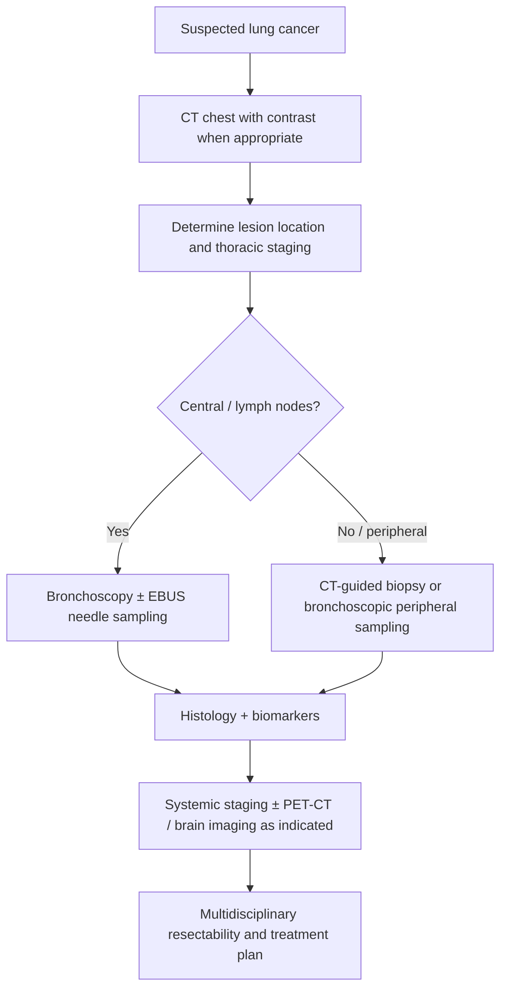

# 21 — Thoracic Surgery

> [!info] Source basis
> *World of Revision*, **Hernia, Thorax and Skin pp. 179–191** (particularly `Thorax`, `Lung Cancer`, `Mediastinal Tumors`), plus **Trauma and Burns** for chest injury and drainage; *Doctut Merged.md*, `THORACIC SURGERY`, `Lung Tumors`, `Thymoma`, `Bronchogenic cyst`, `Chylothorax`, `Cardiac Surgery` (adjacent but separate); *Pocket Companion to Robbins*, **Lung, Pleura and Thymus**; and *First Aid 2025* respiratory and oncology review. Some requested subjects (e.g. surgical management of bronchiectasis and specific chest-tube protocols) are only partially covered in the supplied surgical revision extracts; this is explicitly indicated where relevant.

## 1. Anatomy and operative principles

### Thoracic compartments
- **Pleural cavity:** two lungs each enveloped by visceral pleura, separated from chest wall by potential pleural space lined with parietal pleura.
- **Mediastinum:** central thoracic compartment containing heart/great vessels, trachea, esophagus, thoracic duct, thymus and nerves.
- **Pulmonary hilum:** main bronchi, pulmonary arteries and veins, bronchial arteries, nerves and lymphatics.
- Right lung typically **three lobes** (upper, middle, lower); left **two lobes** (upper, lower plus lingula of upper lobe).
- **Bronchopulmonary segment:** discrete bronchus and segmental pulmonary artery supply; pulmonary veins often run intersegmentally. This anatomy makes **anatomical segmentectomy** possible.
- **Parietal pleura** receives somatic sensory innervation (intercostal and phrenic nerves); **visceral pleura** is relatively insensitive to somatic sharp pain.
- **Intercostal neurovascular bundle** runs beneath the rib in the costal groove (**VAN** top-to-bottom in typical teaching); approach a rib’s **superior margin** to reduce bundle injury. Collateral small neurovascular branches can still be present.

### Chest wall and mediastinal exposure
- **Median sternotomy:** anterior mediastinum, thymus, heart and great vessels.
- **Posterolateral thoracotomy:** broad surgical exposure, often with substantial postoperative pain and muscular injury.
- **Anterolateral thoracotomy:** selected chest/lung and emergent procedures.
- **VATS (video-assisted thoracoscopic surgery):** camera and instruments inserted through small ports; lung often selectively collapsed using **double-lumen endotracheal tube / bronchial blocker**, subject to anesthetic plan.
- **Robotic thoracic surgery:** minimally invasive platform not developed in detail in uploaded revision excerpts.
- Thoracic postoperative risks: atelectasis, air leak, pneumonia, bleeding, pain-related hypoventilation, atrial arrhythmia, VTE, bronchopleural fistula.

## 2. Evaluation before lung resection

### Core questions
- **Can lesion be resected technically?** Location and invasion of bronchi/vessels/chest wall/mediastinum.
- **Is patient physiologically operable?** Cardiopulmonary reserve and comorbidities.
- **Is resection oncologically appropriate?** Stage, metastatic disease, regional nodes and tumor biology.

### Pulmonary evaluation
- Clinical dyspnea, exercise limitation, COPD/interstitial lung disease and cardiac disease.
- Spirometry, diffusion capacity where appropriate; predict postoperative **FEV₁/DLCO** by segments or perfusion to estimate reserve.
- Assess perioperative risk and optimize smoking cessation, bronchial hygiene, nutrition, analgesia and mobilization.
- Source **Thoracoscore:** postoperative mortality prediction model for thoracic procedures. Doctut describes age, sex, ASA class, performance status, dyspnea, comorbidity, malignant diagnosis and operative factors, but the exact variable count/score requires official model derivation; do not use the mnemonic as a validated calculator.

### Lung resection types

| Operation | Amount removed | Main application / caveat |
|---|---|---|
| **Wedge excision** | Nonanatomical wedge | Peripheral benign lesion, selected diagnostic/resection cases; does not respect segment vascular-bronchial anatomy |
| **Segmentectomy** | One or more anatomic bronchopulmonary segments | Segment-specific artery, bronchus and venous anatomy; selected small tumors or limited reserve |
| **Lobectomy** | Entire lobe | Standard anatomical oncologic resection for many operable early lung cancers |
| **Bilobectomy** | Two adjacent right lung lobes | Selected right-sided tumors |
| **Sleeve resection** | Bronchial segment + reanastomosis, possibly with lobectomy | Preserves lung vs pneumonectomy where technically possible |
| **Pneumonectomy** | Entire lung | Central/complex disease not suitable for limited resection; highest physiologic cost |

- Postoperative **pleural drainage** commonly used in these operations; indications and removal criteria follow actual procedure.
- **Pneumonectomy space** gradually fills with fluid. Rapid changes in air-fluid level after surgery, sepsis or new bronchopleural fistula symptoms require urgent evaluation.
- **Anatomic segmentectomy vs wedge:** a segmentectomy divides defined segmental bronchovascular structures; wedge does not.

## 3. Pneumothorax

### Basic physiology
**Air enters pleural space → intrapleural negative pressure lost → lung collapses** to variable extent. If air enters under one-way-valve conditions, pleural pressure rises and **compresses venous return → obstructive shock**.

### Classification

| Type | Typical cause | Distinguishing feature |
|---|---|---|
| **Primary spontaneous** | Apical subpleural bleb rupture without known lung disease | Often young tall person; abrupt unilateral chest pain and dyspnea |
| **Secondary spontaneous** | Underlying COPD, interstitial lung disease, infection or other lung pathology | Can be severe even with smaller pleural air |
| **Traumatic** | Blunt/penetrating chest injury | May coexist with hemothorax/contusion |
| **Iatrogenic** | Central line, biopsy, procedure | Procedure-linked onset |
| **Open pneumothorax** | Communicating chest-wall defect | Ventilation impaired by open defect |
| **Tension pneumothorax** | One-way valve, escalating pressure | **Hypoxemia, shock, reduced ipsilateral breath sounds; clinical emergency** |

### Symptoms and examination
- Sudden unilateral pleuritic pain, tachypnea, reduced movement/breath sounds and **hyperresonance**.
- Tension: severe respiratory distress, tachycardia, hypotension, unilateral absent sounds, sometimes tracheal displacement (late/unreliable), neck-vein distension which can be absent if hypovolemic.
- In a profoundly unstable patient **do not wait for radiograph** before decompression.

### Imaging
- Upright CXR: visceral pleural line, absent peripheral lung markings; supine films may show **deep sulcus sign**.
- **Lung ultrasound:** absent sliding, **barcode/stratosphere M-mode**, presence of lung point can support diagnosis; interpret appropriately because no sliding can occur from other mechanisms.
- CT when complex or diagnosis uncertain in stable patient; avoid delay to emergent decompression.

### Management categories
1. Oxygen/analgesia and monitoring for appropriate small stable cases; source excerpts do not provide standardized size-based observation criteria.
2. **Aspiration** in selected stable spontaneous cases.
3. **Intercostal chest drain** when clinically indicated (symptomatic, large, secondary or traumatic settings as appropriate).
4. **Emergency decompression for tension** followed by definitive pleural drainage.
5. **VATS bullectomy/pleurodesis** or other recurrence-prevention intervention in recurrent cases/persistent leak or selected high-risk occupations.

**Exam distinction:** tension pneumothorax can present with **shock**; simple pneumothorax may not.

## 4. Hemothorax, hemopneumothorax and chest trauma

### Hemothorax
- **Blood in pleural space**, often after rib fractures/intercostal vessel or lung injury.
- Features: chest pain, dyspnea, reduced breath sounds and **dull percussion**; large hemorrhage causes hypovolemic shock.
- CXR/US detects pleural fluid; **eFAST** helps in trauma.
- Treatment principles: resuscitate, drain with appropriate chest tube, control bleeding; surgery/VATS for major persistent bleeding/retained blood.
- Traditional surgical evaluation thresholds in uploaded trauma section: roughly **>1–1.5 L immediately**, or sustained **~200 mL/h for several hours**, but **actual instability/ongoing transfusion requirement is more important than an isolated number**.
- **Retained hemothorax** predisposes to infection/fibrothorax; selected early **VATS evacuation** avoids organization.

### Flail chest
- Unstable chest-wall segment produced by multiple serial rib fractures, with **paradoxical movement** (inward on inspiration, outward on expiration).
- Complicated by pain and **pulmonary contusion** → hypoventilation, atelectasis/hypoxemia.
- Management: oxygen/ventilatory support as needed, **adequate multimodal analgesia**, lung hygiene, careful fluids; selected stabilization of rib fractures.
- The texts differ on minimum ribs (**WOR shortened ≥2; standard teaching often ≥3 consecutive ribs fractured twice**). Recognize the physiology; do not rely only on a mnemonic.

### Pulmonary contusion
- Alveolar-capillary injury produces hemorrhage/edema, impaired gas exchange; radiographic infiltrates may evolve after injury.
- Treatment supportive, respiratory monitoring, oxygen/ventilation when necessary; treat associated chest injuries.

### Cardiac tamponade
- Discussed in thoracic trauma source: pericardial blood limits ventricular filling; hypotension, raised JVP and muffled heart sounds (**Beck triad**, can be incomplete).
- eFAST can show pericardial fluid; **urgent decompression/operative repair** in traumatic unstable physiology as indicated.

## 5. Intercostal chest drain (ICD) and pleural drainage

### Anatomy: “triangle of safety”
- Anterior: lateral border **pectoralis major**.
- Posterior: anterior border **latissimus dorsi**.
- Inferior: approximately fifth intercostal space/nipple horizontal level (actual anatomy/sex variation must be considered).
- Superior apex: base of axilla.
- **Insert just above superior border of rib** to minimize major bundle injury.
- Directional drain targeting depends on fluid vs air, patient position and procedure; **do not use a rigid “air upward/blood downward” rule as an excuse for malposition**.

### Underwater seal mechanism
- Water acts as a one-way valve: pleural air/fluid exits, but atmospheric air should not flow back freely.
- **Swing/tidaling:** fluid movement with respiratory pressure changes, can indicate communication/patency; absence may reflect lung re-expansion or blockage.
- **Bubbling:** indicates air flow into drainage system; persistent bubbling can reflect **ongoing air leak** or connection/system fault.
- Optional **suction** adds controlled negative pressure when indicated; not automatic in every pneumothorax.

### Important practical cautions
- Assess after insertion: respiratory status, drain position, output and system connections.
- Avoid routine aggressive clamping of a **bubbling** drain (risk of tension); clamp only in supervised specific circumstances.
- Keep drainage system below patient’s chest when designed for gravity drainage.
- Document drainage volume/type: serous, bloody, purulent, chylous, air.
- Remove once indicated clinical/imaging criteria and absence of significant ongoing leak/flow are met; precise numeric thresholds vary by indication and local protocol.

### ICD complications

| Early | Delayed |
|---|---|
| Bleeding/intercostal vessel injury | Infection/empyema |
| Lung laceration, intra-abdominal organ injury if placed too low | Chronic pain |
| Malposition/blockage | Persistent bronchopleural fistula |
| Subcutaneous emphysema, poor drainage | Pleural adhesions, re-expansion pulmonary edema (after rapid drainage in susceptible cases) |

## 6. Pleural effusion, empyema and fibrothorax

### Types of effusion
- **Transudate:** systemic hydrostatic/oncotic disturbance (e.g. heart failure, nephrotic/hypoproteinemic states).
- **Exudate:** pleural infection/inflammation, malignancy, pulmonary embolism and other local conditions.
- **Hemothorax:** blood; **chylothorax:** lymphatic chyle; **empyema:** pus.

### Light criteria (interpretive physiology)
Pleural fluid is **exudative if any**:
- Pleural protein / serum protein >0.5
- Pleural LDH / serum LDH >0.6
- Pleural LDH >2/3 the lab upper limit of normal serum LDH

*The provided surgical revision extracts focus more on empyema/chylothorax than complete Light criteria; the full numeric set is a commonly taught physiology framework and should be verified against the relevant source before assuming those exact values were explicitly printed there.*

### Empyema thoracis
**Infected purulent pleural collection**, frequently complicated pneumonia, lung abscess, surgery or trauma.

| Stage | Pathology | Clinical consequence | Source-directed intervention |
|---|---|---|---|
| **Exudative** | Thin fluid, early inflammatory exudate | Relatively free-flowing | Antibiotics plus aspiration/drainage as indicated |
| **Fibrinopurulent** | Neutrophils, fibrin, **septations/loculations** | Incomplete simple aspiration | Effective tube drainage; selected intrapleural strategies / VATS |
| **Organizing** | Fibroblast collagen deposition and thick pleural peel | **Trapped lung / fibrothorax** | **VATS/open decortication** in selected cases |

### Diagnostic assessment
- Fever, pleuritic pain, dyspnea, reduced air entry; CXR/US show collection and loculation, CT maps complex disease.
- Pleural sampling for appearance, pH, glucose, LDH, Gram stain/culture when appropriate.
- **Source control plus antibiotics** is essential. An organized trapped lung may require removal of restrictive pleural peel (**decortication**).
- **Thoracentesis** is diagnostic/therapeutic for selected effusions, but large loculated empyema cannot be treated adequately by simple repeated needle aspiration alone.

### Lung abscess
- **Localized pus-filled cavity in lung parenchyma**, commonly after aspiration, obstruction or necrotizing infection.
- Presentation: subacute fever, productive foul sputum, cough, weight loss and occasionally hemoptysis.
- Imaging: cavitary lesion, often **air-fluid level**; differentiate cavitating malignancy/TB and empyema.
- **Main treatment is prolonged targeted antimicrobial therapy and correction of aspiration/obstruction source.** Surgery is reserved for **refractory or complicated** cases (significant hemoptysis, obstruction, persistent infection, destructive lung) rather than routinely operating on every abscess.
- Limited direct coverage in WOR thorax outline; clinical pathology content drawn primarily from project respiratory sources.

## 7. Chylothorax

**Chyle collects in pleural space following thoracic duct injury/obstruction**, often after esophagectomy, thoracic surgery, trauma or malignancy.

- Milky pleural fluid is suggestive but not guaranteed; **pleural triglyceride >110 mg/dL** is the classic threshold noted in Doctut.
- Confirm biochemically when appearance ambiguous; chylomicrons support chylothorax.
- Nutritional and immunologic consequences: loss of fat, protein, electrolytes and lymphocytes.
- Source management: reduce lymphatic flow with **low-fat / medium-chain triglyceride nutrition or nutritional bypass** where needed; maintain fluid/protein balance and drain significant symptomatic fluid.
- If high-output/persistent leak, thoracic-duct intervention (ligation/embolization) may be required.
- Doctut gives fixed “>5 days” and output/duration thresholds (OCR unclear). **Do not impose them as universal operating criteria.**

### Chylothorax vs pseudochylothorax
- True chylothorax: triglyceride/chylomicron rich, often acute duct injury.
- Pseudochylothorax: cholesterol-rich fluid after longstanding chronic pleural disease; no actual high-chyle input required.

## 8. Bronchiectasis — surgical considerations

### Definition and mechanism
**Permanent abnormal dilatation of bronchi** from destruction of muscular and elastic bronchial wall following chronic infection/inflammation, impaired clearance or obstruction.

- Robbins pathology correlates: damaged bronchial wall, chronic suppurative inflammation, airway widening and fibrosis.
- Etiologies in project material: repeated infection, post-obstructive disease, tuberculosis sequelae and **primary ciliary dyskinesia / Kartagener syndrome**.
- Clinical: chronic productive cough with purulent sputum, recurrent infective exacerbations, hemoptysis, clubbing in selected severe cases.
- **CT chest/HRCT:** tram-track sign, signet-ring bronchial dilation, lack of normal tapering, clustered cystic bronchi.

### Treatment pathway
- Most patients: secretion clearance/physiotherapy, infection management, treat specific causes, vaccination and monitoring.
- **Resection is considered** for localized disease not controlled medically, recurrent clinically important hemoptysis or a focal destructive segment with suitable reserve.
- Operation: **segmentectomy/lobectomy** as appropriate; diffuse bilateral bronchiectasis is generally **not** a simple lobectomy problem.
- Major hemoptysis can require urgent stabilization and **bronchial artery embolization**; surgery in selected localized/refractory disease.
- Distinguish **bronchial systemic circulation** (major source of high-pressure hemoptysis) from low-pressure pulmonary arterial flow.

## 9. Lung neoplasms

### Classification
- **Benign:** **pulmonary hamartoma**—classical benign pulmonary mass, may have **popcorn calcification** on imaging.
- **Primary malignant epithelial tumors:** **adenocarcinoma, squamous cell carcinoma, small cell carcinoma, large cell carcinoma**.
- **Secondary malignant lesions:** metastatic deposits to lungs (common in many solid tumors).
- **Pleural malignancy:** malignant mesothelioma, associated with asbestos exposure.

### Lung-cancer epidemiology and risk
- Strongly associated with **smoking**; other exposure risks include asbestos, radon, occupational agents and air pollution.
- **Adenocarcinoma** is commonly described as most frequent overall and in never-smokers/females in modern source-based framing.
- Older Doctut tables emphasize **squamous cell as most common in smokers or India**, but subtype frequencies vary with population and year. Do not treat historic rankings as universal.

### Histologic and molecular comparison

| Type | Location / source pattern | Histology, IHC | Clinical association |
|---|---|---|---|
| **Adenocarcinoma** | Often **peripheral** | Glands/mucin; **TTF-1, napsin A** commonly positive | In nonsmokers, women; **EGFR/ALK/KRAS** and other drivers |
| **Squamous cell** | Usually **central**, may cavitate | **Keratin pearls / intercellular bridges**; **p40/p63** | Tobacco exposure, **PTHrP → hypercalcemia** |
| **Small cell** | Usually **central/hilar** | Small hyperchromatic cells, nuclear molding, “**salt-and-pepper**” chromatin, **Azzopardi effect**; chromogranin/synaptophysin | Strong smoking link, **SIADH, ACTH/Cushing, Lambert–Eaton**, early metastasis |
| **Large cell** | Often peripheral | Undifferentiated large malignant cells after excluding specific differentiation | Diagnosis of exclusion, more aggressive presentation |

- **Azzopardi phenomenon:** basophilic staining of vessel walls from tumor-cell nuclear material in some small-cell carcinoma cases.
- **Pancoast tumor (superior sulcus):** apical mass invades sympathetic chain and possibly lower brachial plexus → **Horner syndrome** (ptosis, miosis, anhidrosis) and shoulder/ulnar arm pain/hand weakness.
- WOR and Doctut label Pancoast “SCC”; **apical location defines Pancoast syndrome, not a unique mandatory histology**.

### General clinical manifestations
- Persistent **cough**, hemoptysis, dyspnea, chest discomfort, recurrent nonresolving pneumonia, weight loss, clubbing.
- **Hoarseness** from recurrent laryngeal nerve involvement; dysphagia from esophageal compression; **SVC syndrome** from central mediastinal disease.
- **Metastasis** to nodes, brain, bone, liver, adrenals; neurologic deficit, bone pain, hepatomegaly.
- Hypertrophic pulmonary osteoarthropathy in association with some lung tumors.

### Paraneoplastic patterns

| Finding | Associated type / mechanism |
|---|---|
| Hypercalcemia | **Squamous carcinoma** secreting PTH-related peptide |
| SIADH → hyponatremia | **Small cell** |
| Ectopic ACTH → Cushing syndrome | **Small cell** |
| Lambert–Eaton myasthenic syndrome | **Small cell**, presynaptic voltage-gated calcium-channel autoimmunity |
| Migratory thrombophlebitis/Trousseau syndrome | Particularly mucinous **adenocarcinoma** |
| Gynecomastia | Source associates with large cell variants, but association is nonspecific/rare |

**Important correction:** Small cell ectopic ACTH causes hypercortisolism; a Doctut transcription labels it “hypocalcemia,” which is **not the defining consequence**.

### Diagnostic pathway

- **CXR** may reveal mass, collapse, hilar shadow, obstructive pneumonia or effusion, but cannot exclude malignancy.
- **CT thorax** details location, invasion and thoracic nodes.
- **Bronchoscopy/endobronchial biopsy** for central lesions; **EBUS** for mediastinal/hilar nodes; **CT-guided transthoracic biopsy** for peripheral lesions (pneumothorax risk).
- **Mediastinoscopy** samples selected mediastinal nodes (e.g., paratracheal/subcarinal) when indicated; **mediastinotomy**/VATS provides other access.
- **PET-CT** evaluates systemic/metabolic staging in selected cases; tissue diagnosis and anatomical stage remain essential.
- Histologic/molecular testing differentiates SCLC/NSCLC and relevant driver alterations; the uploaded sources focus on **EGFR/ALK/KRAS** but do not catalog all contemporary biomarkers.

### TNM and source staging
The uploaded WOR/Doctut charts summarize the **8th-edition size-based T categories**:

| T | Size alone (when not upstaged by other features) |
|---|---|
| **T1a** | ≤1 cm |
| **T1b** | >1–2 cm |
| **T1c** | >2–3 cm |
| **T2a** | >3–4 cm |
| **T2b** | >4–5 cm |
| **T3** | >5–7 cm |
| **T4** | >7 cm |

- Additional T criteria: visceral pleura/main bronchus/associated atelectasis may alter **T2**; chest wall/phrenic nerve/parietal pericardium involvement may imply **T3**; mediastinum/heart/great vessels, carina, trachea/esophagus/vertebral body etc. may imply **T4**.
- Nodal extent **N0/N1/N2/N3** and distant metastasis **M0/M1** are decisive for stage and operability.
- **Stage system may be updated** since the uploaded 2025 and older teaching references; **the above are explicit source conventions, not a claim of current edition validity**.
- Doctut incorrectly equates all T4 invasion with absolute “inoperability.” Surgical decisions are more nuanced and depend on multidisciplinary staging.

### Treatment based on biology and stage
- **Resectable non-small-cell lung carcinoma (NSCLC):** anatomic surgical resection (**lobectomy** or selected segmentectomy), lymph-node assessment, and stage-specific perioperative systemic/radiotherapy strategy.
- **Advanced or unresectable NSCLC:** systemic therapy and/or radiotherapy, including **driver-directed targeted agents** where indicated. Source names **gefitinib** (EGFR TKI); do not treat it as the only targeted drug.
- **Small-cell lung carcinoma (SCLC):** usually systemic disease at detection; chemotherapy-based treatment with thoracic radiotherapy in selected cases, rather than surgery for most presentations.
- **Solitary selected early SCLC** may differ from broad traditional “never operate on small cell” exam rule, but exact eligibility is not specified in uploaded revision pages.
- The historical claim “NSCLC has **no response to chemotherapy**” is false as an absolute statement; systemic treatment is part of stage-specific NSCLC care.

### Common thoracic surgery complications
- Air leak, bronchopleural fistula, postpneumonectomy empyema, atelectasis, pneumonia, bleeding, arrhythmia, respiratory failure and pulmonary embolism.
- **Bronchopleural fistula:** communication between bronchial stump/airway and pleural space; persistent air leak, infection or postpneumonectomy changes.
- **Postpneumonectomy syndrome:** rare anatomical shift/compression of mediastinal structures years after lung removal.
- **SVC obstruction:** dyspnea, facial/upper limb edema, venous collaterals; common malignancy-related mediastinal emergency context.

## 10. Mediastinal masses

### Anatomical differential by compartment

| Compartment | Typical masses in WOR/Doctut |
|---|---|
| **Anterior / prevascular** | **Thymoma/thymic tumor, lymphoma, teratoma/germ-cell tumor, ectopic thyroid** |
| **Middle / visceral** | **Bronchogenic cyst, pericardial cyst**, lymphadenopathy, vascular masses |
| **Posterior / paravertebral** | **Neurogenic tumors** (schwannoma, neurofibroma), foregut/other cysts and rare meningocele |
| Superior component | Thyroid/lymph node and other upper mediastinal lesions |

**Classic memory aid: 4 Ts of anterior mediastinal mass** = **Thymoma, Teratoma, Thyroid, “Terrible” lymphoma**.

- WOR states thymoma as “most common mediastinal tumor overall”; Doctut explicitly disputes rankings across textbooks. **Do not learn an unsupported universal single winner** without the age group, compartment, and whether lymphadenopathy/secondary tumors are included.
- **Radiology:** CXR may show mediastinal widening; contrast CT localizes and characterizes fat, calcium, solid/cystic composition and invasion; MRI for neural/vascular/spinal extension where relevant.
- **Germ cell tumor/teratoma:** mixed tissue density, internal fat and calcification. Doctut associates Klinefelter syndrome with **mediastinal germ-cell tumor**; specify association chiefly with **nonseminomatous mediastinal germ cell tumors**, not automatically benign mature teratoma.

### Thymoma
- Neoplasm of **thymic epithelial cells**, frequently anterior mediastinal.
- Presentation: incidental asymptomatic mass, compressive dyspnea/dysphagia/SVC signs, or **myasthenia gravis**.
- Other paraneoplastic/immune conditions in source: **pure red-cell aplasia**, hypogammaglobulinemia (Good syndrome) and autoimmune disorders.
- Imaging: **CT mediastinum** assesses capsule, pleural implants and invasion; histology when indicated distinguishes thymoma from lymphoma/germ-cell lesions.
- **Doctut: cytokeratin** as epithelial marker; no single marker by itself excludes all other causes.

### Masaoka–Koga thymoma staging (revision)

| Stage | Definition |
|---|---|
| **I** | Encapsulated, no capsular invasion |
| **II** | Microscopic capsular invasion or invasion into surrounding mediastinal fat/pleura |
| **III** | Macroscopic invasion of adjacent organ (pericardium, lung, great vessels) |
| **IVa** | Pleural/pericardial dissemination |
| **IVb** | Lymphatic/hematogenous metastases |

- **Treatment:** complete **thymectomy/resection** for resectable disease; extension of surgery, adjunct treatment and neoadjuvant therapy depend on stage and resectability.
- **VATS/robotic thymectomy** in selected lesions; median sternotomy for large/invasive tumors as required.
- Management of concomitant **myasthenia gravis** requires perioperative respiratory/neuromuscular planning.
- Source simplification “all tumors >5 cm need chemotherapy” is **not an independent universal criterion**.

### Bronchogenic cyst
- Congenital foregut/tracheobronchial budding anomaly; may lie in middle mediastinum or intrapulmonary.
- Symptoms: incidental mass, infection, compression, cough/hemoptysis or rarely rupture.
- CT shows fluid/complex cyst; definitive management by **excision**, often VATS, particularly when symptomatic or complicated.
- Doctut claims varied communication patterns between intrapulmonary cyst and airway—actual morphology varies; do not make communication mandatory.

### Lung sequestration
**Nonfunctioning lung tissue with **systemic arterial supply** (classically from aorta)**, separate from normal pulmonary arterial distribution.

| Intralobar | Extralobar |
|---|---|
| Within normal visceral pleura of lobe | Separate pleural envelope |
| More common in Doctut | Less common |
| Repeated infections/hemoptysis more common | Congenital associations, including diaphragmatic anomalies |
| Usually pulmonary venous drainage | May have systemic venous drainage |

- **CT angiography** important to identify anomalous feeding systemic artery before surgery; uncontrolled division may cause major hemorrhage.
- Surgery for recurrent infection, symptoms or selected congenital defects.

## 11. Chest wall lesions and deformities

### Pectus excavatum vs pectus carinatum

| Feature | Excavatum | Carinatum |
|---|---|---|
| Appearance | **Depressed/sunken sternum** | **Protruding “pigeon chest” sternum** |
| Consequence | May be cosmetic or significant cardiopulmonary/exercise restriction in severe cases | Predominantly cosmetic; may have symptoms in selected cases |
| Intervention | **Nuss bar** minimally invasive elevation or **Ravitch** reconstruction | Brace for many growing adolescents; surgery in selected severe cases |

- Doctut says both are *only cosmetic*; this **overgeneralizes** the potential cardiorespiratory effects of severe excavatum.
- Assessment includes severity, growth, symptoms, deformity and patient preference.

### Chest wall tumors
- Benign: lipoma, osteochondroma, chondroma and other soft-tissue/bony lesions.
- Malignant: chondrosarcoma and other sarcomas; metastatic involvement can also occur.
- Signs: enlarging mass, pain, local invasion, pathological fracture; **cross-sectional imaging and planned biopsy** before definitive excision in suspicious cases.
- Surgical principle: **wide en-bloc resection with negative margins** when appropriate, followed by reconstruction of chest stability/soft-tissue coverage.
- The short WOR thorax outline does not contain a detailed chest-wall tumor taxonomy; cross-links to its soft-tissue sarcoma chapter for further discussion.

## 12. VATS, thoracotomy and postoperative care

### VATS vs open surgery

| Feature | VATS | Thoracotomy |
|---|---|---|
| Exposure | Video camera, small ports, selective lung collapse | Direct surgical exposure via chest-wall incision |
| Typical advantages | Less incisional tissue injury and faster functional recovery in suitable patients | Broad exposure, easier manual vascular control in some complex cases |
| Challenges | Camera depth, limited tactile feedback, equipment and expertise dependent | More pain, respiratory impairment from large incision |
| Conversion | May be necessary for bleeding or complex anatomy | Already open |

### Surgical indications from source families
- VATS for **selected lung nodule biopsy**, small tumor resection, bleb treatment/pleurodesis, localized empyema, mediastinal cyst and thymectomy.
- Thoracotomy for selected complex large resections, uncontrolled bleeding, advanced infection/decortication and major chest trauma.

### Postoperative essentials
1. **Airway/ventilation:** SpO₂, RR, chest expansion, lung recruitment and oxygenation.
2. **Analgesia:** prevents splinting, atelectasis and impaired cough.
3. **Drain assessment:** quantity/quality, swinging/bubbling, leak, suction setting and tube position.
4. **Mobilization and physiotherapy:** airway clearance, VTE prevention, endurance.
5. **Watch for bleeding**, prolonged air leak, bronchial stump issue, empyema, pneumonia and arrhythmia.
6. After pneumonectomy, beware fluid overload, mediastinal displacement and postoperative bronchopleural fistula.
7. Review histopathology and stage after oncologic resection to guide further treatment.

## 13. Thoracic rapid-revision and image-recognition sheet

| Image/clinical stem | Primary association |
|---|---|
| Absent peripheral vascular lung markings with visible pleural line | **Pneumothorax** |
| Unstable, hyperresonant hemithorax, low breath sounds, hypotension | **Tension pneumothorax → immediate decompression** |
| Dull hemithorax with shock after trauma | **Massive hemothorax** |
| Paradoxical chest wall movement | **Flail segment** |
| Thick loculated pleural collection | **Fibrinopurulent empyema** |
| Thick pleural peel and trapped lung | **Organizing empyema → decortication** |
| Milky pleural fluid TG >110 mg/dL | **Chylothorax** |
| Foul productive sputum and intrapulmonary air-fluid cavity | **Lung abscess** |
| Chronic productive cough, CT signet-ring bronchi | **Bronchiectasis** |
| Popcorn calcification in well-circumscribed lung nodule | **Hamartoma** |
| Central cavitary tumor, keratin pearls, PTHrP | **Squamous carcinoma** |
| Peripheral gland-forming mass, TTF-1/napsin A | **Adenocarcinoma** |
| Central small blue cells, SIADH / ACTH | **Small-cell carcinoma** |
| Apical tumor, Horner syndrome, hand weakness | **Pancoast syndrome** |
| Anterior mediastinal mass and myasthenia | **Thymoma** |
| Posterior mediastinal mass in child | **Neurogenic tumor** |
| Anterior lesion containing fat and calcium | **Teratoma** |
| Congenital vascularized lung mass fed by aorta | **Pulmonary sequestration** |
| Sunken sternum | **Pectus excavatum** |
| Pigeon-shaped protruding chest | **Pectus carinatum** |

## 14. Exam-source disagreements that need care
1. **“Thymoma most common mediastinal tumor overall”** is disputed within uploaded Doctut depending on classification/reference. Compartment-based differential is safer.
2. **“Pancoast is always squamous”** confuses location/syndrome with histology.
3. **“NSCLC never responds to chemotherapy”** is an obsolete blanket statement.
4. **“Tumor touching any T4 structure means never operable”** omits multidisciplinary selection.
5. **“Only small-cell responds to chemotherapy”** similarly overgeneralized.
6. **“Any thymoma >5 cm needs chemotherapy”** is insufficiently contextualized.
7. **“Every pectus deformity is cosmetic only”** ignores symptomatic severe cases.
8. **“Most common lung carcinoma subtype”** can vary by geography, sex, smoking status and historical period.
9. **WOR/Doctut source staging is size-based 8th-edition TNM**; no unsupported claim is made that it remains the latest system.
10. **Invasive procedure choices** depend on pathology, anatomy, physiologic reserve and available expertise, not a single eponymous exam answer.

**Direct source location:** *World of Revision Markdown.md* → `HERNIA, THORAX AND SKIN`, `Thorax 00:22:37`, `Lung Cancer 00:24:35`, `Mediastinal Tumors 00:28:50`; *Doctut Merged.md* → `THORACIC SURGERY`, `Lung Tumors`, `Bronchogenic cyst`, `Chylothorax`; *Robbins Pocket Companion* → **The Lung**, **Pleura** and **Thymus**; *First Aid 2025* → **Respiratory** and **Oncology**.
