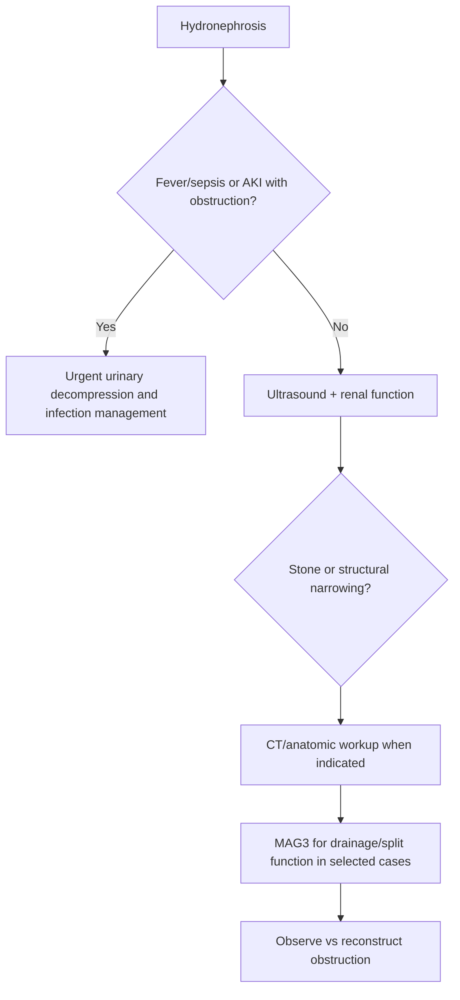

# 22 — Kidney and Upper Urinary Tract Surgery

> [!info] Source basis
> **World of Revision (WOR), Surgery: Urology Part 1, printed pp. 132–142**; **Doctut Merged, Urology I (kidney investigations, stones, RCC, trauma, congenital anomalies)**; **Pocket Companion to Robbins, 9e, kidney chapter (obstruction, urolithiasis, neoplasia)**; **First Aid 2025, Renal section**; **Combined/Bootcamp, Renal pathology and embryology**. Examination conventions are retained but disputed or potentially dated management rules are identified in the appendix.

## 1. Surgical renal and ureteric anatomy

### Kidney anatomy relevant to operations
- **Retroperitoneal organs**, approximately T12–L3; right kidney lies slightly lower because of the liver.
- **Coverings (inside → outside):** fibrous renal capsule → perinephric fat → renal (Gerota) fascia → paranephric fat.
- **Hilum anterior → posterior:** **renal Vein → renal Artery → renal Pelvis** (`V-A-P`).
- **Renal artery:** typically divides into segmental **end arteries** with little collateral supply; injury causes segmental ischemia.
- **Brodel's relatively avascular line:** posterolateral border between anterior and posterior segmental arterial territories; an access plane historically favored for nephrotomy. It is **relatively**, not completely, avascular.
- **Drainage:** left renal vein receives left gonadal and left suprarenal veins; right gonadal vein usually joins IVC directly. This matters in **left varicocele** and renal venous tumor thrombus.
- **Lymphatics:** renal hilar/para-aortic and paracaval nodes; testis has embryologic retroperitoneal lymph drainage distinct from scrotal skin.
- **Adrenal gland:** separate embryologic and vascular relations; normal position in horseshoe kidney.

### Ureter: course, constrictions and blood supply
- Ureter arises at **ureteropelvic junction (UPJ/PUJ)**, descends anterior to psoas, crosses pelvic brim near iliac vessels and enters bladder obliquely.
- **Three classical narrowings:** PUJ; crossing iliac vessels/pelvic brim; **vesicoureteric junction (VUJ)**. Doctut includes additional crossings (vas deferens/round ligament), while WOR emphasizes VUJ for impacted stones.
- Ureter has **segmental longitudinal blood supply** from renal, gonadal, aortic, common/internal iliac, vesical and uterine branches. During reconstruction, preserve **periureteric adventitia** and avoid extensive circumferential devascularization.
- Ureteric obstruction leads to **raised upstream hydrostatic pressure → calyceal dilatation → eventually cortical thinning, interstitial inflammation and fibrosis** if persistent (Robbins).

## 2. Congenital upper tract anomalies

### Duplex collecting system and ectopic ureter
- **Duplicated ureter:** two drainage systems from one kidney; may be partial (bifid ureter) or complete.
- **Weigert–Meyer rule in complete duplication:**
  - **Upper-pole ureter** usually inserts **inferomedial** to the lower-pole orifice and may be ectopic/obstructed, including by ureterocele.
  - **Lower-pole ureter** usually inserts superolaterally and predisposes to **vesicoureteric reflux**.
- **Girl with continuous dribbling despite normal voluntary urination:** ectopic ureter opening **distal to external urethral sphincter or into vagina/vestibule**, while normal ureter still fills bladder.
- **Boy:** ectopic ureter generally opens proximal to external sphincter, so it more often causes infection/obstruction than continuous incontinence.
- **Imaging signs in revision text:** IVU **drooping lily sign**; ultrasound, contrast studies and cross-sectional anatomy help delineate functional moieties.
- **Surgical choices:** ureteric reimplantation, ureteroureterostomy or upper-pole heminephrectomy if a moiety is nonfunctional; individualize according to anatomy and function.

### Ureterocele
- Cystic dilatation of intravesical distal ureter; may be associated with duplex collecting system.
- **Cobra/adder-head sign** on classical IVU: distal ureter bulging into the bladder.
- Presentation: recurrent UTI, obstruction, hydronephrosis or incidental cystic bladder lesion.
- Options discussed in sources: endoscopic puncture/incision, excision and ureteric reimplantation depending on reflux, duplication, bladder anatomy and renal function.

### Horseshoe kidney
- Most commonly **fusion of lower poles**; isthmus usually lies below the origin of the inferior mesenteric artery, arresting ascent.
- Commonly low, malrotated pelvis; ureters descend anterior to isthmus, increasing risk of PUJ obstruction/stones.
- Classical IVU: **flower-vase/handshake configuration**.
- May be incidental; associated stones, hydronephrosis, infection and vascular variants matter during abdominal/retroperitoneal surgery.
- Management: treat the **specific complication**, e.g., Anderson–Hynes pyeloplasty for functionally important PUJ obstruction. **Routine division of the isthmus is not indicated** and may injure vessels.

### Polycystic kidney disease

| Feature | ADPKD (adult pattern) | ARPKD (infantile pattern) |
|---|---|---|
| Genetic pattern | **Autosomal dominant**, often **PKD1** (chr 16) or **PKD2** (chr 4) | **Autosomal recessive**, **PKHD1** (chr 6) |
| Major lesion | Enlarged kidneys with multiple expanding cysts | Collecting-duct dilatation; liver fibrosis |
| Presentations | Hypertension, hematuria, flank pain, stones, recurrent infection, progressive CKD | Neonatal/childhood renal and hepatic disease of variable severity |
| Extrarenal | **Hepatic cysts**, intracranial berry aneurysm, mitral valve prolapse, colonic diverticula | Congenital hepatic fibrosis/portal hypertension |
| Surgery | Usually for complications, selected transplantation | Supportive renal/hepatic management; transplant in selected patients |

> [!warning] Simplification in WOR
> The revision chart describes ARPKD as universally fatal/“not compatible with life.” The **actual outcome varies**; treat that chart as a simplified exam mnemonic rather than a universal clinical statement. Doctut additionally discusses **tolvaptan** for selected progressive ADPKD, while WOR emphasizes dialysis/transplantation at end-stage disease.

### Other anomalies to recognize
- **Multicystic dysplastic kidney:** nonfunctional cystic renal tissue with primitive ducts/cartilage on histology (Robbins); unlike ADPKD, often unilateral and dysplastic.
- **Ectopic/pelvic kidney:** failure of ascent; vessel supply and ureter orientation may be unusual.
- **Crossed fused renal ectopia:** two kidneys fused on one side, distinct from horseshoe kidney.
- **Congenital UPJ obstruction:** discussed below.

## 3. Hydronephrosis and obstructive uropathy

### Mechanism
1. Obstruction at PUJ, ureter, VUJ, bladder neck or urethra reduces urinary drainage.
2. Urine accumulation raises renal pelvic/calyceal pressure; GFR can decline.
3. Persistent partial obstruction causes collecting-system dilation → papillary flattening/calyceal clubbing → **parenchymal atrophy, tubular dysfunction and fibrosis** (Robbins).
4. Stasis predisposes to stones and infection; infection plus obstruction may become a **urologic emergency**.

### Causes by anatomical level

| Level | Intraluminal | Intramural | Extraluminal |
|---|---|---|---|
| Pelvis/ureter | Stones, sloughed papillae, clots | PUJ narrowing, tumor, ureterocele, stricture | Crossing lower-pole vessel, retroperitoneal fibrosis, pelvic/retroperitoneal malignancy |
| Bladder outlet/urethra | Clots, bladder/urethral stones | BPH, bladder-neck obstruction, posterior urethral valves, urethral stricture | Pelvic tumor, prolapse |

- **Unilateral** obstruction may remain clinically silent owing to contralateral compensation.
- **Bilateral obstruction** or obstruction in a solitary kidney may cause **oliguria/anuria and AKI**.
- **Postobstructive diuresis:** brisk urine output after relief of severe chronic obstruction; monitor volume and electrolytes.

### Symptoms and signs
- Intermittent flank pain, renal colic, infection, hematuria or incidental dilation on imaging.
- **Dietl crisis:** intermittent flank pain with transient palpable hydronephrotic kidney, classically associated with intermittent UPJ obstruction and brisk urine output after relief.
- Pyonephrosis presents with obstructed collecting system **plus purulent infection**, potentially fever/sepsis.

### Investigation hierarchy
- **Ultrasound KUB**: hydronephrosis, renal size/cortex, bladder and postvoid residual; no radiation.
- **Noncontrast CT**: stone location and degree of obstruction; especially useful in acute renal colic.
- **CT urography/contrast studies**: selected structural evaluation, injury, malignancy and complex anatomy.
- **Nuclear renography**: differential renal function and drainage.

| Nuclear study | Tracer | Main clinical question |
|---|---|---|
| **DMSA** | Technetium dimercaptosuccinic acid | **Renal cortical scars and functional renal parenchyma** |
| **DTPA** | Diethylenetriamine pentaacetic acid | Glomerular filtration and renal function/drainage studies |
| **MAG3** | Mercaptoacetyltriglycine | **Tubular secretion, effective renal plasma flow, drainage/obstruction**; useful with diuretic renogram |

WOR describes MAG3 as the preferred study for an obstructive drainage question; anatomy and function must both be interpreted.

### Pelviureteric junction obstruction (UPJO)
- Congenital UPJ obstruction is a major cause of antenatal hydronephrosis.
- Causes: intrinsic adynamic/narrow segment; extrinsic crossing lower-pole vessel.
- **Diuretic MAG3 renogram** assesses drainage and split function; ultrasound tracks dilation/parenchyma.
- Operation: **Anderson–Hynes dismembered pyeloplasty** for symptomatic, deteriorating or functionally significant obstruction; ureteropelvic junction is excised and reconstructed widely to provide dependent drainage.
- **Crossing vessel should be preserved** unless specific vascular surgical circumstances mandate otherwise; reconstruct drainage relative to vessel.

### Retroperitoneal fibrosis (Ormond disease)
- Fibroinflammatory retroperitoneal process encasing ureters, causing medial deviation and obstruction; can be idiopathic or associated with radiation/medications.
- Classical IVU: **maiden-waist deformity** (medial ureteral deviation).
- Source options: DJ stent/nephrostomy for decompression, treat cause, selective ureterolysis for persistent severe obstruction.

## 4. Renal and ureteric calculi

### Lithogenesis: why stones form
- **Supersaturation** of urine with calcium/oxalate, phosphate, urate or cystine → nucleation and crystal growth.
- Important influences (Robbins): **low urine volume**, urinary pH, hypercalciuria/hyperoxaluria/hyperuricosuria, urease-producing infections and deficiencies of inhibitors such as **citrate**.
- **Most common type overall:** calcium oxalate ± phosphate, often radiopaque.

### Comparative stone table

| Stone | Typical crystal | Radiology | Environment/association | Important exam/management point |
|---|---|---|---|---|
| **Calcium oxalate** | **Envelope** dihydrate; **dumbbell** monohydrate | Radiopaque | Can occur at diverse pH; hypercalciuria, hyperoxaluria | **Most common**; monohydrate is hard to fragment |
| Calcium phosphate | Variable, often amorphous/rosettes | Radiopaque | More frequent in **alkaline urine** | Consider distal RTA/hyperparathyroidism |
| **Struvite** (Mg ammonium phosphate) | **Coffin-lid** | Radiopaque | **Urease-positive organisms**, classically *Proteus*, alkaline urine | May form **staghorn calculus** and cause recurrent infection |
| **Uric acid** | Rhomboid/rosette; diverse | **Radiolucent on plain X-ray**, CT-visible | **Acidic urine**; gout/tumor lysis possible, sometimes normal serum urate | Urine **alkalinization** is mechanistically important |
| **Cystine** | **Hexagonal** | Faintly radiopaque/visible on CT | Inherited **cystinuria**, hard calculi | Difficult fragmentation; high hydration + alkalinization important |
| Drug stones | Variable | Some relatively radiolucent | Indinavir, triamterene and others discussed in Doctut | Drug history may explain recurrent stones |

- **Cystine hexagons, struvite coffin lids, calcium oxalate envelopes** are classic microscopy recognition questions.
- **Staghorn is a shape, not a chemical diagnosis:** frequently infection-associated struvite, but other compositions can form branching stones.

### Pain localization
- **Renal pelvis:** flank/renal angle pain.
- **Upper ureter:** flank pain radiating toward groin/testis/labium.
- **Mid ureter:** pain toward lower abdomen; right-sided pain can resemble appendicitis.
- **Distal ureter/VUJ:** urgency, frequency, dysuria, groin/scrotal/labial referral.
- **Intramural stone:** **strangury**—painful urgent attempts to void, often only drops.
- Associated: microscopic/gross hematuria, nausea, vomiting, reduced urine output if severe obstruction.

### Diagnosis
- **NCCT KUB** is WOR's investigation of choice for typical nonpregnant acute ureteral stone; assesses stone size, location, density and obstruction.
- **Ultrasound** favored where avoiding radiation matters (e.g., pregnancy and many children), and for hydronephrosis.
- **Urinalysis** for RBC, pyuria, pH, infection; culture when febrile/complicated.
- **Metabolic evaluation** in recurrent/high-risk stone formers: serum creatinine, calcium and other indicated analytes, stone composition and selected 24-h urine testing.

### The obstructed infected kidney: emergency principle
- **Obstruction + suspected infected collecting system (fever, sepsis, pyonephrosis)** is an urgent problem: stabilize, provide antimicrobials and **drain with ureteric stent or percutaneous nephrostomy**, as appropriate.
- Definitive stone removal generally follows management of infection rather than proceeding through an uncontrolled septic obstruction.

### Treatment selection — conceptual matrix

| Option | Principle | Common source indications | Limitations / adverse effects |
|---|---|---|---|
| Observation/analgesia | Small uncomplicated stones may pass | WOR: **<5 mm** often pass | Needs surveillance; persistent obstruction, infection or worsening renal function changes plan |
| Medical expulsive treatment | **α-blocker (e.g., tamsulosin)** relaxes distal ureter | Selected uncomplicated ureteric stones | Not a substitute for decompression in sepsis |
| **ESWL/SWL** | Focused **shock waves** fragment stone | Favorable kidney/upper ureter location, smaller burden | **Steinstrasse**, hematuria, incomplete clearance; low success in hard stones or poor drainage |
| **URS** | Ureteroscope fragments/retrieves stone, often laser | Ureteric stones, selected kidney stones | Ureteral injury, infection, later stricture |
| **RIRS** | Flexible ureteroscopy into renal pelvis/calyces | Selected intrarenal stones, some lower pole stones | Stone burden and anatomy limit clearance |
| **PCNL** | Percutaneous tract into collecting system | **>2 cm renal stones, staghorn**, high stone burden | Bleeding, infection, pleural/visceral injury |
| Open/laparoscopic surgery | Direct stone removal/reconstruction | Selected unusually complex/anatomic cases | Greater invasiveness |

- **ESWL contraindications/relative limitations in the revision notes:** pregnancy, uncorrected coagulopathy, infection or obstruction distal to stone, very hard stones, some difficult anatomy. A blanket “all children contraindicated” is a **source oversimplification**, not a universal rule.
- **PCNL** may involve supracostal/subcostal access; risks include **pleural injury** and adjacent bowel/spleen/liver injury.
- **DJ (double-J) stent:** curls in kidney and bladder for temporary internal drainage/maintaining patency; does **not** necessarily break stones by itself.
- **Dormia basket:** capture/retrieve fragments with ureteroscopic instrumentation.
- **Steinstrasse (“stone street”)**: stacked ureteric fragments after shock wave lithotripsy, potentially obstructing drainage.

### Stone prevention principles
- Encourage enough fluid to produce dilute urine; source goal roughly **>2–2.5 L urine/day** for recurrent stone formers, individualized.
- **Adequate dietary calcium**, not indiscriminate calcium restriction, in typical calcium oxalate stone prevention.
- Moderate salt, excess animal protein and high-oxalate intake where clinically indicated.
- Urinary citrate and selective metabolic treatments depend on stone type and metabolic workup.
- Doctut contains broad prescriptions (e.g., universal cranberry juice, supplements) that should **not** be promoted as blanket stone treatment.

## 5. Vesicoureteric reflux (VUR)

### Mechanism and grading
- Retrograde flow from bladder into ureter/kidney due to ineffective **intramural ureteric valve**; can be primary (short intramural tunnel) or secondary to high bladder pressure/outlet obstruction.
- Risk: recurrent febrile UTIs, renal scarring, reflux nephropathy and hypertension.
- **Investigation:** micturating cystourethrogram (**MCU/VCUG**); ultrasound assesses anatomy; **DMSA** shows scars.

| Grade | VCUG features |
|---|---|
| **I** | Reflux into ureter only; no dilation |
| **II** | Reflux reaches pelvis/calyces without dilation |
| **III** | Mild/moderate ureteral/pelvicalyceal dilation with some calyceal blunting |
| **IV** | Moderate dilation/tortuosity and more blunting |
| **V** | Gross ureteral dilation/tortuosity with loss of papillary impressions |

### Management concepts
- Consider age, infections, renal scarring, bowel/bladder dysfunction and grade rather than treating the number alone.
- WOR classifies lower grades for prophylactic antibiotic management and higher persistent grades for **STING** (subureteric bulking-agent injection) or reimplantation; these are source-era approaches, not automatic universal indications.
- **STING:** endoscopic injection beneath the ureteric orifice to improve flap-valve support.
- **Ureteric reimplantation:** reconstructs the intramural tunnel to resist reflux.

## 6. Renal infections important for surgeons

### Renal tuberculosis
- Usually hematogenous dissemination from tuberculosis elsewhere; chronic granulomatous inflammation → papillary injury, cavitation, fibrosis and strictures.
- Clinical signs: persistent sterile pyuria, hematuria, flank pain, recurrent UTI-like symptoms, obstruction.
- Classical radiographic/pathologic signs from WOR:
  - **Papillary ulcer** early; calyceal destruction/“ghost calyx.”
  - **Putty/cement kidney**: late calcified nonfunctioning kidney.
  - **Kerr kink**: ureteric shortening/kinking.
  - **Golf-hole ureteric orifice** and **thimble bladder** from fibrosis.
- WOR describes testing **three early-morning urine specimens** for mycobacterial evidence and CT urography for anatomy. The source's AFB-smear-only language should **not** be treated as a guarantee of sensitivity; confirmation requires appropriate microbiologic testing.
- **Treatment logic:** antitubercular therapy; drainage/decompression of complications, reconstruct strictures, augment contracted bladder or remove nonfunctional kidney selectively.
- **Boari flap:** bladder-wall tubularized flap bridges a distal ureteric defect/stricture when direct reimplantation would be under tension.

### Pyelonephritis, pyonephrosis and renal/perinephric abscess
- **Acute pyelonephritis:** infection of pelvis and renal parenchyma; fever, flank pain, urinary signs; complicated cases can involve obstruction/sepsis.
- **Pyonephrosis:** pus in an obstructed collecting system → requires **urgent drainage** as well as antibiotics.
- **Perinephric abscess:** local collection; may need image-guided drain or surgery.

### Emphysematous vs xanthogranulomatous pyelonephritis

| Feature | Emphysematous pyelonephritis | Xanthogranulomatous pyelonephritis (XGP) |
|---|---|---|
| Typical association | Diabetes/immunocompromise | Longstanding obstruction, **staghorn stone**, chronic infection |
| Organisms in revision | Often **E. coli** | Commonly **Proteus/E. coli** |
| Imaging | **Gas within kidney/collecting system/perinephric tissues** | Enlarged poorly functioning kidney with low-density inflammatory areas/stone; **bear-paw** appearance described in many imaging notes |
| Pathology | Necrotizing gas-forming infection | Lipid-laden macrophages and chronic destructive inflammation |
| Core treatment | Antibiotics, support, **drainage**, nephrectomy if uncontrolled/nonfunctional | Often **nephrectomy** for extensively destroyed kidney after infection control |

## 7. Cystic and benign renal tumors

### Bosniak renal cyst classification — concept

| Class | Source teaching | Clinical significance |
|---|---|---|
| **I** | Simple, thin wall, no enhancing complex features | Benign; no treatment for uncomplicated cyst |
| **II** | Minimally complex cyst | Usually benign |
| **IIF** | Mildly complex needing **follow-up** | Surveillance for morphologic change |
| **III** | Indeterminate thick/irregular enhancing wall or septa | Higher malignancy concern; selective surgery, biopsy or surveillance according to context |
| **IV** | Enhancing solid component/nodule | High likelihood of malignancy |

- **Bosniak class is for cystic renal masses**, not for solid angiomyolipoma, oncocytoma or RCC. WOR contains a caption erroneously describing an angiomyolipoma as “Bosniak 3”; this should not be generalized.
- Consider contrast CT or MRI features, baseline renal function, hereditary history, lesion size and patient factors.

### Angiomyolipoma (AML)
- Benign **perivascular epithelioid cell (PEComa) family** tumor with **blood vessels, smooth muscle and fat**; associated with **tuberous sclerosis** (Robbins).
- Frequently incidental; can cause flank pain, hematuria or sudden spontaneous retroperitoneal hemorrhage (**Wunderlich syndrome**).
- **Lenk triad:** acute flank pain, flank mass and hypovolemic shock in spontaneous renal hemorrhage.
- **CT fat content** strongly suggests classic fat-rich AML; atypical fat-poor lesions need further distinction.
- Embolization for active bleeding, selected surveillance or nephron-sparing intervention according to symptoms, size, aneurysmal vascularity and growth; **a rigid >4-cm automatic surgery rule is too broad**.

### Oncocytoma
- Benign epithelial tumor of **collecting-duct intercalated cells**, abundant mitochondria → deeply **eosinophilic oncocytes** (Robbins).
- **Mahogany-brown** gross appearance; possible **central stellate scar** on imaging but **not specific enough to exclude RCC**.
- Often hard to differentiate from **chromophobe RCC** radiologically/histologically in small biopsy; managed based on characterization and clinical risk.
- **Birt–Hogg–Dubé syndrome:** folliculin mutation, fibrofolliculomas, pulmonary cysts/pneumothorax and bilateral multifocal renal tumors (Robbins).

## 8. Malignant renal tumors

### Renal cell carcinoma (RCC)
- Most common adult primary **renal parenchymal malignancy**; risk associations include **smoking, obesity, hypertension, CKD/acquired cystic disease and hereditary syndromes** (Robbins).
- Typically age 50–70, may be incidental on ultrasound/CT.

#### Molecular and histologic classification

| Subtype | Origin / driver | Histopathology and associations |
|---|---|---|
| **Clear-cell RCC** | Proximal tubular lineage; **VHL/3p** pathway | Most common; cytoplasm clears from lipid/glycogen; VHL loss stabilizes HIF → increased angiogenic signals |
| **Papillary RCC** | Proximal tubular lineage; **MET** pathway in familial disease | Papillae, foamy macrophages and possible psammoma bodies; papillary type differences |
| **Chromophobe RCC** | Collecting-duct intercalated cell | Pale cells with distinct borders, **perinuclear halos**, wrinkled/“raisin-like” nuclei; often comparatively favorable prognosis |
| **Collecting-duct (Bellini) carcinoma** | Renal medullary collecting duct | Rare aggressive carcinoma |
| **Renal medullary carcinoma** | Medullary tumor, often linked to sickle hemoglobinopathy | Highly aggressive tumor in younger patients |
| Translocation RCC | **TFE3/Xp11** rearrangement | Important in children/young adults |

#### Clinical presentation
- **Painless hematuria** is typical when symptomatic; classic **hematuria + flank pain + palpable mass** is uncommon and often late.
- **Tumor thrombus:** extension into renal vein/IVC, sometimes right atrium, is a distinctive renal cancer feature.
- **Left-sided persistent/nonreducible varicocele** should prompt assessment of renal/retroperitoneal obstruction, though it is not a specific cancer diagnosis.
- Metastasis often via blood, including **lung (“cannonball” nodules)**, bone and other sites.
- Paraneoplastic: **erythrocytosis** (EPO), **hypercalcemia** (PTHrP), hypertension, systemic inflammatory signs, **Stauffer syndrome** (nonmetastatic hepatic dysfunction which may resolve after tumor treatment).

#### Imaging and staging
- **Multiphasic CECT renal protocol** characterizes enhancement, confinement, perinephric involvement, renal vein/IVC thrombus and contralateral kidney; MRI may further assess venous extension/contrast contraindication.
- **T1:** ≤7 cm confined to kidney; subdivided T1a ≤4 cm/T1b >4–7 cm.
- **T2:** >7 cm still confined to kidney.
- **T3:** invades major veins or perinephric/renal sinus tissue but not beyond Gerota fascia.
- **T4:** invasion beyond Gerota fascia including direct ipsilateral adrenal invasion.
- **N/M** status plus histology/grade affect overall stage and treatment; surgical eligibility is not defined by T category alone.

#### Management framework
- **Partial nephrectomy** preferred when feasible for small/localized tumors and especially solitary kidney, bilateral tumors or CKD risk; preserves nephrons.
- **Radical nephrectomy** when nephron-sparing not feasible and suitable oncologic control requires removing kidney with perinephric tissue/fascial envelope; **adrenalectomy and lymphadenectomy are not routine in every case**.
- **Ablation** or surveillance may be considered in selected small renal masses in patients with comorbidity.
- Advanced/metastatic disease requires individualized systemic oncology management; WOR describes RCC as chemo/radio-resistant and surgery-only, an **overgeneralization** relative to evolving systemic therapies. **The sources do not establish a universal modern drug sequence.**

### Wilms tumor (nephroblastoma)
- Common childhood renal cancer, usually **2–5 years**; embryonal tumor of nephrogenic tissue.
- Typical **painless abdominal mass**, sometimes fever, hematuria or hypertension; may not cross midline compared with classic neuroblastoma but **this is only a clue**.
- Genetics/syndromes:
  - **WT1** pathway on chromosome 11p13; **WAGR** = Wilms, Aniridia, Genitourinary anomalies, developmental delay (historical name uses “retardation”).
  - **Denys–Drash**: WT1-associated nephropathy, gonadal dysgenesis, Wilms risk.
  - **Beckwith–Wiedemann**: 11p15 imprinting, overgrowth, macroglossia, visceromegaly and embryonal tumors.
- **Triphasic histology:** blastemal, epithelial (tubular) and stromal components; anaplasia is adverse prognostic feature.
- **Treatment protocols differ:** source mentions **NWTSG/COG surgery-first** and **SIOP preoperative chemotherapy** approaches. Surgery, chemotherapy and sometimes radiation depend on stage, histology and chosen protocol.
- **Bilateral stage V** demands renal-sparing planning where possible.

### RCC vs Wilms vs neuroblastoma

| Feature | RCC | Wilms | Neuroblastoma |
|---|---|---|---|
| Age | Usually adults | Young children | Usually younger children |
| Organ | Renal epithelium | Embryonic kidney | Sympathetic/adrenal medulla |
| Classical clinical | Hematuria, incidental renal mass, venous thrombus | Painless renal mass | Abdominal mass, possible systemic/catecholamine findings |
| Pathology | Clear/papillary/chromophobe subtypes | **Blastema + tubules + stroma** | **Small blue cells; Homer-Wright rosettes** |
| Oncology source nuance | Nephrectomy plus risk-adapted systemic options | Protocol-based surgery/chemotherapy | Biologic risk-driven multimodality management |

## 9. Renal and ureteric trauma

### Renal trauma principles
- Blunt injury: deceleration/crush or flank impact; penetrating: stab/gunshot.
- Indicators: gross hematuria, flank ecchymosis/tenderness, rib/pelvic fractures, shock; **absence of gross hematuria does not exclude vascular injury**.
- **Stable:** contrast CT with delayed excretory images where collecting-system injury suspected.
- **Unstable:** resuscitate and obtain urgent hemorrhage control (operation/angiography as feasible).

| Injury spectrum | Simplified AAST-style concept |
|---|---|
| I | Contusion/subcapsular hematoma, no laceration |
| II–III | Increasing laceration depth/perirenal hematoma without major collecting-system/vascular disruption |
| IV | Collecting-system or segmental vascular injury with urine leak or significant injury |
| V | Shattered kidney or major hilar/renal vascular avulsion/devitalization |

- **Management:** most **hemodynamically stable** injuries may be observed with monitoring, with selective stenting/drainage/embolization; unstable expanding hemorrhage or irreparable destruction may require surgery.
- The uploaded Doctut injury-chart thresholds and mandatory IVP/renal exploration comments are **historical teaching**, not an absolute algorithm for all CT-era trauma patients.

### Ureteric trauma
- Usually iatrogenic pelvic surgery or penetrating injury; concern with absent expected ureteric course, postoperative urine leak, fever/flank pain or rising drain output.
- Intraoperatively inspect ureteric **peristalsis and integrity**; avoid devascularization.
- Repair principles: **debride to viable edges, tension-free spatulated anastomosis over stent, preserve blood supply, drain if needed**.
- **Distal injury:** ureteroneocystostomy ± psoas hitch/Boari flap.
- **Short upper/mid injury:** ureteroureterostomy where feasible; large defects may require complex reconstruction/autotransplant in selected cases.

## 10. Final rapid revision

| Prompt | Answer |
|---|---|
| Duplication: upper moiety | **Ectopic inferomedial insertion and obstruction/ureterocele** |
| Girl dribbling despite normal voids | **Ectopic ureter distal to sphincter** |
| Horseshoe kidney ascent arrested by | **Inferior mesenteric artery** |
| IVU cobra-head | **Ureterocele** |
| IVU maiden waist | **Retroperitoneal fibrosis** |
| Renal cortical scarring tracer | **DMSA** |
| UPJ drainage functional scan | **MAG3 diuretic renogram** |
| Most common stone/crystal | **Calcium oxalate/envelope** |
| Struvite crystal | **Coffin lid**, urease organism |
| Cystine crystal | **Hexagonal** |
| Post-ESWL fragmented stone column | **Steinstrasse** |
| Large staghorn stone procedure | **PCNL** in appropriate cases |
| Spontaneous AML bleed | **Wunderlich syndrome / Lenk triad** |
| RCC clear-cell molecular event | **VHL loss, HIF signaling** |
| RCC paraneoplastic hepatic dysfunction | **Stauffer syndrome** |
| Wilms histology | **Triphasic** |
| WAGR | **WT1 (11p13)** |

**Chapter source anchors:** WOR Urology Part 1 pp. 132–142; Doctut Urology I (renal investigations, calculi, renal tumors, trauma, congenital anomalies); Robbins Kidney pp. 944–956 (including urolithiasis and renal neoplasia); First Aid 2025 Renal and Oncology sections; Bootcamp renal pathophysiology. Consult the source concordance appendix for discrepancies.
