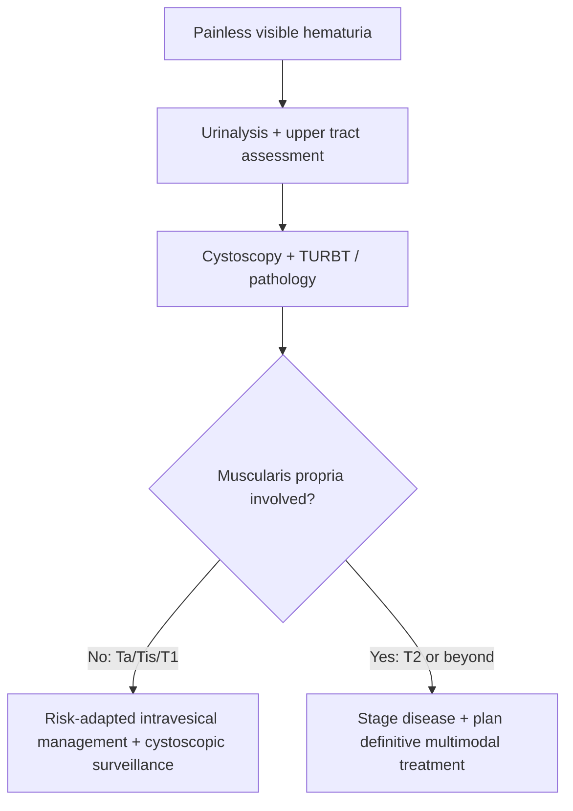

# 23 — Bladder, Prostate and Urethral Surgery

> [!info] Source basis
> **WOR Surgery: Urology Part 2, printed pp. 143–152**; **Doctut Merged: Urology II (prostate, bladder, urethra, congenital outlet anomalies and trauma)**; **Robbins Pocket Companion: Lower Urinary Tract and Male Genital System, printed pp. 959–971**; **First Aid 2025 Renal/Reproductive**; **Combined/Bootcamp urologic pathology**. Historical numerical cutoffs and source-era treatment diagrams are flagged in the appendix.

## 1. Functional and surgical anatomy

### Bladder
- **Detrusor** = smooth muscle of bladder wall; **urothelium** accommodates filling without a large rise in pressure.
- **Trigone:** ureteric orifices superiorly and internal urethral opening inferiorly; mucosa more firmly attached.
- **Bladder dome** is peritonealized and particularly vulnerable to **intraperitoneal rupture** when overdistended.
- **Bladder base/neck and pelvic wall** are more often injured in **extraperitoneal rupture** from pelvic fracture.
- **Internal sphincter** at bladder neck is predominantly smooth muscle under autonomic control; **external urethral sphincter** is striated, voluntarily controlled (pudendal nerve).
- **Autonomic pathways:** parasympathetic pelvic splanchnics (S2–S4) contract detrusor; sympathetic hypogastric pathways promote storage, bladder-neck closure; pudendal nerve contracts external sphincter.

### Prostate zones (McNeal)

| Zone | Relation | Typical pathology |
|---|---|---|
| **Peripheral (~70% glandular tissue)** | Posterior and lateral, palpable via DRE | Most **prostate adenocarcinomas** arise here |
| **Transition (~5–10% in younger adult)** | Surrounds proximal urethra | **Benign prostatic hyperplasia (BPH)** develops here |
| **Central** | Around ejaculatory ducts | Smaller fraction of cancers |
| Anterior fibromuscular stroma | Nonglandular supportive tissue | Not typical origin of adenocarcinoma |

- **Prostatic urethra** receives ejaculatory ducts at verumontanum. **Verumontanum** is the important distal anatomical limit in TURP; excessive distal resection can damage the voluntary sphincter.
- **Corpora amylacea:** concentric eosinophilic secretions within prostatic glands; calcification may contribute to benign prostatic concretions (Robbins/WOR).

### Male urethra
- **Posterior urethra:** prostatic + membranous; membranous segment is fixed and vulnerable to pelvic-fracture injury.
- **Anterior urethra:** bulbar + penile/spongy; bulbar portion vulnerable to straddle injury.
- **External meatus** is classically the narrowest physiological part, while prostatic urethra is relatively distensible.
- **Corpus spongiosum** surrounds anterior urethra; corpora cavernosa are paired erectile bodies.

## 2. Lower urinary tract symptoms (LUTS)

### Classify before attributing to BPH

| **Storage symptoms** | **Voiding symptoms** | **Post-micturition symptoms** |
|---|---|---|
| Frequency, nocturia, urgency, urge incontinence | Hesitancy, slow/intermittent stream, straining, terminal dribbling | Incomplete emptying, post-void dribble |

- LUTS may reflect **BPH, overactive bladder, infection, diabetes, prostate cancer, neurologic disease, medications or urethral stricture**; an enlarged prostate is not the sole explanation.
- **Red flags:** visible hematuria, recurrent UTI, renal insufficiency, recurrent retention, fever/sepsis, neurological deficits and weight loss.
- History: symptoms and bother, duration, fluid/caffeine, medications, neurologic disorders, prior instrumentation/UTI, sexual function and family cancer risk.

### Initial assessment
- Abdominal exam for distended bladder; external genitalia and meatus; targeted neurologic exam; **DRE** when indicated.
- **DRE:** BPH often smooth/rubbery enlarged gland; suspicious malignancy can feel hard/nodular, but normal DRE **cannot exclude** cancer.
- **Urinalysis** for infection, hematuria or glycosuria; renal function if retention/obstructive risk.
- **Ultrasound KUB/prostate:** gland size, upper-tract dilation, bladder wall and **postvoid residual (PVR)**.
- **Uroflowmetry:** provides flow curve and peak rate (`Qmax`); source convention **>15 mL/s** usually not obstructed, 10–15 equivocal, <10 suspicious, but **flow depends on voided volume and detrusor contractility**.
- **Pressure-flow urodynamics:** distinguishes true bladder outlet obstruction from impaired bladder contractility in selected cases.
- **PSA:** a prostate-derived marker, elevated in some cancers but also BPH, infection and manipulation; use depends on risk, age and shared decision-making.

## 3. Benign prostatic hyperplasia (BPH)

### Pathophysiology
- **Nodular hyperplasia** of glands and fibromuscular stroma in **transition/periurethral zone** (Robbins).
- Androgen-dependent process; **5α-reductase** converts testosterone → **dihydrotestosterone (DHT)**, which maintains prostate growth and interacts with growth factors.
- **Two components of obstruction:**
  - **Static:** increased prostatic tissue mechanically compresses urethra.
  - **Dynamic:** **α₁-adrenergic** smooth-muscle tone at prostate/bladder neck raises resistance.
- Persistent obstruction → detrusor hypertrophy/trabeculation, diverticula, incomplete emptying, recurrent infection/stones and in severe disease bilateral hydroureteronephrosis.

### Clinical presentation
- Hesitancy, weak stream, poor emptying, straining, nocturia, urgency and frequency; progressive residual urine can cause overflow incontinence and urinary retention.
- Differential: urethral stricture (prior injury/instrumentation), carcinoma, infection, bladder dysfunction, anticholinergic medications and spinal pathology.

### Medical treatments in source

| Therapy | Mechanism | Time course | High-yield adverse effects |
|---|---|---|---|
| **α₁ blockers** (e.g., tamsulosin) | Relax prostate/bladder-neck smooth muscle (**dynamic**) | **Relatively rapid** | Dizziness, orthostatic symptoms, altered ejaculation |
| **5α-reductase inhibitors** (finasteride/dutasteride) | Reduce DHT-driven tissue growth (**static**) | Months; WOR describes ~6 mo | Sexual side effects, **PSA falls ~50%** after months |
| Combination | Addresses dynamic and static components | Selected larger symptomatic glands | Monitor adverse effects/PSA interpretation |

**Exam trap:** finasteride decreases PSA concentration; a PSA measured during therapy cannot be interpreted as if untreated.

### Indications for intervention (WOR/Doctut)
- **Refractory urinary retention**, recurrent UTIs, recurrent gross hematuria attributed to prostate, bladder calculi, upper urinary tract dilation/renal deterioration from outlet obstruction, or intolerable symptoms despite suitable conservative/medical treatment.
- Procedure selection depends on prostate size, anatomy, anticoagulation, patient condition and technique availability.

### Procedures

| Procedure | Key principle | Typical note |
|---|---|---|
| **TURP** | Endoscopic resection of obstructing transition zone | Classic reference operation |
| **Bipolar TURP** | Bipolar resection with **normal saline irrigation** | Avoids hypotonic glycine-fluid absorption issue of classic monopolar technique |
| **HoLEP** | **Holmium laser enucleation** of adenomatous tissue | Endoscopic anatomical enucleation |
| **GreenLight/PVP** | Laser vaporization of obstructing tissue | Selected patients/technology |
| **TUIP** | Incision rather than wide resection | Smaller selected prostates |
| Open/simple prostatectomy | Adenoma enucleation, **not radical cancer surgery** | For very large glands when endoscopic alternatives unsuitable |

- Doctut names **Freyer** (transvesical/suprapubic) and **Millin** (retropubic) approaches for open/simple prostatectomy; these refer to adenoma enucleation, not cancer radical prostatectomy.
- **3-way Foley** after TURP: one lumen for balloon, one for drainage, one for saline irrigation to prevent clot retention.

### TURP complications

| Timing/type | Mechanism | High-yield significance |
|---|---|---|
| Bleeding/clot retention | Open prostatic venous channels and arterial oozing | Irrigation, hemostasis, monitoring |
| **Retrograde ejaculation** | Bladder-neck/internal sphincter disruption | **Common long-term sexual effect** |
| Urinary incontinence | Sphincter injury or detrusor dysfunction | Distal resection beyond verumontanum is an anatomical risk |
| Bladder-neck contracture/urethral stricture | Healing/fibrosis | Late renewed obstruction |
| **TURP syndrome** | Absorption of non-electrolyte/low-tonicity irrigant during traditional monopolar TURP | **Dilutional hyponatremia**, fluid overload, headache/confusion/seizures |
| Infection | Instrumentation | Appropriate perioperative measures |

#### TURP syndrome mechanism
- Exposed venous sinuses absorb glycine/other nonconductive irrigation fluid → circulating dilution, **hyponatremia** and neurological/cardiovascular effects.
- In sources, **glycine (1.5%)** is described as common monopolar irrigant; **normal saline** is used with bipolar methods. A WOR statement calling glycine “isotonic” is imprecise in this context; concentrate on electrolyte-free irrigation and absorption risk.
- Severe symptomatic hyponatremia is a monitored emergency; **do not apply a fixed correction regimen from a revision table independently of symptoms, chronicity and physiology**.

## 4. Prostate adenocarcinoma

### Risk and pathology
- Most originate in **peripheral zone** and are **adenocarcinoma**; age, family/genetic risk (including **BRCA2**) and ancestry are described in sources.
- Often asymptomatic early; may be found via PSA/DRE or incidentally. Advanced disease causes urinary symptoms, hematuria, bone pain or weight loss.
- **Spread:** local extension to capsule/seminal vesicles; pelvic/obturator lymph nodes; hematogenous spread to axial skeleton via **Batson vertebral plexus**, characteristically **osteoblastic bone metastases**.

### PSA and diagnostic tests
- **PSA is not cancer-specific.** WOR's age-banded “PSA 0–3 normal, >3–4 biopsy” and Doctut's “>30 localized, >35 metastatic” numbers are **not reliable universal stage/biopsy rules**.
- Cancer evaluation integrates PSA level/trend, age, DRE, risk and increasingly imaging when available; source biopsy options include **TRUS-guided** or **transperineal template/systematic biopsy**.
- **TRUS biopsy:** sampling from prostate through rectal wall; source lists ≥12 systematic cores, with infection risk.
- **Transperineal biopsy:** accesses prostate through perineal skin, facilitates anterior sampling; choice depends on setting.
- **Staging:** cross-sectional imaging and bone imaging in patients whose cancer/risk features justify it; source mentions CT and bone scan.

### Gleason grading and Grade Groups
- Tumor gland architecture is assigned patterns, usually **3–5 in contemporary biopsies**; **primary (most prevalent) + secondary (next predominant)** determines Gleason score (e.g., `3+4=7`).
- **3+4 and 4+3 are not equivalent**: greater pattern 4 burden indicates higher risk.

| ISUP Grade Group | Gleason score | Risk principle |
|---|---|---|
| **1** | 3+3=6 | Well differentiated among conventionally scored cancers |
| **2** | 3+4=7 | Intermediate; pattern 3 predominates |
| **3** | 4+3=7 | Worse than 3+4 |
| **4** | 4+4=8; 3+5=8; 5+3=8 | High grade |
| **5** | 9–10 | Highest grade |

**Source framing:** WOR lists theoretical Gleason minimum **2**, but contemporary clinically used biopsy grading centers on pattern **3–5**. Learn the distinction.

### Staging concepts
- **T1:** clinically inapparent; discovered incidentally or by biopsy (T1a/T1b/T1c).
- **T2:** confined within prostate (T2a/T2b/T2c subdivisions are source-era usage).
- **T3:** extracapsular extension/seminal vesicle invasion.
- **T4:** invasion into adjacent fixed structures such as bladder/rectum/pelvic wall, beyond seminal vesicles.
- Nodal status, metastases, PSA and Grade Group determine risk together.

### Management strategies in the sources

| Situation | Broad options | Principle |
|---|---|---|
| Very low/low risk, favorable longevity/context | **Active surveillance** in selected cases | Avoid morbidity from treating biologically indolent cancer; requires structured monitoring |
| Clinically localized cancer suitable for definitive treatment | **Radical prostatectomy** or radiotherapy/brachytherapy according to risk | Oncologic control with urinary/sexual quality-of-life tradeoffs |
| Locally advanced/high-risk disease | Combined modalities; radiotherapy and **androgen deprivation therapy (ADT)**; surgery in selected patients | Integrate local/systemic risk |
| Metastatic disease | Hormonal/systemic treatments ± radiotherapy/supportive care | Relieve symptoms and treat systemic disease |

- **Radical prostatectomy** removes prostate and seminal vesicles with surgical reconstruction; pelvic lymph node dissection is performed when indicated, not automatically all iliac nodes.
- **ADT:** bilateral orchiectomy (surgical), GnRH agonists/antagonists and androgen-axis agents; flutamide/abiraterone appear in WOR but their mechanisms/classes are different.
- WOR's flowchart uses **fixed age 70 and T-stage thresholds**, as well as “brachytherapy → residual cancer → prostatectomy,” which **does not define a universal management algorithm**. Record it as historical examination-source material.
- **Metastatic castration-resistant disease** involves additional systemic strategies in the source, including chemotherapy and selected bone-targeted treatments, but these files do **not** establish a complete current oncology sequence.

## 5. Bladder cancer (urothelial carcinoma)

### Histology, risk and pathogenesis
- The bladder lining is **urothelium (transitional epithelium)**; **urothelial carcinoma** is the most common bladder malignancy in many settings.
- Risk factors emphasized by WOR/Robbins: **cigarette smoking**, aromatic amine/industrial chemical exposure, **cyclophosphamide**, chronic irritation and carcinogens.
- **Squamous carcinoma** is particularly associated with **Schistosoma haematobium** infection and chronic inflammation, more important in endemic regions.
- Robbins describes molecular routes:
  - **Low-grade papillary** route often linked to **FGFR3/RAS** pathway and chromosome 9 changes; frequently recurrent but less invasive.
  - **High-grade flat/CIS** route often involves **TP53/RB** disruption; greater progression potential.
- **Field cancerization/multifocality:** entire urothelial lining may be susceptible; recurrence after resection is common and **cystoscopic surveillance is essential**.

### Symptoms and differential diagnosis
- **Painless gross hematuria** is the classic presentation; may also have frequency, urgency, dysuria or obstruction.
- Other causes of hematuria include stones, infection, trauma, renal malignancy and glomerular disease; **visible hematuria warrants evaluation rather than attributing it to BPH by default**.

### Diagnostic workflow
1. History, urinalysis, renal function and appropriate imaging of upper tracts.
2. **Cystoscopy** visually identifies lesions; **TURBT** establishes diagnosis, tumor grade and depth (must include adequate muscle for assessing muscle invasion when relevant).
3. **Urine cytology** is more useful for high-grade lesions and CIS; poor sensitivity in low-grade cancer (Robbins).
4. Contrast cross-sectional imaging/staging when invasive or high-risk disease is suspected.

### Staging—memorize the wall layers

| Stage | Histologic depth | Group |
|---|---|---|
| **Ta** | Papillary **noninvasive**, above basement membrane | Non–muscle-invasive (NMIBC) |
| **Tis** | **Flat carcinoma in situ** | NMIBC, high-risk biology |
| **T1** | **Lamina propria invasion**, but not muscularis propria | NMIBC |
| **T2** | **Muscularis propria invasion** | **Muscle-invasive** (MIBC) |
| **T3** | Extends into **perivesical soft tissue** | Locally advanced |
| **T4** | Invades adjacent organs/structures | Locally advanced |

**Crucial distinction:** `T1` means **above muscularis propria** but **already invasive into lamina propria**—not merely “above muscle” without invasion.

### Treatment framework in source

| Stage/risk pattern | Source-based treatment concepts | Important caveats |
|---|---|---|
| Low-risk **Ta** | Complete **TURBT**, selected postoperative intravesical chemotherapy | Follow-up cystoscopy still important |
| **Tis/CIS** | **Intravesical BCG** | Flat/high-grade lesion may be invisible as a bulky mass |
| **T1 / high-risk NMIBC** | Complete TURBT, selected repeat TURBT, **BCG or risk-based treatment** | Recurrence and progression risk; refractory disease can require cystectomy |
| **Muscle invasive (≥T2)** | **Radical cystectomy** with pelvic nodes in eligible patients ± perioperative systemic therapy; radiotherapy-based bladder preservation in selected cases | Multidisciplinary choice based on stage and patient factors |
| **Locally advanced/metastatic** | Systemic treatment, symptom control ± surgery/radiation | Source diagrams contain incomplete drug-era detail |

### Radical vs partial cystectomy
- **Radical cystectomy:** removal of bladder and pelvic lymph nodes, with sex/oncology-specific adjacent organ management and urinary diversion; WOR's routine “remove urethra in all” statement is too broad.
- **Partial cystectomy:** selected localized solitary tumors (e.g., dome/urachal location or specific favorable lesions); not automatic for all small lesions.
- **Urinary diversion** options:

| Diversion | Pathway | Major trade-offs |
|---|---|---|
| **Ileal conduit** | Ureters → isolated ileal segment → abdominal stoma/collection bag | Common incontinent diversion, stoma care |
| **Orthotopic neobladder** | Intestinal reservoir connected to urethra | Continence training, emptying issues, selected candidates |
| **Continent cutaneous reservoir** | Internal reservoir drained by catheter via stoma | Intermittent self-catheterization and metabolic/technical issues |
| **Ureterosigmoidostomy** | Ureters draining into colon | Source labels largely obsolete owing to **infection, metabolic issues and cancer risk** |

- **Bowel urinary diversions** may result in **hyperchloremic metabolic acidosis** because intestinal mucosa exchanges urinary chloride/ammonium for bicarbonate; exact electrolyte pattern varies with bowel segment and renal status.

## 6. Bladder stones, diverticula and neurogenic bladder

### Bladder stones
- May be primary or arise secondarily to **obstruction/stasis** (BPH, stricture, neurogenic bladder, bladder diverticulum, foreign body).
- Present with dysuria, terminal hematuria, intermittency/strangury, recurrent infection.
- Assessment: ultrasound and cystoscopy when needed; evaluate cause and remove stone.
- WOR/Doctut describe **transurethral cystolithotripsy/cystolitholapaxy**, with **suprapubic/open cystolithotomy** selected for difficult stones/anatomy.
- **Stone-composition note:** WOR labels “mixed urate” common, while Doctut differentiates primary calcium oxalate and secondary ammonium urate. Do not assume one composition is universally most common worldwide.

### Bladder diverticula
- Mucosal herniation through detrusor due to chronic raised pressure/weakness; can retain urine → infection, calculi, sometimes tumors.
- Management includes controlling obstruction and selective diverticulectomy when symptomatic/complicated.

### Neurogenic bladder
- Neurologic lesion disrupts coordinated **detrusor contraction and sphincter relaxation**.
- **Suprasacral lesions:** possible detrusor overactivity with detrusor-sphincter dyssynergia and high-pressure storage.
- **Sacral/peripheral lesions:** weak or areflexic detrusor with poor emptying.
- Investigations: PVR, renal function, ultrasound and urodynamics in selected cases; management protects **upper tracts** as well as continence.
- Intermittent catheterization, medications and reconstructive options depend on pattern and risk; source coverage here is limited.

## 7. Foley catheterization and urinary retention

### Urinary retention
- **Acute**: painful, distended bladder, inability to void.
- **Chronic**: high residual with less pain; may present as overflow incontinence or renal impairment.
- Causes: BPH, stricture, neurogenic disease, medication effects, stones, clot retention, pelvic surgery.

### Foley catheter
- **French gauge (Fr):** external circumference in mm; diameter ≈ `Fr / 3` mm.
- Source color convention:

| Fr size | Typical catheter color in WOR |
|---|---|
| **12 Fr** | White |
| **14 Fr** | Green |
| **16 Fr** | Orange |
| **18 Fr** | Red |

- A **2-way catheter** has drainage + balloon channels; a **3-way** adds continuous irrigation channel for postoperative or bleeding management.
- Sterile technique, lubrication, balloon inflation **only after intravesical placement** and secure fixation are essential principles.
- Catheter duration/replacement depends on product and care plan: source “rubber 25–30 days, silicone 90 days” values are **not universal safe indwelling intervals**.

### Do not blindly instrument possible urethral injury
- **Blood at meatus following pelvic fracture/straddle trauma** is an important contraindication to blind catheter passage until injury assessed.
- **Retrograde urethrogram (RGU)** is the key source investigation in suspected urethral disruption; suprapubic drainage is a major alternative when transurethral catheterization is unsafe.

## 8. Bladder trauma

### Intraperitoneal vs extraperitoneal rupture

| Feature | **Intraperitoneal** | **Extraperitoneal** |
|---|---|---|
| Typical injury | Direct blow to **distended bladder dome** | **Pelvic fracture** with injury at base/lateral wall |
| Urine path | Into peritoneal cavity | Into perivesical/retropubic tissues |
| Clinical | Abdominal pain, peritonitis, poor urine output, pseudo-AKI from urine absorption | Pelvic trauma, suprapubic pain, inability to void, pelvic hematoma |
| Imaging | **Retrograde CT cystography**: contrast outlines bowel/peritoneal space | Contrast extravasates around bladder in pelvis |
| Treatment | Usually **surgical repair** + drainage | Many uncomplicated cases managed by **catheter drainage**, surgery for complex injury |

- **Diagnostic distinction:** passive excreted contrast on routine CT may miss bladder rupture; bladder must be adequately filled with contrast via catheter for dedicated cystography when appropriate.
- Worsening sepsis or associated bowel/bladder-neck injury changes treatment.
- WOR gives fixed 7-day catheter and routine two-layer closure; actual duration/reconstruction depends on injury and recovery.

## 9. Urethral trauma

### Pattern recognition

| Feature | **Anterior urethra** | **Posterior urethra** |
|---|---|---|
| Mechanism | **Straddle injury** to bulbar urethra, instrumentation | **Pelvic fracture urethral injury** |
| Hematoma | Superficial perineal/scrotal “**butterfly**” hematoma in source | Deep pelvic/perineal hematoma |
| Signs | Blood at meatus, poor voiding | Blood at meatus, urinary retention, pelvic fracture |
| Investigations | **RGU** | **RGU** ± further bladder studies |
| Immediate aim | Avoid aggravation; secure safe urine drainage | Stabilize pelvic injury/hemorrhage and provide safe urinary drainage |

- **High-riding/floating prostate** on DRE is a traditional teaching point but **not a reliable diagnostic requirement**; absence does not rule out injury.
- **RGU:** contrast introduced retrograde through urethra demonstrates site/extent of extravasation.
- **MCU/VCUG:** voiding cystourethrogram, often useful in follow-up/reconstructive evaluation.

### Urethral stricture
- Fibrotic narrowing from trauma, instrumentation, infection/inflammation or ischemia; causes slow stream, recurrent UTI, retention.
- **Short selected strictures:** dilation or **optical internal urethrotomy (OIU/DVIU)** (recurrence possible).
- **Short obliterative segment:** excision and primary anastomosis when tension-free.
- **Longer/complex strictures:** **urethroplasty**, often with **buccal mucosal graft**.
- Evaluate length/location before planning repair; source gives an oversimplified short/long algorithm.

### Penile fracture
- Rupture of **tunica albuginea of corpus cavernosum** in erect penis, often intercourse-related bending.
- **Pop/snap → immediate pain/detumescence → eggplant deformity** from hematoma.
- May coexist with urethral injury if blood at meatus/voiding difficulty.
- Source treatment: urgent surgical exploration, hematoma evacuation and albugineal repair.

## 10. Posterior urethral valves (PUV)

### Pathophysiology
- Congenital obstructive membrane within **posterior urethra of boys**; **Young type I** is the most classically described.
- Increased voiding pressure → thickened/trabeculated bladder, hydroureteronephrosis, VUR and potentially dysplastic/poorly functioning kidneys.
- Presentation: antenatal bilateral hydronephrosis, neonatal weak stream/distended bladder, recurrent febrile UTI, later CKD.
- **MCU/VCUG:** posterior urethral dilatation with obstructing transition; ultrasound may show thick bladder wall and renal changes.
- Management principle: secure urinary drainage and stabilize renal/electrolyte status, then **endoscopic valve ablation/fulguration** when feasible; long-term surveillance for bladder/kidney dysfunction.

## 11. Exstrophy–epispadias spectrum

### Bladder exstrophy (ectopia vesicae)
- Congenital defect of lower anterior abdominal wall and bladder ventral wall with **exposed bladder mucosa**; associated with pubic diastasis and **epispadias**.
- **Male:** epispadias, pubic separation, inguinal hernia/cryptorchidism may coexist.
- **Female:** bifid clitoris, abnormal labia/urethral location.
- Urine drains continuously from exposed ureteric orifices; risk of infection and long-term malignant change if uncorrected.
- Treatment: specialized reconstructive closure with preservation of renal function and continence; additional procedures may be needed.

## 12. Final comparison and rapid revision

| Question stem | Most useful clue |
|---|---|
| Smooth enlarged prostate + weak stream | **BPH (transition zone)** |
| Hard peripheral nodule + bone lesions | **Prostate cancer (peripheral zone)** |
| Finasteride | **DHT synthesis ↓; PSA ~50% lower after months** |
| TURP resection distal limit | **Verumontanum** |
| TURP + confusion after hypotonic irrigant absorption | **TURP syndrome / dilutional hyponatremia** |
| Painless visible hematuria | Exclude **urothelial carcinoma**, among other causes |
| Bladder **T1** | **Lamina propria** invasion |
| Bladder **T2** | **Muscularis propria** invasion |
| Flat high-grade bladder lesion | **Tis / CIS**, BCG-related treatment concept |
| Common incontinent diversion | **Ileal conduit** |
| Full bladder, blunt blow, peritonitis | **Intraperitoneal bladder rupture** |
| Pelvic fracture + blood at meatus | **Posterior urethral injury → RGU before blind catheterization** |
| Straddle injury + butterfly hematoma | **Bulbar/anterior urethral injury** |
| Boy + weak stream + bilateral hydronephrosis | **PUV** |
| Exposed bladder mucosa and epispadias | **Bladder exstrophy** |

**Chapter source anchors:** WOR Urology Part 2 pp. 143–152; Doctut Urology II; Robbins Lower Urinary Tract and Prostate; First Aid 2025 Reproductive/Renal; Combined Bootcamp Urologic Pathology. See source-concordance appendix.
