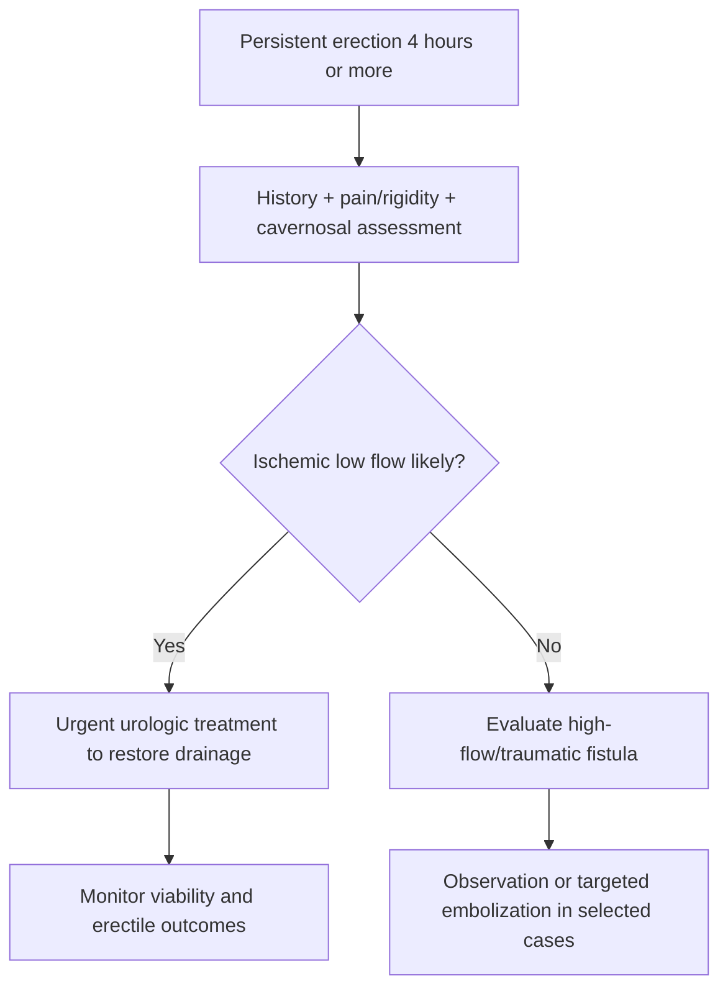
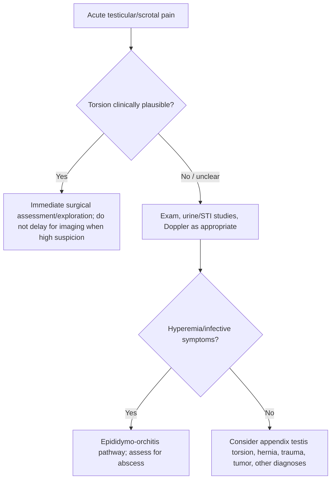

# 24 — Male Genital, Penile and Scrotal Surgery

> [!info] Sources
> **WOR Surgery: Urology Part 2, pp. 147–157**; **Doctut Merged Urology II (hypospadias, phimosis, paraphimosis, priapism, penile carcinoma, cryptorchidism and scrotal surgery)**; **Robbins Pocket Companion, Male Genital System, printed pp. 970–980**; **First Aid 2025 Reproductive**; **Combined/Bootcamp Urology/Pathology**. Tumor pathology and markers are anchored strongly in Robbins; older source treatment schedules are explicitly qualified.

## 1. Embryology, anatomy and clinical examination

### Testicular descent and the coverings
- Testis develops at embryonic **posterior abdominal wall/genital ridge** and descends through inguinal canal into scrotum, guided by gubernaculum and hormonal/developmental influences.
- **Processus vaginalis:** peritoneal extension accompanies descent; normally proximal channel obliterates. Persistence predisposes to **congenital communicating hydrocele and indirect inguinal hernia**.
- **Tunica vaginalis:** parietal/visceral layers around testis; a **hydrocele** is fluid in this sac.
- **Tunica albuginea:** dense testicular covering; **penile tunica albuginea** surrounds each corpus cavernosum and can rupture in penile fracture.
- **Spermatic cord:** vas deferens, testicular artery, cremasteric vessels, pampiniform plexus, autonomic nerves and lymphatics.
- **Testicular arterial supply** arises from abdominal aorta; **testicular lymphatics drain to retroperitoneal para-aortic nodes**, not inguinal nodes in an undisturbed testis.
- **Scrotal skin drainage** is to **superficial inguinal nodes**, important for penile/scrotal cancers and scrotal incision contamination.

### Venous drainage and varicocele
- **Right testicular vein → IVC**; **left → left renal vein** at nearly right angle. Left gonadal venous column/anatomy helps explain **left-sided varicocele predominance**.
- A **new isolated right-sided/nonreducible varicocele** or rapidly developing varicocele should prompt assessment for a secondary cause, not automatically be labeled primary.

### Systematic scrotal examination
- History: sudden vs gradual pain, fever/urinary symptoms, trauma, swelling fluctuation, sexual history where relevant, infertility, cryptorchidism and cancer risk.
- Inspect at rest and standing; examine each testis separately, epididymis posteriorly and cord toward inguinal ring.
- **Transillumination:** fluid-filled hydrocele may transmit light, but negative/positive transillumination alone cannot exclude malignancy or diagnose every swelling.
- **Cough impulse/reducibility** suggests hernia; **bag of worms** increases when standing/Valsalva in varicocele.
- **Testicular torsion suspicion is primarily clinical** and should never be delayed by a reassuring but inadequate bedside maneuver.

## 2. Developmental penile and urethral anomalies

### Hypospadias
- **Ventral urethral opening**, often dorsal hooded prepuce and **ventral chordee** (downward penile curvature).
- Spectrum: **glanular/coronal → penile shaft → penoscrotal/scrotal/perineal**; more proximal anatomy may be associated with severe chordee and other genital abnormalities.
- Problems: abnormal urine direction/spraying, cosmetic concerns, penile curvature, later sexual/reproductive issues depending on anatomy.
- **Association with cryptorchidism:** more concerning when proximal hypospadias and/or nonpalpable testes coexist; assess broader developmental anatomy.
- **Important surgical precaution: do not circumcise before reconstruction planning**, because preputial tissue may be needed for repair.

### Reconstructive principles
1. **Orthoplasty:** straighten penis and correct chordee.
2. **Urethroplasty:** construct/extend urethral channel to appropriate meatus.
3. **Glanuloplasty/meatoplasty:** reconstruct glans and outlet.
4. **Skin cover/scrotoplasty** if required.
- WOR cites **6–12 months** as a common operative period; actual timing depends on anatomy and center.
- Distal mild cases may be repaired in one stage, while proximal or complex cases can require staged approaches; **Thiersch–Duplay**, **Denis Browne**, **MAGPI** appear in older source lists.
- Complications: **urethrocutaneous fistula**, meatal stenosis, recurrent curvature, stricture and cosmetic changes.

### Epispadias
- **Dorsal** ectopic urethral opening, contrasted with ventral hypospadias.
- Often part of **exstrophy–epispadias spectrum** (see Ch. 23); continence and bladder neck must be assessed.

## 3. Phimosis, paraphimosis and balanitis

### Phimosis
- Inability to retract foreskin over glans; **physiologic nonretractility** in young children is common and not synonymous with pathologic scarring.
- **Pathologic/acquired phimosis:** recurrent inflammation, lichen sclerosus/**balanitis xerotica obliterans (BXO)**, fibrosis.
- Symptoms: pain, recurrent balanoposthitis/UTI, ballooning with voiding, spraying, difficult hygiene or intercourse.
- **Do not forcibly retract physiologic adherent foreskin**, as trauma can produce secondary scarring.
- WOR/Doctut emphasize circumcision for symptomatic scarring; reconstructive/medical management choice depends on etiology and severity.
- **Circumcision should not be performed before hypospadias repair planning**.

### Paraphimosis — urgent diagnosis
- Foreskin is retracted behind glans and cannot be returned; **constricting ring → venous/lymphatic obstruction → edema → progressive arterial compromise**.
- Often after catheter placement or examination when foreskin not replaced.
- Signs: painful swollen glans, constricting band, exposed glans.
- Management concepts in source: analgesia, compress edematous tissue and **manual reduction**; **dorsal slit** if reduction fails or ischemia threatens; consider later definitive treatment to prevent recurrence.
- **Always return foreskin to normal position after catheter care**.

### Balanoposthitis
- Inflammation of glans/prepuce due to irritation, Candida, bacterial/STI causes or dermatosis; recurrent disease can lead to pathologic phimosis.
- Manage cause, hygiene and risk factors; evaluate persistent atypical lesions for malignancy rather than repeatedly treating as simple infection (Robbins).

## 4. Peyronie disease

### Definition and mechanism
- **Localized fibrosis/plaque of tunica albuginea of corpus cavernosum** → asymmetric expansion during erection → **curvature toward plaque**, pain and possible erectile dysfunction.
- Can coexist with other fibrosing conditions such as **Dupuytren contracture** (Doctut).
- Often a palpable dorsolateral plaque; progression varies between active/painful and stable deformity phases.
- **Imaging:** clinical evaluation is central; ultrasound may characterize plaques and erectile vascular function; WOR names MRI but it is **not required for every presentation**.

### Treatment concepts in sources
- Counseling/observation for mild nonbothersome disease; medical or intralesional options in appropriate lesions.
- **Collagenase of *Clostridium histolyticum*** appears in WOR as an intralesional option in selected disease (availability varies).
- **Nesbit plication:** shortening the convex (longer) side to straighten penis; risk includes perceived penile shortening.
- More complex grafting or prosthesis strategies depend on deformity, stability and erectile function.

## 5. Priapism: differentiate low-flow from high-flow

### Definition
- Persistent penile erection unrelated to sexual stimulation or beyond it, **≥4 hours**; differentiate immediately because **ischemic priapism threatens cavernosal tissue**.

| Feature | **Ischemic (low-flow)** | **Nonischemic (high-flow)** |
|---|---|---|
| Physiology | Venous outflow failure → stagnant, deoxygenated blood | Unregulated high arterial inflow, often after fistula/trauma |
| Pain | **Painful, rigid corpora** | Often less painful, incomplete rigidity |
| Important associations | **Sickle cell disease**, leukemia, medications/intracavernosal agents | **Perineal/penile trauma** and arteriosinusoidal fistula |
| Cavernosal blood gas | **Hypoxic, acidotic, hypercarbic** | Relatively well oxygenated |
| Urgency | **Emergency** | Often less time-critical |
| Treatment core | Analgesia, cavernosal aspiration/irrigation and **intracavernosal sympathomimetic** with monitoring; selected shunt | Observation/selective vascular imaging and embolization if persistent |

### Pathophysiology of ischemic damage
- Cavernosal blood stagnates → falling oxygen/pH, swelling, progressive smooth-muscle injury/fibrosis → erectile dysfunction risk with delay.
- WOR's “after 6 h ischemia/necrosis” is an oversimplified absolute threshold; **a painful sustained erection >4 h warrants immediate evaluation**.
- Doctut emphasizes **phenylephrine**, while WOR mentions “adrenaline”; the notes disagree on specific agent. Clinical choice/dose requires a supervised protocol.

### Shunt procedures in source
- **Distal corporospongiosal shunts** (e.g., Winter) relieve trapped cavernosal blood in resistant ischemic cases.
- **Proximal shunts** and **Grayhack corporosaphenous shunt** are historical methods discussed in WOR/Doctut; use depends on local experience and modern approach.
- **Cavernosal blood gas** and/or Doppler help distinguish flow patterns; blanket penile angiography for every priapism is not warranted by all source pathways.

## 6. Penile carcinoma

### Risk factors and precancerous conditions
- Usually **squamous cell carcinoma (SCC)**, associated with **high-risk HPV (particularly 16/18)**, smoking, chronic inflammation, phimosis and poor local hygiene (Robbins).
- **Bowen disease:** penile shaft **carcinoma in situ**, often erythematous/gray shiny plaque.
- **Erythroplasia of Queyrat:** carcinoma in situ of **glans/prepuce**, classically velvety red plaque.
- **Bowenoid papulosis:** often multiple pigmented genital papules in younger patients; histology may resemble Bowen but generally less invasive evolution.
- **BXO/lichen sclerosus** and leukoplakia are notable source associations requiring surveillance of persistent suspicious lesions.
- **Buschke–Löwenstein tumor:** giant condylomatous/verrucous lesion, locally destructive; differentiated from ordinary HPV condyloma.

### Clinical presentation and spread
- Nonhealing ulcer, indurated nodule, foul-smelling fungating mass, bleeding or deformity, usually glans or foreskin.
- **Lymphatic spread:** superficial then deep inguinal, followed by pelvic nodes; nodal involvement strongly affects prognosis.
- Ipsilateral/bilateral nodes may enlarge from **secondary infection** rather than cancer; imaging/biopsy strategy matters.
- WOR states fatal femoral/iliac vessel erosion as a characteristic mechanism of death in advanced neglected disease; it is **not a universal cause of mortality**.

### Examination and investigations
- Examine whole penis, extent of corpora/urethral involvement, both groins and local skin lesions.
- **Biopsy of primary lesion** confirms diagnosis and histologic grade.
- Imaging/local staging may assess corpora and nodal disease; WOR mentions PET-CT as routine, but source evidence does not support **every patient requiring PET-CT**.
- Historical **Jackson staging** appears in source; learn **modern anatomical TNM** concept separately.

### Organ-preserving vs ablative treatment

| Extent | Source options | Main principle |
|---|---|---|
| Penile intraepithelial neoplasia/CIS | Topical therapy (e.g., 5-FU), local excision, laser or selected skin resurfacing | Preserve penis with monitoring |
| Small localized distal invasive lesion | Local excision/glansectomy or **partial penectomy** if required | Clear tumor while preserving function where possible |
| Large proximal/extensive involvement | **Total penectomy** / extensive reconstruction | Oncologic control |
| Groin nodes at risk/confirmed | Sentinel node evaluation and/or appropriate inguinal/pelvic dissection | Regional control and staging |

- WOR gives **0.5-cm margin** and **≥2-cm residual stump** as historic surgical mnemonics; margins and conservation depend on histology, location, reconstructability and selected technique.
- **Inguinal lymph node dissection:** risk of lymphedema, wound infection, skin necrosis and vascular injury.
- Doctut references **Cabanas sentinel node**, **Lacy incision**, **Catalona modified dissection**—named examination points, not a requirement to reproduce procedures in every patient.

## 7. Undescended and ectopic testes

### Terminology
- **Cryptorchidism/undescended testis:** testis fails to reach dependent scrotum along normal pathway.
- **Ectopic testis:** travels **outside normal descent path**, e.g., superficial inguinal pouch (WOR's common site).
- **Retractile testis:** normally descended and can be placed in scrotum but is pulled upward by cremasteric reflex; may need surveillance for acquired ascent.
- **Absent/vanishing testis:** testicular tissue not demonstrable (e.g., antenatal vascular event), distinct from undescended viable tissue.

### Clinical implications
- Most commonly palpable **inguinal canal**; source notes right more common than left.
- Abnormal temperature and germ-cell/Sertoli cell damage impair fertility potential; bilateral disease is particularly significant.
- Increased risk of **germ cell tumor**, especially **seminoma**, and associated indirect inguinal hernia, torsion and trauma.
- **Orchiopexy reduces risk but does not abolish lifetime malignancy risk**; ongoing self-examination/clinical awareness matters.

### Management
- Spontaneous descent frequently occurs during early infancy; source recommends surgical correction **around 6–12 months** (and not unnecessarily delayed beyond early childhood).
- **Palpable testis:** inguinal/scrotal exploration and **orchiopexy** preserving vas/vessels; repair patent processus vaginalis where relevant.
- **Nonpalpable testis:** surgical/laparoscopic localization and management according to whether intra-abdominal, atrophic/vanished or high-positioned.
- **High intra-abdominal testis:** source names **Fowler–Stephens** one- or two-stage vascular-dependent orchiopexy.
- **Retractile testis:** usually no immediate operation unless true ascending/undescended status develops.
- WOR includes β-hCG stimulation as a simplified route to diagnosing anorchia; **it is not a universally definitive substitute for complete evaluation**.

## 8. Testicular torsion and acute scrotum

### Mechanism
- **Twisting of spermatic cord → venous obstruction first → congestion and swelling → arterial impairment → hemorrhagic infarction** (Robbins).
- **Bell-clapper deformity:** high tunica vaginalis investment permits intravaginal mobility and rotation; may be **bilateral**.
- **Extravaginal neonatal torsion** occurs outside tunica vaginalis and differs from classic adolescent intravaginal torsion.

### Bedside pattern
- Sudden severe unilateral scrotal pain ± vomiting, high-riding/transverse testis (**Deming/Angel signs** in WOR), absent cremasteric reflex in many cases.
- **Prehn sign** (pain relief with elevation) is traditionally described for epididymitis; **unreliable as a stand-alone diagnostic test**.
- **Blue-dot sign:** usually torsion of appendix testis (Morgagni), not of main testis.
- **Color Doppler:** reduced/absent perfusion may support torsion; **do not delay urgent exploration** when clinical suspicion is high.

### Torsion vs epididymo-orchitis

| Feature | Torsion | Epididymo-orchitis |
|---|---|---|
| Onset | **Abrupt**, severe | Often more gradual; can sometimes be rapid |
| Associated | Nausea/vomiting, prior intermittent similar episodes | Dysuria, discharge, fever or UTI/STI history |
| Position | **High-riding/transverse** testis may occur | Normal/low, swollen tender epididymis |
| Cremasteric reflex | Frequently absent | Often present |
| Doppler | Reduced/absent blood flow (early/partial torsion may complicate interpretation) | Usually increased vascularity |
| Priority | **Immediate surgical consideration** | Microbiologic evaluation/appropriate antimicrobials after torsion excluded |

### Surgical management
- **Prompt scrotal exploration, detorsion and assessment of viability**; **orchiopexy of both testes** because bell-clapper predisposition may be bilateral (Robbins).
- Nonviable testis may need orchidectomy with contralateral fixation.
- **Time = viability:** source states near-complete salvage with early treatment (first ~6 h) and markedly reduced salvage after ~24 h, but **no single cutoff guarantees failure/success**. **Delayed presentation does not justify withholding specialist assessment.**

## 9. Epididymitis, orchitis and testicular infection

### Age and organisms (Robbins)
- Sexually active younger males: **Chlamydia trachomatis, Neisseria gonorrhoeae** common causes.
- Older men with outlet problems/UTI: **enteric Gram-negative bacilli**, notably *E. coli*.
- Children: consider **anatomic urinary abnormalities** and enteric pathogens.
- **Mumps orchitis** may occur in postpubertal males after parotitis; **tuberculous epididymitis** often begins in epididymis and may involve testis.

### Diagnosis and treatment principles
- Clinical symptoms, urinalysis/culture and targeted STI testing; **first exclude torsion when acute severe pain**.
- Appropriate antimicrobial therapy if bacterial, analgesia/scrotal support and treat urinary obstruction or abscess where necessary.
- Chronic tuberculous epididymitis can mimic tumor; tissue/microbiologic diagnosis as needed.

## 10. Hydrocele, hematocele, spermatocele and hernia

### Types of fluid collections

| Lesion | Contents/location | Distinguishing feature |
|---|---|---|
| **Hydrocele** | Serous fluid within tunica vaginalis | Scrotal swelling, often **transilluminates** |
| **Hematocele** | Blood in tunica vaginalis | Trauma/torsion/bleeding; transillumination usually poor |
| **Chylocele** | Lymphatic fluid | Lymphatic obstruction; may occur with filarial disease |
| **Spermatocele** | Sperm-containing epididymal/ductal cyst | Often cystic mass separate from testis, upper pole |
| **Inguinal hernia** | Bowel/omentum through inguinal canal | May have reducibility, cough impulse, extends to groin |

### Hydrocele mechanisms
- **Primary vaginal hydrocele:** fluid balance between secretion/absorption disturbed without obvious underlying pathology; usually slowly progressive, painless.
- **Secondary hydrocele:** infection, trauma or tumor increases fluid secretion/impairs drainage. **Never miss an underlying testicular mass obscured by hydrocele.**
- **Communicating congenital hydrocele:** patent processus vaginalis allows peritoneal fluid passage; may vary in size with posture/crying.
- **Infantile hydrocele, funicular/encysted hydrocele of cord** reflect different degrees of processus vaginalis persistence.

### Management
- **Children:** observe uncomplicated cases in early infancy; persistent communicating hydrocele/associated hernia may require **ligation of patent processus vaginalis (herniotomy)**, timing individualized.
- **Adults with symptomatic primary hydrocele:** source operations include **Lord plication** (thin/smaller sac) and **Jaboulay eversion** (larger sac), with inspection for secondary pathology.
- **Risks:** hematoma, infection, chronic pain, recurrence and injury to testis/epididymis.

## 11. Varicocele

### Pathophysiology
- Dilatation/tortuosity of **pampiniform plexus**, more commonly left, owing to venous hydrostatic/anatomic factors and valvular failure.
- Classic **bag of worms** above testis, prominent when standing or with Valsalva, reduced supine; often asymptomatic.
- May be associated with impaired spermatogenesis due to elevated scrotal temperature, altered oxygenation/oxidative stress.
- **Diagnosis:** clinical examination; **scrotal Doppler** for uncertain exam and selected infertility assessment.

### Grading and fertility relevance
- Clinical grading usually distinguishes Valsalva-only vs palpable at rest vs visible veins; **subclinical-only ultrasound abnormalities are not equal to a clinically important palpable varicocele**.
- Fertility assessment includes semen analysis and couple evaluation, rather than treating an incidental vein finding alone.

### Options in source
- **Microsurgical varicocelectomy** (ligation of dilated veins while preserving testicular artery/lymphatics) and **percutaneous embolization**.
- WOR labels embolization “first line” and microsurgery “most effective”; selection depends on recurrence, fertility indications, expertise and anatomy and cannot be universally ranked from the notes alone.
- Risks: recurrence/persistence, postoperative hydrocele from lymphatic disruption, arterial injury and discomfort.

## 12. Fournier gangrene

### What it is
- **Necrotizing fasciitis of perineum, scrotum and genital tissues** often polymicrobial (aerobic and anaerobic synergy).
- Risk: **diabetes**, immunosuppression, periurethral/perianal infections, trauma/instrumentation; may progress along fascial planes to abdominal wall.
- Clinical: **rapidly progressive severe pain**, edema, erythema, skin discoloration/bullae, crepitus (may be absent), fever, septic shock.
- **Testes often spared** because their main arterial supply originates from abdominal aorta, distinct from superficial perineal skin circulation; sparing is **not guaranteed**.

### Management principles
1. **Immediate recognition and resuscitation** with sepsis/shock support.
2. **Urgent extensive surgical debridement** of necrotic tissue, often repeated as needed.
3. **Broad-spectrum antimicrobial therapy** with later microbiologic adjustment.
4. Drain source (perianal/urogenital), maintain suitable urinary/fecal diversion when indicated.
5. Later wound care, grafts/flaps and rehabilitation/reconstruction.

**Exam point:** **debridement/source control is the central life-saving procedure**—antibiotics alone are insufficient.

## 13. Testicular tumors

### Classification and clinical pattern
- **Germ cell tumors ~95%** of testicular tumors (Robbins): **seminoma** and **nonseminomatous germ cell tumors (NSGCTs)**; mixed tumors are common.
- Other groups: **sex cord-stromal** (Leydig, Sertoli), lymphomas and paratesticular neoplasms.
- **Most common pediatric prepubertal malignant GCT:** **yolk-sac tumor**; **common adult germ cell histology:** **seminoma**; **older patient:** lymphoma is an important testicular malignancy.
- Presentation: usually **painless testicular enlargement/mass**; do not assume every testicular lump is cancer, but investigate intratesticular solid masses promptly.
- Testicular lymph drainage → **para-aortic retroperitoneal nodes**; lung and other distant metastases in advanced disease.

### Testicular GCT histopathology

| Tumor | Gross/histologic clue | Marker / feature |
|---|---|---|
| **Seminoma** | Homogeneous gray-white mass; **large clear cells** separated by fibrous septa with **lymphocytes** | **PLAP, OCT4, c-KIT**; may have low β-hCG from syncytiotrophoblasts; **pure seminoma does not produce AFP** |
| **Embryonal carcinoma** | Infiltrative, often hemorrhagic/necrotic; primitive glandular/papillary cells | **CD30, cytokeratin, OCT4** |
| **Yolk-sac / endodermal sinus** | Reticular/lacy architecture; **Schiller–Duval bodies**; hyaline globules | **AFP** elevated |
| **Choriocarcinoma** | Hemorrhagic small primary, early hematogenous spread; cyto- and syncytiotrophoblasts | Often markedly **β-hCG** elevated |
| **Teratoma** | Tissue from multiple germ layers (cartilage, epithelium, neural, etc.) | Postpubertal testicular teratoma is treated as malignant-potential even if mature histologically |
| **Mixed GCT** | Two or more GCT histologies | Clinical behavior dictated by nonseminomatous components |
| **Leydig-cell tumor** | Sex cord stromal; may make androgens/estrogens | Precocious puberty, gynecomastia possible; **Reinke crystals** classic clue |
| **Sertoli-cell tumor** | Sex cord stromal | Often nonfunctioning, can make hormones; may associate with feminization |
| **Testicular lymphoma** | Diffuse lymphoid infiltration, often older men | Often **diffuse large B-cell lymphoma**, CNS spread risk (Robbins) |

### Tumor markers — key distinctions

| Marker | High-yield associations | Caveat |
|---|---|---|
| **AFP** | Yolk sac, some embryonal/mixed NSGCTs | **Raised AFP argues against pure seminoma** |
| **β-hCG** | Choriocarcinoma; selected embryonal/mixed tumors; may be mildly elevated in seminoma | Not completely specific |
| **LDH** | Tumor burden/turnover | Nonspecific; included in staging markers |
| **PLAP** | Seminoma tissue marker | Not a routine serum staging marker in the WOR table |

### Genetic basis (Robbins)
- Most postpubertal GCTs associated with **germ cell neoplasia in situ (GCNIS)**, formerly **ITGCN**, and gain of **chromosome 12p** material; intratubular precursor expresses pluripotency markers **OCT3/4, NANOG**.
- Risk: cryptorchidism, gonadal dysgenesis, familial clustering and prior testicular cancer.

### Investigation pathway
1. **Ultrasound scrotum**: characterize solid **intratesticular** mass and perfusion.
2. Baseline **AFP, β-hCG, LDH** and appropriate staging investigations; draw markers **before orchiectomy** to allow baseline comparison.
3. **Radical inguinal orchiectomy**, with high control of spermatic cord, is typical diagnostic and therapeutic step for suspicious solid primary GCT.
4. **Avoid routine transscrotal tumor biopsy** because of scrotal violation/altered lymph drainage and tumor-spillage concerns.
5. Pathology, imaging, postoperative marker decline and selected risk features determine management.

### Pathologic T-stage in WOR

| Stage | Classical description |
|---|---|
| **pT1** | Confined to testis/epididymis without lymphovascular invasion (as source summarizes) |
| **pT2** | Lymphovascular invasion and/or selected tunica involvement |
| **pT3** | **Spermatic cord** invasion |
| **pT4** | **Scrotal** invasion |

Staging also requires **regional nodes, metastases and serum tumor markers**; precise substaging changes with staging edition.

### Post-orchiectomy treatment principles
- **Seminoma:** highly radiosensitive/chemosensitive; stage I options in sources include surveillance, adjuvant carboplatin or radiotherapy in selected historic contexts.
- **NSGCT:** surveillance, adjuvant chemotherapy or **retroperitoneal lymph node dissection (RPLND)** depending on stage/risk; **BEP** (bleomycin–etoposide–cisplatin) is a classic regimen.
- **Advanced disease:** platinum-based systemic therapy and selective resection of residual masses; histology of residual teratoma matters.
- WOR gives a fixed table of **stage → carboplatin/BEP/RT/RPLND**; it is an **exam-source snapshot, not a patient-specific up-to-date chemotherapy plan**. Clinical decisions require stage, histology, marker kinetics, disease burden and protocol.

### High inguinal orchiectomy vs simple orchiectomy
- **Radical inguinal orchiectomy:** for suspected testicular cancer; preserves conventional oncologic routes and permits cord control.
- **Simple scrotal orchiectomy:** may be used for other benign/nononcologic indications but **not standard initial approach to suspected primary germ cell cancer**.
- **RPLND** addresses retroperitoneal lymphatics; potential complications include ejaculatory dysfunction and vascular/lymphatic injury.

## 14. Male infertility — surgical considerations

### Approach
- History: infertility duration, sexual function, prior cryptorchidism/torsion/orchitis, infection, surgery, fever, medications and toxins.
- Physical: testicular size, epididymis, vas deferens presence, varicocele and secondary sexual characteristics.
- **Semen analysis** is initial investigation; interpret volume, sperm count/concentration, motility/morphology and repeat if abnormal.

### Azoospermia differential

| Type | Examples | Clue |
|---|---|---|
| **Pretesticular/endocrine** | Hypogonadotropic hypogonadism | Hormone pattern |
| **Testicular failure / nonobstructive** | Severe spermatogenic impairment, genetic disease, bilateral cryptorchidism | Often smaller testes, elevated FSH |
| **Posttesticular/obstructive** | Bilateral vas/epididymal obstruction, ejaculatory duct obstruction | Normal testes/spermatogenesis may coexist; low-volume semen in distal duct obstruction |

- Seminal vesicle contributes **fructose**; low fructose with low-volume acidic ejaculate suggests **ejaculatory duct/seminal vesicle obstruction** in appropriate context (Doctut).
- **TRUS** may image ejaculatory ducts/seminal vesicles; targeted semen tests and reproductive endocrinology evaluation are helpful.
- Selected procedures: varicocelectomy, microsurgical reconstruction of obstructed ducts, testicular sperm retrieval and assisted reproductive technologies.

## 15. Comprehensive acute scrotum algorithm

## 16. High-yield comparison grid

| Clue | Diagnosis |
|---|---|
| Ventral meatus + hooded prepuce + chordee | **Hypospadias** |
| Dorsal meatus + bladder wall defect | **Epispadias / exstrophy spectrum** |
| Foreskin trapped behind glans | **Paraphimosis** |
| Palpable plaque + curvature toward plaque | **Peyronie disease** |
| Painful rigid erection beyond 4 h | **Ischemic priapism** |
| Erythematous CIS on glans | **Erythroplasia of Queyrat** |
| CIS plaque on shaft | **Bowen disease** |
| Nonpalpable testis, normal descent path | **Undescended** |
| Testis outside descent path | **Ectopic** |
| Sudden severe scrotal pain + high transverse testis | **Torsion** |
| Blue-dot sign | **Torsion of appendix testis** |
| Transilluminating swelling surrounding testis | **Hydrocele** |
| Superior epididymal separate cyst | **Spermatocele** |
| Bag of worms standing/Valsalva | **Varicocele** |
| Severe perineal pain, bullae, septic toxicity | **Fournier gangrene** |
| Solid painless intratesticular mass | **Testicular cancer until evaluated** |
| Clear cells + lymphocytic septa | **Seminoma** |
| Schiller–Duval bodies + AFP | **Yolk-sac tumor** |
| Marked β-hCG + hemorrhagic metastases | **Choriocarcinoma** |
| Older man, diffuse testicular tumor | **Lymphoma** |

**Chapter source anchors:** WOR Urology Part 2 pp. 147–157; Doctut Urology II; Robbins Male Genital System pp. 970–980; First Aid 2025 Reproductive; Bootcamp Testicular/Prostatic pathology. See source concordance.
