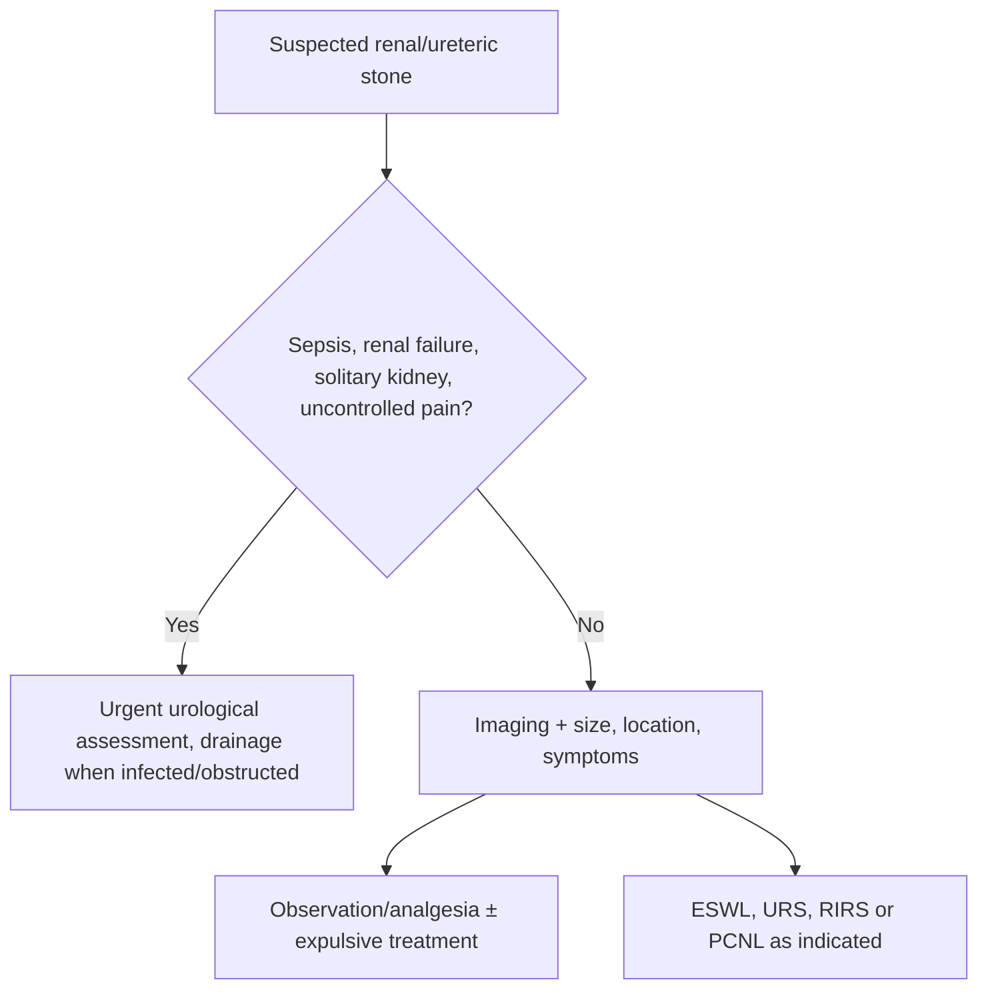
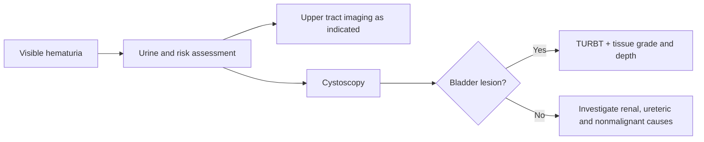
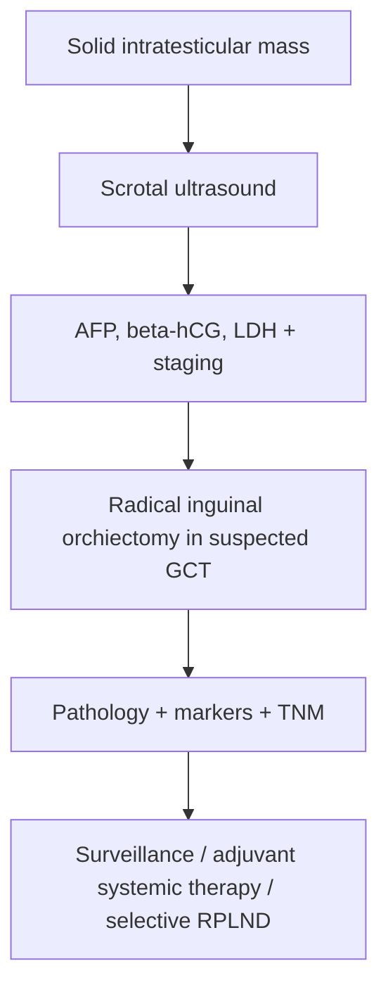

# Appendix — Urology Source Concordance, Conflicts, Operations and Exam Revision

## A. Source map

> [!info] Provenance
> The primary content is a **paraphrased synthesis of the uploaded project sources only**, not a verbatim reproduction. Not every uploaded reference devotes equal coverage to surgery; WOR and Doctut supply procedural facts, while Robbins/First Aid/Bootcamp contribute pathophysiology, histology and associations. Source-derived opinions **are not automatically current management recommendations**.

| Project source | Sections used in these notes | Strongest coverage |
|---|---|---|
| **World Of Revision.pdf** / **World of Revision Markdown.md** | Surgery: **Urology Part 1 pp. 132–142**, **Urology Part 2 pp. 143–157** (same document family) | Surgical anatomy, stone procedures, renal tumors, BPH/TURP, bladder cancer, urethral trauma, hydrocele, testis and penile cancer |
| **Doctut Merged.md** | `UROLOGY - I`, `UROLOGY - II`, selected renal tumors and pathology | Additional named operations, stone management, renal injury, congenital anomalies, male infertility, inguinal nodes |
| **Pocket Companion to Robbins Pathologic Basis of Disease 9e** | Printed **Kidney pp. 944–956**, **Lower urinary tract & male genital pp. 959–980** | Renal cysts, stone pathogenesis, tumor morphology/genetics, urothelial cancer molecular pathways, GCT histopathology and markers |
| **First Aid for USMLE Step 1, 2025** | **Renal pp. 595 onward**, **Reproductive pp. 629 onward**, oncology/biochemistry correlations | Core mechanisms, congenital/genetic associations, tumor markers, infections |
| **Combined (reduced).pdf / Bootcamp** | Renal, Reproductive, Pathology and Pharmacology sections | Obstructive uropathy, renal tumor subtypes, urologic cancer histology, reproductive physiology |
| **05-Pathology part 1.pdf.md** | Cellular injury, necrosis, inflammation, neoplasia | Mechanistic context for ischemic injury, gangrene, malignancy |
| **Prior Surgery Part I/IV notes in project** | General trauma, sepsis/source control and cross-topic links | Connect to renal trauma, Fournier gangrene, splenic/nephrectomy principles |

### Source organization for efficient checking
1. **WOR** supplies the chapter-level order used here: upper urinary tract → lower urinary tract/prostate → male genital/scrotal.
2. **Doctut** has similarly ordered `UROLOGY - I` and `UROLOGY - II` transcription with additional historic named procedures.
3. **Robbins** supplies cell-of-origin distinctions (chromophobe/oncocytoma from intercalated cells; seminoma histology; high- vs low-grade urothelial cancer pathways).
4. **First Aid and Bootcamp** reinforce genetic syndromes, neoplasia, congenital anatomy and stone physiology.

## B. Source disagreements and legacy rules — do not memorize uncritically

| Issue | What appears in uploaded notes | Safer exam interpretation and remaining uncertainty |
|---|---|---|
| **ARPKD prognosis** | WOR calls infantile disease uniformly fatal | Renal/hepatic manifestations and prognosis vary. Avoid universal mortality claim. |
| **Adult PKD therapy** | WOR emphasizes dialysis/transplant; Doctut also lists tolvaptan | Distinguish prevention of progression in selected disease from renal replacement at end stage. |
| **Ureteric narrowings** | Doctut lists up to five crossing sites; classical list has three | Know three normal physiologic constrictions plus additional compression/crossing points. |
| **MAG3 vs DTPA** | Source says MAG3 completely “replaced” DTPA | Each tracer addresses different aspects of function/drainage; do not overgeneralize. |
| **Renal stone ESWL** | WOR describes “ultrasonic waves” | Treatment uses **focused shock waves** (extracorporeal shock-wave lithotripsy), distinct from a diagnostic ultrasound image. |
| **ESWL absolute contraindications** | WOR lists children, obesity, pacemakers, stone >1.5 cm uniformly | Clinical suitability is patient-, stone- and device-dependent; not every item is an unconditional prohibition. |
| **Stone size and management** | WOR/Doctut “<5 mm no treatment; >5 mm ESWL/URS” | Size is only one variable—**sepsis, obstruction, kidney function and persistent symptoms** may alter urgency. |
| **Calcium supplements / cranberry juice** | Broad stone-prevention recommendations in Doctut | Adequate dietary calcium and individualized dietary advice; source does not support universal cranberry/supplement use. |
| **Staghorn = struvite** | Emphasized as synonym | Many are infection-associated but staghorn describes shape, not composition. |
| **Bilateral VUR treatment** | WOR grades 1–3 prophylaxis and 4–5 surgery if persistent | Fever/UTIs, scarring, bladder function, grade and age alter treatment selection. |
| **Urine AFB alone** | WOR says three early-morning AFB stains confirm renal TB | Insensitive smear can miss disease; source's test listing is not a sensitivity guarantee. |
| **Bosniak for AML** | WOR figure caption labels AML “Bosniak 3” | Bosniak classification applies to **cystic renal lesions**, not typical solid fat-rich AML. |
| **AML >4 cm** | WOR mandates partial nephrectomy in some >4-cm lesions | Symptoms, growth, aneurysmal vessels and hemorrhage risk matter; embolization can be useful. |
| **Oncocytoma central scar** | WOR presents central scar as characteristic | A clue, not definitive separation from chromophobe RCC. |
| **RCC “surgery only / chemo resistant”** | Historical WOR comparison with Wilms | Standard cytotoxic chemo resistance does not mean advanced RCC has no systemic treatments. Source does not define a complete current systemic sequence. |
| **Adrenalectomy in radical nephrectomy** | Doctut lists adrenal as routinely removed | Usually selective based on involvement; not inherent to every nephrectomy. |
| **Wilms chemo vs biopsy** | Doctut gives differing COG/SIOP routines | Recognize **surgery-first vs preoperative-chemo protocols**; do not enforce a universal “biopsy mandatory.” |
| **RCC/TNM details** | WOR table lacks T1a/b and newer subtleties | Memorize anatomic extent; check stated staging edition in exams. |
| **PSA 3–4 cutoff** | WOR suggests automatic biopsy for elevated value | PSA depends on age, prostate size, inflammation and risk; no universal single biopsy threshold. |
| **PSA >30 / >35 stage** | Doctut labels some levels as localized/metastatic | PSA alone does not establish metastasis or local stage. |
| **BPH “isotonic glycine”** | WOR describes glycine as isotonic irrigant | It is an **electrolyte-free nonconductive irrigant**, and absorption can produce TURP syndrome; bipolar saline changes that risk. |
| **TURP timing/correction** | Source lists fixed sodium and therapy cutoffs | Treat neurologic effects and correction speed as an individualized monitored emergency, not a rigid exam-prescription. |
| **Radical cystectomy removes urethra** | WOR names urethrectomy routinely | Urethral management depends on cancer involvement and planned reconstruction. |
| **Every bladder Ta observes** | WOR gives a simplified Ta/Tis/T1 management scheme | Recurrence and progression risk require risk-adapted instillation and cystoscopic follow-up. |
| **Testicular torsion Doppler “to confirm”** | WOR lists Doppler prior to surgery | High clinical suspicion justifies **urgent exploration** without delay for imaging. |
| **Prehn sign** | WOR treats elevation response as diagnostic | Neither sensitivity nor specificity is enough to independently distinguish torsion from epididymitis. |
| **Undescended testis hCG test** | WOR implies hCG response distinguishes anorchia reliably | Requires broader clinical assessment, often imaging/exploration where indicated. |
| **Varicocele embolization first-line** | WOR labels it first-line while also calling microsurgery most effective | Multiple valid modalities; indications and experience determine selection. |
| **Priapism injection** | WOR says adrenaline, Doctut discusses phenylephrine | Drug and dose should follow local specialist protocol; ischemic vs nonischemic distinction is most important. |
| **Fixed cancer schedules** | WOR lists carboplatin, BEP, RT and RPLND purely by broad stage | Treatment depends on histology, risk, markers and protocol; one static table is not universally applicable. |
| **Penile cancer old stages** | WOR uses Jackson, Doctut also shows dated TNM cutoffs | Learn location/invasion and **anatomical TNM** concepts, identify historical named staging if exam specifies. |

## C. Operations and named procedures — memory map

| Name | Organ/disease | What is performed / why |
|---|---|---|
| **Anderson–Hynes** | PUJ obstruction | **Dismembered pyeloplasty** reconstructs unobstructed PUJ |
| **Boari flap** | Distal ureteric loss/stricture | Bladder-wall flap reconstructs length and connects to ureter |
| **Ureteroureterostomy** | Short ureteric injury/duplex anomalies | Tension-free connection between ureteric segments |
| **Ureteroneocystostomy** | Distal ureteric defect | Reimplant ureter into bladder |
| **STING** | Vesicoureteric reflux | Subureteric endoscopic bulking injection |
| **PCNL** | Large kidney/staghorn stones | Percutaneous nephroscopic stone fragmentation/removal |
| **RIRS** | Intrarenal calculi | Flexible retrograde ureteroscopic lithotripsy |
| **URS / Dormia basket** | Ureteric stones | Endoscopic fragmentation or retrieval |
| **DJ stent** | Ureteric obstruction | Internal stent connecting kidney and bladder for drainage |
| **TURP** | BPH | Endoscopic prostate adenoma resection |
| **HoLEP** | BPH | Holmium laser enucleation |
| **Freyer** | Large BPH | Transvesical/suprapubic simple prostatectomy |
| **Millin** | Large BPH | Retropubic simple prostatectomy |
| **TURBT** | Bladder tumor | Endoscopic tissue resection/diagnosis |
| **Intravesical BCG** | Selected NMIBC/CIS | Immunostimulation against urothelial cancer |
| **Ileal conduit** | After cystectomy | Bowel conduit brings urine to stoma |
| **DVIU/OIU** | Selected urethral stricture | Direct-vision internal incision of narrowing |
| **Buccal mucosal graft urethroplasty** | Long/complex urethral stricture | Mucosal graft enlarges/reconstructs urethral lumen |
| **Valve ablation** | PUV | Endoscopic disruption of obstructive posterior urethral folds |
| **Orthoplasty** | Hypospadias | Straighten chordee |
| **MAGPI** | Distal hypospadias | Meatal advancement and glanuloplasty |
| **Nesbit** | Peyronie curvature | Tunical plication/wedge-shortening to straighten |
| **Winter shunt** | Refractory ischemic priapism | Distal corporospongiosal shunt |
| **Grayhack shunt** | Historical priapism shunt | Cavernosum–saphenous venous communication |
| **Orchiopexy** | Cryptorchidism/torsion | Bring/fix testis to scrotum |
| **Fowler–Stephens** | High intra-abdominal testis | One-/two-stage orchiopexy relying on collateral vessels |
| **Lord plication** | Hydrocele | Plicate rather than widely evert thin sac |
| **Jaboulay eversion** | Large adult hydrocele | Evert tunica vaginalis sac |
| **Microsurgical varicocelectomy** | Varicocele | Ligate dilated internal spermatic veins, preserve artery/lymphatics |
| **High inguinal orchiectomy** | Suspected testis GCT | Remove testis via inguinal route with cord control |
| **RPLND** | Selected testicular cancer | Retroperitoneal nodal clearance |
| **Partial penectomy / glansectomy** | Penile SCC | Remove tumor preserving function when feasible |

## D. High-yield numerics and thresholds

| Topic | Source teaching value | How to use |
|---|---|---|
| Normal uroflow peak | **>15 mL/sec** | Approximate, volume-dependent |
| Kidney stone passage | **<5 mm** more likely spontaneous | No fixed guarantee; consider location/complications |
| PCNL stone burden | **>2 cm**, staghorn | Strong classic indication, individualized |
| Cystine | **Hexagonal** | Microscopic clue |
| VUR grades | **I–V** | MCU/VCUG |
| Bosniak | **I, II, IIF, III, IV** | CT/MRI cyst assessment |
| RCC size | **T1 ≤7 cm, T2 >7 cm**, kidney-confined | Other criteria determine staging |
| RCC T1a | **≤4 cm** | Small renal mass subgroup |
| Wilms age | **2–5 years** typical | Not exclusionary |
| BPH finasteride PSA | **~50% decrease** after months | Interpret treated PSA carefully |
| TURP irrigation | Glycine (monopolar), **saline (bipolar)** | Hyponatremia risk from absorption |
| Bladder cancer | **T1 lamina propria; T2 muscularis propria** | Most important T-stage distinction |
| Hypospadias repair | **~6–12 months** source teaching | Specialist timing |
| Ischemic priapism | **≥4 h** prolonged erection | Emergency assessment |
| Torsion time | **First 6 h** critical | Early action; no absolute viability cutoff |
| Hydrocele | Fluid **between tunica vaginalis layers** | Different from hernia |
| Testicular tumor | AFP, **β-hCG, LDH** | Stage and follow-up; pure seminoma should not produce AFP |

## E. Clinical vignettes for self-testing

1. **Girl with lifelong dribbling between otherwise normal voluntary voids:** ectopic upper-pole ureter opening distal to sphincter; review Weigert–Meyer.
2. **Boy with recurrent febrile UTI and bilateral hydroureteronephrosis, distended trabeculated bladder:** posterior urethral valve; MCU and valve ablation after drainage/stabilization.
3. **Severe colic, fever, hydronephrosis and ureteric calculus:** obstructed infected collecting system; **urgent drainage/source control**, not simply analgesia/stone fragmentation.
4. **Renal mass with large fat density and spontaneous flank hemorrhage:** angiomyolipoma with possible Wunderlich syndrome; stabilization and embolization assessment.
5. **Incidental enhancing renal mass with renal vein thrombus:** RCC; stage vascular involvement before considering surgery.
6. **Toddler with firm renal mass and aniridia:** consider **Wilms tumor in WAGR spectrum**.
7. **Older man with nocturia, slow stream, elevated PVR and smooth enlarged prostate:** BPH; distinguish dynamic vs static obstruction.
8. **Hours after monopolar TURP, agitation/confusion and hyponatremia:** TURP syndrome due to irrigation-fluid absorption.
9. **Painless gross hematuria and papillary bladder lesion:** cystoscopy/TURBT for urothelial malignancy and muscle-depth assessment.
10. **Bladder T1** is **lamina propria invasive**, while **T2** reaches muscularis propria—important transition to MIBC.
11. **Pelvic fracture and blood at external urethral meatus:** suspect urethral disruption; avoid blind Foley, obtain appropriate urethral assessment.
12. **Sudden penile pop, detumescence and expanding hematoma:** penile fracture; corpus cavernosum tunica rupture.
13. **Inability to replace retracted foreskin with glans edema:** paraphimosis, time-sensitive reduction.
14. **Teenager with sudden painful high-riding testis and vomiting:** torsion; emergency referral/exploration, not delayed Doppler when convincing.
15. **Young man with asymptomatic left bag-of-worms swelling and infertility:** evaluate clinically significant varicocele and semen profile.
16. **Diabetic with rapidly progressive painful scrotal/perineal discoloration and shock:** Fournier gangrene; immediate debridement plus antibiotics/resuscitation.
17. **Painless solid testis tumor, AFP elevated, Schiller–Duval bodies:** yolk sac tumor/NSGCT component.
18. **Testicular tumor with clear glycogen-rich cells and lymphocytic fibrous septa:** seminoma.
19. **Small testis mass with high β-hCG and widespread hemorrhagic lung metastases:** choriocarcinoma.
20. **Elderly patient with testicular mass and aggressive lymphoid histology:** consider primary testicular **DLBCL lymphoma**.

## F. Three diagnostic algorithms to memorize

### Renal colic / urinary obstruction

### Painless visible hematuria

### Painless testicular mass

## G. Integration with the rest of the Surgery vault

- `[[06_Trauma_Surgery]]` — renal/pelvic trauma and shock; avoid repeating initial ATLS notes.
- `[[03_Wounds_Healing_Infection]]` — Fournier necrotizing fasciitis and postoperative infection.
- `[[05_Shock_Sepsis_Transfusion]]` — obstructed infected kidneys, renal trauma hemorrhage, sepsis.
- `[[09_Thyroid_Parathyroid_Surgery]]` — endocrine neoplasia concepts where related.
- `[[21_Thoracic_Surgery]]` — pulmonary RCC/testis metastasis radiographic correlations.
- `[[GIT]]` — bowel segments used for urinary diversion, fluid/electrolyte changes.
- `[[Renal]]` — stone biochemistry, glomerular vs postrenal hematuria and CKD.
- `[[Oncology]]` — prostate, bladder, renal, penile and testicular systemic treatment frameworks.

> [!summary] Revision strategy
> - **First pass:** kidney congenital → stones → RCC/Wilms → BPH → bladder cancer → trauma → testis disorders.
> - **Second pass:** memorize **named procedures, signs, histologic markers and T-stage borders**.
> - **Third pass:** answer 20 vignettes above and revisit source disagreement chart to avoid false “absolute” rules.
