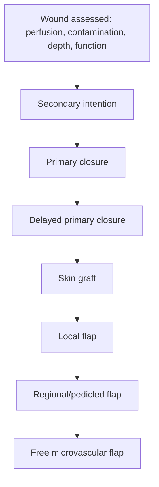

# 26 — Plastic and Reconstructive Surgery

> [!info] Source basis
> **World of Revision—Surgery, “SPECIALITY SURGERY”:** skin grafts, flap surgery, pressure ulcers, VAC, scars and cleft lip/palate. **Doctut Merged—“PLASTIC SURGERY”, “SKIN CANCER”:** ulcers, infections, skin neoplasms, wound reconstruction and clefts. **Robbins 9e:** repair and cutaneous neoplasia. This chapter incorporates surgical principles and exam distinctions without copying source text.

## 1. Reconstructive surgery: the central problem

**Objective:** restore **coverage, blood supply, function and acceptable appearance**. Primary decision is whether tissue can heal by secondary intention, direct closure, graft, flap or microsurgical free-tissue transfer.

### Reconstructive ladder

- This is a **conceptual hierarchy**, not a requirement to try every lower rung; a complex defect can directly warrant a flap.
- Evaluate **recipient vessels, infection, exposed tendon/bone with or without covering, dead space, radiation, pressure, sensation** and donor morbidity.
- Skin grafts **lack their own vascular supply**; flaps carry their own vascularized tissue.

## 2. Skin grafts: split vs full thickness

| Characteristic | **STSG** (Thiersch in revision nomenclature) | **FTSG** (Wolfe) |
|---|---|---|
| Tissue harvested | Epidermis + **part of dermis** | Epidermis + **entire dermis** |
| Donor site | Often anterolateral thigh/buttock; re-epithelializes if dermal appendages remain | Often postauricular/supraclavicular; needs primary donor closure or another closure method |
| Graft take | More reliable in marginal recipient vascularity | Demands well-vascularized recipient bed |
| Surface area | Can cover large area; can **mesh** to expand | More limited by available donor closure |
| Secondary contraction | **More** due to less dermis | **Less**, better dimensional stability |
| Texture/cosmesis | Less supple/color match than FTSG in many sites | Better in selected visible sites |
| Typical use | Large burn/ulcer defects | Face, hand, small high-value sites where minimal contraction matters |

### Source detail: graft take
1. **Plasmatic imbibition (~first 24–48 h):** graft survives initially by nutrient diffusion from wound bed.
2. **Inosculation (~day 2–4):** graft capillaries connect to recipient vessels.
3. **Revascularization/neovascularization (following days):** new circulation matures.

> [!important] Requirements for graft survival
> **Vascular bed + immobilization + no hematoma/seroma + infection control.** Graft on **bare cortical bone without periosteum**, bare cartilage without perichondrium or tendon without paratenon generally has poor take.

### Why grafts fail
- **Hematoma/seroma** blocks diffusion and vascular connection; infection causes tissue damage.
- Shear/movement disrupts vascular bridging.
- Poor perfusion, radiation damage, edema and recipient-bed necrosis.
- Avoid overly bulky compression that compromises perfusion; use appropriate bolster/negative-pressure dressing when indicated.

### Meshed STSG
- **Advantages:** coverage expansion, drainage of exudate/seroma, better conformity.
- **Disadvantages:** meshed appearance, increased secondary contraction and variable cosmesis.
- **Humby knife** classically harvests STSG (WOR). Modern dermatome options are also depicted in surgical equipment discussions.

## 3. Flaps — vascularized reconstruction

### Classification
- **Local random-pattern flap:** perfused through subdermal plexus, e.g., advancement/rotation/transposition.
- **Axial-pattern flap:** known named vascular pedicle, generally more predictable length/reach.
- **Pedicled regional flap:** remains attached through vascular pedicle while transposed.
- **Free flap:** completely detached, then **microvascular arterial and venous anastomoses** at recipient site.
- **By contents:** cutaneous, fasciocutaneous, musculocutaneous, muscle-only, osseous/osteocutaneous and perforator flaps.

### Important named designs

| Flap | Defining feature | Important application in sources |
|---|---|---|
| **Z-plasty** | Triangular transposition changes scar axis; lengthens contracted line | Postburn contracture release; 60° classic theoretical lengthening ~75% |
| **V–Y advancement** | Advances tissue along axis with V-shaped incision and Y closure | Local defect coverage, scar release |
| **Rhomboid/Limberg** | Geometric transposition of adjacent skin | Pilonidal wound and varied cutaneous defects |
| **Deltopectoral** | Regional pedicled skin flap | Head/neck reconstruction |
| **PMMC** | Pectoralis major myocutaneous flap | Head/neck defects; source calls common regional workhorse |
| **Abbe–Estlander** | Lip-sharing flap | Lip/commissure reconstruction |
| **Latissimus dorsi** | Thoracodorsal vascular pedicle | Chest/breast/upper-limb reconstruction |
| **TRAM** | Rectus abdominis muscle/skin | Breast; risks abdominal wall weakness/hernia |
| **DIEP** | Deep inferior epigastric artery **perforator** skin/fat, muscle largely spared | Autologous breast reconstruction with less muscle sacrifice |
| **Radial forearm free flap** | Thin pliable fasciocutaneous flap | Oral/head-neck; evaluate radial–ulnar circulation |
| **Fibular free flap** | Vascularized bone and optional soft tissue | **Mandibular reconstruction** |

### Mathes–Nahai muscle vascular patterns
- **Type I:** one dominant vascular pedicle.
- **Type II:** one dominant + several minor pedicles.
- **Type III:** two dominant pedicles.
- **Type IV:** multiple segmental pedicles.
- **Type V:** one dominant + multiple secondary segmental pedicles (**pectoralis major, latissimus dorsi** in WOR).
- The type classification is most relevant to muscle/musculocutaneous flap design, not to all skin flaps indiscriminately.

### Compromised flap: arterial vs venous

| Feature | **Arterial insufficiency** | **Venous congestion** |
|---|---|---|
| Color | Pale | Dark/blue, congested |
| Temperature | Cool | May initially be relatively warm; later cool |
| Capillary refill | Slow/absent | Brisk then sluggish if severe |
| Pinprick blood | Little/none | Dark brisk oozing |
| Mechanism | Inflow obstruction | Outflow obstruction |

**Both are time-critical threats to free-flap viability**. Etiologies include thrombosis, kink/torsion, pressure, hematoma, microvascular technical issue.

## 4. Pressure injuries (bed sores)

### Mechanism
- Prolonged **pressure/shear** over bony prominences → diminished capillary perfusion + deformation injury → ischemia/necrosis.
- Moisture, immobility, malnutrition, poor sensation and vascular insufficiency exacerbate risk.
- Source sites (descending teaching order): **ischial tuberosity, greater trochanter, sacrum, heel, malleolus**; location varies by position (wheelchair vs bedridden).

| Stage | Finding |
|---|---|
| **1** | Intact skin with **nonblanchable erythema** (signs differ in darkly pigmented skin) |
| **2** | Partial-thickness skin loss, exposed dermis or appropriate blister pattern |
| **3** | Full-thickness skin loss with subcutaneous fat visible; no exposed deep structures |
| **4** | Full-thickness tissue loss with exposed/palpable fascia, muscle, tendon, cartilage or bone |
| **Unstageable** | Slough/eschar obscures depth |
| **Deep-tissue pressure injury** | Persistent deep red/maroon/purple injury in intact or nonintact skin |

### Prevention and treatment
- Off-loading/repositioning; pressure-redistribution mattresses and seating; maintain clean/dry skin; correct nutrition/hydration; prevent shear; manage incontinence.
- Decontamination/debridement of nonviable tissue **where indicated**; evaluate osteomyelitis and spreading infection; protect viable tissue.
- Advanced wounds may need **NPWT/VAC**, flap coverage, dead-space obliteration and long-term pressure reduction.
- Doctut and WOR give pressure/time rules such as “change every two hours,” but exact intervals must be individualized; duration alone does not prove adequate pressure relief.

### Negative-pressure wound therapy (NPWT/VAC)
- Foam/gauze + sealed drape + suction removes exudate, helps granulation and can reduce edema in selected wounds.
- WOR lists commonly used pressures around **−120 to −125 mmHg** as a revision value; setting varies with wound/patient/device.
- **Not a substitute** for debridement of necrotizing infection or revascularization of ischemic wound; avoid suction directly over unprotected major vessels or organs.

## 5. Wound reconstruction and postburn contractures

- Wound evaluation: **color of granulation, dead tissue, depth, vascularity, moisture, infection, bone exposure, pressure and function**.
- **Primary contracture** refers to immediate shrinkage of harvested graft (typically more in FTSG); **secondary contracture** refers to contraction after placement (more STSG).
- Contracture across a joint impairs movement; interventions include splinting/physiotherapy, scar modulation, **Z-plasty**, local flap or graft after release.
- Deep burn contracture may recur if released without adequate functional rehabilitation and wound coverage.

## 6. Cleft lip and palate: embryology, assessment, reconstruction

### Causation and associations
- **Lip/primary palate** defects arise from failed fusion of facial processes; **secondary palate** defects arise from failure of palatal shelves to fuse.
- Consequences: feeding difficulty, nasal regurgitation, speech/velopharyngeal insufficiency, recurrent otitis media, dental malocclusion, psychosocial issues.
- Source associations: Pierre Robin sequence (**micro/retrognathia, glossoptosis, airway obstruction**), Treacher Collins, Stickler and other syndromic conditions.

### LAHSHAL system
- Records bilateral cleft configuration from right to left: **Lip – Alveolus – Hard palate – Soft palate – Hard palate – Alveolus – Lip**.
- Capital letter in WOR denotes complete defect, lowercase partial; blank/dot indicates intact depending on convention.
- Document unilateral/bilateral and complete/incomplete rather than using one generic “cleft palate” label.

### Operations and timing

| Area | Procedures from uploaded sources | Timing caveat |
|---|---|---|
| **Cleft lip** | **Millard rotation-advancement**, other repairs (Mulliken/Manchester named in Doctut) | Historical **rule of tens** (10 weeks, 10 lb, Hb 10 g/dL); institutional timing depends on health/growth |
| **Cleft soft palate** | **Furlow double-opposing Z-plasty**, intravelar veloplasty | Usually planned during infancy to support speech development |
| **Cleft hard palate** | **Wardill–Kilner V–Y**, **von Langenbeck** palatoplasty | Variable timing; balance speech and maxillofacial growth |

- Reconstruct the **orbicularis oris** for lip function, not merely superficial skin alignment.
- Cleft surgery also requires hearing/audiology, feeding support, speech therapy, orthodontics and long-term craniofacial follow-up.
- **Complications:** oronasal fistula, persistent velopharyngeal insufficiency, hearing impairment, scar/growth disturbance.

> [!warning] Source discrepancy
> WOR and Doctut present multiple fixed age schemes (lip ~3–6 months, soft palate ~3–6 months, hard palate ~9–12 or ~15–22 months). These **must not be combined into an invented universal schedule**. Timing is individualized; consult the center’s cleft protocol.

## 7. Skin and soft-tissue tumors relevant to plastic surgery

### Basal-cell carcinoma (BCC)
- **Commonest skin cancer** in source notes; UV-related, favors sun-exposed head/neck, classically **pearly rolled edge** and telangiectasia; “rodent ulcer.”
- Microscopy: **basaloid nests with peripheral palisading** and retraction clefts.
- Usually locally invasive, **metastasis rare**.
- Treatment is excision with histologic margin assessment; **Mohs micrographic surgery** on high-risk/cosmetically sensitive sites, recurrent lesions or when margin conservation matters.

### Cutaneous squamous-cell carcinoma (cSCC)
- Arises from squamous keratinocytes; risks include UV, chronic scars/ulcers, immunosuppression and certain genetic disorders.
- Lesion often indurated/ulcerative with **everted edge**; biopsy shows **keratin pearls** in differentiated lesions.
- **Marjolin ulcer:** carcinoma (often SCC) developing in chronically scarred/burned/nonhealing tissue; requires biopsy of suspicious chronic wounds.
- Management: appropriate excision, risk stratification and nodal assessment when indicated.

### Malignant melanoma
- **ABCDE:** asymmetry, irregular border, color variation, diameter (size alone not exclusive), evolution.
- **Breslow thickness** is a major prognostic variable and guides surgery and nodal discussion (cross-link to oncology).
- Wide local excision and selective **sentinel lymph-node biopsy** based on stage/risk; avoid fixed margin for every lesion.

### Soft tissue sarcoma
- Deep enlarging mass, >5 cm or otherwise suspicious → image and plan biopsy through specialist team before unplanned excision.
- Local control generally involves wide excision ± radiation and multidisciplinary decision-making.
- **Dermatofibrosarcoma protuberans** can be locally aggressive, recurrent and requires careful margins; **desmoid-type fibromatosis** is locally infiltrative but not metastatic.

## 8. Diagnostic differences worth remembering

| Clue | Likely lesion |
|---|---|
| Rolled pearly edge | **BCC** |
| Everted indurated edge | **SCC** |
| Irregular variegated pigment, evolving | **Melanoma** |
| Keloid extends past wound margin | **Keloid** (not hypertrophic scar) |
| Colorless insensate wound with exposed bone | Needs assessment for **flap**, not automatic simple graft |
| Flap pale/cold/no bleeding | **Arterial inflow failure** |
| Flap dark, swollen with excessive bleeding | **Venous obstruction** |

### High-yield consolidation
- **STSG = takes more reliably, more secondary contraction; FTSG = better cosmesis, needs good bed.**
- **Flap has blood supply; graft initially survives by diffusion.**
- **DIEP preserves muscle relative to TRAM; radial forearm needs arterial circulation assessment.**
- **Pressure stage 4 can expose bone/tendon; offloading continues after reconstruction.**
- **LAHSHAL** documents cleft distribution; **Millard** repairs lip, **Furlow** soft palate, **Wardill–Kilner/von Langenbeck** palate.

**Sources:** WOR *SPECIALITY SURGERY—Skin Grafts, Flaps, Bed Sores, Cleft*; Doctut *PLASTIC SURGERY* and *SKIN CANCER*; Robbins 9e *Tissue Repair/Skin Tumors*; First Aid 2025 *skin pathology*. Terminology and source conflicts in appendix.
