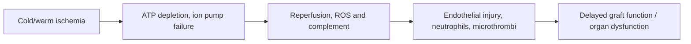

# 27 — Transplant Surgery

> [!info] Source basis
> **World of Revision—Surgery, “Transplant Surgery”, “Renal Transplant”, “Liver Transplant”; Pathology—Transplant Pathology.** **Robbins 9e—Immune System: transplant rejection; renal and hepatobiliary pathology.** **First Aid 2025—transplant immunology, HLA, immune suppression, graft-versus-host concepts.** **Doctut Merged—organ transplantation, immunosuppressants and congenital liver conditions.** Source charts describing preservation time, HLA/rejection and historical survival percentages are flagged when they overgeneralize.

## 1. Fundamental transplant terminology

| Graft | Donor and recipient | Example |
|---|---|---|
| **Autograft** | Same person | Autologous skin graft |
| **Isograft / syngeneic graft** | Genetically identical individuals | Identical twins |
| **Allograft / homograft** | Different individuals of same species | Deceased donor kidney |
| **Xenograft / heterograft** | Different species | Selected bioprosthetic tissue or experimental organ transplantation |

- **Orthotopic:** transplant placed in its normal anatomical position (typically liver/heart).
- **Heterotopic:** placed in a different anatomical site (**renal allograft in iliac fossa**).
- **Living donor** vs **deceased donor**; deceased donation may occur after neurologic determination of death or following circulatory death depending on protocol.
- Risks must be evaluated for **both donor and recipient**; living donor surgery has independent ethical, medical and surgical considerations.

## 2. Organ donation, donor selection and matching

### Donor assessment
- Determine donor eligibility, consent/authorization, infection and malignancy screening, anatomical/vascular suitability, organ perfusion and function.
- Recipient assessment: indication, transplant benefit, surgical fitness, active infection/malignancy evaluation, psychosocial support and lifelong follow-up capacity.
- **ABO compatibility** is important for solid-organ transplantation; certain specialized ABO-incompatible protocols exist.
- **HLA matching** reduces alloimmune incompatibility risk and is particularly important for kidneys; **crossmatching** identifies clinically relevant recipient anti-donor antibodies.

### HLA and immunobiology
- **HLA class I** (A/B/C) on most nucleated cells presents antigen to CD8 cells.
- **HLA class II** (DR/DQ/DP) on antigen-presenting cells activates CD4 cells.
- **Direct allorecognition:** donor APC presents donor HLA to recipient T cells.
- **Indirect allorecognition:** recipient APC processes donor proteins and presents via recipient HLA.
- T-cell activation → interleukin signaling, proliferation, cytotoxicity; B cells produce **donor-specific antibodies (DSA)** activating complement/endothelium.

## 3. Deceased donation and Maastricht categories

**Source-specific Maastricht categories (WOR):**

| Category | Description from uploaded revision source | Core distinction |
|---|---|---|
| **I** | Dead on arrival | Uncontrolled DCD |
| **II** | Failed resuscitation | Uncontrolled DCD |
| **III** | Expected circulatory arrest after planned withdrawal | Controlled DCD |
| **IV** | Circulatory arrest in an already brain-dead donor | Controlled setting in source table |
| **V** | Unexpected in-hospital cardiac arrest | Additional category used in some versions |

- DCD = **donation after circulatory death**; DBD = donation after neurologic determination of death.
- **Regional and chronological variants of Maastricht classification exist**; do not assume category V is included in every modern reference.
- Preservation quality depends on donor physiology, **warm ischemia**, cold ischemia, reperfusion and organ-specific tolerance.

## 4. Organ preservation and ischemia–reperfusion injury

### Static cold storage
- Cooling (~4°C) limits ATP consumption, but residual ischemic injury continues.
- **University of Wisconsin (UW) solution** contains substances intended to limit edema, oxidative injury and metabolic damage.
- WOR gives **kidney up to ~36 hours** and **heart <3 hours** as historical exam estimates; these **are not universal safe limits**, especially with modern preservation and donor selection.

### Machine perfusion
- **Hypothermic machine perfusion:** oxygenated/nonoxygenated flow under reduced temperature to assess/preserve kidneys and other organs.
- **Normothermic perfusion:** near-physiologic flow and temperature may allow functional assessment and improve utilization of marginal grafts.

### Ischemia–reperfusion injury mechanism

- Avoid an oversimplification that restoring flow is invariably harmless; reperfusion itself activates inflammation.

## 5. Transplant rejection: mechanisms and timeline

| Type | Characteristic timing | Mechanism | Histology/clinical clue |
|---|---|---|---|
| **Hyperacute** | Minutes to hours after vascularization | **Preformed donor-reactive antibodies**, complement and endothelial activation | Diffuse vascular thrombosis, immediate poorly perfused graft |
| **Acute cellular (T-cell mediated)** | Days–months; can occur later | Recipient T cells recognize alloantigen | Interstitial inflammation/tubulitis in kidney; specific organ lesion patterns |
| **Acute antibody-mediated** | Variable after transplant | De novo/preexisting donor-specific antibodies | Microvascular injury, C4d in appropriate settings, DSA and graft dysfunction |
| **Chronic rejection / chronic allograft injury** | Months–years | Chronic alloimmune and nonimmune injury | Vascular intimal thickening, fibrosis, organ-specific epithelial loss |

### Important immunology nuance
- **Hyperacute** is historically classified as **type II antibody-mediated hypersensitivity**.
- The source states **acute rejection = type IV hypersensitivity**. This applies best to **acute T-cell-mediated** rejection; antibody-mediated acute rejection also exists.
- **Chronic rejection** is not solely intravascular thrombosis: progressive obliterative vasculopathy, fibrogenesis and organ-specific injury are key.

### Clinical presentation depends on organ
- **Kidney:** rising creatinine, oliguria (may be asymptomatic initially).
- **Liver:** cholestasis/transaminase rise, biopsy for diagnosis.
- **Heart:** ventricular dysfunction, arrhythmias, graft vasculopathy.
- **Lung:** reduced FEV1, infection-like symptoms, chronic lung allograft dysfunction.
- **Diagnosis:** graft-function assessment, imaging to exclude obstruction/vascular complication, **biopsy when indicated**, immunological testing and DSA.

## 6. Immunosuppression

### Three periods
1. **Induction:** potent peri-transplant agents (e.g., anti-IL-2 receptor antibodies, antithymocyte globulin depending on risk).
2. **Maintenance:** commonly calcineurin inhibitor + antimetabolite ± glucocorticoid, individualized.
3. **Rejection treatment:** depends on histology/severity—steroids for many cellular episodes, other T-cell-directed and antibody-directed therapies when appropriate.

| Drug group | Examples | Mechanism | Main toxicities/associations |
|---|---|---|---|
| **Calcineurin inhibitors** | **Tacrolimus**, cyclosporine | Impair NFAT/IL-2 signaling and T-cell activation | **Nephrotoxicity**, hypertension, neurotoxicity; tacrolimus causes diabetes risk; cyclosporine gingival hyperplasia/hirsutism |
| **Antimetabolites** | **Mycophenolate**, azathioprine | Inhibit lymphocyte nucleic-acid synthesis | Cytopenia, GI toxicity, infection; teratogenic risk with mycophenolate |
| **mTOR inhibitors** | **Sirolimus, everolimus** | Block downstream IL-2 cell-cycle response | Poor wound healing, hyperlipidemia, cytopenia, pneumonitis |
| **Glucocorticoids** | Prednisone, methylprednisolone | Broad cytokine/immune suppression | Infection, diabetes, osteoporosis, weight gain, hypertension |
| **Costimulation blocker** | Belatacept | CTLA4-Ig blocks CD28–B7 signaling | Infection/PTLD risk in selected patients |
| **Anti-IL-2 receptor** | Basiliximab | CD25 blockade | Induction immunosuppression |
| **T-cell depletion** | Antithymocyte globulin | Depletes T lymphocytes | Infusion reactions, cytopenias and infection |

- **Drug levels:** monitor calcineurin inhibitors due to narrow therapeutic windows and drug interactions.
- **Never infer the same regimen or dose for all organ recipients** from a table.

## 7. Kidney transplantation

### Indications and setup
- Definitive renal replacement option for suitable patients with end-stage renal disease; diabetes and chronic glomerular disease are notable causes in revision sources.
- **Donor kidney usually implanted in iliac fossa (heterotopic)** rather than the native renal bed.
- Standard broad anatomy: **renal artery → external/internal iliac arterial system; renal vein → iliac vein; ureter → bladder (ureteroneocystostomy)**.
- Native kidneys usually remain unless a special indication exists (e.g., infection, malignancy, size issues).

### Preoperative considerations
- ABO/HLA and crossmatch; infection/cancer screening; cardiovascular disease and vascular anatomy; nutrition and dialysis status.
- Donor organ perfusion/cold ischemia, anastomotic technique, ureteric blood supply and immunosuppression planning.

### Postoperative complications

| Time/type | Possible problem | Investigation/recognition |
|---|---|---|
| Immediate graft dysfunction | Vascular thrombosis, anastomotic kink, severe ischemia–reperfusion injury, rejection | **Urgent Doppler ultrasonography**, labs and specialist assessment |
| Vascular | Renal artery/vein thrombosis, later transplant artery stenosis | Falling perfusion/output, bruit, hypertension |
| Urologic | Urine leak, ureteric obstruction/stricture | Fluid collection, creatinine rise, hydronephrosis |
| Immune | Acute rejection | Rising creatinine, biopsy |
| Infection | Wound/UTI, CMV, BK virus, opportunistic infections | Timing and immunosuppression context matter |
| Long-term | Chronic graft dysfunction, malignancy, post-transplant diabetes | Serial follow-up |

### Common examination stems
- **Immediate graft dusky/mottled on reperfusion:** think vascular catastrophe or hyperacute rejection; assess anastomoses and crossmatch context.
- **Rising creatinine several weeks later:** consider acute rejection **and** obstruction, ischemic injury, drug toxicity and infection.
- **Fever during first 6 months:** infection risk is high, but Doctut/WOR “first month bacteria, overall CMV” is a simplified pattern rather than a universal frequency ranking.

## 8. Liver transplantation

### Indications and transplant types
- **Adults:** decompensated cirrhosis/selected acute liver failure; **children:** biliary atresia is an important indication.
- **Deceased donor whole-liver**, **living donor partial-liver**, **split-liver**, **reduced-size**, **auxiliary** and **domino** procedures appear in WOR.
- **Auxiliary transplant:** native liver preserved, graft placed alongside in selected conditions.
- **Domino:** explanted organ from one transplant recipient used for another where appropriate; the phrase “donor and recipient both have same systemic disease” in WOR is not a universal definition.

### Hepatocellular carcinoma (HCC)
- **Milan criteria:** single HCC **≤5 cm**, or up to **3 nodules each ≤3 cm**, without macrovascular invasion/extrahepatic spread; used to select appropriate candidates in classic teaching.
- Transplant can treat HCC and underlying diseased liver simultaneously; eligibility also depends on staging/list criteria and organ availability.

### Key postoperative problems
- **Hepatic artery thrombosis:** early major vascular complication; can cause bile duct ischemia.
- Portal vein thrombosis, hepatic venous outflow obstruction, bile leak/stricture, graft dysfunction, infection.
- **Chronic ductopenic rejection** → loss of small bile ducts (classical **vanishing bile duct syndrome**).
- Immunosuppression toxicity, recurrent original liver disease and graft-related malignancy.

### Acute liver failure
- **King’s College criteria** are an exam framework for transplant selection and are divided into acetaminophen vs non-acetaminophen causes.
- Uploads reference them without consistently giving complete parameter sets. **No detailed numeric King’s College table is fabricated here**; use a dedicated source to learn exact criteria.

## 9. Infection and malignancy after transplant

- **Early:** surgical/wound, catheter, hospital-acquired and donor-derived infection possibilities.
- **Intermediate (weeks–months):** viral reactivation/opportunistic infection, notably CMV/BK/EBV depending on organ and risk.
- **Later:** community infection with residual opportunistic risk during high-dose immune suppression.
- **Post-transplant lymphoproliferative disorder (PTLD):** commonly driven by **EBV-related B-cell proliferation**; spectrum from polyclonal proliferation to lymphoma.
- Skin malignancies, particularly cutaneous SCC, increase with chronic immunosuppression.
- Balance immunosuppression vs infection/rejection; prophylaxis and monitoring individualized.

## 10. Graft-versus-host disease (GVHD) vs solid-organ rejection

| Feature | Graft rejection | GVHD |
|---|---|---|
| Direction | **Recipient immune cells attack donor graft** | **Donor immunocompetent cells attack recipient tissues** |
| Setting | Solid organ transplant | Particularly hematopoietic stem-cell transplant; rare after some solid organs |
| Principal target | Graft endothelium/parenchyma | Skin, liver, gut |
| Clinical clue | Organ dysfunction | Rash, diarrhea, cholestasis |

### High-yield revision
- **Allograft**: same species, genetically nonidentical; **isograft**: genetically identical.
- **Renal transplant**: iliac fossa with iliac vessel and ureter–bladder anastomoses.
- **Hyperacute**: preformed antibodies + thrombotic graft ischemia.
- **Acute cellular**: T cells; **acute antibody-mediated** also exists.
- **Tacrolimus/cyclosporine**: calcineurin inhibitors with nephrotoxicity.
- **Sirolimus**: mTOR inhibitor, problematic wound healing.
- **Milan criteria**: one ≤5 cm or ≤3 each ≤3 cm.
- **Chronic liver rejection**: duct loss/vanishing duct syndrome.
- **PTLD**: often EBV B-cell proliferations.

**Sources:** WOR *Transplant Surgery/Renal Transplant/Liver Transplant*; Robbins *Transplant Rejection*; First Aid 2025 *Immunology/Transplantation*; Doctut *Transplantation*. See source-conflicts appendix for out-of-date classification, timing, HLA and organ preservation claims.
