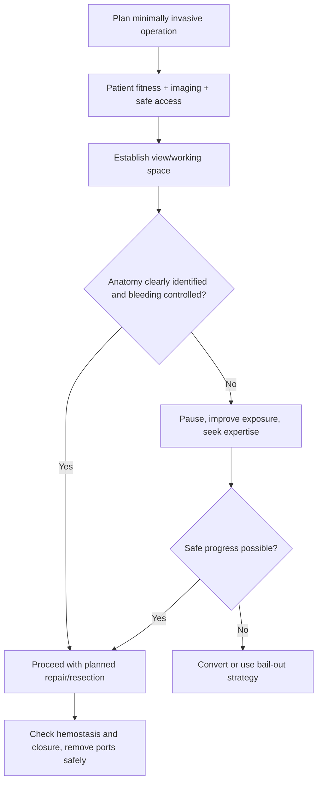

# 29 — Minimally Invasive Surgery, Endoscopy and Robotic Technology

> [!info] Scope and provenance
> **Doctut Merged—“Laparoscopy” and surgical instruments**, **World of Revision—Surgery: instruments/electrosurgery, laparoscopic approaches and related procedures**, and **WOR—Anaesthesia: monitoring/positioning** supply most direct material. The uploaded sources contain **limited standalone coverage of robotics and modern image-guided platforms**; such gaps are labeled rather than represented as comprehensively sourced. This is an exam-level overview, not operative technique training.

## 1. General concept

- **Minimally invasive surgery (MIS)** performs operative tasks through small ports, natural orifices or endoscopic access while preserving the essential goals of open surgery: anatomic dissection, complete disease treatment, safe hemostasis and closure.
- Includes **laparoscopy, thoracoscopy/VATS, endoluminal endoscopy, endovascular interventions, robotic-assisted surgery** and hybrid procedures.
- Advantages may include smaller incisions, reduced postoperative pain, shorter admission, less wound infection and earlier mobility for appropriately chosen operations.
- Disadvantages: entry-related injury, limited tactile feedback, equipment dependence, altered depth perception, higher learning curve, pneumoperitoneum-related physiology, cost and possible conversion to open.
- **Conversion to open is a safety decision**, not a failure, when bleeding, poor visualization, adhesions, anatomy or malignancy risk demand it.

## 2. Components of a laparoscopic stack

| Device | Purpose | Exam/source details |
|---|---|---|
| **Monitor/display** | Displays operative view | Ergonomic placement determines operator posture |
| **Laparoscope/camera head** | Transmits image from abdomen | Common **0° or 30°** angled optics; 5- or 10-mm examples in Doctut |
| **Light source/light cable** | Illumination | Thermal risk from disconnected illuminated cable |
| **Insufflator** | Delivers CO₂ to reach pressure/flow target | Avoid excessive intraperitoneal pressure |
| **CO₂ source** | Gas supply | CO₂ readily soluble/nonflammable relative to some alternatives |
| **Trocar/cannula with valve** | Port access while preserving gas | Common 5, 10/12-mm sizes; site and closure matter |
| **Veress needle** | Closed abdominal entry for insufflation | Spring-loaded blunt protective stylet, but **injury can still occur** |
| **Open Hasson cannula** | Open entry under direct vision | Alternative where scar/adhesions or access strategy favor it |
| **Graspers/dissectors** | Manipulate tissue | Maryland dissector, atraumatic and toothed graspers |
| **Clip appliers/energy devices** | Clip/cauterize/divide structures | Misidentification/thermal spread remain risks |
| **Needle holders/staplers** | Suture and staple internally | Endoscopic knotting, extracorporeal knots, endostaplers |
| **Suction–irrigation** | Clear operative field and control bleeding | Must be used without masking active bleeding |

### Entry: Veress vs open (Hasson) approach
- **Closed:** Veress needle entry followed by CO₂ insufflation and trocar placement.
- **Open:** dissection to fascia/peritoneum then blunt trocar under direct vision.
- Risks of either approach: **bowel injury, vascular injury, omental injury, gas misplacement, failed entry**; no technique eliminates risk.
- Prior laparotomy/adhesions and pregnancy/obesity alter the safest entry plan.

## 3. Pneumoperitoneum physiology

### Why CO₂?
- Rapid absorption, effective laparoscopic working space, comparatively low combustibility; end-tidal CO₂ can increase due to absorption.
- **Intraperitoneal pressure** is usually titrated to the minimum that permits safe visualization (common adult values ~12–15 mmHg in standard teaching; variable by patient/procedure).

### Systemic effects

| System | Main effect of rising abdominal pressure / CO₂ | Anesthesia concern |
|---|---|---|
| Respiratory | Diaphragm pushed up, compliance decreases, airway pressures increase | Ventilation support, higher EtCO₂, hypercapnia |
| Cardiovascular | Inferior vena cava compression and altered venous return; SVR response | Reduced cardiac output in vulnerable patients; hemodynamic change |
| Renal | Renal perfusion and urine output may decline with pressure | Avoid interpreting every transient low UOP as a kidney lesion |
| Cerebral/eye | Higher CO₂ and Trendelenburg can elevate ICP/IOP | Relevant to intracranial disease and ocular surgery history |
| Thromboembolic | Venous stasis, altered position and operative duration | VTE prophylaxis according to risk |

### Common gas-related complications
- **Subcutaneous emphysema:** CO₂ tracks into tissue; may elevate EtCO₂.
- **Capnothorax/pneumothorax:** gas enters thorax in selected operations/injury.
- **Gas embolism:** sudden cardiovascular collapse, abrupt change in end-tidal CO₂ and oxygenation; rare but severe.
- **Hypercapnia and respiratory acidosis** in susceptible patients.
- **Excessive pressure** reduces perfusion and increases cardiopulmonary compromise.

> [!warning] Source-specific pressure
> Doctut states a **maximum laparoscopic insufflation pressure of 15 mmHg** (OCR sometimes renders “Z5”). This is useful as a conventional adult operating value, **not** a universal maximum for every patient/procedure. Surgical/anaesthetic strategy governs the actual pressure.

## 4. Positioning: the patient as an anatomic retractor

| Position | Common use | Key mechanical effect / risk |
|---|---|---|
| **Trendelenburg** | Pelvic/colorectal operations | Bowel shifts cephalad; worsens ventilation and may raise ocular/cranial pressure |
| **Reverse Trendelenburg** | Upper GI, lap cholecystectomy | Bowel shifts caudad; hypotension from venous pooling possible |
| **Right-side-up tilt** | Gallbladder exposure | Moves intestines/omentum away from right upper quadrant |
| **Lloyd–Davies modified lithotomy** | Pelvic/lower GI | Facilitates perineal access; pressure/nerve injury possible |
| **Lateral decubitus** | Thoracoscopy/renal procedures | Improves access but requires padding and lung management |
| **Prone** | Selected spinal/posterior minimally invasive procedures | Airway/eye/pressure risks |

- Doctut notes position can be the **“best retractor”** in lap cholecystectomy.
- Nerve injury risk: **common peroneal nerve** in lithotomy; brachial plexus if upper limb overextended; skin pressure injuries in long cases.

## 5. Optical and surgical technique principles

- **Camera orientation:** horizon, center of target, maintain clean optics and adequate light; instrument movements are amplified by fulcrum effect.
- **Triangulation:** ports chosen to allow instruments to approach target from useful directions without sword-fighting.
- **Tissue handling:** traction–countertraction, blunt and sharp dissection, anatomic planes, early recognition of bleeding.
- **Bimanual operation:** one instrument exposes tissue, other dissects/controls energy; minimize unintended torque on tissues.
- **Specimen retrieval:** bag extraction where appropriate and oncologic handling per procedure; avoid tumor spillage.
- **Port closure:** larger fascial defects may require closure to reduce port-site hernia, depending on size/location/type of port.

## 6. Electrosurgery and advanced energy

| Device | Mechanism | Advantage | Major hazard |
|---|---|---|---|
| **Monopolar cautery/electrosurgery** | Current runs from active electrode through body to dispersive return electrode | Versatile cutting/coagulation | Thermal injury, return-pad burn, capacitive coupling |
| **Bipolar** | Current flows between two poles of forceps | More localized energy | Lateral thermal spread still possible |
| **Ultrasonic (“harmonic”)** | High-frequency mechanical vibration produces cutting/coagulation | Seals/dissects without monopolar current pathway | **Still creates heat**; residual-hot tip burn |
| **Advanced bipolar vessel-sealer** | Feedback-controlled tissue compression/electrothermal sealing | Vessel sealing, cutting in certain devices | Size/tissue restrictions and collateral heat |
| **Laser** | Focused optical energy | Select endoscopic/urological procedures | Eye/skin fire hazards and plume |

- WOR/Doctut sometimes frame “harmonic = no heat” or “bipolar = no burns”; **these are inaccurate absolutes**. Device-specific thermal injury still occurs.
- Surgical smoke and energy near bowel/bile duct demand safe activation and direct visualization.

## 7. Common procedures and operative landmarks

### Laparoscopic cholecystectomy
- Patient often reverse Trendelenburg with left tilt/right side up; careful dissection in hepatocystic region.
- **Critical view of safety (CVS)** before dividing duct/artery: clear hepatocystic triangle of fat/fibrous tissue, separate lower gallbladder from cystic plate, and see **only two structures entering gallbladder**.
- Failure to obtain safe anatomy → alternative approach (**subtotal cholecystectomy**, conversion, senior expertise), not blindly clipping.
- Complications: bile-duct injury, hemorrhage, bile leak, retained stones.

### Laparoscopic appendectomy
- Establish anatomy of appendix/mesoappendix, secure appendiceal artery/base and retrieve contaminated appendix safely.
- Benefits vary by severity/setting; avoid uncontrolled abdominal contamination.

### TEP vs TAPP inguinal hernia repair
- **TEP (totally extraperitoneal):** preperitoneal dissection without deliberate entry into peritoneal cavity.
- **TAPP (transabdominal preperitoneal):** enter peritoneal cavity then place mesh in preperitoneal plane and close peritoneal flap.
- Both repair the **myopectineal orifice**; injury risks include major vessels, nerves and bladder.
- Cross-link: Surgery Part IV hernia notes for full anatomical boundaries.

### Bariatric surgery
- Source mentions sleeve gastrectomy and Roux-en-Y gastric bypass elsewhere in Surgery/GIT.
- Key differences: **sleeve** reduces stomach reservoir; **Roux-en-Y bypass** changes gastric capacity and intestinal nutrient path. Operative choice also depends on GERD/metabolic and nutritional risks.

## 8. Endoscopic and natural-orifice procedures

| Procedure | Anatomical access | Purpose |
|---|---|---|
| **Upper GI endoscopy (OGD)** | Mouth → esophagus/stomach/duodenum | Diagnose/biopsy/perform endoscopic hemostasis |
| **Colonoscopy** | Anus → colon ± terminal ileum | Diagnosis, polypectomy, bleeding control |
| **ERCP** | Side-viewing endoscope at major papilla | Therapeutic biliary/pancreatic interventions; pancreatitis risk |
| **EUS** | Endoscope with ultrasound | Lesion depth assessment, needle aspiration/drainage |
| **Flexible bronchoscopy** | Nose/mouth → bronchi | Diagnostic sampling, airway assessment/intervention |
| **VATS** | Thoracic ports into pleural space | Thoracic surgery with visualization; see Part V |
| **Cystoscopy/ureteroscopy** | Transurethral | Endourology, stones, stents, biopsy |

- Endoscopic tissue removal/closure and endoluminal hemostasis depend on operator skill and relevant complications; **perforation, hemorrhage, sedation/aspiration and infection** are recurring risks.

## 9. Robotic-assisted surgery

### Principle
- Surgeon operates instruments from console/controls with robotic arms at patient; **robot does not autonomously make medical decisions** in conventional robotic surgery.
- Potential advantages: wristed instrument articulation, tremor filtering, three-dimensional operative view and ergonomics.
- Limitations: cost, setup time, training, port collision/space and variable availability; not automatically better for every operation.
- Common applications include urological, colorectal, gynecological and selected thoracic operations.

> [!info] Source limitation
> The uploaded WOR/Doctut corpus contains only limited standalone robotic surgery detail. The concise overview above is **general explanatory scaffolding** rather than a faithfully extracted chapter on robotics; source coverage is **insufficient** for exact robotic platform comparisons, outcome statistics or cost data. Those are intentionally not invented.

## 10. Image-guided intervention and minimally invasive vascular treatment

- **Ultrasound guidance:** vascular access, drain insertion, biopsy and targeting fluid collections.
- **Fluoroscopy/angiography:** guides catheters for balloon angioplasty, stenting, embolization, thrombolysis and selected endovascular graft deployment.
- **CT-guided percutaneous drainage/biopsy:** accesses deep collections/lesions without open incision where safe.
- **IR vs surgery:** interventional radiology can supply source control (abscess drainage) or hemorrhage management (embolization), but selection depends on hemodynamics/anatomic accessibility.

## 11. Safety, checklist and conversion logic

### Complications to recognize
- Entry injury → bleeding/bowel perforation, peritonitis/sepsis; pneumoperitoneum-related cardiopulmonary changes; port-site infection/hernia; thermal injury, gas embolism; bile-duct/ureter/vessel injury in region-specific surgery.
- **Delayed thermal bowel injury** may present days after procedure with pain, fever and sepsis; avoid assuming early postoperative stability excludes it.

## 12. Exam-grade comparisons

| Pair | Fundamental difference |
|---|---|
| **Open vs laparoscopy** | Wide direct exposure vs camera/ports, changed access/physiological conditions |
| **TAPP vs TEP** | Enters peritoneum vs remains extraperitoneal |
| **Monopolar vs bipolar** | Patient current path/return pad vs localized forceps circuit |
| **Veress vs Hasson** | Needle closed entry vs controlled open entry |
| **Laparoscopic vs robotic-assisted** | Manual laparoscopic instruments vs console-mediated articulated instruments |
| **Laparoscopy vs VATS** | Abdominal cavity vs chest/pleural space |
| **ERCP vs EUS** | Papillary duct intervention vs intraluminal ultrasound imaging/guided sampling |

### Rapid revision
- **CO₂** is typical gas for laparoscopic insufflation.
- **Reverse Trendelenburg + right-side-up** aids gallbladder exposure.
- **Veress** is closed insufflation; **Hasson** is open access.
- **Critical view of safety** is essential before clipping suspected cystic structures.
- **TEP ≠ TAPP** (peritoneal entry).
- **Conversion to open** is often a positive safety decision.
- Energy devices may cause **thermal injury even when not monopolar**.

**Sources:** Doctut *Laparoscopy/OT instruments*; WOR *General Surgery, specialty-specific laparoscopic techniques*; WOR *Anaesthesia—positioning and monitoring*. **Source gap:** detailed modern robotics outcomes, equipment comparisons and advanced endoscopic technologies were not available comprehensively in the supplied corpus.
