# OneShot 4.0 — ENT

## Contents

- [Ear](#ear)
  - [Ear anatomy](#ear-anatomy)
  - [Labyrinth and investigations](#labyrinth-and-investigations)
  - [Infective diseases of the ear](#infective-diseases-of-the-ear)
  - [Non-infective diseases of the ear](#non-infective-diseases-of-the-ear)
- [Throat](#throat)
  - [Throat anatomy](#throat-anatomy)
  - [Diseases of the throat](#diseases-of-the-throat)
  - [Diseases of the larynx](#diseases-of-the-larynx)
  - [Carcinomas and tracheostomy](#carcinomas-and-tracheostomy)
- [Nose and sinuses](#nose-and-sinuses)
  - [Anatomy and imaging](#nose-and-sinuses-anatomy-and-imaging)
  - [Diseases of the nose and sinuses](#diseases-of-the-nose-and-sinuses)
- [Multiple-choice questions](#multiple-choice-questions)

---

# Ear

## Ear anatomy

### Sensory innervation of the auricle

- Arnold's nerve
- Auriculotemporal nerve
- Auricle / sensory branch of the facial nerve
- Lesser occipital nerve
- Greater auricular nerve

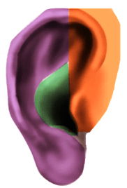

### Middle ear anatomy with facial nerve

| Eustachian tube | Stapedius muscle / acoustic reflex |
|---|---|
| Length: 36 mm | Function: dampens loud sound |
| Straighter in children | Afferent nerve: CN VIII |
| Function: balances pressure and drainage | Efferent nerve: CN VII |
| Investigation: tympanometry | Absent reflex: hyperacusis |

### Prussack's space and facial recess

| Prussack's space | Facial recess |
|---|---|
| Superior: lateral malleal fold | Facial nerve |
| Medial: neck of malleus | Chorda tympani |
| Lateral: pars flaccida and scutum | Fossa incudis |

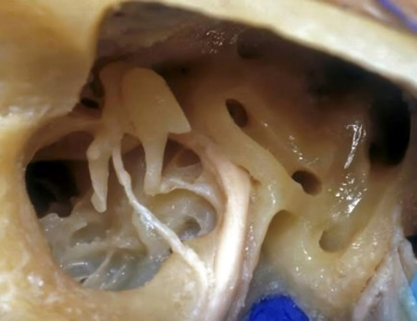

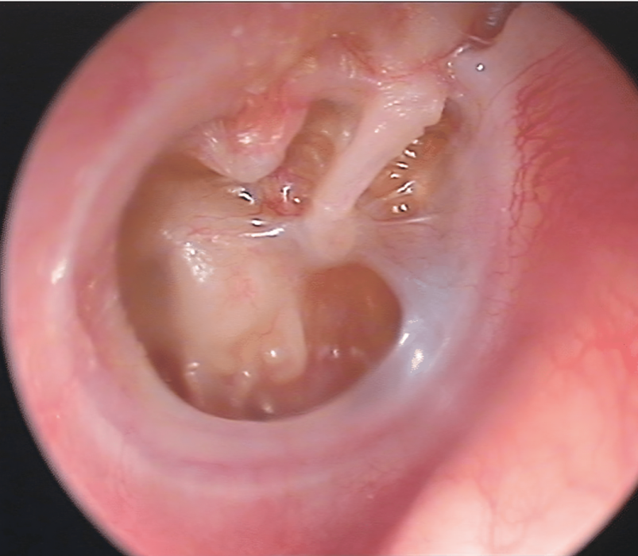

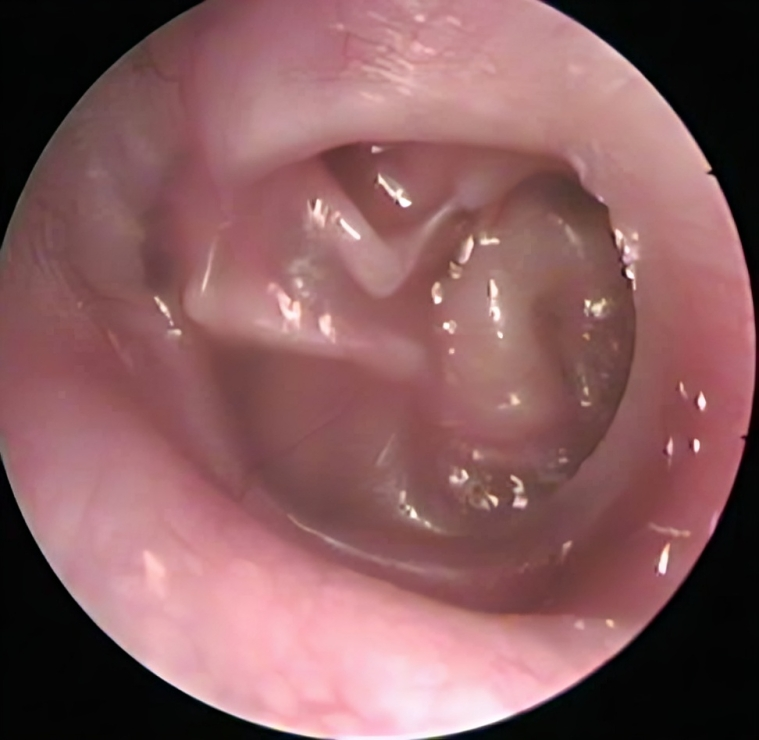

## Labyrinth and investigations

### Labyrinth

| Structure | Notes |
|---|---|
| Cochlea — inner hair cells | X |
| Cochlea — outer hair cells | Produce otoacoustic emissions (OAE); easily damaged |
| Vestibule | Listed in the source table |
| Semicircular canals | Listed in the source table |

### Investigations of ear diseases

| Hearing tests | Vestibular function tests |
|---|---|
| Tuning-fork test | Caloric test |
| Audiometry | Fistula test |
| Tympanometry | HINT |
| BERA | VEMP — vestibular-evoked myogenic potential |
| OAE | |

### Tuning-fork tests (512 Hz)

1. Rinne test
2. Weber test
3. ABC test / Schwabach's test
4. Bing test
5. Gelle test

| 256 Hz | 512 Hz | 1024 Hz | Hearing loss |
|---|---|---|---|
| Negative | Positive | Positive | 15–30 dB |
| Negative | Negative | Positive | 30–45 dB |
| Negative | Negative | Negative | 45–60 dB |

### Audiometry

Graphs shown: bilateral congenital hearing loss, Carhart's notch in otosclerosis, and Meniere's disease in the left ear.

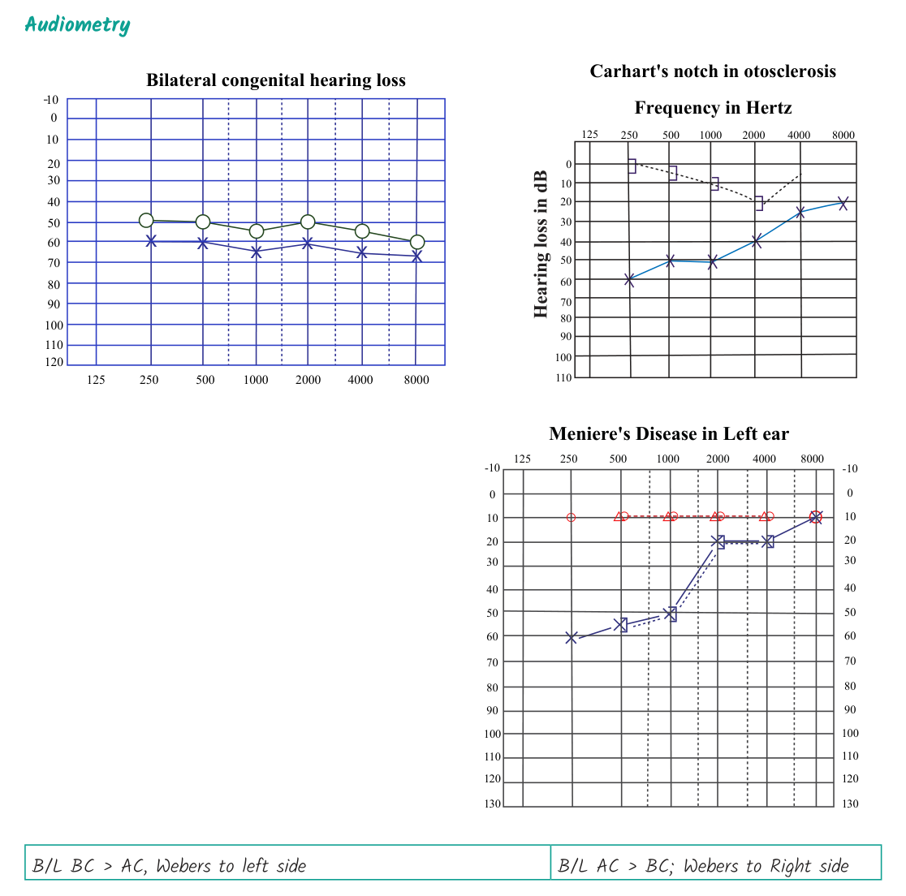

- Bilateral **BC > AC**; Weber lateralizes to the left side.
- Bilateral **AC > BC**; Weber lateralizes to the right side.

### BERA and OAE in sensorineural hearing loss

| Cochlear disease | Retrocochlear disease |
|---|---|
| Normal BERA | BERA has increased latency |
| Absent OAE | OAE present |
| Recruitment | Tone decay |
| SISI | Rollover curve |
| | Low speech-discrimination score |

### Caloric test

**COWS**

- Hypoactive labyrinth: nystagmus is on the opposite side, but the eyeball moves towards the same side.
- Hyperactive labyrinth: nystagmus is on the same side, but the eyeball moves towards the opposite side.

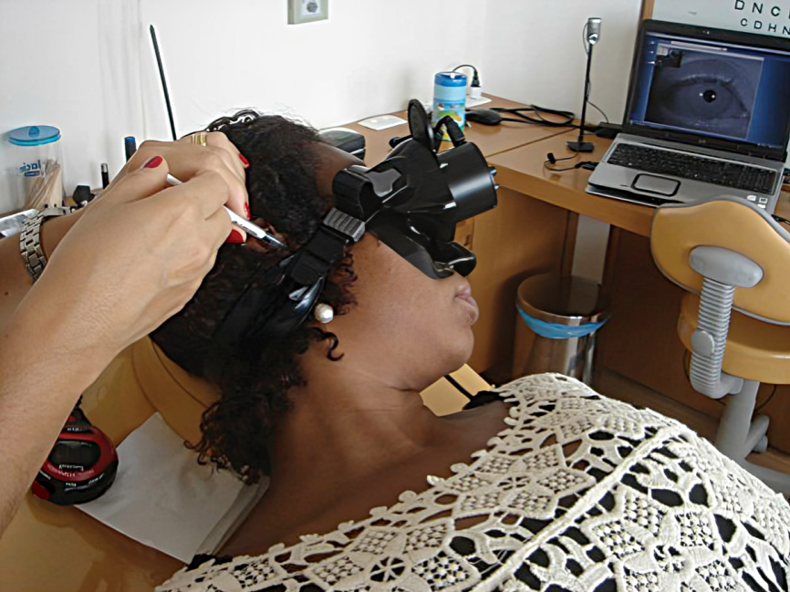

### Fistula test

| True-positive fistula test | False-positive fistula test (Hennebert's sign) |
|---|---|
| Labyrinthine fistula or CSOM | Meniere's disease |
| Fenestration surgery or type V tympanoplasty | |
| Post-stapedectomy | |
| Perilymph fistula | |

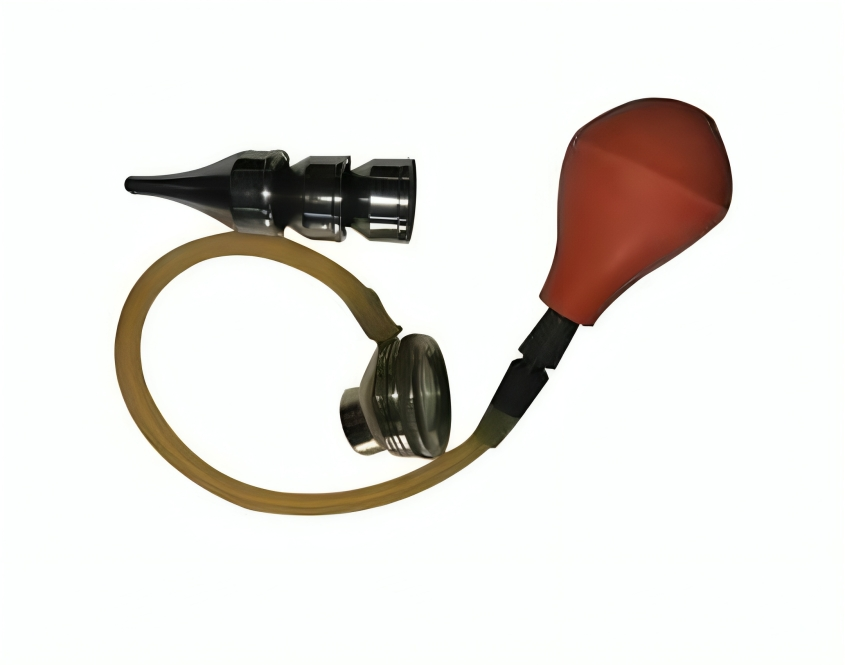

### Head impulse test

In vestibular neuronitis, when the head is tilted towards the side of the lesion, a saccadic movement is seen on the opposite side.

## Infective diseases of the ear

### Acute infections

| Malignant otitis externa | ASOM | Acute mastoiditis |
|---|---|---|
| *Pseudomonas* | *Streptococcus pneumoniae* | *Streptococcus pyogenes* |
| Diabetes | *H. influenzae*, *Moraxella* | Ironed-out mastoid |
| Nocturnal pain | Red, bulging tympanic membrane | Pinna displaced anteroinferiorly |
| Osteitis and facial palsy | Cartwheel appearance; fluid level | Lighthouse sign; reservoir sign |
| | Lighthouse sign; reservoir sign | Bezold's abscess — SCM |
| | Nasal decongestants and AMB; myringotomy | Citelli's abscess — digastric; Luc's abscess — superior canal wall |

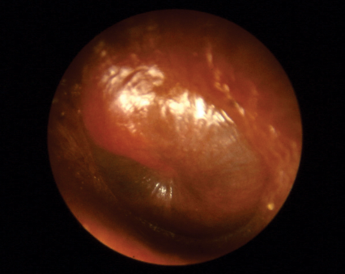

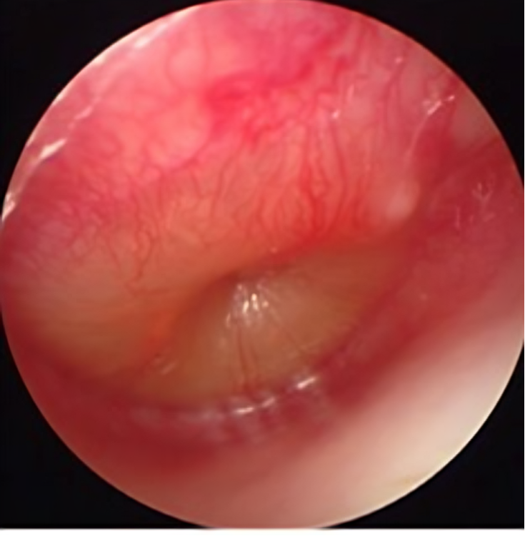

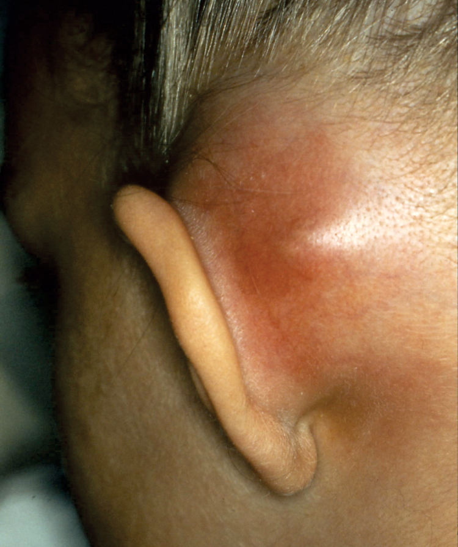

### Chronic infections

| SOM / glue ear | Safe CSOM | Unsafe CSOM | Tuberculosis |
|---|---|---|---|
| No pathogen | *Pseudomonas* | *Pseudomonas* | Painless |
| Child: adenoid hypertrophy | Copious discharge | Foul-smelling, scanty discharge | Watery discharge |
| Adult: nasopharyngoscopy | Central perforation | Retraction pocket | Multiple perforations |
| Most common cause of hearing loss in children | Myringoplasty | Cholesteatoma | Pale granulations |
| Retracted TM; air bubbles | | Marginal perforation; attic perforation | |
| Tympanogram: type B | | MRM | |
| Myringotomy + grommet + adenoidectomy | | | |

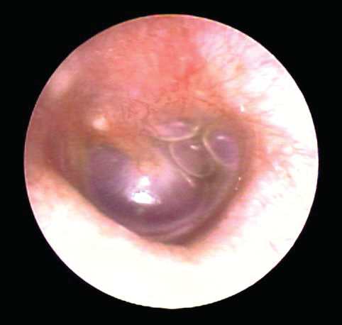

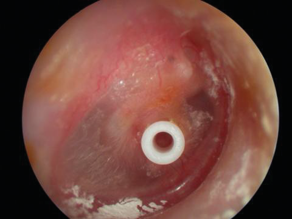

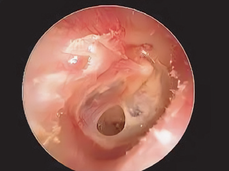

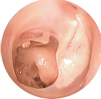

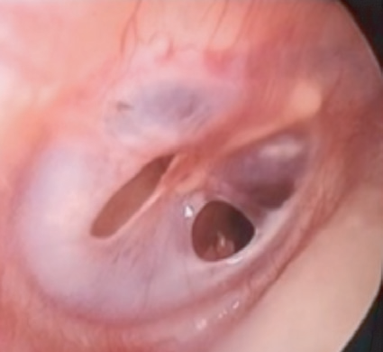

### Complications

| Cholesteatoma | Gradenigo's syndrome | Labyrinthine fistula | Lateral sinus thrombosis | Brain abscess |
|---|---|---|---|---|
| Prussack's space | Three Ds | Bulge of LSCC | Picket-fence fever | Fever and headache |
| Keratin squamous epithelium | Discharge | Vertigo | Gresinger's sign | Aphasia |
| Wittmaack's theory | Diplopia | Nystagmus | Delta sign | Convulsions |
| MRM | Deep pain | True-positive fistula test | Crow beck sign; Tobey ayer sign | |

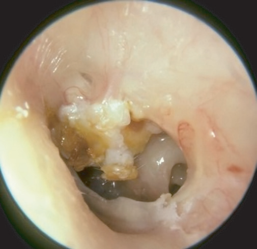

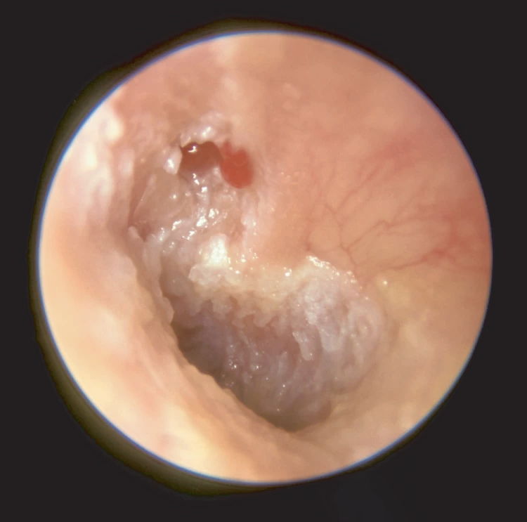

### Ear surgeries

| Procedure | Notes |
|---|---|
| Myringotomy + grommet | ASOM: posteroinferior quadrant; glue ear: anteroinferior quadrant with grommet |
| Myringoplasty | Safe CSOM; temporalis fascia has low BMR |
| Tympanoplasty type I | Malleus — myringoplasty |
| Tympanoplasty type II | Incus |
| Tympanoplasty type III | Stapes head — columella |
| Tympanoplasty type IV | Round window and Eustachian tube |
| Tympanoplasty type V | Fistula on LSCC — fenestration |
| Mastoidectomy | Simple: acute mastoiditis; MRM: unsafe CSOM |
| Radical mastoidectomy | Three steps: exteriorization, retain footplate, block Eustachian tube |

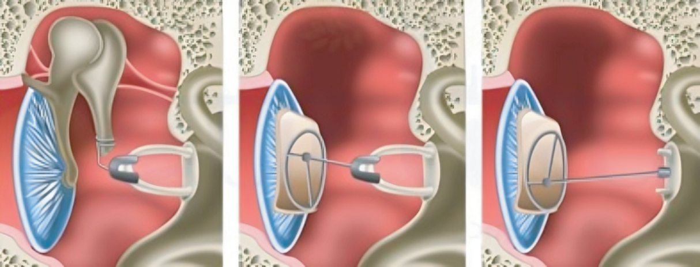

## Non-infective diseases of the ear

### Non-infective conditions

| Otosclerosis | Meniere's disease | BPPV | Superior canal dehiscence syndrome |
|---|---|---|---|
| Fistula ante fenestrum | Endolymphatic hydrops | Posterior SCC | Minor's syndrome |
| 35-year-old pregnant woman; CHL | Mutation: short arm of chromosome 6 | Positional vertigo, under 20 seconds | Third-window effect |
| Schwartze sign | Fluctuating SNHL; tinnitus | Dix–Hallpike manoeuvre | CHL and autophony |
| Paracusis Willisii | Vertigo: 24 min–24 hrs | Epley manoeuvre | Conservative management |
| Gelle's test is -ve | Electrocochleography | | |
| Tympanometry: As | Betahistine; Meniett device; intratympanic gentamicin | | |
| Treatment of choice: stapedotomy | | | |
| Drug of choice: sodium fluoride | | | |

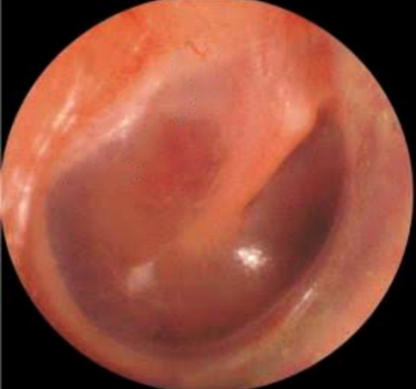

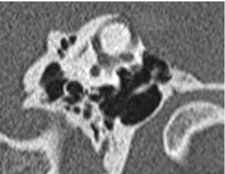

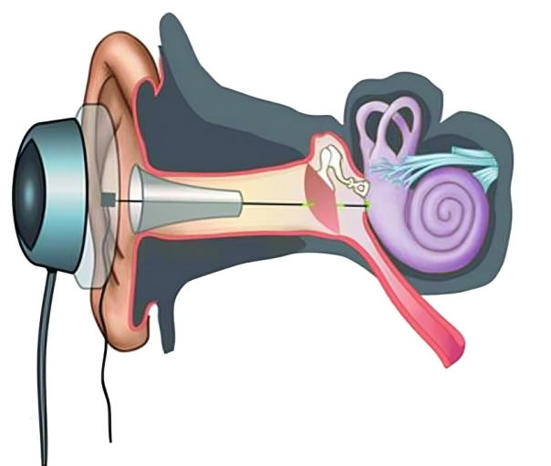

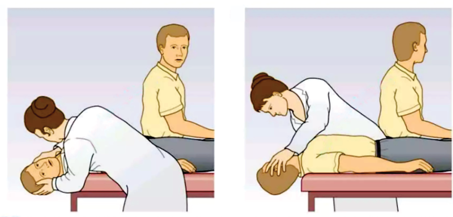

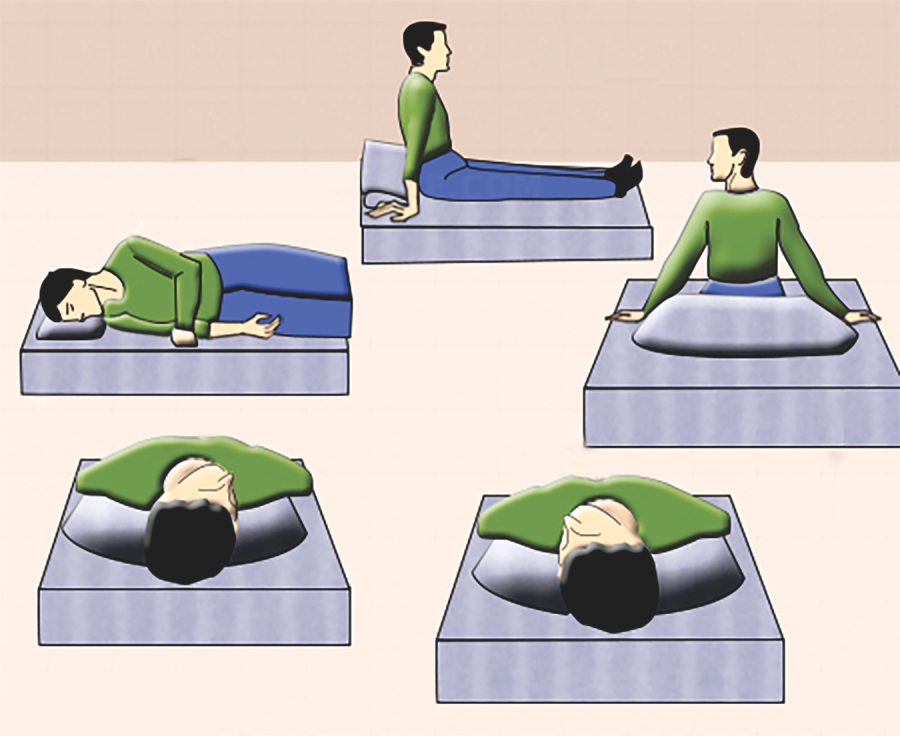

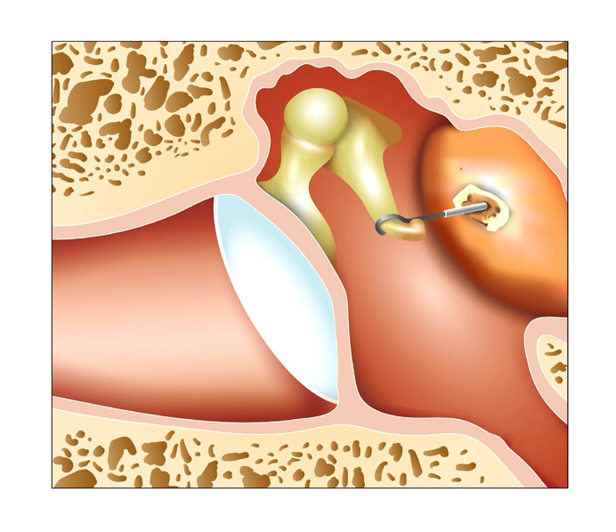

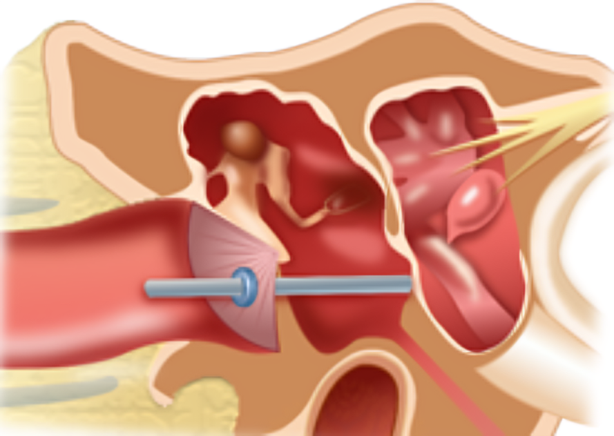

### Tumours

| Glomus tumour | Acoustic neuroma |
|---|---|
| Paraganglioma | Arises from the inferior vestibular nerve |
| Pulsatile tinnitus | Site: cerebellopontine angle |
| Rising-sun sign; Brown's sign; Phelp's sign; Aquino sign | Most common manifestation noted: loss of corneal reflex |
| | Hitselberger's sign |
| | Gold-standard investigation: gadolinium MRI |
| | Gamma-knife stereotactic radiotherapy |

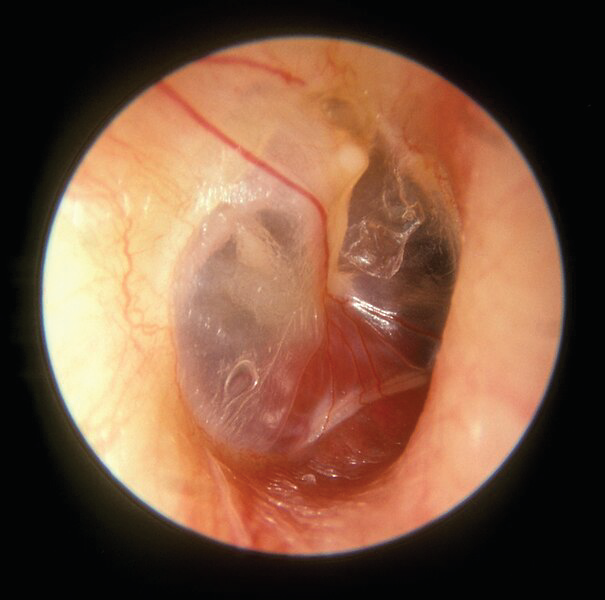

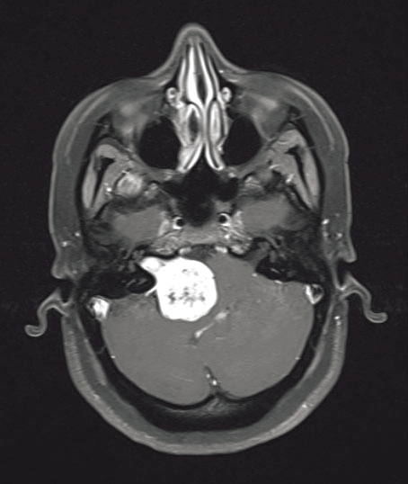

### Assistive devices for hearing

| Hearing aid | Cochlear implant | Brainstem implant |
|---|---|---|
| An amplifier; used in any type of hearing loss | Used in bilateral severe hearing loss due to cochlear disease | Used in bilateral severe hearing loss due to retrocochlear disease |
| | Electrodes implanted through the round window or into the scala tympani | Implanted into the recess of the fourth ventricle |

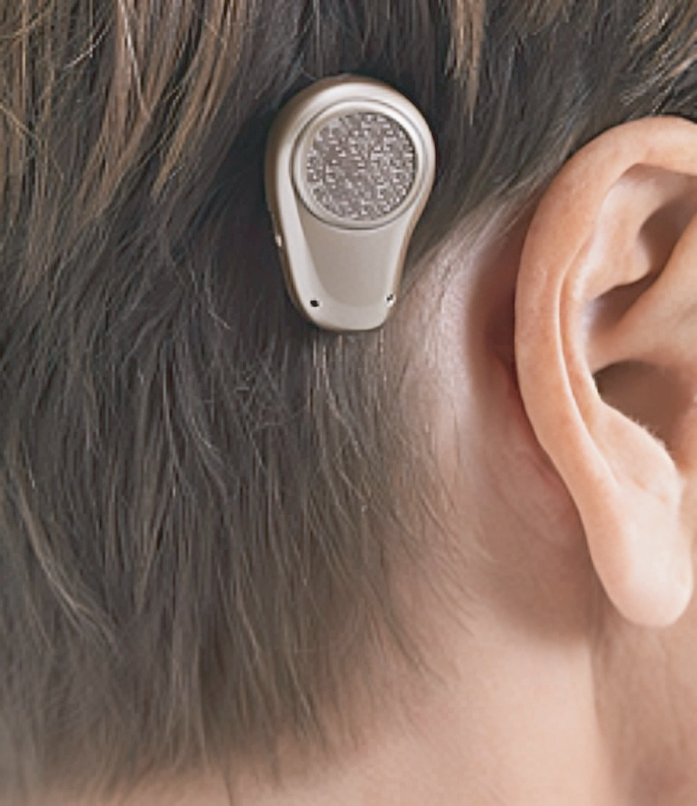

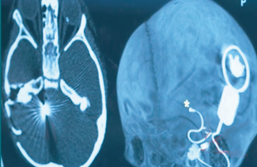

---

# Throat

## Throat anatomy

### Arteries of the tonsil

1. Main: tonsillar or facial artery
2. Ascending pharyngeal artery
3. Ascending palatine artery
4. Descending palatine artery
5. Dorsal lingual artery

### Muscles of the larynx and vocal-cord movement

| Abduction | Adduction | Tension |
|---|---|---|
| Helps in breathing | Helps in voice production | Helps in high-pitch voice |
| Posterior cricothyroid muscle | Lateral cricothyroid muscle | Cricothyroid muscle |
| | Interarytenoid muscle | Thyroarytenoid muscle |
| | Thyroarytenoid muscle | |
| | Cricothyroid muscle | |
| Supplied by recurrent laryngeal nerve | Supplied by recurrent laryngeal nerve | External laryngeal nerve |

## Diseases of the throat

### Nasopharynx and adenoid facies

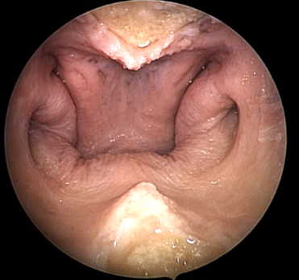

**Features of adenoid facies**

- High-arched palate
- Crowded upper teeth
- Collapsed ala
- Hypoplastic maxilla
- Dull expression

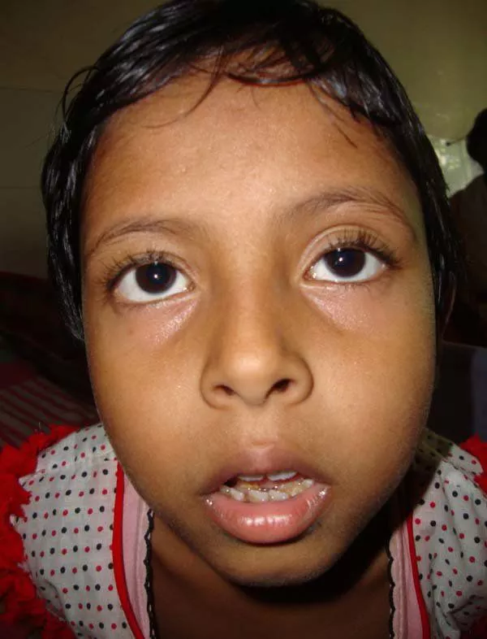

### Choanal atresia

- Cause: bucconasal membrane
- Technique mentioned: McGovern's technique

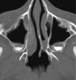

### Clinical images of throat and neck disease

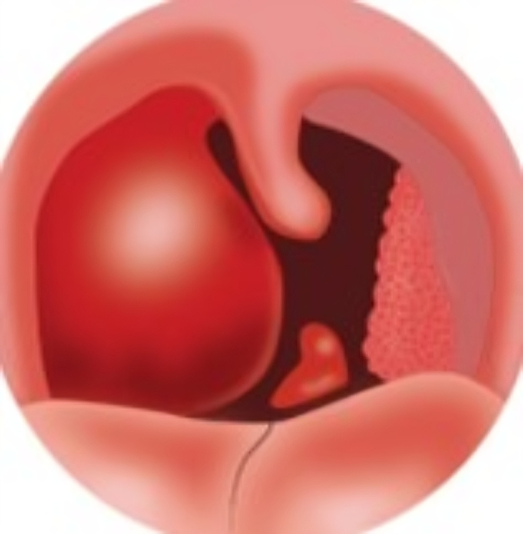

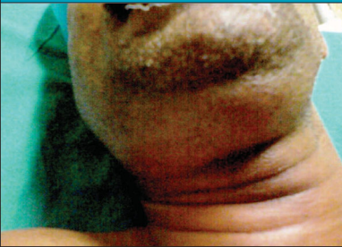

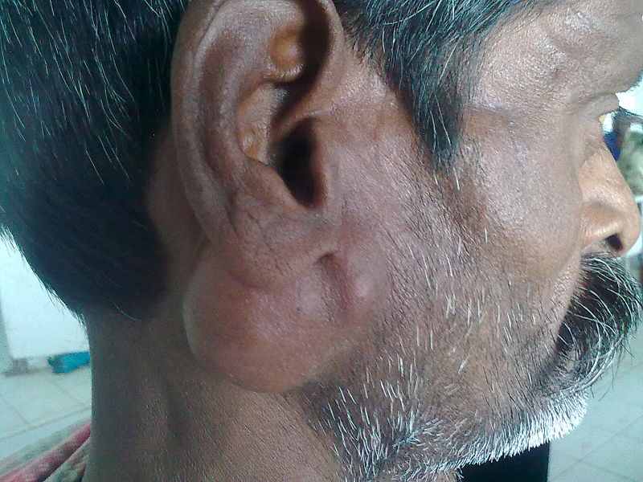

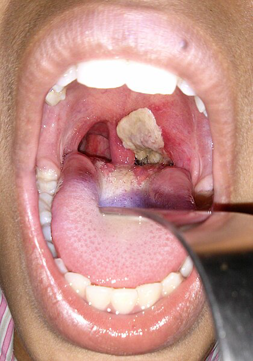

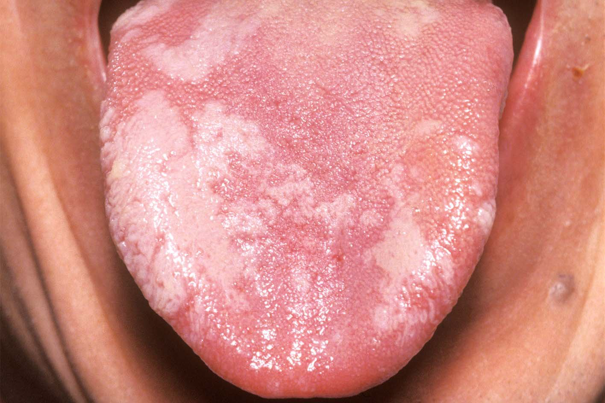

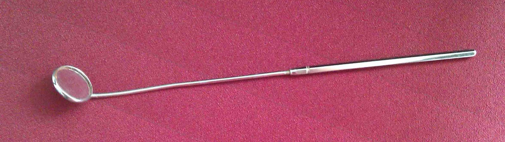

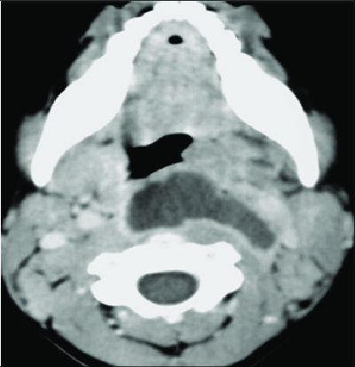

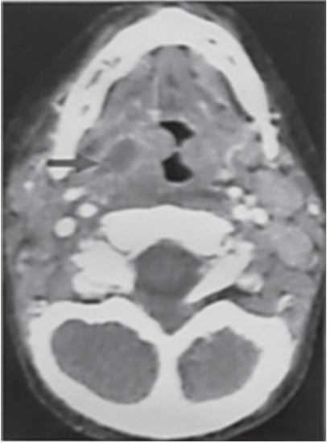

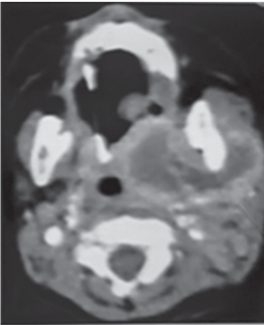

### Tonsillectomy

| Indications | Contraindications |
|---|---|
| Recurrent tonsillitis | Acute tonsillitis |
| Chronic tonsillitis | Bleeding disorders |
| Quincy | Cleft palate |
| Eagle's disease | |

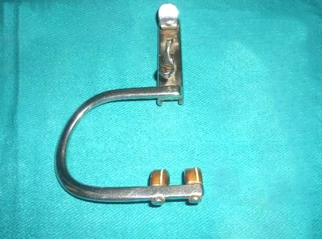

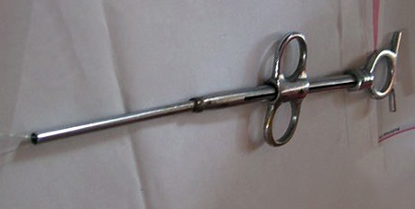

### Complications of tonsillectomy

**1. Bleeding**

| Primary bleeding | Reactionary bleeding | Secondary bleeding |
|---|---|---|
| Caused by veins | Within 24 hours after surgery; caused by arteries; immediate re-ligation under GA | 5–8 days; infection is the cause; antibiotics + re-ligation |

**Other complications**

- Grisel's syndrome
- Hypernasal voice / rhinolalia aperta

## Diseases of the larynx

### Congenital diseases of the larynx

**Laryngomalacia**

- Most common congenital disease of the larynx
- Presentation: newborn with inspiratory stridor
- Omega-shaped epiglottis
- Treatment: reassurance

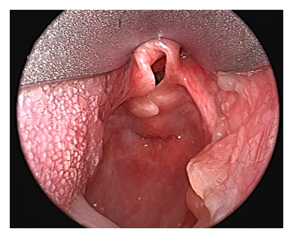

**Subglottic stenosis**

- May cause expiratory or biphasic stridor
- Graded into four grades by Myer and Cotton
- Topical mitomycin-C may be beneficial

### Laryngitis

| Acute epiglottitis | Croup | Tuberculosis |
|---|---|---|
| *Streptococcus pyogenes* | Parainfluenza virus | Site: interarytenoid area |
| Child in tripod position | Child lying on mother's lap | Hoarseness and pain |
| Fever, dyspnoea, dysphagia | Dyspnoea, voice change | Cobblestone appearance; mouse-nibbled appearance; turban epiglottis |
| X-ray: thumb sign | X-ray: steeple sign | |
| Drug of choice: cephalosporin | Treatment: steroid, nebulisation, antibiotics | |

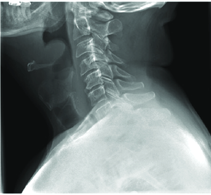

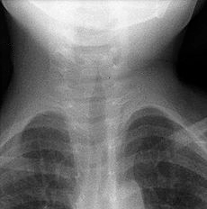

### Non-neoplastic growths

| Vocal-cord nodule | Vocal-cord polyp | Reinke's oedema | Laryngocele | Granuloma |
|---|---|---|---|---|
| Voice misuse | Voice misuse | Hypothyroidism | Dilation of the saccule in trumpet blowers | Intubation |
| Site: junction of anterior one-third and posterior two-thirds | Same site as vocal-cord nodule | Treatment of choice: conservative; microflap technique | Conservative management | Posterior one-third |
| Treatment of choice: voice rest | Treatment of choice: MLS + PPI | | | CO₂ laser + botulinum toxin + mitomycin-C |

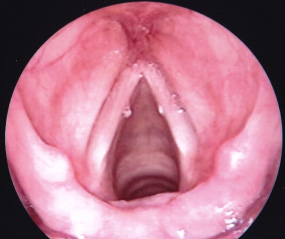

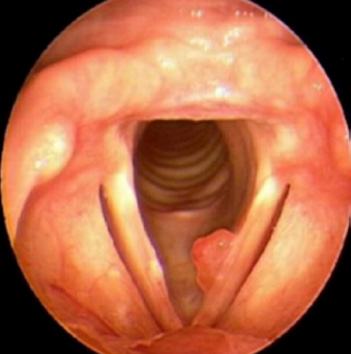

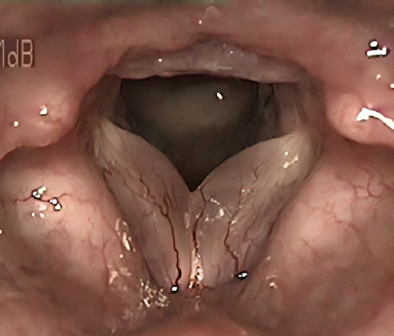

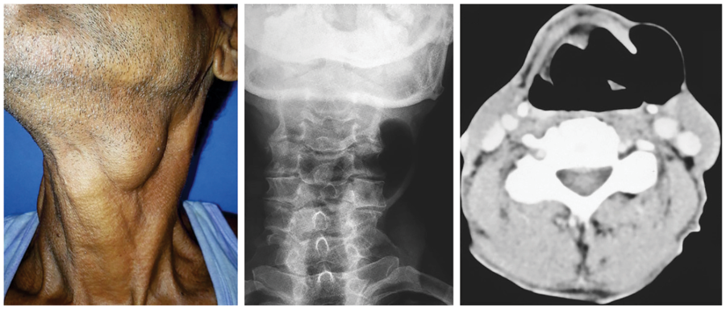

### Benign growths of the throat

| Juvenile nasopharyngeal angiofibroma | Laryngeal papilloma |
|---|---|
| Site: sphenopalatine foramen | Most common site: glottis |
| Presentation: juvenile male with epistaxis | Aetiology: HPV 6 and HPV 11 |
| Signs: antral sign and frog face | Presentation: child with hoarseness |
| Investigation of choice: CECT | Microdebridement + intralesional cidofovir |
| Treatment: embolisation and excision | |

## Carcinomas and tracheostomy

### Carcinomas

| Nasopharyngeal carcinoma | Laryngeal carcinoma |
|---|---|
| Site: fossa of Rosenmüller | Site: glottis |
| Aetiology: EBV and nitrosamine | Aetiology: smoking and alcohol |
| Most common presentation: lymphadenopathy | Hoarseness and dyspnoea |
| Trotter's triad: soft-palate palsy, facial pain, hearing loss | Intraluminal proliferative growth |
| Treatment: chemoradiation | Stages I–II: transoral laser microsurgery; stages III–IV: concurrent chemoradiation |

### Tracheostomy

- Most common indication: laryngeal obstruction due to laryngeal carcinoma
- Site: tracheal rings 2 and 3
- High tracheostomy: ring 1
- Mini-tracheostomy is also called **cricothyroidotomy**
- Most common complications: tube dislodgement and bleeding

### Speech rehabilitation

| Setting | Method |
|---|---|
| Tracheostomy | Fenestrated tube + Muir Passy valve |
| Laryngectomy | Tracheoesophageal speech; electrolarynx |

---

# Nose and sinuses

## Nose and sinuses: anatomy and imaging

### Nasal septal arteries

- Sphenopalatine artery
- Greater palatine artery
- Superior labial artery
- Anterior ethmoidal artery
- Posterior ethmoidal artery

### Lateral wall of the nose: ostia and drainage

| Region | Opening / drainage noted in the source |
|---|---|
| Sphenoethmoidal recess | Sphenoid ostia |
| Superior meatus | Posterior ethmoid ostia |
| Middle meatus | Maxillary, frontal and anterior ethmoid ostia |
| Inferior meatus | Nasolacrimal duct |

### X-ray of sinuses

| Water's view | Pierre's view | Caldwell's view |
|---|---|---|
| Most commonly done view | Most commonly done view | Done for frontal sinus |
| Best view to see maxilla | Best for maxilla and sphenoid | |
| Sphenoid is not seen | | |

## Diseases of the nose and sinuses

### Epistaxis

- Most common site: Little's area / Kiesselbach's plexus
- Artery of epistaxis: sphenopalatine artery
- Most common causes: nose picking and idiopathic
- Treatment: nose pinching, silver-nitrate cautery, nasal packing, ligation of vessels
- Ligation: TESPAL

### Deviated nasal septum (DNS)

**Common presentations**

1. Nasal blockage, mainly on the same side.
2. Sometimes blockage on the opposite side due to compensatory hypertrophy of the inferior turbinate.

- Headache: Sluder's neuralgia / anterior ethmoidal syndrome
- Nasal-valve boundaries: anterior end of inferior turbinate; lower end of upper lateral cartilage; septum

**Treatment**

| Septoplasty | Submucosal resection |
|---|---|
| Freer's incision / hemitransfixion | Killian's incision |
| Preferred after 16–17 years | Bleeding is the most common complication |
| | Done after 16–17 years |

### Nasal polyps

**Features**

1. Pale in colour
2. Poor blood supply
3. Poor nerve supply

Most common cause noted: allergy.

**Associated syndromes**

| Samter's triad | Kartagener's syndrome | Young's syndrome |
|---|---|---|
| Polyps | Polyps | Polyps |
| Asthma | Bronchiectasis | Bronchiectasis |
| Aspirin sensitivity | Situs inversus | Azoospermia |

**Types of nasal polyp**

| Maxillary / antrochoanal polyp | Ethmoidal polyp |
|---|---|
| Most common in children | Most common in adults |
| Unilateral and single | Bilateral and multiple — “bunch of grapes” |
| Not recurrent | Recurrent |
| Treatment: antibiotic + FESS | Treatment: steroid + FESS; if recurrent, ethmoidectomy |

### Rhinosinusitis: non-infective types

| Allergic rhinitis | Vasomotor rhinitis | Atrophic rhinitis |
|---|---|---|
| Allergic shiners | Increased parasympathetic activity | Most common cause noted: decreased oestrogen |
| Allergic salute | Treatment: vidian neurectomy | Features: roomy, dry cavity; crusting; foul smell; anosmia (“merciful anosmia”) |
| Dennie–Morgan lines | | Alkaline nasal douche: sodium bicarbonate, sodium biborate, sodium chloride |
| | | Surgeries: Young's surgery; Lautenslager's surgery |

### Fungal rhinosinusitis

| Aspergillosis | Mucormycosis / rhino-orbito-cerebral fungal disease | Allergic fungal sinusitis |
|---|---|---|
| Most common type noted; *A. fumigatus*; aspergilloma | Called “black fungus”; seen in diabetes; caused by *Rhizopus*; angio-invasive; causes necrosis | Bent and Kuhn criteria |
| | Drug of choice: liposomal amphotericin B | See major and minor criteria below |

**Bent and Kuhn criteria for allergic fungal sinusitis**

| Major criteria | Minor criteria |
|---|---|
| Evidence of type I IgE-mediated hypersensitivity | Asthma |
| Nasal polyposis | Unilateral predominance |
| Characteristic CT findings | Radiographic bone erosion |
| Eosinophilic mucus | Fungal culture |
| Positive fungal smear | Charcot–Leyden crystals |
| | Serum eosinophilia |

### Other nasal conditions

| Rhinophyma | Rhinoscleroma | Rhinosporidiosis |
|---|---|---|
| “Potato nose” | “Woody nose” | *Rhinosporidium seeberi* |
| Due to hypertrophy of sebaceous glands | *Klebsiella rhinoscleromatis*; also called Frisch bacilli | Aquatic protozoan; “strawberry polyp” |
| | HPE: Mikulicz cells and Russell bodies | HPE: sporangia with endospores |
| | Drug of choice: streptomycin | Drug of choice: dapsone |

### Fractures of facial bones

Most common facial bone to fracture: facial bone.

| Septal fracture | Maxilla / Le Fort fracture | CSF rhinorrhoea |
|---|---|---|
| Vertical: Chevallet fracture | Le Fort I: horizontal fracture | M/C/C: cribriform-plate fracture |
| Horizontal: Jarjavay fracture | Le Fort II: pyramidal fracture | Halo / target sign |
| Treatment: closed reduction | Le Fort III: craniofacial dysjunction | Glucose > 30 gm; beta-2 transferrin |
| | | Treatment: conservative |

### Tumours of the nose and sinuses

| Inverted papilloma / Ringertz tumour | Sinonasal carcinoma |
|---|---|
| Benign tumour with malignant potential | Most common site: maxilla, with squamous-cell carcinoma |
| Treatment: excision with wide margin / medial maxillectomy | Second: ethmoids, with adenocarcinoma; common in woodworkers |
| | Ohngren's line helps determine prognosis of maxillary carcinoma |

---

# Multiple-choice questions

## 1. Hearing loss in a child

An 8-year-old child presented with hearing loss, and the following surgery was done. Which statement could be true?

- a. May have tonsillectomy along with this
- b. If the ear fluid is cultured, it will be sterile
- c. This is done in the anteroinferior quadrant
- d. All are true

## 2. Hoarseness in a teacher

This is the image of a teacher who presented with hoarseness of voice. Pick the correct statement.

- a. This condition is usually unilateral
- b. It is due to fibrosis of the vocal cord
- c. Voice rest with a proton-pump inhibitor is the treatment of choice
- d. All are true

## 3. CT of the paranasal sinuses

A 35-year-old woman presented with nasal obstruction and anosmia for a few weeks. The CT scan is shown. Which is **not** a major criterion by Bent and Kuhn?

- a. The finding is described as a “double-density scan”
- b. Nasal polyp is a common finding
- c. Fungal culture will be positive for fungus
- d. Nasal mucin will have eosinophilia

## 4. Respiratory distress in a child

A 3-year-old child had fever for 2–3 days. Today the child has difficulty breathing and looks cyanosed. The X-ray is shown. Which statement is true?

- a. This is a case of croup
- b. The X-ray shows the steeple sign
- c. Steroid with nebulisation with adrenaline could be beneficial
- d. All are true

## 5. X-ray of the paranasal sinuses

The X-ray of the PNS shown below is done for which sinus?

- a. Maxillary sinus
- b. Frontal sinus
- c. Ethmoidal sinus
- d. Sphenoidal sinus

## 6. ENT examination instrument

A patient came to the ENT OPD and was being examined for an ENT complaint. The following instrument was being used. What is the most likely primary complaint?

- a. Hoarseness of voice
- b. Hearing loss
- c. Nasal obstruction
- d. Feeling of a lump in the throat

## 7. Ear surgery and prosthesis

A patient presented with hearing loss and otorrhoea and underwent surgery. Which statement is true?

- a. This is “columella surgery”
- b. The most likely diagnosis was serous otitis media
- c. The prosthesis shown is a total ossicular replacement prosthesis
- d. All are true

## 8. Epistaxis in an adolescent

A 13-year-old schoolboy had sudden epistaxis at school. The bleeding stopped before he reached hospital. Nasal endoscopy was done a few days later; the image is shown. Which statement is true?

- a. The contractile layers in the blood vessels of this tumour are absent
- b. May have antral sign
- c. The most common site is the sphenopalatine foramen
- d. All are true

## 9. Audiogram and tuning-fork tests

A driver presented with hearing loss. The audiogram is shown. If tuning-fork tests are done, which finding is expected?

- a. Bilateral positive Rinne's, with Weber lateralised to the right side
- b. Bilateral positive Rinne's, with Weber lateralised to the left side
- c. Bilateral negative Rinne's, with Weber lateralised to the left side
- d. Right-sided positive Rinne's and left-sided negative Rinne's

## 10. Positional manoeuvre

Looking at the image of the procedure, pick the correct statement.

- a. This is a canalith-repositioning manoeuvre
- b. It is done in a patient who has continuous vertigo for a few days
- c. Labyrinthectomy is the alternate treatment in this case
- d. All are true
