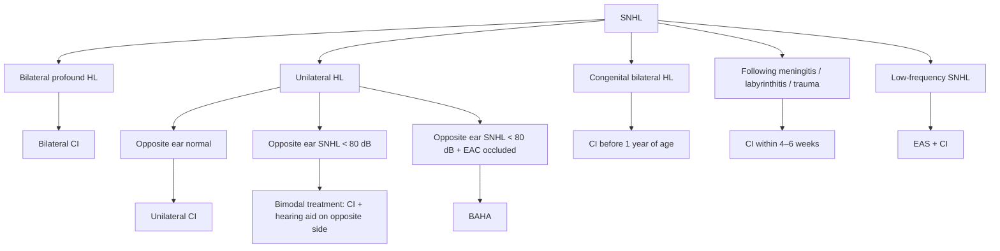

# Vestibular, Hearing and Facial Nerve

## Benign Paroxysmal Positional Vertigo (BPPV)

### Introduction

- The vestibule contains the saccule and utricle.
- The three semicircular canals have a cupula.
- The posterior semicircular canal and the superior semicircular canal meet at the **crus commune**.

**Semicircular canals and vestibular structures**

![[images/inner-ear-osseous-labyrinth.png]]

- The saccule and utricle have a **macula**. The macula is a linear-acceleration sensing system.

**Otoliths/otoconia**

- Calcium oxalate stones are present on the kinocilia.
- Movement of these hair cells causes opening of potassium channels and triggers an action potential.
- The utricle is responsible for sensing horizontal movement.
- The saccule is responsible for sensing vertical movement.

**Cristae ampullaris**

- A bulb-like broadening at the base of each semicircular canal.
- Contains the cupula.
- Responsible for sensing angular acceleration.

### Pathophysiology

Utricoliths (otoliths of the utricle) sometimes enter the semicircular canals and irritate the endolymph. This occurs most commonly in the posterior semicircular canal (95% of cases).

### Presentation

- Females > males.
- Vertigo lasting for 3–5 seconds.
- Loss of balance or unsteadiness.
- No hearing loss.

| Feature | Peripheral vertigo | Central vertigo |
|---|---|---|
| Onset | Sudden, severe | Slow, progressive |
| Nausea and vomiting | Associated with nausea and vomiting | Generally not associated with nausea and vomiting. Projectile vomiting may occur if there is raised intracranial pressure. |
| Course | Lasts for minutes to hours | Not improving |
| Causes | BPPV; Meniere's disease; superior semicircular canal dehiscence (third-window effect; Tumarkin's drop); vestibular neuronitis | Migraine; multiple sclerosis; brain tumours |

### Diagnosis

**Dix–Hallpike test**

- Turn the patient's head to 45 degrees, then make the patient lie down in the same position with the head hanging down.
- The goal is to dislodge the otolith so that it enters the posterior semicircular canal.
- This exacerbates the patient's symptoms and produces torsional geotropic nystagmus.
- A positive test indicates posterior semicircular canal BPPV.

![[images/dix-hallpike-test.png]]

### Treatment

**Epley's manoeuvre**

- For posterior semicircular canal BPPV.
- Make the patient lie down and turn the head 45 degrees towards the affected side.
- Next, turn the head 90 degrees to the opposite side, followed by turning the body in the same direction and then sitting upright, in an attempt to relocate the dislodged otolith into the utricle.

![[images/epley-maneuver.png]]

Related figure labels: sense of linear or angular motion; no motion; superior SCC; posterior SCC; lateral SCC; utricle; latency of 1 minute; 0–10 seconds.

**Semont's manoeuvre**

- Done if Epley's manoeuvre fails.
- Turn the patient's head and body to 45 degrees on the affected side and then to the opposite side without moving the patient's head, followed by sitting upright.

**Brandt–Daroff exercise**

- To let the otolith go in and come out every day, allowing the semicircular canals to get adjusted to the otolith.

**Fitzgerald's caloric test**

- Warm and cold water are put in the ear.
- **COWS:** cold water = opposite-side nystagmus; warm water = same-side nystagmus.
- These responses are dampened in patients with BPPV.

**Barbecue-roll manoeuvre or Gufoni manoeuvre**

- For lateral semicircular canal BPPV.
- Make the patient sit, lie down on one side, turn the head up, and sit upright.

![[images/barbecue-roll-maneuver-sequence.png]]

**Singulectomy**

- The singular nerve is cut.
- The singular nerve is a division of the inferior vestibular nerve.
- Singulectomy is done in rare cases when the manoeuvres do not relieve the patient's symptoms.

**Superior vestibular nerve supplies**

- Superior semicircular canal.
- Inferior semicircular canal.
- Utricle.
- Endolymphatic sac.
- Upper part of the saccule.

**Inferior vestibular nerve supplies**

- Posterior semicircular canal.
- Lower part of the saccule.

## Vestibular Neuronitis

### Neuronitis vs. labyrinthitis

| Feature | Labyrinthitis | Vestibular neuronitis |
|---|---|---|
| Structure/definition | Labyrinth: bony covering encapsulating the inner ear; vestibule, utricle and saccule | Vestibular nerve |
| Involvement | Cochlea, saccule, utricle and semicircular canals | Vestibular nerve. The source lists: (1) superior vestibular nerve — posterior SCC, saccule; (2) inferior vestibular nerve — utricle, superior and lateral SCC, and upper part of the saccule. |
| Pathology | Inflammation of the entire labyrinthine capsule due to a viral infection | Inflammation of the vestibular nerve due to a viral infection |
| Hearing and balance | Hearing loss + vertigo | Only vertigo, no hearing loss |

**Labyrinthitis — inflammation of the inner ear**

![[images/labyrinthitis-inner-ear-illustration.png]]

**Vestibular neuronitis — inflammation of the balance nerve**

![[images/vestibular-neuronitis-inner-ear-illustration.png]]

### Clinical picture

- A history of viral URTI is seen in both.
- Dizziness and imbalance are self-limiting and can last for months.
- Nausea and vomiting (non-projectile).
- MRI brain: normal.
- No cranial nerve involvement.
- Peripheral nystagmus.
- Positive head-thrust test.

**Vestibular neuronitis**

- Vertigo develops over a few hours and resolves over days.
- No associated hearing loss.

**Labyrinthitis**

- Vertigo develops over a few minutes.
- May have associated SNHL or meningitis.

### Head-thrust test (head-impulse test)

- Hold the patient's head and ask the patient to fix the eyes on your glabella.
- Turn the head suddenly while keeping the eye gaze fixed.
- **Negative head-thrust test:** no nystagmus upon suddenly turning the head.
- **Positive head-thrust test:** nystagmus upon suddenly turning the head.

![[images/head-impulse-test-inner-ear.png]]

| Feature | Central vertigo | Peripheral vertigo |
|---|---|---|
| Nystagmus | Multidirectional | Horizontal/unidirectional |
| Causes listed | TIA, stroke, brain tumours, migraine | BPPV, Meniere's disease, labyrinthitis, fistula |

### Vestibular rehabilitation exercises

**Cawthorne & Cooksey's exercises**

- These exercises teach the brain that a movement causes vertigo, so the body develops rehabilitation to accept the movement and stop reacting to it.
- Doing the exercises 2–3 times a day reduces the intensity of vertigo and dizziness.
- **Note:** Brandt–Daroff exercise is for posterior semicircular canal BPPV.

![[images/gaze-stabilization-head-positions.png]]

| Exercises in bed | Exercises in sitting position |
|---|---|
| Looking up and then down; looking alternately left and right; convergence exercises; bending alternately forward and backward; turning alternately to the left and then right | Shrugging and rotating shoulders; bending forward and picking up objects; turning the head and trunk alternately to the left and right |

![[images/vestibular-rehabilitation-exercises.png]]

## Acoustic Neuroma

### Introduction

- The cerebellopontine (CP) angle is a triangular space between the cerebellum and the pons.
- The ophthalmic, olfactory and oculomotor nerves pass through the CP angle.
- The most common site of origin of acoustic neuroma is the eighth cranial nerve.
- The middle cranial fossa contains the abducens, trochlear and trigeminal nerves.
- The ophthalmic part of CN V is responsible for the corneal reflex.
- Cranial nerves VII and VIII pass through the CP angle to the internal acoustic meatus.
- Also known as **vestibular schwannoma**, **neurilemmoma** or **eighth-nerve tumour**.
- Constitutes 80% of all CP-angle tumours and 10% of all brain tumours.

![[images/vestibulocochlear-nerve-anatomy.png]]

### Features

- Autosomal dominant.
- Benign.
- Unilateral in 90% of cases; neurofibromatosis type 2 (NF2) has bilateral acoustic neuromas.
- Very slow-growing.
- Encapsulated.

### NF2 Tumor Types

The figure labels the following associated tumour types/findings:

- Bilateral vestibular schwannomas (VS).
- Multiple meningiomas.
- Ependymomas (glial).
- Peripheral schwannoma (plexiform, subcutaneous).
- Spinal meningiomas.
- Median nerve tumours.
- Intracranial/intraorbital tumours.
- Posterior subcapsular lens opacity (cataract).
- Spinal schwannoma.
- Peroneal/tibial tumours (drop foot).
- Sciatic nerve tumours.

![[images/nf2-tumor-types.png]]

### Clinical features

- Tinnitus.
- Sensorineural hearing loss (SNHL).
- Hennebert's sign: loss of sensation on the posterosuperior part of the ear canal.
- Vertigo is **not** seen here.
- Instability/vague giddiness.
- Most common nerve involved in acoustic neuroma: CN VIII > CN V.
- Paresthesia of the face.
- Absent corneal reflex.
- Schirmer's test: decreased tear production.
- The greater superficial petrosal nerve, a branch of the facial nerve, supplies the lacrimal gland.
- Taste sensation lost in the anterior two-thirds of the tongue.
- Swallowing difficulty.

![[images/acoustic-neuroma-mri.png]]

![[images/acoustic-neuroma-histology.png]]

- Schwannomas are composed of cellular **Antoni A** areas alternating with hypocellular **Antoni B** areas.
- Antoni A areas are composed of interlacing bundles of spindle cells (Schwann cells) with wavy or oval nuclei.

### Investigation of choice (IOC)

- MRI with gadolinium contrast.
- Ice-cream-cone appearance.

### Auditory tests

- **Rinne's test:** SNHL (mild to moderate), AC > BC = no problem in the ossicular chain. False negative in profound/severe SNHL.
- **Weber's test:** lateralises to the opposite side.
- **Absolute bone conduction (ABC):** shortened on the affected side.
- **Schwabach's test:** shortened.
- **PTA:** SNHL.
- **Stapedial reflex:** present.
- **VEMP (vestibular evoked myogenic potential):** negative unilaterally.

### BERA/ABR

- Brainstem evoked response audiometry/auditory brainstem response.
- Waves I and II: cochlear nerve and cochlear nuclei.
- There is no wave for the auditory cortex in the brain.

![[images/auditory-brainstem-pathway-and-waveform.png]]

### Treatment

- If less than 3 cm: X-knife or gamma-knife surgery.
- If more than 3 cm, the listed approaches are:
  1. Midline cranial fossa approach.
  2. Translabyrinthine approach.
  3. Suboccipital (retrosigmoid) approach.
  4. Combined translabyrinthine–suboccipital approach.
- **Radiotherapy:** conventional radiotherapy.

![[images/acoustic-neuroma-surgical-approach.png]]

## Sensorineural Hearing Loss (SNHL)

### Contents and definition

- Presbycusis.
- Noise-induced hearing loss.
- Ototoxicity.
- Sensorineural hearing loss results from lesions of the cochlea, eighth nerve or central auditory pathways.

![[images/cochlear-hair-cell-anatomy.png]]

Labels shown in the figure include OHC stereocilia and membrane, scala media (high-K⁺ endolymph), tectorial membrane, auditory nerve, Deiters' cell, basilar membrane, IHC and OHC.

- Outer hair cells (OHCs) intensify low-intensity sound (12,000 at birth).
- Inner hair cells (IHCs) transform sound from waves in the cochlea to electric signals (3,500–4,000 at birth).

| Feature | Outer hair cell | Inner hair cell |
|---|---|---|
| Number | More in number | Less in number |
| Damage | More prone to damage | Less prone to damage |
| Arrangement | Arranged in 3 rows | Arranged in 1 row |
| Number at birth | 12,000 | 3,500–4,000 |

### 1. Presbycusis

- Age-related hearing loss.
- Occurs after 60 years of age.
- High-frequency sounds are affected.
- Cannot hear well in noisy environments.
- Management: cochlear implant.

![[images/presbycusis-audiogram.png]]

- Rinne's: positive (AC > BC).
- Weber's: to the opposite/central.
- ABC: shortened.
- Schwabach's: shortened.
- Stapedial reflex: present.
- Speech discrimination: reduced.
- Hearing in noisy environments: reduced.

### 2. Noise-induced hearing loss

![[images/noise-induced-hearing-loss-audiogram.png]]

![[images/noise-level-decibel-chart.png]]

The chart categories are labelled high risk/hearing damage, high noise level, risk/hearing damage (pain threshold), average sound level, and no risk/hearing damage. It marks hearing protection as mandatory in the workplace for high/average-noise categories.

**Sound levels shown in the chart**

| Sound level (dB) | Examples/label shown |
|---:|---|
| 150 | Jet plane, explosion |
| 130 | Formula 1 |
| 120 | Pain threshold; airplane taking off, jackhammer |
| 110 | Ambulance, concert |
| 100 | Lawn mower, circular saw, wind noise |
| 85 | Drilling, sanding, radio loud |
| 80 | Busy traffic, dog barking |
| 70 | Office sounds, listening to music |
| 60 | Conversation |
| 30 | Recording studio |
| 0–5 | Silence (not realistic) |

The chart also lists maximum daily doses without hearing protection as 107 dB for 1 minute, 95 dB for 15 minutes, and 80 dB for 8 minutes.

- The basal part of the cochlea is affected by high-frequency sounds, whereas low amplitude affects the apex.
- Meniere's disease causes low-frequency hearing loss.
- SNHL affects the base and high-frequency sounds.
- A dip is present at 4000 Hz in both bone and air conduction.
- **Note:** Carhart notch is a dip in bone conduction at 2000 Hz in otosclerosis.

### 3. Ototoxicity

- Damage of the inner hair cell due to some drugs.
- **Vestibulotoxic drugs (affect balance):** gentamicin and streptomycin. Gentamicin is used as a therapeutic agent in Meniere's disease.
- **Ototoxic drugs (affect hearing):** neomycin, amikacin, tobramycin, cisplatin, carboplatin, quinine, loop diuretics, erythromycin and aspirin.
- **Red Man Syndrome:** adverse drug reaction due to vancomycin in which rashes develop on the face, neck and torso, along with ototoxicity and nephrotoxicity.

| Feature | Presbycusis | Noise-induced hearing loss | Ototoxicity |
|---|---|---|---|
| Cause/context | Occurs due to aging | Due to noise trauma | Chronic traditions; taking painkillers; on anticancer drugs; on antibiotics; on diuretics |
| Age/presentation | Age: 60 years | Seen in younger-age individuals | — |
| PTA | Sloping is seen on PTA | Dip at 4000 Hz in both AC and BC | Sharp dip is present; no sloping |
| Management | Give multivitamin, methylcobalamin and folic acid for better nerve health | Use ear muffs | Identify the ototoxic drug and change it |

## Tinnitus

- It is referred to as “crying of dying nerves”.
- Perception of sound without any external stimuli.

### Types of tinnitus

1. **Subjective tinnitus:** only the patient can hear the sound.
2. **Objective tinnitus:** both doctor and patient can hear the sound.

**Example:** Pulsatile tinnitus is heard in glomus tumour.

### Treatment

- **Caroverine:** a muscle relaxant. It works by blocking the action of glutamate.
- **Ginkgo biloba:** monoamine oxidase (MAO) inhibitor.
- **Tinnitus masking devices:** white noise (noise with a wide band of frequency).

### Tinnitus retraining therapy

- **Habituation of reaction:** uncoupling of the brain and body from the negative reaction to tinnitus.
- **Habituation of tinnitus:** blocking tinnitus-related neuronal activity from reaching the level of consciousness.
- Therapy consists of two major components:
  1. Counseling.
  2. Sound therapy.

![[images/tinnitus-retraining-habituation-curve.png]]

## Assessment of Hearing in Infants and Children

### Newborn hearing screening

- On the third day.
- Investigation of choice for a well baby: otoacoustic emissions (OAE).
- Investigation for a sick baby: BERA/ABR.
- Only objective tests are done.

1. Otoacoustic emissions (screening of choice).
2. ABR (BERA).
3. CERA (cortical evoked response audiometry): checks cortical responses.
4. ASSR (auditory steady-state response): can check for various frequencies and auditory brainstem implantation.
5. Impedance audiometry.

**Neonatal screening procedures**

- ABR/OAEs.
- Arousal test.
- Auditory response cradle.

**Behaviour-observation audiometry**

- Moro's reflex.
- Cochleopalpebral reflex.
- Cessation reflex.

- Distraction technique (6–18 months).
- Conditioning techniques (7 months–2 years):
  - Visual reinforcement audiometry.
  - Play audiometry.

**Objective tests**

- ABR.
- Otoacoustic emissions.
- Impedance audiometry.

### Otoacoustic emissions (OAE)

Three types:

1. **SOAE:** spontaneous (no tone).
2. **TEOAE:** transient evoked (click or single tone); most commonly used.
3. **DPOAE:** distortion product (two tones).

**Note:** Those with more than 30 dB hearing loss or middle-ear fluid will have decreased OAE, an indication for impedance therapy.

![[images/otoacoustic-emissions-infant-screening.png]]

### Auditory brainstem response (ABR) audiometry

- The baby should be in sound sleep, with no ambient noise.
- There are seven waves.
- The most important wave is the fifth wave, produced by the lateral lemniscus in the pons.
- Latency of the fifth wave: acoustic neuroma, brain tumour.
- Waves 1 and 2: produced by the cochlear nerve and cochlear nucleus in the medulla.
- Waves 3 and 4: produced by the superior olivary nucleus in the pons.
- Wave 6: inferior colliculus.
- Wave 7: medial geniculate body.
- **Note:** There is no wave for the auditory cortex; therefore, ABR cannot evaluate the auditory cortex.

![[images/auditory-brainstem-response-infant-test.png]]

![[images/auditory-brainstem-response-testing.png]]

### CERA (cortical evoked response audiometry)

- Exclusively looks at the auditory cortex.
- Used to check the need for an auditory brainstem implant.

### ASSR (auditory steady-state response)

- Varying frequencies are given.

### Impedance audiometry

**Indications**

- Decreased OAE: >30 dB hearing loss.
- No response even after doing OAE and BERA.
- To rule out fluid in the middle ear.

![[images/impedance-audiometry-probe.png]]

- Probe labels: 226 Hz; mV; daPa.
- Also known as **immittance audiometry**.

**Components of the probe**

1. Tone generator: generates sound at 226 Hz.
2. Microphone: collects the sound back.
3. Pressure-changing system: causes pressure changes in daPa.

**Note:** Unit of electrical conductivity: mmHos/Siemens.

### Impedance audiometry graphs

| Type | Appearance/meaning | Association listed |
|---|---|---|
| Type A | Normal | — |
| Type As | Stunted or short wave | Seen in otosclerosis |
| Type Ad | Deep (discontinuity) | — |
| Type B, normal volume | Flat/normal-volume pattern | Middle-ear fluid |
| Type B, high volume | Flat/high-volume pattern | Perforation |
| Type B, low volume | Flat/low-volume pattern | EAC blockage |
| Type C | Negative-pressure pattern | Eustachian tube blockage, adenoids |

![[images/impedance-audiometry-tympanograms.png]]

## Cochlear Implants, BAHA and Rehabilitation

### Hearing rehabilitation

**Hearing aids**

1. Conventional hearing aids.
2. Bone-anchored aids.

**Implants**

1. Cochlear implants.
2. Auditory brain system.

### Hearing aids

**Indications**

- Sensorineural hearing loss: presbyacusis, noise-induced hearing loss and ototoxicity.
- Conductive hearing loss.

- Amplifies certain frequencies.
- Band (channels of frequencies): 4, 8, 16, 32.

**Types**

1. Behind the ear.
2. In the canal.
3. Completely in the canal — most expensive.

![[images/hearing-aid-frequency-amplification.png]]

![[images/hearing-aid-fitting.png]]

### BAHA — bone-anchored hearing aid

**Indications (EAC cannot be used for a normal hearing aid)**

1. Anotia, microtia.
2. Atresia or EAC occlusion.
3. Chronic otitis media.
4. Keratosis obturans.
5. Otosclerosis/congenital ossicular fixation.

**Note:** The bone-anchored titanium fixture does not pass through the skull; it is only anchored. Therefore, it is not an implant.

- Titanium fixture: anchored to the skull.
- Sound processor: converts sound into vibrations.

![[images/hearing-aid-device.png]]

![[images/hearing-aid-insertion.png]]

![[images/bone-anchored-hearing-aid-anatomy.png]]

![[images/bone-anchored-hearing-aid-components.png]]

### Cochlear implants

**Components**

1. Speech processor.
2. Transmitter.
3. Receiver (implanted internally).
4. Electrode.

- The electrode goes in through the facial recess into the round window and coils in the cochlea.
- It identifies the frequency of sound and generates an action potential to stimulate the cochlear nerve.
- Basal part of the cochlea: high-frequency sound (low amplitude).
- Apex of the cochlea: low-frequency sounds (high amplitude).

![[images/cochlear-implant-anatomy.png]]

![[images/cochlear-implant-electrode-insertion.png]]

- Electrode array: 12–24 electrodes (does not go up to the apex).
- Ball electrode: grounding platinum–iridium electrode.

| Outside | Inside |
|---|---|
| Speech processor | Receiver |
| Microphone | Stimulator |
| Transmitter | Ball electrode |
| Battery | Electrode array |

![[images/cochlear-implant-external-components.png]]

![[images/cochlear-implant-device-in-hand.png]]

### Indications for cochlear implant

**Levels of hearing loss**

- <25 dB: normal.
- 25–40 dB: mild hearing loss.
- 40–60 dB: moderate hearing loss.
- 60–80 dB: moderate to severe hearing loss.
- >80 dB: severe hearing loss.
- >100 dB: profound hearing loss.

| Hearing loss | CI (cochlear implant) treatment |
|---|---|
| Bilateral profound hearing loss (HL), bordering on deafness/deafness | Bilateral cochlear implantation |
| Unilateral HL with normal hearing in the contralateral ear | Unilateral cochlear implantation |
| Unilateral HL with impaired hearing in the contralateral ear | Bimodal treatment (CI + hearing aid in the contralateral ear) |
| Congenital bilateral HL | Bilateral CI within the first year of life |
| Acquired HL | Unilateral or bilateral CI with no age limit |
| HL with usable residual hearing in a low-frequency range | Electric acoustic stimulation (EAS) CI + hearing aid on the affected side |
| HL following meningitis/labyrinthitis/trauma | Unilateral or bilateral CI, preferably within 4–6 weeks |

- Bone is drilled and the electrode is passed through the facial recess directly into the round window.

![[images/cochlear-implant-surgical-view.png]]

### Complications of cochlear implantation

| Early complications | Late complications |
|---|---|
| Facial paralysis | Exposure of device and extrusion |
| Wound infection | Pain at the site of implant after 3 months |
| Wound dehiscence | Migration/displacement of device |
| Flap necrosis | Late device failure |
| Electrode migration — revision of surgery | Otitis media |
| Device failure — revision of surgery | — |
| CSF leak | — |
| Meningitis | — |
| Postoperative dizziness/vertigo | — |

### Auditory brainstem implant

- Direct stimulation of the auditory cortex.
- Electrodes passed directly into the cerebellopontine angle.

**Indications**

1. Acoustic neuroma.
   - BERA does not assess the auditory cortex.
   - Waves 1–5 latency.
2. NF2.
3. Congenital cochlear nerve myelinating diseases/demyelination.

![[images/auditory-brainstem-implant-anatomy.png]]

![[images/auditory-brainstem-implant-surgical-view.png]]

## Facial Nerve

### Terminologies

- **Afferent (affect):** towards the CNS.
- **Efferent (effect):** away from the CNS.
- **General:** supplying vague areas.
- **Visceral:** related to an organ.
- **Somatic:** related to skin (sensations).

### Nuclei/nucleus

Nerve fibres from the cortex come here and go out, forming a nerve. Nerve fibres from the facial motor cortex come to the brainstem. The facial nerve is derived from the second branchial arch. All four nuclei of the facial nerve are present in the pons.

**1. Motor nucleus — special efferent**

- The most important nucleus of the facial nerve.
- Winds around the abducens nerve nucleus and forms the facial colliculus.
- Then it goes laterally and comes out of the cerebellopontine angle along with CN VIII.
- Supplies the facial muscles.

**2. Parasympathetic (preganglionic) — general efferent**

- Supplies the lacrimal gland (tears).
- Supplies the submandibular and sublingual glands (saliva).
- Does not supply the parotid gland; the parotid is supplied by the auriculotemporal nerve, not the facial nerve.

**3. Somatic nucleus — afferent**

- Supplies sensation from the posterosuperior part of the EAC.

**4. Taste — special afferent**

- Through the chorda tympani nerve.
- From the anterior two-thirds of the tongue.
- Lingual nerve: efferent for the anterior two-thirds of the tongue.

![[images/facial-nerve-brainstem-nuclei.png]]

- The motor fibre is bigger than the three sensory fibres.
- The three sensory fibres are coiled together into a smaller nerve called the **nerve of Wrisberg** or **intermediary nerve**.

**The facial nerve in the internal acoustic meatus**

- Anterosuperior: facial nerve.
- Anteroinferior: cochlear nerve.
- Posterosuperior: superior vestibular nerve.
- Posteroinferior: inferior vestibular nerve and singular nerve.

![[images/internal-acoustic-meatus-nerve-quadrants.png]]

### Supply to motor nuclei (UMN vs LMN)

The facial nerve fibres supply the superior part of the ipsilateral motor nuclei and both the superior and inferior parts of the contralateral motor nuclei.

- In stroke, haemorrhage or any tumour affecting the motor cortex on one side, the upper part of the face is spared because the non-affected side will still be functioning and will supply both the superior and inferior parts.
- The patient will only have facial palsy of the lower part of the face on the contralateral side, with loss of the nasolabial fold.
- Injury to the facial nerve anywhere below the nucleus affects both the upper and lower motor fibres.
- The patient will have complete facial palsy on the opposite side.

![[images/central-vs-peripheral-facial-palsy-pathway.png]]

### Grading of facial nerve palsy

- **I:** Normal.
- **II:** Closes eyes with minimal effort.
- **III:** Closes eyes with a lot of effort.
- **IV:** Eyes partially open.
- **V:** Eyes fully open.

### Pathway

- The facial nerve comes out of the internal auditory canal along with the vestibulocochlear nerve.
- **First genu:** first turn of the facial nerve. Gives a branch for the lacrimal gland (tears), called the greater superficial petrosal nerve.
- Takes a second bend horizontally and makes a short segment (8 mm).
- Then it takes a vertical bend (13–15 mm) — the **second genu** — and exits from the stylomastoid foramen. It has two branches:
  1. Nerve to stapedius.
  2. Chorda tympani nerve.
- It enters under the tragus, 1 cm below the tragal pointer, and gives its five branches:
  1. Temporal branch.
  2. Zygomatic branch.
  3. Buccal branch.
  4. Mandibular branch.
  5. Cervical branch.

![[images/facial-nerve-brainstem-pathway.png]]

![[images/facial-nerve-inner-ear-course.png]]

### Afferent vs efferent

- **Afferent neurons:** carry information from sensory receptors of the skin and other organs to the CNS.
- **Efferent neurons:** carry motor information away from the CNS to the muscles and glands of the body.

![[images/afferent-and-efferent-nerve-pathways.png]]

### Nucleus/nuclei

**Facial nucleus (motor)**

- In the ventrolateral pontine tegmentum.
- Supplies motor fibres of the stapedius, posterior belly of digastric, stylohyoid and muscles of facial expression.
- SVE — special visceral efferent.

**Superior salivary nucleus (parasympathetic)**

- In the pons, medial to the facial nucleus.
- Supplies secretomotor parasympathetic fibres to the lacrimal, submandibular and sublingual glands.
- GVE — general visceral efferent.

**Spinal nucleus of the trigeminal nerve (somatic sensory)**

- In the upper cervical spinal cord, medulla and pons, ventral to the vestibular and cochlear nuclei.
- Receives somatosensory fibres from the posterior external auditory canal.
- GSA — general somatic afferent.

**Solitary nucleus (taste)**

- In the medulla and lower pons, lateral to the dorsal nucleus of the vagus nerve.
- Receives taste fibres from the anterior tongue via the chorda tympani.
- SVA — special visceral afferent.

![[images/facial-nerve-nuclei-anatomy.png]]

### Functions and distribution

**Motor**

- Muscles of facial expression.
- Posterior belly of the digastric muscle.
- Stylohyoid muscle.
- Stapedius muscle.

**Parasympathetic**

- Lacrimal gland.
- Parotid gland.
- Submandibular gland.
- Sublingual gland.

**Sensory**

- Skin of the posterior aspect of the external auditory canal, mastoid and lateral pinna.

**Taste**

- Anterior two-thirds of the tongue.

### Internal acoustic meatus

- Anterosuperior: facial nerve.
- Anteroinferior: cochlear nerve.
- Posterosuperior: superior vestibular nerve.
- Posteroinferior: inferior vestibular nerve and singular nerve.
- **Bill's bar** separates the relevant nerve areas.

![[images/internal-acoustic-meatus-cross-section.png]]

### Spaces

**Facial recess**

- Between the annulus of the eardrum and the facial canal.
- The electrode for a cochlear implant is placed through the facial recess.

**Sinus tympani**

- Medial to the facial nerve.
- Between the ponticulus (lower edge of the oval window) and subiculum (upper edge of the round window).
- Usually, some amount of cholesteatoma is left behind in this space and may lead to recurrence.

![[images/middle-ear-and-inner-ear-anatomy.png]]

Labels shown across the ear diagrams include the vestibular and cochlear parts of CN VIII, facial nerve (CN VII), superior/posterior/lateral semicircular canals, stapes, incus, malleus, scala tympani, cochlear duct, scala vestibuli, tympanic membrane, round window, prominence of the facial canal, prominence of the lateral semicircular canal, promontory, tegmen tympani, tensor tympani, aditus to the mastoid antrum, pharyngotympanic tube, oval window, pyramidal eminence, lesser petrosal nerve, chorda tympani nerve, sympathetic plexus, internal carotid artery, tympanic branch of CN IX, and internal jugular vein.

![[images/cutaneous-sensory-nerve-cross-section.png]]

![[images/facial-nerve-branch-anatomy.png]]

### Supply to the digastric muscle

- Posterior belly: facial nerve, formed by the second branchial arch.
- Anterior belly: maxillary branch of the trigeminal nerve, formed by the first branchial arch.

### Branches of the facial nerve

1. Greater superficial petrosal nerve.
2. Nerve to stapedius.
3. Chorda tympani.
4. Communicating branch.
5. Posterior auricular nerve.
6. Muscular branches.
7. Peripheral branches.

![[images/terminal-facial-nerve-branches.png]]

### Bell's palsy

- LMN lesion.
- The whole face is affected unilaterally.

### Melkersson–Rosenthal syndrome (MRS)

- Facial nerve palsy.
- Lip oedema (upper lip).
- Fissure or groove in the tongue.

### Ramsay Hunt syndrome

- Herpes zoster oticus.
- Facial nerve palsy + vesicles.

![[images/central-vs-peripheral-facial-palsy.png]]

### Fractures of the skull

**Longitudinal fractures**

- Most common, >80%.
- Blow to the temporoparietal area.
- Facial nerve palsy: 10–20%.
- Ruptured tympanic membrane, blood from EAC, CSF otorrhoea.

**Transverse fractures**

- <20%.
- Facial nerve palsy: >50%.
- Anteroposterior injury — facial/orbital blow.
- Intact tympanic membrane.

![[images/skull-base-fracture-anatomy.png]]

### Surgery of the facial nerve

1. Decompression through the Fallopian canal.
2. End-to-end anastomosis.
3. Nerve graft (cable graft).
4. Hypoglossal–facial anastomosis.
5. Plastic procedures.

![[images/facial-nerve-decompression-anatomy.png]]

## Syndromes Related to Facial Nerve

### Bell's palsy

- Idiopathic.
- Lower motor neuron palsy.
- Can be due to oedema of the labyrinthine system or HSV-1.
- **<24 hours (3 days):** give steroids (3 weeks), acyclovir (history of URTI or viral infection).
- Electrophysiological testing (done after 3 weeks):
  - >90% degeneration: surgical decompression.
  - <90% degeneration: continue steroids and repeat the electrophysiological test.

### Ramsay Hunt syndrome

- Due to herpes zoster oticus.
- Manifestations: vesicles, severe pain and burning in the auricular area along with facial nerve palsy.

### Melkersson–Rosenthal syndrome

- Facial nerve palsy + upper-lip oedema + fissured tongue.

### Moebius syndrome

- Sixth and seventh nuclei absent.

### Millard–Gubler syndrome

- Sixth and seventh nuclei absent, along with hemiplegia.

### Heerfordt syndrome

- Parotid swelling + uveitis + facial nerve palsy.

### Synkinesis

**Crocodile tears**

- Due to aberrant connections between different branches of the facial nerve.
- Tears while chewing.
- History of trauma.

**Frey's syndrome**

- Also called gustatory sweating.
- Sweating while chewing food.
- Aberrant connection between the auriculotemporal nerve and facial nerve.
- A complication of parotid surgery.
- Diagnosis: starch paper test.
