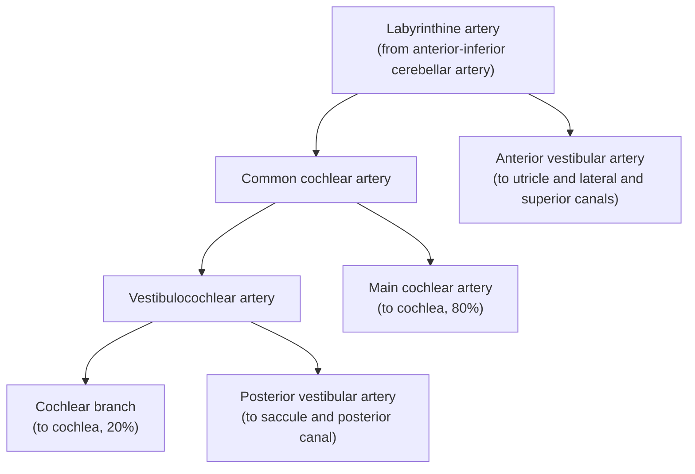

# Ear Foundations, Hearing and External Ear

## Introduction to ENT and Module Overview

### IMPORTANCE OF ENT IN NEET

![[images/ent-specialty-overview-illustration.jpg]]

### IMPORTANCE OF ENT FOR A DOCTOR

![[images/head-and-neck-anatomy-illustration.jpg]]

### CAREER IN ENT

![[images/ent-career-map-india.jpg]]

### TEACHING MODULE - A UNIQUE APPROACH

![[images/medical-students-illustration.jpg]]

### DESIGNED FOR NEET PG, 3RD YEAR & NEET

![[images/sagittal-upper-airway-anatomy.jpg]]

![[images/otoscopy-tympanic-membrane-example-1.jpg]]

![[images/otoscopy-tympanic-membrane-example-2.jpg]]

## Evolution and Embryology of the Ear

### BASIC TERMINOLOGIES

- Anterior/ventral: In front
- Posterior/dorsal: behind
- Medial: to the midline
- Lateral: away from midline
- Superior/cranial: above
- Inferior/caudal: below
- Proximal: near
- Distal: far

### EMBRYOLOGY OF EAR

- Starts developing from the 3rd week of gestation.
- Physical structures develop by 8-10 weeks.
- Hearing function develops by the 20-24th week.
- Auditory pathway develops by 4-8 years.
- Before 3rd week of gestation: we have epiblast, hypoblast, Yolk sac, amniotic sac are present.
- By the 3rd week epiblast starts secreting hyaluronic acid between epiblast and hypoblast, and has mesenchymal cells.
- Epiblast, hypoblast and mesenchymal cells layers together make an Ectoderm, Endoderm and Mesoderm.
- Ectoderm, Mesoderm and Endoderm start folding from cranial to caudal.
- Ectoderm and endoderm joint at cranial end and form oropharyngeal area, and at caudal end they join and form cloacal area.
- 4th germ layer: Neural crest cells
- These cells start invaginating from ectoderm and form a Neural groove.
- These cells detach and form a Neural tube and rest of the cells attach to the sides of ectoderm known as Neural crest cells.
- Neural crest cells play an important role to make musculoskeletal structures and cartilages of our body.
- Neural crest cells start traveling ventrolateral.

### CROSS SECTION OF PHARYNGEAL ARCHES

![[images/pharyngeal-arches-cross-section.jpg]]

![[images/embryonic-pharyngeal-apparatus.jpg]]

- When Neural crest cells move, they push Para Axial mesoderm and Lateral plate of mesoderm.
- Highest proportion of cells in pharyngeal arches: Neural crest cells.
- Paraxial mesoderm: for 1, 2, 3 pharyngeal arches
- Lateral plate of mesoderm: for 4, 6 pharyngeal arches: makes blood vessels of our body
- Have 4 pouches, 5 arches and 4 clefts: together they are known as pharyngeal apparatus
- 1st arch is divided into 2 parts: both are supplied by trigeminal nerve (5th CN).
- 2nd arch supplied by 7th CN (facial nerve).
- 3rd arch supplied by glossopharyngeal nerve (4th CN).
- 4th arch supplied by superior laryngeal nerve.
- 6th arch is supplied by recurrent laryngeal nerve.
- So, 1st and 2nd pharyngeal pouches, 1st cleft and 1st cleft contribute to our hearing system.
- 1st pharyngeal pouch forms: tubotympanic recess (Eustachian tube and middle ear).
- 2nd pouch forms: pharyngeal Tonsillar area
- 3rd pouch forms: inferior parathyroid gland
- 4th pouch forms: superior parathyroid gland

#### 1st and 2nd arch, 1st pouch and 1st cleft:

- 1st cleft makes an external auditory canal/meatus (at the dorsal surface of 1st pharyngeal arch or 1st cleft).
- Atresia: when the ear canal is not formed, canal is filled with bone and tissue.

### DEVELOPMENT OF PINNA

![[images/pinna-six-hillocks-development.jpg]]

- 1st and 2nd arches start developing Swelling (total - 6) known as Hillocks/Hiss.
- Tragus develops from the 1st arch.
- Space between tragus and the external auditory canal is known as the incisura terminalis.
- 1st pouch forms tubo tympanic cavity/Auditory tube/Eustachian tube, middle ear.

### Clinical significance of mesoderm:

- Mesoderm develops from Neural crest cells, having Fibrous tissue.
- So ectoderm and endoderm can heal after birth but mesoderm can't.
- 2 muscles are formed by the mesoderm:-tensor tympani muscle & stapedius muscle.

### EAR ANATOMY

- Stapes, incus and malleus: they have Gliding synovial joints between them.
- External auditory canal size: 10 mm.
- Sound is going through external auditory canal to oval window by Impedance matching mechanism By increasing the area with the help of stapes, incus and malleus.
- Inner ear develops from the level of rhombencephalon.
- From the dorsal surface of rhombencephalon otic placode will become otic cyst or otic vesicle.
- This otic vesicle divides into 2: Pars superior (forms semicircular canal, utricle, endo lymphatic sacs) and Pars inferior (forms saccule, cochlea).

#### The Internal Ear

![[images/internal-ear-anatomy.jpg]]

- Endolymph comes from Stria vascularis and it is rich in K⁺.
- Endolymphatic duct and sac is the place from where endolymph get stored and secrets.
- Free space between utricle and saccule: Vestibule.
- Semicircular canal, saccule and cochlea covered by perilymph.

- Perilymph is rich in Na (similar to CSF), connected to subarachnoid space through cochlear aqueduct.
- Superior and posterior semicircular canals develop first, little bulb-like structures present below them known as ampulla.
- 3 of the semicircular canals are at 90° to each other.

### ORGAN OF CORTI, SACCULE, MACULA STRUCTURES

#### Cross section of cochlea:

- In middle: cochlear duct.
- Superior to the cochlear duct there is Scala Vestibuli which is connected to the stapes (footplate of stapes is also a part of cochlea).
- Inferior to the cochlear duct there is Scala tympani.
- Malleus, incus: develops from 1st pharyngeal arch.
- Supra structures of stapes: develops from 2nd pharyngeal arch.
- Footplate of stapes: develops from otic vesicle.
- Reissner's membrane: above the cochlear duct, Basilar membrane: below the cochlear duct.
- Base of the cochlea has high frequency sound, in the center it has low frequency sound.

#### Organ of corti:

![[images/organ-of-corti-cochlear-cross-section.jpg]]

- Auditory nerves are Bipolar: the dendritic portion enters to inner ear/Organ of corti and the Axon portion forms the Vestibulo cochlear nerve.
- 90% of dendritic cells of hearing come to the inner ear cells; the rest of the 10% are to the 3 layers of outer hair cells.

- Tectorial gel layer: helps to move hair cells.
- When basilar membrane moves and outer hair cells starts shaking, at that time prestin protein cause contraction of outer hair cells and bring tectorial plate down so that inner hair cells comes in contact with gel layer and now K channel will open so K comes down and through the supporting cells K goes back.

#### Saccule:

- On the surface it has supporting cells, hair cells, calcium carbonate crystals known as: Otolith/Otoconia.
- Angular movement from semicircular canal, linear movement from utricle and saccule.

### Branchial cyst:

- Painless lump in the neck that appears during respiratory infections.

![[images/branchial-cleft-remnants-diagram.jpg]]

![[images/branchial-cyst-neck-swelling.jpg]]

## Anatomy and Physiology of the Ear

### THE EXTERNAL EAR

- Pinna develops from the 1st and 2nd pharyngeal arches.
- External auditory canal is short and straight in children, and curves posteriorly in adults.
- To see external auditory canal we have to pull pinna outwards, upwards and backwards.
- Length of external auditory canal: 24 mm/2.4 cm, outer 1/3rd is Cartilaginous and inner 2/3rd is bony, width is 10 mm.

![[images/external-middle-inner-ear-anatomy.jpg]]

- In Cartilaginous part wax is produced - benefits are protection from Germs, dust and bacteria.
- Fissures of Santorini: direct connection of any infection in external ear to parotid gland (Examples: Otitis externa, facial swelling).
- Foramen of Huschke: present in Bony area of auditory canal → infection in this can lead to painful jaw movement.

#### Pinna:

- Helix: curving inside
- Anti Helix: upward part
- Concha

### OUTER EAR

![[images/auricle-landmarks.jpg]]

#### Tragus:

- Develops from 1st pharyngeal arch.
- Space between tragus and external auditory canal known as: incisura terminalis.
- Lempert endaural incision: incision for doing surgeries from incisura terminalis.
- Tragal sign: painful tragus in case of any infections in external auditory canal.

#### Nerve supply of external ear:

- Upper part of helix: auriculotemporal nerve
- Other part of helix, anti helix and lobule: Great auricular nerve

![[images/external-ear-sensory-innervation.jpg]]

- Behind the ear = lesser occipital nerve
- Arnold's nerve = auricular branch of vagus nerve = over manipulation to this nerve will lead to coughing patient.

### EAR DRUM

Pearly Grey/pink appearance.
- Identification of correct position:
  1. Cone of light at anterior site
  2. Lateral (short) process of malleus and Eustachian tube: anteriorly
  3. Round window: posteriorly
  4. Pars tensa: lower part
  5. Pars flaccida: upper part, shiny, also known as Shrapnell's membrane.
- Amplification = 1:18

![[images/tympanic-membrane-landmarks.jpg]]

![[images/pars-flaccida-pars-tensa-cross-section.jpg]]

![[images/tympanic-membrane-photograph-1.jpg]]

![[images/tympanic-membrane-photograph-2.jpg]]

### MIDDLE EAR

#### Mastoid air cells:

- Function: pneumatized middle ear, and it makes sure that no secretions accumulate into the middle ear.
- Aditus ad antrum: connection between mastoid and tympanic cavity on the roof.
- Tip cells: develops after 2 years of birth, so before 2 years any post auricular incision should be at the wider angle.

![[images/mastoid-antrum-air-cells-and-eustachian-tube.jpg]]

![[images/prussaks-space-anatomy.jpg]]

#### Prussack's space anatomy:

- Laterally pars flaccida
- Medially neck of malleus
- Superiorly lateral malleolar fold
- Inferiorly lat process of malleus
- Anterior boundary ant malleolar fold & ligament arising from the neck of malleus
- Posterior boundary post malleolar fold & ligament arising from neck of malleus

- Connected to post pouch of von troltsch by small gap b/w post malleolar fold & fibrous annulus
- Prussak space: is a small recess of middle ear
Boundaries:-
- Laterally Pars flaccida
- Medially  neck of malleus
- Superiorly  Lateral malleolar fold
- Inferiorly  Lateral process of malleus
- Anterior boundary  anterior malleolar fold & ligament arising from the neck of malleus
- Posterior boundary  posterior malleolar fold & ligament arising from neck & malleus

#### Walls of middle ear:

![[images/middle-ear-walls-and-boundaries.jpg]]

#### Anterior wall:

- 1 muscle: tensor tympani
- 1 nerve: chorda tympani nerve (branch of facial nerve)
- 1 artery: Internal Carotid artery
- 1 tube: Eustachian tube

#### Posterior wall

#### Medial wall:

- Promontory
- Jacobson's nerve
- Glossopharyngeal nerve plexus
- Oval and round window
- Stapedial nerve, chorda tympani nerve

#### Lateral wall

#### Superior wall:

- Tegmen tympani

#### Inferior wall:

- Jugular vein

![[images/facial-recess-otoscopic-view.jpg]]

![[images/middle-ear-surgical-view.jpg]]

#### Facial recess:

- Medial: facial nerve canal
- Lateral: Annulus of the tympanic membrane with chorda tympani.

![[images/facial-recess-and-sinus-tympani-anatomy.jpg]]

#### Pyramid separates the two:

- Sinus tympani medially
- Facial recess Laterally

#### Boundaries of Sinus Tympani:

![[images/sinus-tympani-endoscopic-view.jpg]]

- Superiorly: ponticulus (below the oval window)
- Inferiorly: subiculum (above the round window)
- Anteriorly: stapedius muscle
- Laterally: pyramid & stapedius muscle, facial nerve canal
- Medial: Posterior semicircular canal

![[images/mastoid-air-cell-groups.jpg]]

### INNER EAR

- Scala vestibuli

#### Scala media:

- 3 outer hair cells later & 1 inner hair cells layer
- Stria vascularis: produces endolymph (rich in K).
- Perilymph (rich in Na⁺)
- Spiral limbus: produces all supporting cells.
- Cochlea has 2 and 3/4th turn.

![[images/cochlea-and-organ-of-corti-anatomy.jpg]]

- Reissner's membrane: between scala vestibuli and Scala media.
- Basilar membrane: between Scala media and Scala tympani.

**Organ of Corti**

![[images/organ-of-corti-cell-structure.jpg]]

*Cross-section of one spiral of cochlea*

- Outer hair cells and inner hair cells layer joints tightly and make a reticular membrane over them.
- Tectorial plate: gel layer that helps to move outer and inner hair.
- Hensen cells
- Deiters' cells
- Scala tympani

#### Semicircular canal (scc):

![[images/vestibular-apparatus-semicircular-canals.jpg]]

- Superior/Anterior scc
- Posterior scc
- Lateral scc
- Ampulla of water: swelling in between each scc (for angular acceleration).
- Utricle and saccule: both have Macula (for linear acceleration: horizontal in utricle and vertical in saccule).

**Vestibular hair cell**

![[images/vestibular-hair-cell-structure.jpg]]

#### Utricle:

- Have calcium carbonate crystals = known as Otolith or Otoconia

#### Blood supply

#### Ampullary Crest Function

![[images/ampullary-crest-head-rotation.jpg]]

## Hearing Tests: Tuning Fork, Audiometry and Tympanometry

### Air conduction and bone conduction

- Air conduction/ossicular conduction: from ear pinna → canal → ossicles.
- Bone conduction/cochlear conduction: SNHL (sensorineural hearing loss), cochlear and retrocochlear parts.
- Apex of cochlea is for low frequency sound.
- Base of the cochlea is for high frequency sound.

### TUNING FORK TEST

- Subjective test
- Made up of Elivar (steel + nickel + chromium).
- Hearing frequency: 20–20,000 Hz
- Most common hearing frequency: 200 Hz–1 kHz.
- 256 Hz: produces more vibration and long tone decay.
- 512 Hz: optimal vibration and tone decay.
- 1024 Hz: less vibration and short tone decay.

![[images/tuning-fork-anatomy.jpg]]

1. Weber's CHL/SNHL
2. Rinne's AC > BC
3. ABC/Schwabach's SNHL
4. Gelle's/Bing's to check ossicular stiffness
5. Strenger/Lombard test

PTA or Audiogram = Is a subjective test.

### OBJECTIVE TEST

- Impedance Audio Audiometry/tympanometry
- OAE/BERA/ASSR
- Electro cochleo graphy

### WEBER'S TEST

- For side identification and the nature of hearing loss.
- If a patient complains of not hearing at the right side, and after doing a test if sound goes to the same side = CHL, if sound goes to the opposite side = SNHL.

![[images/webers-test-tuning-fork-placement.jpg]]

### RINNE'S TEST

- AC > BC: is normal (rinne's positive).
- Strike the tuning fork put it over the mastoid bone ask the patient till what time sound is audible when sound is audible, put fork on ear If AC < BC: Rinne's negative (hearing loss +).

![[images/rinnes-test-air-and-bone-conduction.jpg]]

- Rinne's false negative

  - AC < BC: negative (but it's false)

  - It shows because of the profound SNHL.

### ABC - ABSOLUTE BONE CONDUCTION

![[images/absolute-bone-conduction-test.jpg]]

![[images/schwabachs-relative-bone-conduction-test.jpg]]

- At the cochlear side.
- Trigger bone conduction pathway by placing Tuning fork and closing the ear still patient is able to hear the sound indicates normal cochlear function of that side.

### SCHWABACH'S TEST (RELATIVE BONE CONDUCTION)

- Use for Otosclerosis
- No masking is done (Masking tool: Baraney's noise box).
- Length of hearing of patient is more than doctor (examiner): positive otosclerosis.

![[images/schwabach-test-examiner-comparison.jpg]]

### BING'S

- EAC is repeatedly closed and opened.
- Fluctuations in sound are absent.

![[images/bings-test-ear-occlusion.jpg]]

### GILLE'S

- Check by increasing the pressure by speculum.
- Absent Fluctuation.

![[images/gelles-test-pressure-speculum.jpg]]

### STENGER'S TEST

![[images/stengers-test-blindfolded-patient.jpg]]

- Use for identification of U/L Deafness.

  - Put the both tuning fork at both sides of the patient place 1 tuning fork closure
to the patient, so the patient will feel like sound is coming from 1 side only.

  - If the patient is deaf on the left side and we put a left sided Tuning fork closure and
the patient will say that he is hearing from the right side indicates true deafness
at the left side.

### LOMBARD TEST

- If a patient complains of not hearing from both the ears, at that time this test will be performed to check to see if it is true or not.
- Doctor will suddenly increase the sound of music of which the patient is not at all aware of.

### PURE TONE AUDIOMETRY

![[images/pure-tone-audiometry-test.jpg]]

- Subjective test
- Threshold mapping is done.
- Doctor will start checking the sound from more dB to less dB.

| Right |  | Left |
|---|---|---|
| ○ | Unmasked | × |
| △ | Masked | □ |
| < |  | > |
| [ |  | ] |

#### Air bone gap:

- 256 Hz = 15 dB
- 512 Hz = 30 dB
- 1024 Hz = 45 dB
- 2k notch = Carhart's notch: seen in otosclerosis.
- 4k notch: seen in SNHL

### HEARING LOSS GRADING

- < 25 dB: normal
- 25 - 40 dB: mild hearing loss
- 40 - 55 dB: moderate hearing loss
- 56 - 70: moderate to severe hearing loss
- 71 - 90: severe hearing loss
- > 90 dB: profound hearing loss

### SPEECH AUDIOMETRY

![[images/speech-audiometry-curves.png]]

- Instead of giving a tone, examine the patient by giving words.
- Because in CHL: problem is related to volume, in SNHL: problem is related to clarity.
- Speech discrimination score:

A list of 50 PB words is presented, and the number correctly heard is multiplied by 2.

| SD score | Ability to understand speech |
|---|---|
| 90–100% | Normal |
| 76–88% | Slight difficulty |
| 60–74% | Moderate difficulty |
| 40–58% | Poor |
| <40% | Very poor |

### TYMPANOMETRY

![[images/tympanometry-device-and-tympanogram.jpg]]

![[images/tympanogram-curve-types.png]]

**Objective test/Immittance test/Impedance audiometry.**

#### Principle of impedance audiometry:

- Oscillator to produce a tone of 220 HZ.
- Air pump to increase or decrease air pressure in the air canal.
- Microphone to pick up and measure sound pressure level reflected from the tympanic membrane.

#### Types of Tympanograms:

- A: normal
- As: shallow tympanogram (Stiffness)
- Ad: deep tympanogram (discontinuity)
- B: flat or dome shaped (fluid in middle ear)
- C: maximum compliance at pressure more than 200 mm H₂O (negative pressure in the middle ear).

### Stapedial Reflex:

![[images/stapedial-reflex-acoustic-immittance-chart.png]]

### OAE = OtoAcoustic Emissions

- Best for check neonatal hearing screening.
- S OAE: Spontaneous sound (when we don't give any sound and just collect the sound).
- T OAE: Transient sound (giving click or tone).
- DP OAE: Distortion product (giving 2 sounds).

### BERA OR ABR

![[images/bera-abr-hearing-test-infant.jpg]]

- BERA (Brainstem evoked response audiometry.)
- Total 7 waves are formed.
- 5th wave: formed by Lateral lemniscus in pons.

### ELECTROCOCHLEOGRAPHY

- Action potential and summation potential.
- AP: SP = 30
- If ratio is around 40: Meniere's disease.

## Pinna and External Auditory Canal

### DEVELOPMENT OF PINNA

- Ear pinna is made of yellow fibrous cartilage.
- Lateral surface of cartilage is more tightly attached.
- Cartilaginous part is created from neural crest cells.
- External pinna is formed by 1st arch And other forms from 2nd pharyngeal arch to the sixth hillocks of hills.

![[images/pharyngeal-pouches-and-developmental-derivatives.jpg]]

### Auricle or Pinna:

- The Crust of the helix is an important part because the painful deformity will be
related to the helix.
- Spine of the helix have important surgical landmark.
- Tragus is also important landmark, beneath the tragus is the facial nerve that stretches
into the parotid gland.
- No cartilage between the tragus and crus of the helix, and this area is called incisura
terminalis.

![[images/auricle-anatomical-landmarks-front.jpg]]

![[images/auricle-anatomical-landmarks-side.jpg]]

### Nerve supply:

![[images/external-ear-nerve-supply.jpg]]

- Great auricular nerve supplies: lateral part lobule, helix and antihelix.
- Auriculotemporal nerve supplies: Anterior, superior lateral part of ear pinna, crus of
helix.
- Near the external auditory canal on the posterior surface there is auricular branch
of vagus nerve (Arnold's Nerve) that makes you cough and faint when you do
manipulation outside ear. Also facial nerve provides sensory support.
- On the back supplied by lesser occipital nerve (medial surface) and greater auricular
nerve.

### DEFORMITIES OF THE PINNA

![[images/microtia-grading.jpg]]

- The first and second pharyngeal arches do not form between the 1st and 3rd week of gestation then starts developing a small ear.
- When there is absolute no fusion, first and second pharyngeal arch do not form:
Grade IV microtia (no ear pinna or canal) condition called Anotia.
- For such children we do (if intact cochlear system): BAHA (Bone Anchored Hearing Aid)
- Remnant of pinna: Grade III microtia
- Helix, lobule but no external auditory canal: Grade II microtia
- Entiere structure of pinna but small: Grade I microtia

### Macrotia (Large ear):

![[images/macrotia-and-prominent-ear.jpg]]

![[images/bat-lop-cup-and-cryptotia.jpg]]

- Prominent ear, otapostasis or bat ear is an abnormally protruding human ear (unilateral or bilateral).
- The concha is large with poorly developed antihelix and scapha.
- Lop ear: Helix is lop
- Cup ear: Helix becomes cup, absent antihelix and scapha.
- Cryptotia: When a helix is not formed.
- Cosmetic surgery of ear pinna: Otoplasty
- Cosmetic surgery of external auditory canal: Meatoplasty
- Pinna usually develops at the age of five so repair work of the cartilage advocated at the age of five.
- It is done at 6 years of age (ideal age) as pinna attains adult size by this time.

### Mozart's Ear:

![[images/mozarts-ear.jpg]]

- Fusion of crus of helix and crura of the antihelix.

### Wildermuth ear:

![[images/wildermuth-ear.jpg]]

- It is the absence of curvature of the helix, in this condition there is flat/unfolded helix.

### Darwin's tubercle:

![[images/darwins-tubercle.jpg]]

- Gouty tophi of pinna uric acid, sodium urate crystals accumulates inside this pinna cause pain.
- Most common site basal cell carcinoma: Lateral surface of nose.

### Keloid:

![[images/ear-keloid.jpg]]

- Keloid is the abnormal hypertrophic scar formation.
- Keloids are very common on the helix and antihelix part of the ear.
- Any history of ear piercing or injury or trauma.
- Treatment: Excision (safe) or cosmetic otoplasty.
- To avoid any granulation or growth: Mitomycin C

### Perichondritis:

![[images/perichondritis-of-pinna.jpg]]

- Inflammation of the cartilage and its surrounding space.
- Very painful condition, skin is tightly adherent to the lateral surface.
- Infection could be due to injury, trauma, lacerations.
- Treatment: Incision and drainage with Iv antibiotics and pressure bandaging, dressings.

### Subperichondrial hemorrhage/hematoma/wrestler's ear:

![[images/wrestlers-ear-hematoma.jpg]]

- A pick punch causes or blows directly causes bleeding and collection of blood Infected material in the perichondrial space.
- Management: Incision and drainage, pressure bandaging.
- Complication of wrestler's ear: Cauliflower ear or box ear. Occurs due to necrosis of cartilage.
- Post traumatic pinna deformity

### EXTERNAL ACOUSTIC (AUDITORY) CANAL

![[images/external-auditory-canal-anatomy.jpg]]

- It is 24mm in length: 2.4 cm outer
- Inner part: Bony
- Outer 1/3rd: Cartilaginous (contains hair follicles, sebaceous glands)
- Fissure of santorini: Connecting parotid space, so any parotid infection facial swelling is connected to fissure of santorini.
- Foramen of huschke: Related temporomandibular joint movement, ear discharge or worsening pain.
- External auditory canal: 9-10 mm in diameter

### DISEASE OF EXTERNAL AUDITORY CANAL

### Atresia of External Canal:

- Management: Meatoplasty (reconstruction of EAC)

![[images/external-canal-atresia.jpg]]

### Collaural Fistula:

- 1st branchial cleft deformity
- Opening 1 -EAC
- Opening 2: Just behind angle of mandible

![[images/collaural-fistula.jpg]]

### Wax in the ear:

![[images/cerumen-obstructing-ear-canal.jpg]]

- Wax is also called cerumen produced by ceruminous glands.
- Two types of wax: Soft and hard
- Has antibacterial properties and prevents entry of insects.
- When wax is extremely profused and hard causing hearing loss.

- Hearing loss by wax: 10 - 15 decibels.
- Management: Paradichlorobenzene drops (dissolves wax)

### Syringing:

![[images/ear-syringing-procedure.jpg]]

- We take warm water (37° C) body temperature.
- Direction of flushing is in such a way pushing upward near scutum cause repel effect and push wax towards outward direction.

### Insect in the ear:

![[images/insect-in-ear-canal.jpg]]

![[images/insect-in-ear-endoscopic-view.jpg]]

- Management 1st step: Turpentine oil
- Especially occurs in diabetic patient.

### Keratosis of obturans:

![[images/keratosis-obturans.jpg]]

- Desquamated keratin (stony hard) blocks and causes severe pain.
- Management: Surgical removal
- Usually seen unilateral but bilateral in (children).

### Otitis Externa - Swimmer's ear:

- There are two types of external auditory canal infection: Diffuse and localized.

![[images/otitis-externa-clinical-appearance.jpg]]

| Diffuse otitis externa | Localized otitis externa |
|---|---|
| Also called swimmer's ear, Singapore ear, telephone ear, or tropical ear. | Localized follicularis. |
| Occurs because of humidity/water entering the ear during swimming. | Causative agent: *Staph aureus*. |
| Clinical features: pain, redness inside the ear, and multiple swellings. | Tragus sign: positive. |
| Causative agent: *Pseudomonas*. | History of injury. |
| Tragus sign: may be positive or negative. | Pus/furuncle is formed. |

### Wet newspaper appearance (Candidiasis):

![[images/candida-otomycosis-wet-newspaper-appearance.jpg]]

- Candidiasis is a yeast found in immunocompromised people (Diabetes) It is called otomycosis (most common).
- Clinical feature: Itching, curdy white discharge
- Treatment: Antifungal (Nystatin) drops, fluconazole can be used.
- Clean out, debride and keep the ears dry.

### Aspergillus Niger:

![[images/aspergillus-niger-otomycosis.jpg]]

- Aspergillus niger is the most common cause of otomycosis.
- It has septate hyphae, acute angle branching (< 90°).
- Clinical feature: Lots of itching
- Treatment: Antifungal

### Herpes Zoster Oticus (Varicella Zoster Virus):

![[images/herpes-zoster-oticus-ramsay-hunt.jpg]]

![[images/auricular-nerve-supply.jpg]]

- Known as Ramsay Hunt syndrome.
- 7th nerve palsy: Facial palsy
- Self limiting found in immunocompromised people (diabetes).
- Treatment: Antiviral (Acyclovir).

![[images/ramsay-hunt-syndrome-manifestations.jpg]]

### Malignant Otitis Externa:

![[images/malignant-otitis-externa-endoscopic-view.jpg]]

- History of DM, elderly unilateral disease, immunocompromised state.
- Extremely painful, bleeding, granulation tissue.
- Skull base osteomyelitis
- Causative agent: Pseudomonas
- It is not a cancer or tumor.
- Investigation: CT scan, Technetium scan
- Treatment: Third generation cephalosporins doc orally
- Packing into ear
- Microscopic cleaning of ear canal
- Gadolinium scanning to see bone recovering, blood supply improving.
- Elevated ESR and CRP

### Osteoma:

![[images/external-auditory-canal-osteoma.jpg]]

- Very rare white pearly, painless, asymptomatic.
- Arises from cancellous bone from the posterior wall are most common.

### Exostosis/Surfer's ear:

![[images/external-auditory-canal-exostosis.jpg]]

- It is in the bony part of the ear canal, irritation and inflammation due to extreme cold water.
- Bony growth and hypertrophy causing conductive hearing loss and severe pain.
- History of surfing.
- Management: surgical

### Foreign body in the ear:

![[images/foreign-body-in-ear-canal.jpg]]

- Foreign body such as cotton, paper, rubber: Removed by forceps and can be flushed down.
- Vegetative body (cotton seed): Do not use water as it can swell. Can be removed surgically by breaking it down.
- Battery: Do not use water, Use a magnet.
