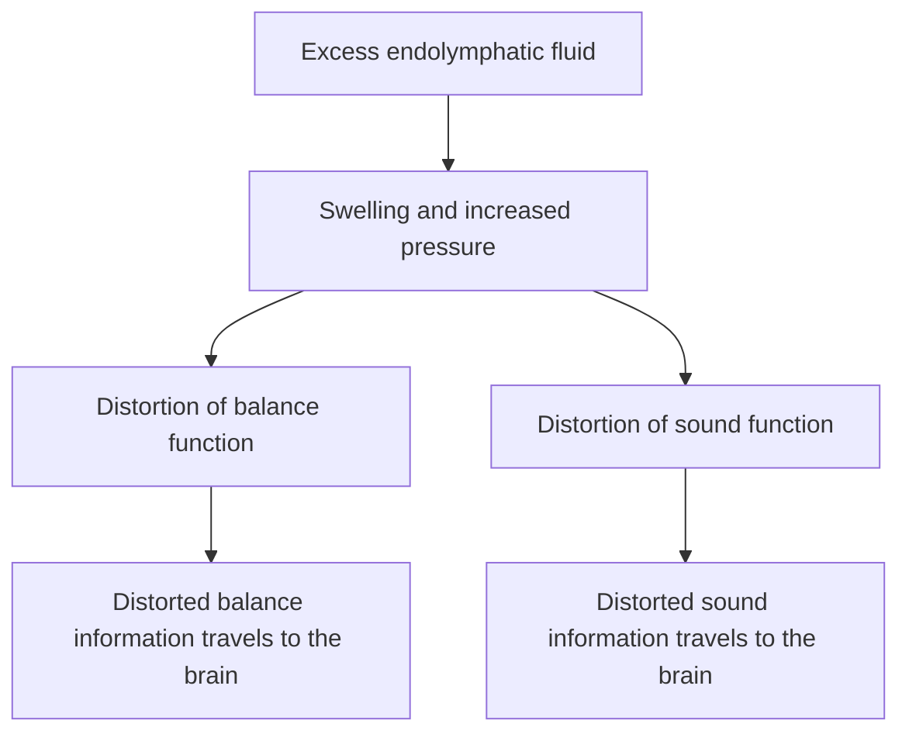

# Tympanic Membrane and Middle Ear Disorders

## Tympanic Membrane

### Introduction

- The tympanic membrane plays an important role as the first part to receive vibrations.
- It has all three germ layers: ectoderm, endoderm and mesoderm.
- The eardrum has a diameter of **9-10 mm**.
- Surface area: **90 mm²**; area usable for vibration: **40 mm²**.

### Embryology and anatomy

![[images/pharyngeal-arches-and-middle-ear-development.png]]

Labels shown include the primary tympanic cavity, external auditory meatus, auditory tube, cervical sinus, palatine tonsil, inferior and superior parathyroid glands, thymus, ultimobranchial body, malleus, incus and stapes.

![[images/external-middle-and-inner-ear-anatomy.png]]

### Parts and layers of the tympanic membrane

The tympanic membrane has two parts: the **pars tensa** and the **pars flaccida** (Shrapnell's membrane). Its outer rim is the **annulus tympanicus**. The illustrated view also labels the scutum and external ear canal.

- Total surface area: approximately **90 mm²**; usable area: approximately **45 mm²**.
- The **umbo** is the central point where most vibration occurs.
- The membrane lies at an angle of **45-55°** in the external auditory canal (EAC).

![[images/tympanic-membrane-cross-sectional-anatomy.png]]

![[images/tympanic-membrane-radial-circular-fibers.png]]

![[images/tympanic-membrane-histological-layers.png]]

Labels in the histology figure include the stratum corneum, stratum granulosum, stratum spinosum, stratum basale, subepidermal layer, radial fibrous layer, circular fibrous layer, submucosal layer and mucosal epithelium.

The tympanic membrane has three layers:

- **Outer epithelial layer:** continuous with the skin lining the meatus.
- **Middle fibrous layer (lamina propria):** encloses the handle of the malleus and contains radial, circular and parabolic fibres.
- **Inner mucosal layer:** continuous with the mucosa of the middle ear.

Embryological origin:

- **Ectoderm:** epithelial layer.
- **Mesoderm:** fibrous tissue layer.
- **Endoderm:** mucosal layer.

### Normal tympanic membrane

![[images/normal-tympanic-membrane.png]]

- The cone of light always faces anteriorly.
- The lateral process also faces anteriorly.
- In the right ear, the cone of light forms an **“R”**.
- In the left ear, the Eustachian tube and round window may be seen.

### Red tympanic membrane (myringitis)

![[images/red-tympanic-membrane-myringitis.png]]

Inflammation of the tympanic membrane is called **myringitis**.

- It causes pain and some decrease in hearing.
- Viruses are the most common cause.

**Clinical scenario:** A 5-year-old child presents crying with severe ear pain for 20 minutes. Findings listed in the notes are fever, signs of infection and crying with pain.

**Answer:** Myringitis.

### Healed tympanic membrane perforation

![[images/healed-tympanic-membrane-perforation.png]]

## Diseases of the Tympanic Membrane

### Retracted tympanic membrane

![[images/foreshortened-handle-of-malleus.png]]

![[images/retracted-tympanic-membrane.png]]

- The Eustachian tube equalizes air pressure.
- During chewing, the muscles contract and the normally collapsed Eustachian tube opens, allowing air to pass and equalize pressure.
- Retraction is described in five grades for both pars flaccida and pars tensa.

#### Pars flaccida retraction — TOS and PLAUSEN

| Grade | Finding |
|---|---|
| 1 | Air pocket is intact. |
| 2 | No air pocket; touching the neck (dimple). |
| 3 | Retraction pocket. |
| 4 | Attic erosion. |
| 5 | Cholesteatoma. |

#### Pars tensa retraction — SADE

| Grade | Finding |
|---|---|
| 1 | Cone of light is lost. |
| 2 | Foreshortening of the long process and a more prominent short process; incudostapedial joint becomes prominent. |
| 3 | Promontory touching. |
| 4 | Adhesion. |
| 5 | Atelectatic tympanic membrane. |

### Myringitis bullosa

![[images/myringitis-bullosa.png]]

- **Most common causative agent:** *Mycoplasma pneumoniae*.
- Respiratory infection causes blebs or bullous-like formations on the tympanic membrane.
- **Symptoms:** severe ear pain, fever and not taking food.
- Seen in babies younger than 5 years.
- **Treatment listed:** antibiotics and drops.

### Myringitis granulosa

![[images/myringitis-granulosa.png]]

- Granulation tissue is present on the tympanic membrane.
- Nonspecific granulations are associated with impacted wax, a long-standing foreign body or external ear infection.

### Multiple perforations in tuberculosis

![[images/tuberculous-multiple-tympanic-membrane-perforations.png]]

![[images/tuberculous-multiple-tympanic-membrane-perforations-detail.png]]

- Multiple painless perforations of the tympanic membrane.

### Tympanosclerosis

![[images/tympanosclerosis.png]]

- Caused by calcium deposition in the fibrous (middle) layer of the tympanic membrane.
- Mostly occurs in older people, over 60 years of age.
- The eardrum alone does not contribute to more than **15-30 dB** of hearing loss.
- Hearing loss becomes moderate to severe when the ossicles and bony structures are involved.

## Acute and Serous Otitis Media

### Introduction and Eustachian tube

- Middle-ear problems arise due to obstruction of the Eustachian tube.
- The Eustachian tube is **1.2 cm behind the inferior turbinate**.
- Blockage by mucus, infection or adenoids can cause middle-ear problems in children, especially ages **6-13 years**.

![[images/eustachian-tube-and-middle-ear-anatomy.png]]

The anatomy illustration labels the temporal bone, pinna, malleus, incus, stapes, semicircular canals, cochlea, vestibular and cochlear nerves, round window, tympanic membrane and Eustachian tube.

**Eustachian tube anatomy**

- Lateral one-third is bony: **12 mm**, close to the internal carotid artery.
- Medial two-thirds is cartilaginous: **24 mm**.
- Total length: **36 mm**.
- It is angled at **45° in adults** and **0-15° in children**, placing children at higher risk of fluid accumulation in the middle ear.

### Acute otitis media (AOM)

#### Stages

1. **Stage of tubal occlusion:** Eustachian tube blockage; the eardrum may be retracted, and the cone of light may or may not be distorted. Pain may extend from behind the ear to the neck and is described as dull, aching and annoying.
2. **Stage of pre-suppuration/congestion:** Ear blockage with the start of infection; a **cartwheel appearance** is described.
3. **Stage of suppuration:** Red, bulging tympanic membrane; pain and yellowish-to-greenish discharge when pus comes out.
4. **Stage of resolution:** The tympanic membrane begins to heal, with scar formation.

- **Most common organism listed:** *Streptococcus pneumoniae*.
- **Lighthouse sign:** Hyperemia and prominent vasculature cause a pulsatile appearance.

![[images/acute-otitis-media-stage-1.png]]

![[images/acute-otitis-media-stage-2.png]]

![[images/acute-otitis-media-stage-3.png]]

![[images/acute-otitis-media-stage-4.png]]

![[images/acute-otitis-media-clinical-stage-5.png]]

![[images/acute-otitis-media-resolution.png]]

- The eardrum heals in **2-4 weeks**.
- The tear is described as a natural radial tear.
- If pus remains for **more than 3 months** with persistent infection, it becomes chronic suppurative otitis media (CSOM).

### Myringotomy

Myringotomy is a **curvilinear incision in the posteroinferior quadrant** to evacuate pus.

![[images/myringotomy-incision-diagram.png]]

**Indications listed:**

- Bulging tympanic membrane with acute pain.
- Incomplete resolution despite antibiotics, with a persistently full tympanic membrane and conductive deafness.
- Persistent effusion beyond **12 weeks**.

The posteroinferior quadrant is chosen because pus can drain naturally when the child lies down.

### Serous otitis media

Also called **secretory otitis media** and **glue ear**. The source notes also use the term “otitis media externa.”

![[images/serous-otitis-media-otoscopy.png]]

- Infection does not occur; normal, mucosal, colourless fluid accumulates behind the tympanic membrane.
- Occurs in school-going children due to blockage.
- **Causes:** adenoids and allergies.

**Treatment listed:**

- Decongestants such as phenylephrine and antihistamines.
- For glue ear, place a ventilation tube (grommet) in the **anteroinferior quadrant** to keep draining the fluid; the notes give a duration of **2-6 months**.
- Adenoidectomy.

The incision for ventilation is a radial incision in the anteroinferior quadrant.

### Grommets and ventilation tubes

#### Shepard's grommet

![[images/shepard-grommet.png]]

![[images/shepard-grommet-in-tympanic-membrane.png]]

- Short-term; commonly used.
- **PTFE:** polytetrafluoroethylene (Teflon).
- Expelled within **4.5-6 months**.

#### Donaldson grommet

![[images/donaldson-grommet.png]]

- Short-term; approximately **4.5 months**.
- Made of silicone.

#### Shah's grommet

![[images/shah-grommet.png]]

- Long-term; stays for up to **9 months to 1 year**.
- Made of Teflon.

#### T-tube / ventilation tube

![[images/t-tube-ventilation-tube.png]]

- Long-term.
- Made of silicone.

### Hearing tests in middle-ear fluid

- Fluid in the middle ear causes **conductive hearing loss (CHL)**.
- Loss may be unilateral or bilateral, depending on the obstruction.
- Adenoids are associated with **bilateral conductive hearing loss**.
- **Weber's test:** lateralizes to the same side.
- **Rinne's test:** normally AC > BC. BC > AC indicates conductive hearing loss; Rinne is negative in acute suppurative otitis media (ASOM) and secretory otitis media.
- **Absolute bone conduction (ABC):** normal; assesses cochlear function.
- **Schwabach's test:** lengthened.
- Pure-tone audiometry (PTA) is used.

![[images/weber-and-rinne-hearing-tests.png]]

In conductive hearing loss, the **air-bone gap is greater than 20 dB**. Middle-ear fluid pathology is associated with mild-to-moderate conductive hearing loss.

![[images/middle-ear-fluid-audiogram.png]]

#### Tympanogram

![[images/tympanogram-patterns.png]]

- **Type B curve:** normal canal volume is listed as **0.6-2 mm³**.
- With ear wax or a foreign body in the ear canal, a low-volume type B curve is seen.
- With a perforated tympanic membrane, a high-volume type B curve is seen.
- Stapedius function is noted as normal.

### Complications of acute otitis media

#### Mastoiditis

The notes include the phrase **“Iron out mastoid”** under mastoiditis.

![[images/mastoiditis-clinical-view.png]]

**Schuller view (X-ray view):**

![[images/schuller-view-positioning-schematic.png]]

![[images/mastoid-x-ray-findings.png]]

#### Gradenigo syndrome (petrositis)

**Triad:**

- Pus in the ear or ear discharge.
- Retro-orbital pain (trigeminal nerve, CN V).
- Abducens nerve palsy, causing inability to look laterally.

**Treatment listed:**

- Schwartz surgery.
- **Mac Ewen's triangle** is an important landmark for drilling the bone.
- Radical or cortical mastoidectomy.
- Antibiotics.

![[images/mac-ewens-triangle-mastoid-anatomy.png]]

The figure labels the mastoid antrum, suprameatal/inferior temporal line, spine of Henle, root of the zygomatic bone, external acoustic meatus, mastoid bone and mandible.

## Chronic Otitis Media

### Cholesteatoma / chronic suppurative otitis media (CSOM)

A cholesteatoma is described as a lining of squamous epithelium or a keratin ball filled with keratin debris, sitting on a fibrous stroma and having the capacity to erode bone.

The notes classify mucosal and squamous disease as active or inactive.

#### Types of cholesteatoma

- **Congenital.**
- **Acquired:**
  - **Primary:** tympanic membrane intact.
  - **Secondary:** tympanic membrane perforated.
  - **Tertiary:** implanted surgical tube.

#### Congenital cholesteatoma

- **Tead's epithelial cell rest theory:** remnant of the ectodermal plate.
- **Fretdberg's implantation theory:** the amniotic sac is responsible.
- **Derlack and Clemens' criteria:** pearly-white cholesteatoma, intact tympanic membrane and no pre-existing middle-ear disease.

![[images/pearly-white-cholesteatoma.png]]

#### Primary acquired cholesteatoma

- **Sade's metaplasia theory:** middle-ear infection.
- **Basal-cell hyperplasia (Lange and Rudell's theory):** middle-ear infection.
- **Wittmaack's invagination theory:** negative pressure causes invagination of the pars flaccida and formation of a retraction pocket.

#### Secondary acquired cholesteatoma

- Tympanic membrane is perforated.
- **Haberman's migration theory.**

#### Tertiary acquired cholesteatoma

- Implantation and invasion.

#### Toss combination theory

The notes identify the combination theory as the most accepted: **perforation causes migration**.

![[images/cholesteatoma-pathogenesis-theories.png]]

### Causes and bone erosion

#### Pressure necrosis theory

- Described as the most popular theory.
- Enzymes released by osteoclast cells release cytokines and proteolytic substances.

#### Pyogenic osteitis

- Pyogenic bacteria cause osteolytic destruction of bone.
- The first bone to erode in CSOM is the **long process of the incus**, due to its end-arterial blood supply.

### Spread of cholesteatoma

- **Most common site of spread:** posterosuperior attic area.
- **Most common route:** posterior mesotympanum.
- It may also spread through the malleolar folds.
- The notes label cholesteatoma as **attico-antral**.

![[images/cholesteatoma-spread-to-mastoid.png]]

### Tubotympanic (safe) versus atticoantral (unsafe) disease

| Feature | Tubotympanic / safe type | Atticoantral / unsafe type |
|---|---|---|
| Discharge | Profuse, mucoid, odourless | Scanty, purulent, foul-smelling |
| Perforation | Central | Attic or marginal |
| Granulations | Uncommon | Common |
| Polyp | Pale | Red and fleshy |
| Cholesteatoma | Absent | Present |
| Complications | Rare | Common |
| Audiogram | Mild-to-moderate conductive deafness | Conductive or mixed deafness |

![[images/tympanic-membrane-perforation-types.png]]

The illustrated perforation types include central anterior perforation, medium-sized central perforation, subtotal perforation, total perforation with destruction of the fibrous annulus, attic perforation and posterosuperior marginal perforation.

| Finding | Mucosal disease | Squamosal disease |
|---|---|---|
| Discharge | Profuse, sticky | Scanty |
| Smell | Not described as foul | Extremely foul-smelling |
| Pain | Painless | Painful |
| Blood | No blood tinge | May be blood-tinged |
| Hearing loss | Mild-to-moderate conductive | Mixed hearing loss |

![[images/middle-ear-ossicles-and-cholesteatoma-anatomy.png]]

Anatomical labels shown include the lateral malleal ligament, Prussak's space, lateral process of the malleus, tympanic membrane and neck of the malleus.

![[images/attic-cholesteatoma.png]]

![[images/cholesteatoma-clinical-comparison.png]]

![[images/central-tympanic-membrane-perforation.png]]

![[images/chronic-otitis-media-cholesteatoma.png]]

The notes also label examples as **tubotympanic total perforation: inactive mucosal otitis media** and **active mucosal chronic otitis media**.

### Hearing tests in chronic otitis media

| Test | Mucosal disease | Squamosal disease |
|---|---|---|
| Weber's test | Lateralizes to the same side | Lateralizes to the same side |
| Rinne's test | Negative | Negative |
| Absolute bone conduction (ABC) | Normal | Reduced |
| Schwabach's test | Lengthened | Reduced |
| Pure-tone audiometry | Mild-to-moderate CHL | Mixed hearing loss |
| Stapedial reflex | Normal | Negative (facial nerve involvement is noted) |

### Complications of chronic otitis media

#### Mucosal disease

- Mastoiditis.
- Petrositis.
- Sites of cholesteatoma listed in the notes: cerebellopontine (CP) angle and jugular fossa.

#### Squamosal disease

- Facial nerve palsy.
- Labyrinthitis.
- Labyrinthine fistula; the fistula test may be positive.
  - **False-negative fistula test:** cholesteatoma sits on the fistula and blocks the opening.
  - **False-positive fistula test:** dehiscent semicircular canal and Ménière's disease.
- Mastoiditis.
- Petrositis.
- Brain abscess.
  - **Bezold's abscess:** sternocleidomastoid muscle.
  - **Citelli's abscess:** posterior belly of the digastric muscle.
  - **Luc's abscess:** external auditory canal.

![[images/middle-ear-abscess-spread.png]]

![[images/mastoiditis-and-neck-abscess-anatomy.png]]

### Investigations and treatment

**Investigations listed:**

- Ear microscopy examination.
- High-resolution CT (HRCT).
- Pure-tone audiometry.
- X-ray: Law's view.

**Treatment listed:**

- Antibiotics.
- Surgery: radical mastoidectomy or cortical mastoidectomy. The notes describe modified radical mastoidectomy (MRM) as an approach that tries to preserve everything.

#### Canal-wall-up versus canal-wall-down procedure

| Feature | Canal-wall-up procedure | Canal-wall-down procedure |
|---|---|---|
| Meatus | Normal appearance | Widely open meatus communicating with the mastoid |
| Dependence | Does not require routine cleaning | Depends on a doctor cleaning the mastoid cavity once or twice a year |
| Recurrence or residual disease | High rate of recurrent or residual cholesteatoma | Low rate of recurrence or residual disease; described as a safe procedure |
| Second-look surgery | Requires second-look surgery after about 6 months to rule out cholesteatoma | Not required |
| Patient limitations | No limitation; swimming allowed | Swimming may infect the mastoid cavity and is curtailed |
| Auditory rehabilitation | Hearing aid is easy to wear if required | Hearing-aid fitting may be difficult due to the large meatus and mastoid cavity, which can become infected |

### Surgical notes and sinus tympani

- A postaural **Wild's incision** is made.
- In a child younger than **2.5 years**, a modified Wild's incision is used.
- Graft uptake is described as good because of its low blood-supply requirements.
- The thickness of the tympanic membrane is similar.
- **Sinus tympani** is the site where disease may be left behind.

![[images/sinus-tympani-and-facial-recess-anatomy.png]]

Labels in the illustration include the chorda tympani, facial recess, facial nerve, stapedius muscle in the pyramid sinus, sinus tympani, cochleariform process, tensor tympani muscle, Eustachian tube and tympanic membrane.

## Otosclerosis

### Introduction

Otosclerosis, also known as **otospongiosis**, is described as a disease of the bony labyrinth.

- **First pharyngeal arch:** malleus and incus (supplied by the mandibular and maxillary divisions).
- **Second pharyngeal arch:** head and crura of the stapes (supplied by the facial nerve).
- The notes state that the third pharyngeal pouch is part of the bony labyrinth or otic capsule.
- Otosclerosis is described as a disease of the bony labyrinth, not of the stapes.
- Normally, cartilage forms spongy (immature) bone, followed by hard lamellar (mature) bone.
- The otic capsule has about **40 centres of ossification**. Sometimes ossification in these centres does not occur, resulting in more spongy-bone formation.

![[images/otosclerosis-and-otic-capsule-anatomy.png]]

### Types by site of focus

1. **Fissula ante fenestram:** a developmental cleft in front of the oval window.
   - Most common type; seen in **80%** of cases.
   - The abnormal ossification spreads anteriorly and involves the footplate of the stapes.
   - The oval window connects to the scala vestibuli; the round window connects to the scala tympani.
   - The anterior part of the stapes footplate is most commonly involved.
2. **Fossula post fenestram focus:** a rare, inverted cleft involving the posterior part of the stapes footplate.
   - The annular ligament allows movement of the stapes.
3. **Circumferential foci:** annular ligament involvement only.
4. **Biscuit type:** only the stapes footplate is involved.
5. **Obliterative type:** annular ligament and footplate involvement.

![[images/otosclerosis-types.png]]

### Types of otosclerosis by hearing loss

1. **Stapedial:** conductive hearing loss (CHL).
   - Includes anterior, posterior, biscuit, circumferential and obliterative types.
   - Seen at **25-30 years**.
2. **Cochlear:** sensorineural hearing loss (SNHL), tinnitus and vertigo; also called malignant otosclerosis.
3. **Mixed.**

### Causes and associations

- Hereditary: autosomal dominant.
- **COL1A gene defect:** affects type I collagen.
- Measles (paramyxovirus, morbillivirus).
- **Osteogenesis imperfecta type I:** the notes state an association with otosclerosis in more than 50%.
- **Van der Hoeve syndrome:** osteogenesis imperfecta + otosclerosis + blue sclera.
- Metabolic diseases: diabetes mellitus and hypertension.
- Autoimmune association.
- Enzymes: trypsin-to-antitrypsin ratio.
- Hormonal fluctuations; otosclerosis may worsen during pregnancy.

![[images/blue-sclera-osteogenesis-imperfecta.png]]

### Presentation

- Female-to-male ratio: **2:1**.
- Usually bilateral.
- Usually presents in the third decade.
- Hearing may be better in noisy environments: **Paracusis Willisii**.
- **Flamingo-pink tympanic membrane (Schwartze sign):** noted in 10%.

![[images/otoscopy-clinical-example-01.png]]

![[images/otoscopy-clinical-example-02.png]]

![[images/otoscopy-clinical-example-03.png]]

![[images/otoscopy-clinical-example-04.png]]

![[images/otoscopy-clinical-example-05.png]]

**Image note from the source:** the image on the right is **not** the Schwartze sign; it is the **rising-sun sign of glomus jugulare**.

- In the active spongiotic stage, the notes advise no surgery and list NaF. They state that NaF decreases osteoblastic activity, decreases proteolytic activity and increases osteoclastic activity.
- **Blue syndrome of Manasse:** new blood vessels surrounded by new bone growth.

### Hearing tests and imaging

- Bilateral **2000-Hz dip in bone conduction:** Carhart's notch.
- A dip at **4000 Hz** in both bone and air conduction is seen in noise-induced hearing loss or ototoxicity.

![[images/carharts-notch-audiogram.png]]

**Weber's test:** lateralizes to the side of the complaint.

**Rinne's test:**

- Normally, AC > BC.
- Rinne is negative on both sides.
- Absolute bone conduction: normal.
- Schwabach's test: the patient hears the sound for a longer period.
- Tympanometry: type **As**, described as sclerotic/shunted.

**HRCT temporal bone:** double-ring appearance.

![[images/otosclerosis-double-ring-hrct.png]]

### Treatment

- **Stapedectomy:** removal of the entire stapes; described as the older approach.
- **Stapedotomy:** the superstructure of the stapes is removed and the footplate is left behind.
- **Rosen's endomeatal incision** is used.

![[images/stapedectomy-and-stapedotomy.png]]

**Notes on management:**

- In bilateral CHL, surgery is performed on the worse ear first. The other side is operated on after one year.
- Surgery is not performed during the active spongiosis stage.
- In the active spongiosis stage, medical management with NaF is listed to increase bone formation.
- If otosclerosis is detected during pregnancy, operate after delivery.
- If only one ear is functional and has otosclerosis, hearing aids are advised.
- Stapedectomy is contraindicated in pilots; only stapedotomy is done.
- After surgery, Carhart's notch disappears and a type **Ad** tympanogram is seen.
- Mixed hearing loss and vertigo after surgery indicate fistula formation.
- In facial nerve palsy, remove the piston.

## Glomus Jugulare and Middle Ear Tumours

### Introduction and classification

- The notes list nail beds and fingers as the most common site of glomus tumours.
- Glomus tumours are a type of paraganglionic tumour.
- They arise from neural crest cells.

Types of mesodermal cells listed:

- Paraxial mesoderm.
- Lateral plate mesoderm.
- Intermediate mesoderm.

Neuroendocrine tumours arising around blood vessels:

1. **Primary tumours:**
   - Benign: glomus tumour.
   - Malignant: carcinoma, sarcoma.
2. **Secondary tumours:**
   - From adjacent areas, e.g. nasopharynx and parotid.
   - Metastatic, e.g. from carcinoma of the bronchus, breast, kidney, thyroid, prostate and gastrointestinal tract.

![[images/glomus-tumour-middle-ear-anatomy.png]]

The labelled ear anatomy includes the helix, scapha, triangular fossa, antihelix, concha, auricular lobule, temporal muscle and bone, external acoustic meatus, malleus, incus, stapes, semicircular canals, cochlea, vestibular and cochlear nerves, tympanic membrane, tympanic cavity, cartilage and Eustachian tube. The illustration divides the ear into outer, middle and inner regions.

### Types of neural crest cell tumours

Also called **paragangliomas**.

1. **Chromaffin:** secretory cells, e.g. pheochromocytoma.
2. **Non-chromaffin:** non-secretory cells.
   - Non-chromaffin cells are described as two types: baroreceptors (glomus bodies) and chemoreceptors.
   - Succinate dehydrogenase converts succinate to fumarate.
   - If this enzyme malfunctions, succinate accumulates in cells.

### Presentation and tumour location

- Glomus tumours are benign and locally invasive.
- Malignancy is listed in **4%** of cases.
- Age group: **50s-70s**.
- Tumours arising from the jugular bulb and extending upward through the floor (hypotympanum) are called **glomus jugulare**.
- Tumours arising from the mesotympanum are called **glomus tympanicum**.

| Feature | Glomus jugulare | Glomus tympanicum |
|---|---|---|
| Origin | From the floor; more common | From the medial wall |
| Nerve involvement | Compression of CN IX, X, XI and XII | Facial nerve involvement |
| Clinical effects | Dysphagia, pharyngeal and palatal palsy, voice changes; weakness of sternocleidomastoid and trapezius | Conductive hearing loss |
| Hearing loss | Conductive hearing loss | Conductive hearing loss |
| Intracranial spread | Present | Not listed in the notes |
| Other features | Rising-sun sign and pulsatile tinnitus | Pulsatile tinnitus |

![[images/glomus-jugulare-and-tympanicum.png]]

### Clinical features and signs

- **Vernet's syndrome:** CN IX, X and XI involved.
- **Collet-Sicard syndrome:** CN IX, X, XI and XII involved.
- Female-to-male ratio: **5:1**.
- Conductive hearing loss, usually unilateral.
- Pulsatile tinnitus.
- **Brown's sign:** blanching of the tympanic membrane during external-auditory-canal Siegelisation.
- **Equino sign:** tinnitus decreases on internal carotid artery compression.

#### Rule of 10s

- 10% multicentric.
- 10% bilateral.
- 10% familial.
- 10% paediatric.
- 10% malignant.

![[images/glomus-tumour-clinical-images.png]]

#### Phelp's sign and imaging

- **Phelp's sign:** absence of the crest of bone between the jugular bulb and internal carotid artery; seen on CT.
- MRI shows a **salt-and-pepper appearance** due to microhaemorrhage around the jugular bulb (“moth-eaten” appearance).

![[images/phelps-sign-ct-jugular-bulb.png]]

### Treatment

- **Biopsy is contraindicated.**
- Surgical removal approaches listed:
  - Transcanal approach.
  - Hypotympanic approach.
  - Extended facial-recess approach.
  - Mastoid-neck approach.
  - Infratemporal-fossa approach (Fisch).
  - Transcondylar approach.
- Radiation.
- Embolisation.

## Ménière's Disease

### Introduction and inner-ear anatomy

Ménière's disease is also known as **endolymphatic hydrops**. It is due to increased pressure in the scala media because of decreased absorption or increased production of endolymph.

- At the **4th week of gestation**, a small thickening called the otic placode develops at the rhombencephalon, then forms the otic pit and otic vesicle.
- The otic vesicle forms the **pars superioris** and **pars inferioris**.
- Pars superioris forms the semicircular canals, utricle and endolymphatic sac.
- Pars inferioris forms the saccule, cochlea and cochlear aqueduct.
- The vestibule is the bony covering of the utricle and saccule.
- The promontory contains the oval and round windows.
- The footplate of the stapes sits on the oval window.
- The scala vestibuli and scala tympani contain perilymph.

![[images/inner-ear-anatomy-and-embryology.png]]

The diagram labels the cristae within the ampullae, semicircular ducts, utricle, saccule, vestibulocochlear nerve, vestibular duct, cochlear duct, tympanic duct, bony and membranous labyrinths, and cochlea.

### Conduction of sound waves

Sound transmission is described as:

**Oval window → scala vestibuli → modiolus → scala tympani → round window (secondary tympanic membrane) → basilar membrane → organ of Corti.**

- The scala tympani opens at the round window.
- A large difference in potassium concentration exists between endolymph and perilymph.

### Functions of the endolymphatic sac

- Absorbs endolymph.
- Regulates endolymphatic pressure.

### Mechanism of Ménière's disease

Ménière's disease presents with **episodic vertigo, low-frequency sensorineural hearing loss (SNHL) and aural fullness**.

![[images/menieres-endolymphatic-hydrops-mechanism.png]]

### Presentation and associated factors

- Autosomal dominant inheritance is listed.
- Unilateral at presentation.
- Usually occurs in the **4th-6th decade**.
- Cause listed: idiopathic.
- Male-to-female ratio: **1:1**.
- Other causes or associations listed:
  - Autoimmune association: HLA-B7/DR3.
  - Allergy.
  - Hereditary factors.
  - Infections: cytomegalovirus, varicella-zoster virus and HSV.
- **Apex:** low frequency, high amplitude.
- **Base:** high frequency, low amplitude.
- Ménière's disease is associated with low-frequency hearing loss.

![[images/healthy-inner-ear-versus-menieres-disease.png]]

### Signs and symptoms

- Low-frequency hearing loss.
- Tinnitus: hissing or whooshing sounds.
- Vertigo.
- Aural fullness.
- Episodic symptoms.
- Symptom progression listed: **rotatory vertigo → tinnitus → SNHL and aural fullness**.
- Paralytic nystagmus; the fast component is toward the normal side.

### Characteristic features

- **Tullio's phenomenon:** vertigo in response to loud sounds.
- **Tumarkin's drop attack (otolithic crisis).**
- **Diplacusis.**

### Conditions associated with both hearing loss and vertigo

- Ménière's disease.
- Superior semicircular canal dehiscence.
- Ototoxicity.
- Labyrinthitis.
- Perilymph fistula.

### Investigations

#### Pure-tone audiometry and hearing tests

- Pure-tone audiometry (PTA).
- Rinne's test: AC > BC.
- Weber's test: lateralizes to the opposite ear.
- Absolute bone conduction: shortened.
- Schwabach's test: shortened.
- Stapedial reflex threshold is reduced.

![[images/menieres-disease-audiogram.png]]

- **SISI (Short Increment Sensitivity Index): 70-100%.**

#### Stages of Ménière's disease

| Stage | Hearing level listed |
|---|---|
| I | <25 dB |
| II | 26-40 dB |
| III | 42-70 dB |
| IV | >71 dB |

#### Electrocochleography (ECoG)

- **SP:AP <30%** is listed as diagnostic of Ménière's disease.
- **SP:** summation potential.
- **AP:** action potential.

![[images/electrocochleography-waveforms.png]]

- **Gadolinium-enhanced MRI:** dye is seen in both endolymph and perilymph.

![[images/sound-transmission-through-inner-ear.png]]

#### Vestibular evoked myogenic potentials (VEMP)

- Used to check inferior and superior vestibular nerve function.
- VEMP is negative in acoustic neuroma.

![[images/vestibular-evoked-myogenic-potentials-imaging.png]]

![[images/vestibular-potential-waveforms.png]]

![[images/vemp-electrode-layout-and-responses.png]]

![[images/vemp-electrode-placement.png]]

### Management

#### Medical management

- Caffeine restriction.
- Salt restriction: **less than 2 g/day**.
- Vestibular sedatives listed: cinnarizine, prochlorperazine and diphenhydramine.
- Vasodilator: betahistine.
- Meniett device.
- Cawthorne and Cooksey exercises.

#### Middle-ear injections

- Gentamicin injection.
- Micro-wick at the round window.

#### Surgery

- Labyrinthectomy.
- Vestibular neurectomy.
- Endolymphatic sac surgery.

### Donaldson's line

- An imaginary line drawn from the longitudinal semicircular canal that bisects the posterior semicircular canal.
- The endolymphatic sac lies just inferior to this line.

![[images/donaldsons-line-endolymphatic-sac.png]]
