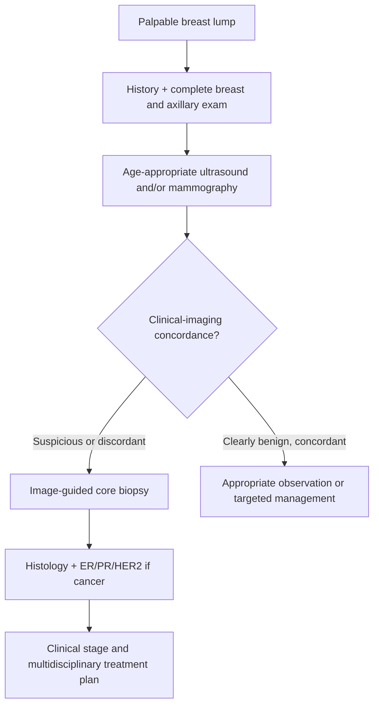
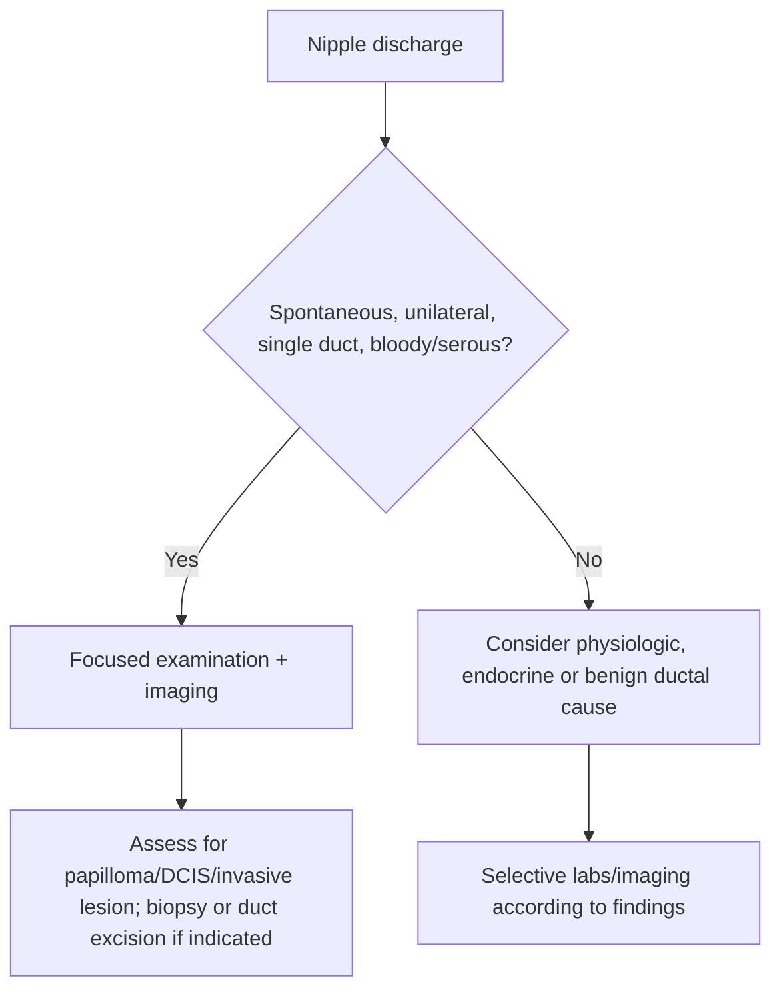
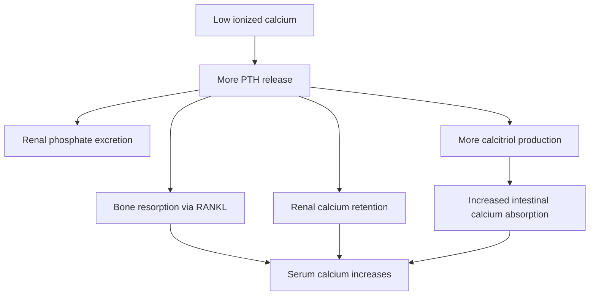
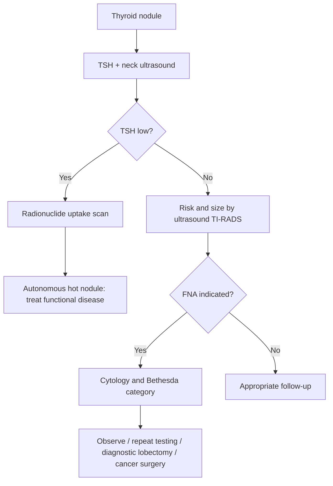
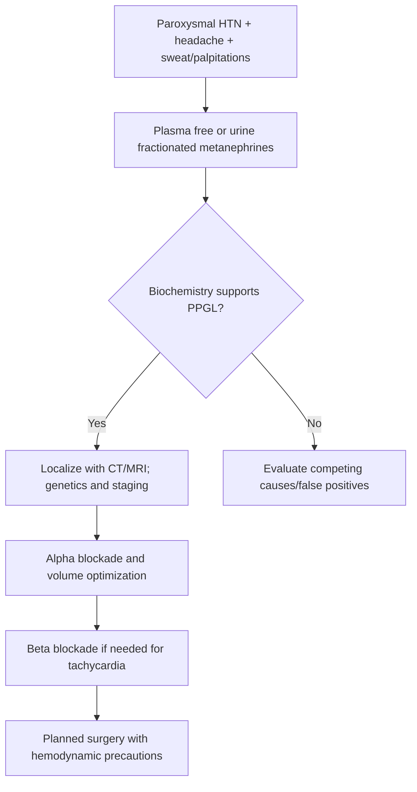
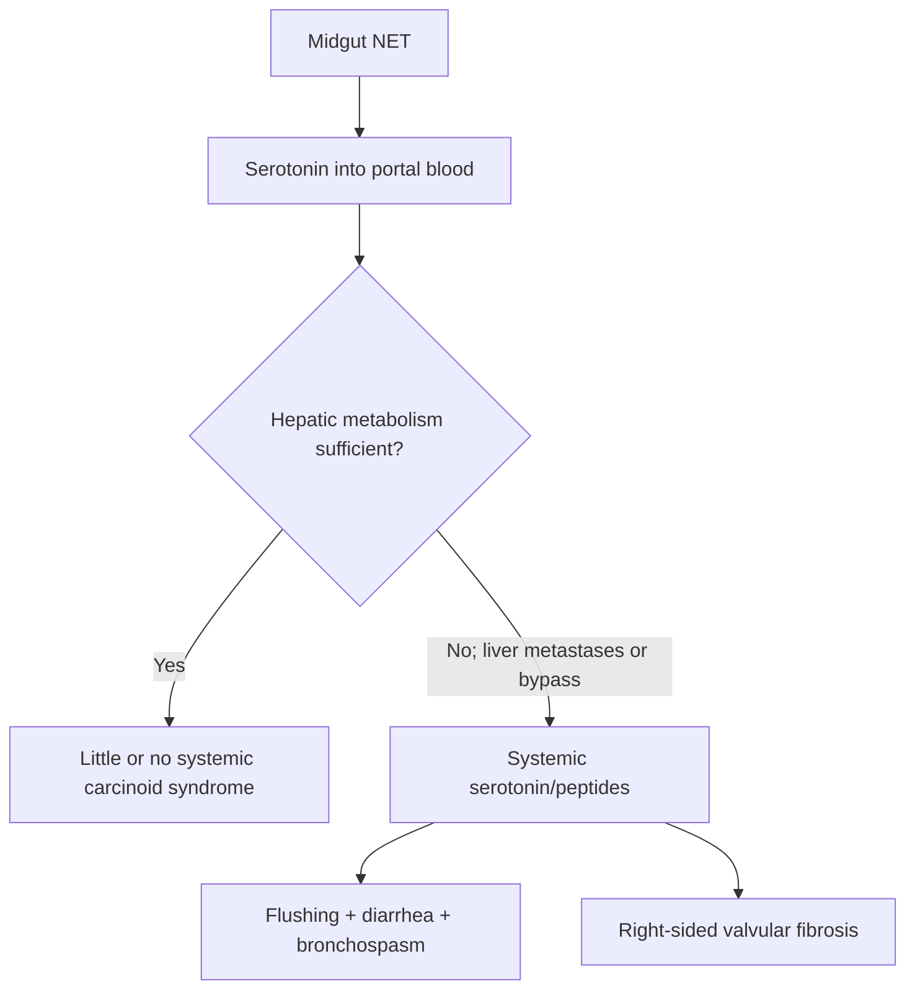
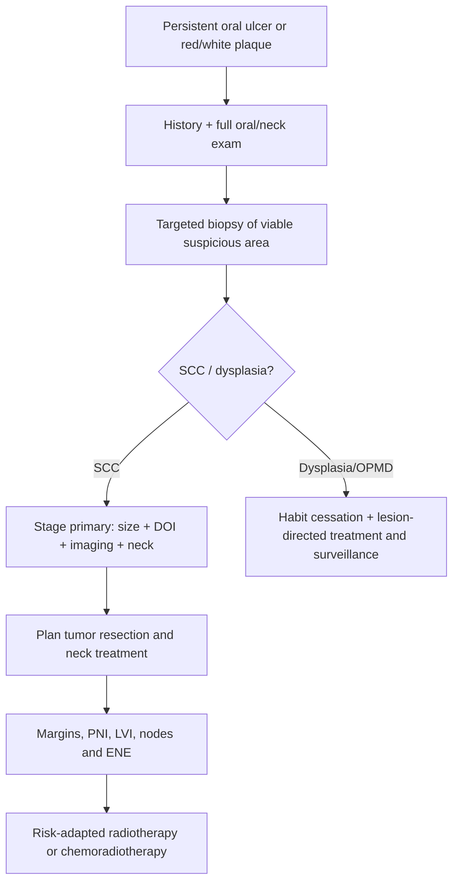
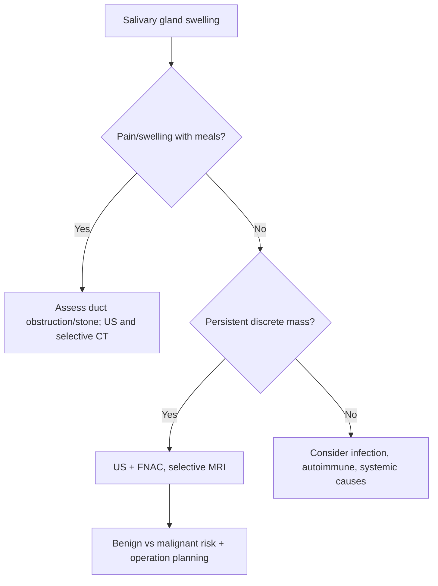

# Surgery — Part II: Complete Detailed Notes

**Scope:** Breast Surgery; Thyroid and Parathyroid Surgery; Adrenal and Neuroendocrine Surgery; Oral Cancer, Salivary Glands and Neck Swellings. **Gastrointestinal Surgery excluded.**

## Contents

1. [Breast Surgery](#08-breast-surgery)
2. [Thyroid and Parathyroid Surgery](#09-thyroid-and-parathyroid-surgery)
3. [Adrenal and Neuroendocrine Surgery](#10-adrenal-and-neuroendocrine-surgery)
4. [Oral Cancer, Salivary Gland and Neck Surgery](#11-oral-cancer-salivary-gland-and-neck-surgery)
5. [Source Concordance and Revision Appendix](#12-source-concordance-exceptions-and-revision-appendix)

**Sources:** Marrow World of Revision Surgery 2025, Robbins Pocket Companion 9th, First Aid Step 1 2025, Doctut Merged, 05-Pathology part 1, Combined/Bootcamp. The dedicated surgical sections determine scope; the concordance appendix records differing or potentially outdated details. No external web research was used.

---

## 08. Breast Surgery

> [!abstract] Scope
> Surgical anatomy → triple assessment → breast imaging/cytology → benign breast conditions → breast cancer pathology and molecular subtypes → staging → breast/axillary surgery → systemic and radiotherapy → special situations. **Source-consolidated exam notes**; clinical guidelines and drug regimens may change.

### 1. Surgical anatomy and examination

#### Development and topography
- Mammary gland: modified sweat gland with **15–20 lobes** drained by major lactiferous ducts; lobes contain terminal duct–lobular units (TDLUs), where many proliferative lesions and carcinomas arise.
- Extends approximately **2nd–6th ribs**, from sternum toward midaxillary line; superolateral extension = **axillary tail of Spence**.
- **Cooper suspensory ligaments** tether skin to supporting fascia; shortening by fibrosis/tumor produces **dimpling**.
- **Retromammary space** separates breast from pectoral fascia; fixation to chest wall suggests locally advanced extension.
- **Lymphatic drainage:** axillary nodes (predominant), internal mammary/parasternal nodes and other regional pathways. Upper outer quadrant is frequently affected because of greater tissue volume.
- Axillary nodal levels relative to **pectoralis minor**: **I lateral**, **II posterior**, **III medial**.
- Chest-wall muscles and nerves relevant to dissection: pectoralis major/minor; **long thoracic nerve** (serratus anterior → winged scapula), **thoracodorsal nerve** (latissimus dorsi), **intercostobrachial nerve** (medial upper-arm sensation), medial/lateral pectoral nerves.

#### Clinical examination
1. **History:** age, duration, growth, pain and menstrual variation, pregnancy/lactation, trauma/infection, nipple discharge (spontaneous/expressed, single/multiple ducts, color), previous irradiation/biopsy, cancer family history (both maternal and paternal branches).
2. **Inspection:** sitting and arms at sides/raised/pressed to hips; asymmetry, contour changes, scars, nipple deviation or retraction, skin erythema/ulceration, edema.
3. **Palpation:** all quadrants and axillary tail systematically; record size, quadrant or clock-face position and distance from nipple, margins, surface, mobility, consistency, tenderness, skin/deep fixation.
4. **Nodes:** axillary, supraclavicular, infraclavicular; examine contralateral breast.
5. **Special:** nipple expression only when clinically appropriate; inspect nipple–areolar complex for eczema-like lesion.

| Sign | Mechanism | Examination association |
|---|---|---|
| Skin dimpling | Cooper ligament tethering | Underlying desmoplastic carcinoma |
| Nipple retraction | Shortening of involved lactiferous ducts | Carcinoma; can occur with chronic duct disease |
| **Peau d’orange** | Dermal lymphatic obstruction → skin edema around follicles | Locally advanced/inflammatory breast cancer |
| New acquired nipple inversion | Fibrosis, malignancy or inflammatory process | Needs evaluation |
| Fixation to chest wall | Invasion of deep structures | T4a when actual chest-wall involvement |
| Inflamed red breast without lactation | May simulate mastitis | Exclude inflammatory carcinoma |

> [!tip] Dimpling ≠ retraction ≠ peau d’orange
> The **structure involved** differs: Cooper ligament / duct / subdermal lymphatic respectively.

### 2. Triple assessment: clinical + imaging + tissue

**Triple assessment** means:
1. Clinical assessment.
2. Breast imaging suited to age, density and clinical setting.
3. Pathological assessment when indicated.

Concordance matters. A suspicious physical mass must be investigated even if imaging appears benign.

#### Imaging

| Modality | Role and classic exam findings |
|---|---|
| **Ultrasound** | Frequently initial imaging in younger/pregnant patients; distinguishes cystic from solid; guides aspiration/biopsy; surveys axilla |
| **Mammography** | Standard craniocaudal (**CC**) and mediolateral oblique (**MLO**); MLO includes more axillary tail; spiculated mass/architectural distortion and suspicious microcalcifications |
| **Breast MRI** | High-risk evaluation, implants, selected extent-of-disease questions, assessing treated breast where indicated; source associates intracapsular rupture with **linguine sign** |
| **Image-guided core biopsy** | Preferred for tissue architecture and receptor studies; stereotactic biopsy often used for calcifications visible only on mammography |
| **PET/CT or cross-sectional staging** | Selected higher-stage or symptomatic disease, **not routine for every early breast lump** |

**Characteristic images** in source:
- **Popcorn calcification** → involuting/calcified fibroadenoma.
- **Spiculation** → high suspicion for malignancy.
- Fine pleomorphic/clustered microcalcifications → consider **DCIS**.
- Implant rupture: intracapsular = **stepladder** appearance by US and **linguine** on MRI; extracapsular silicone can produce **snowstorm** appearance on US.

#### BI-RADS

| BI-RADS | Meaning | Next step (general) |
|---|---|---|
| 0 | Incomplete | Additional imaging or comparison |
| 1 | Negative | Routine indicated screening |
| 2 | Benign | Routine indicated screening |
| 3 | Probably benign, malignancy <2% | Short-interval imaging follow-up, often ~6 months |
| 4A | Low suspicion | Tissue diagnosis; risk >2–10% |
| 4B | Moderate suspicion | Tissue diagnosis; risk >10–50% |
| 4C | High suspicion | Tissue diagnosis; risk >50–<95% |
| 5 | Highly suggestive of malignancy (≥95%) | Tissue diagnosis |
| 6 | Known biopsy-proven malignancy | Treatment planning/response assessment |

**Biopsy techniques**
- **FNAC:** cytology; useful in selected circumstances, but cannot reliably establish invasion versus in-situ disease and lacks full architectural information.
- **Core (Tru-cut) needle biopsy:** preserves architecture and usually supports **ER, PR, HER2**, grade and other markers.
- **Vacuum-assisted biopsy/excision:** percutaneous sampling/removal of selected small lesions.
- **Stereotactic core biopsy:** useful for mammographic microcalcifications.
- **Punch biopsy:** skin/nipple involvement, including suspected Paget disease.
- Incisional/excisional biopsy: selected situations; biopsy tract planning matters.

#### Screening note
Marrow's Breast section describes annual mammography at 40 for average risk and additional MRI for high-risk groups. **Screening age and frequency are society- and country-dependent**; do not interpret an American exam-source threshold as a universal Indian clinical mandate.

### 3. Benign breast disorders

#### Developmental and physiologic
- **Accessory breast/nipple:** persistence along embryonic milk line; may swell with hormonal changes and can develop ordinary breast pathology.
- **Mastalgia:** cyclic/bilateral/diffuse often hormonal; focal noncyclic pain can reflect cyst, infection, trauma, chest wall cause.
- **Gynecomastia:** concentric, rubbery subareolar enlargement in men due to altered estrogen-androgen balance; physiologic in puberty, associated with cirrhosis, Klinefelter syndrome, medications or endocrine tumors. Differentiate from eccentric hard male breast carcinoma.

#### Fibroadenoma
- Common benign **fibroepithelial** tumor in younger women; **breast mouse**: smooth, rubbery, highly mobile.
- Arises from intralobular stroma with accompanying ductal epithelium.
- **Pericanalicular:** stromal proliferation around patent round ducts.
- **Intracanalicular:** proliferating stroma compresses ducts into slit-like spaces.
- US frequently shows well-circumscribed oval solid mass; old involuting lesions may develop **popcorn calcifications**.
- Management depends on imaging-pathology concordance, size, growth, symptoms and concern for phyllodes; observation or excision/vacuum-assisted removal as selected.

#### Phyllodes tumor
- Another fibroepithelial tumor, with **leaf-like architecture** and increased stromal cellularity.
- Usually presents at older age than fibroadenoma, with **rapid enlargement**, occasionally prominent surface veins.
- Graded **benign, borderline or malignant** by stromal cellularity/atypia, mitoses, overgrowth and margins.
- Malignant phyllodes tends to spread **hematogenously**, classically to lung; nodal spread uncommon.
- Primary treatment: **surgical excision with adequate clear margins**, with mastectomy when necessary for control; routine axillary dissection is generally not part of the approach.
- **Distinction:** fibroadenoma = circumscribed young woman's mobile mass; phyllodes = growing larger stromal lesion requiring margin-conscious surgery.

#### Fibrocystic and proliferative changes

| Pathology category (Robbins) | Examples | Subsequent cancer-risk association |
|---|---|---|
| Nonproliferative | Simple cysts, fibrosis, apocrine changes | Little/no elevation |
| Proliferative without atypia | Usual ductal hyperplasia, papilloma, sclerosing adenosis | About **1.5–2×** |
| Proliferative with atypia | Atypical ductal or lobular hyperplasia | About **4–5×** |

- **Fibrocystic change:** cyclic mastalgia and nodularity; common and usually benign.
- Cysts: simple (thin wall, fluid, no solid component) versus complicated (internal debris) versus complex cystic-solid lesion (solid component requiring evaluation).
- **Sclerosing adenosis** can mimic carcinoma radiologically/pathologically.
- **Fat necrosis:** after trauma/surgery; palpable mass, skin changes and calcification may mimic cancer; histology evolves through fat-cell destruction and chronic macrophage/giant-cell response.
- **Mondor disease:** superficial thrombophlebitis of chest-wall/breast veins → tender cord; generally self-limited, evaluate for an underlying cause where appropriate.

#### Mastitis, abscess and periductal disease
- **Lactational mastitis:** milk stasis/nipple fissuring and bacterial infection, commonly *Staphylococcus aureus*; pain, erythema, fever. Antimicrobial therapy when bacterial, continued effective breast emptying and analgesia.
- **Breast abscess:** fluctuant painful focus or image-confirmed pus; ultrasound-guided aspiration/drainage, antibiotics and follow-up; formal incision/drainage in selected refractory/large/complex cases.
- **Periductal mastitis / recurrent subareolar abscess (Zuska disease):** smoking association; squamous metaplasia → keratin plug → duct rupture → inflammation/fistula; recurrent disease may require duct/fistula excision.
- **Mammary duct ectasia:** dilated large ducts with inspissated secretion and chronic inflammation, often green/brown/sticky discharge; can produce subareolar mass and nipple inversion. Robbins differentiates duct ectasia from smoking-associated squamous metaplasia/abscess.
- **Granulomatous mastitis:** consider infection (TB), systemic inflammation and idiopathic granulomatous lobular mastitis; tissue diagnosis and infectious exclusion before immunosuppression.
- **Inflammatory breast cancer:** can mimic mastitis; consider particularly in a nonlactating patient with diffuse red edematous breast, no resolution or rapid progression.

#### Nipple discharge: approach

| Discharge | Key possibilities | Next step |
|---|---|---|
| Bilateral, multiduct, milky | Physiologic, pregnancy/lactation, hyperprolactinemia, drugs, hypothyroidism | Pregnancy test/endocrine workup as indicated |
| Green/brown, sticky, multiduct | Duct ectasia | Examine and image if pathological features |
| **Unilateral spontaneous single-duct bloody/serous** | Intraductal papilloma, DCIS/carcinoma | Triple assessment and targeted biopsy |
| Eczematous, eroded nipple | Paget disease versus dermatitis | Nipple/skin biopsy when suspicious |

- **Solitary central intraductal papilloma:** fibrovascular core in major duct; classic **bloody nipple discharge**; localized duct excision (**microdochectomy**) may be used.
- **Multiple/peripheral papillomas:** greater association with atypia and other proliferative lesions.
- **Hadfield operation:** major duct excision for selected extensive/recurrent central duct disease.
- **Paget disease**: eczema-like unilateral nipple change; large pale malignant Paget cells in epidermis; investigate underlying DCIS/invasive cancer.

### 4. Breast cancer: pathogenesis, genetics, morphology

#### Risk factors
- Increasing age, prolonged cumulative estrogen exposure (early menarche, late menopause), nulliparity/late first birth, certain menopausal hormone therapy, alcohol, radiation, personal proliferative atypia and prior breast cancer.
- Inherited susceptibility: **BRCA1, BRCA2**, also **TP53, PTEN, CHEK2** and others. Paternal family history matters.
- Breastfeeding and physical activity are protective associations.
- Risk may differ by menopausal status and tumor receptor class.

#### Histologic entities

| Lesion | Key characteristic |
|---|---|
| **DCIS** | Neoplastic ductal epithelium **confined by basement membrane** with myoepithelial layer preserved; mammographic microcalcifications common; comedo-type central necrosis possible |
| **LCIS** | Lobular neoplasia, **E-cadherin loss**, frequently incidental, can be bilateral/multicentric; marker of increased risk and non-obligate precursor |
| **Invasive ductal carcinoma / NST** | Most common invasive form; desmoplastic stroma, variable grade |
| **Invasive lobular carcinoma** | Discohesive **single-file (Indian file)** cells; loss of E-cadherin; may be multifocal |
| **Paget disease** | Malignant cells infiltrating nipple epidermis, usually associated with underlying duct carcinoma |
| **Inflammatory breast carcinoma** | Rapid red swollen breast with **dermal lymphatic tumor emboli**; clinically T4d |
| Tubular, mucinous, medullary-pattern and other special subtypes | Characteristic histology and prognostic differences; context-specific |

**Pathology mechanism:** in situ carcinoma retains the basement membrane / peripheral myoepithelial cell barrier; invasive carcinoma breaches it and infiltrates stroma, opening routes for lymphovascular spread.

#### Receptor testing and molecular patterns
- **ER/PR:** nuclear immunostaining. The Marrow source refers to an **Allred score 0–8**.
- **HER2 IHC:** 0/1+ negative; 2+ equivocal → assess amplification using ISH/FISH; 3+ positive.
- **Ki-67:** proliferative index; thresholds and subtype definitions vary by context.

| Approximate clinical surrogate | ER | PR | HER2 | Proliferation | Key implication |
|---|---|---|---|---|---|
| Luminal A-like | + | Usually + | − | Lower | Endocrine-responsive; generally favorable |
| Luminal B-like | + | Variable | − or + | Higher | More proliferative; systemic therapy decisions individualized |
| HER2-enriched phenotype | Usually − | Usually − | + | Variable | HER2-targeted treatment relevant |
| **Triple-negative** | − | − | − | Often high | Chemotherapy central; often aggressive biology |
| Basal-like molecular class | Often triple-negative | — | — | Variable | Overlaps but is **not identical** to clinical TNBC |

> [!important] Source reconciliation
> The older quick-review table pairs "basal-like = triple-negative", but these are **overlapping, not interchangeable** classifications. The labels are retained as exam terminology.

#### Hereditary syndromes
- **BRCA1:** often associated with triple-negative phenotype and hereditary breast/ovarian cancer.
- **BRCA2:** breast/ovarian risk plus notable male breast, pancreatic and prostate cancer associations.
- **Li–Fraumeni:** TP53, early varied cancers.
- **Cowden:** PTEN, breast/thyroid/endometrial manifestations.
- Consider genetic counseling/testing in strong family patterns, unusually young breast cancer, bilateral disease, TNBC, male breast cancer, and relevant ovarian/pancreatic/prostate histories.

### 5. Breast cancer staging — surgical essentials

#### T category (core examination framework)
- **Tis:** in-situ disease (DCIS; Paget without invasive component).
- **T1:** ≤2 cm.
- **T2:** >2 to ≤5 cm.
- **T3:** >5 cm.
- **T4a:** chest-wall invasion.
- **T4b:** skin ulceration, ipsilateral satellite skin nodules or edema including peau d'orange.
- **T4c:** T4a + T4b.
- **T4d:** inflammatory breast carcinoma.

**Important:** skin dimpling or nipple retraction alone is not sufficient to classify T4. Breast size does not by itself change staging unless T threshold or qualifying extension is present.

#### Regional nodal overview
- **N0:** no regional metastasis.
- **N1:** classically movable ipsilateral axillary nodes.
- **N2:** fixed/matted ipsilateral axillary nodes or designated internal mammary involvement.
- **N3:** more extensive regional nodes including infraclavicular or supraclavicular nodes and combinations.
- **M1:** distant metastasis.

Clinical versus pathological N categories and treatment-response notation differ: **cTNM, pTNM and yc/ypTNM**.

**Routes of distant spread:** skeleton (vertebrae), liver, lungs, brain; histologic subtype influences patterns.

### 6. Operative management of primary breast cancer

#### Breast-conserving surgery (BCS)
- Also termed **wide local excision / lumpectomy**, with histologic margin assessment.
- Frequently followed by **whole-breast irradiation** where indicated.
- When properly selected with indicated adjuvant therapy, long-term survival is broadly comparable with mastectomy.
- **Technical concerns/contraindications:** diffuse malignant calcification/multicentric disease not amenable to acceptable excision, persistently involved margins, inability to receive indicated RT, unfavorable tumor-to-breast size ratio, selected pregnancy timing and patient preference.
- **Oncoplastic surgery:** volume displacement or replacement using nearby tissue/flaps to preserve contour.

> [!warning] Margin wording discrepancy
> Marrow's notes say a "1-mm margin". That should not be applied indiscriminately to every invasive cancer, DCIS, or neoadjuvant setting: definitions depend on histology and multidisciplinary guidance.

#### Mastectomy types

| Operation | Breast | Pectoral muscles | Axilla |
|---|---|---|---|
| Simple/total | Breast ± nipple–areolar complex as planned | Preserve | No formal clearance unless separately indicated |
| **Modified radical (MRM)** | Breast and nipple–areolar complex | Major preserved; minor may be preserved/retracted depending technique | Axillary dissection |
| Classical radical (Halsted) | Breast | Pectoralis major and minor removed | Full axillary clearance |
| Skin-sparing / nipple-sparing | Selected skin/NAC preservation | Preserve | Nodal surgery separately based on indication |

Routine radical Halsted operation is historically important but largely replaced by less mutilating approaches.

#### Sentinel lymph-node biopsy (SLNB)
- **Sentinel node:** first node(s) draining the primary tumor region; nodal status helps determine further treatment.
- Mapping: **blue dye**, **Tc-99m radiocolloid with gamma probe**, **indocyanine green (ICG)** and combinations.
- Selected clinically node-negative breast cancers undergo SLNB; indications after neoadjuvant therapy depend on pretreatment nodal stage, response and technique.
- Axillary dissection is not automatic after every positive sentinel node; tumor burden, surgery type, irradiation and systemic therapy affect decisions.

#### Axillary lymph-node dissection
- Levels I/II typical therapeutic targets, level III in selected extensive disease.
- Preserve long thoracic and thoracodorsal nerves, assess intercostobrachial nerve where feasible.
- Complications:
  - **Seroma** (frequent early).
  - **Lymphedema** of arm (risk rises with more extensive nodal surgery/RT).
  - Intercostobrachial neuropathy → sensory loss medial upper arm.
  - Long thoracic injury → winging scapula.
  - Thoracodorsal injury → impaired latissimus dorsi function.
  - Infection, hematoma, restricted shoulder movement.
- Long-standing post-therapy lymphedema rarely predisposes to lymphangiosarcoma (**Stewart–Treves syndrome**).

#### Reconstruction
- Immediate or delayed, with implants or autologous tissue.
- **TRAM flap:** transverse rectus abdominis myocutaneous; possible abdominal-wall morbidity.
- **DIEP flap:** deep inferior epigastric perforator; generally spares rectus muscle.
- **Latissimus dorsi flap:** useful regional flap in selected reconstruction.
- Consider prior/planned radiotherapy, perfusion, body habitus and patient preference.

### 7. Systemic treatment and radiotherapy

#### Neoadjuvant therapy
- Preoperative systemic treatment can downstage primary and nodal disease, assess biologic response and increase feasibility of conservation.
- Source indications include **locally advanced disease**, sizable HER2-positive/TNBC, and desire for downstaging.
- Response can be followed clinically and by imaging; pathology determines residual disease and complete response.
- Surgical and systemic plans depend heavily on receptor status and stage.

#### Adjuvant therapies

| Modality | Common basis | Examples/source concepts |
|---|---|---|
| Chemotherapy | Higher recurrence risk, subtype, stage and molecular test result | Anthracycline/taxane-based approaches described in broader sources |
| HER2-targeted | Confirmed HER2-positive disease | Trastuzumab mentioned in Doctut notes |
| Endocrine | **ER-positive** tumor | Tamoxifen (SERM) or aromatase inhibitor such as letrozole/anastrozole in appropriate menopausal setting |
| Radiotherapy | Usually after BCS; selected postmastectomy/regional-node situations | Reduces local/regional recurrence |

**Endocrine therapy effects:** tamoxifen can produce hot flashes, venous thrombosis and endometrial effects; aromatase inhibitors produce bone loss/arthralgia → assess skeletal health. Duration is individualized rather than one universal number.

**Gene expression tests** in selected ER+/HER2− early breast cancer: **Oncotype DX**, **MammaPrint** and other available assays help chemotherapy decisions in a defined clinical context.

### 8. Special breast cancer situations

#### Ductal carcinoma in situ (DCIS)
- Noninvasive duct-confined lesion, frequently detected as **microcalcifications**.
- Morphologic variants include comedo, cribriform, micropapillary, papillary and solid forms.
- Management may include BCS plus irradiation or mastectomy for extensive/diffuse disease; sentinel biopsy may be considered when mastectomy is planned or invasion suspected.
- **Van Nuys index:** age, size, margin and grade/necrosis, historically used for local risk stratification.

#### Lobular neoplasia / LCIS
- Frequently incidental, bilateral and multicentric; **loss of E-cadherin**.
- Classic LCIS functions as a risk marker and non-obligate precursor; management and excision depend on subtype, extent and imaging-pathology concordance.
- Do not equate classic LCIS with invasive cancer.

#### Paget disease of nipple
- Unilateral stubborn eczematous/erosive nipple; **biopsy** demonstrates large pale Paget cells in epidermis.
- Evaluate entire breast for occult DCIS or invasive carcinoma.
- Surgery based on extent and associated tumor, with appropriate RT/axillary assessment.

#### Inflammatory breast cancer
- Rapid erythema, diffuse edema, warmth and peau d'orange; dermal lymphatic involvement; **T4d**.
- **Systemic therapy generally precedes surgery**, followed by appropriate local-regional therapy.

#### Male breast cancer
- Around **1%** of breast cancers; BRCA2, Klinefelter syndrome, liver disease, radiation and family history are associations.
- Usually subareolar mass, nipple changes/discharge; assess with imaging and core biopsy.
- Frequently ER-positive; management uses surgery and receptor-driven systemic treatment.

#### Breast cancer during pregnancy
- Imaging with targeted US and biopsy when indicated.
- Timing of surgery, chemotherapy and RT depends on trimester, fetal safety and stage; radiotherapy and endocrine treatment are generally deferred until after pregnancy. Multidisciplinary approach is mandatory.

### 9. Clinical problem-solving algorithms

#### New palpable breast lump

#### Spontaneous nipple discharge

### 10. Rapid revision: classic examination clues
- **Breast mouse** → fibroadenoma.
- **Popcorn calcification** → involuting fibroadenoma.
- **Rapid large leaf-like stromal lesion** → phyllodes tumor.
- **Bloody spontaneous single-duct discharge** → intraductal papilloma until appropriately evaluated.
- **Green sticky multiduct discharge** → duct ectasia.
- **Recurrent periareolar abscess + smoker** → squamous metaplasia / Zuska disease.
- **Peau d'orange** → subdermal lymphatic obstruction.
- **Orphan...?** Not a breast sign: reserve for papillary thyroid carcinoma.
- **Single-file invasive cells + E-cadherin loss** → invasive lobular carcinoma.
- **Pleomorphic microcalcifications** → suspect DCIS.
- **Serratus anterior paralysis** → long thoracic nerve injury.
- **Medial arm numbness after axillary surgery** → intercostobrachial nerve injury.
- **Chronic upper-limb lymphedema + violaceous nodules** → Stewart–Treves.
- **Unilateral nipple eczema refractory to treatment** → biopsy for Paget disease.

### Source map
- *World of Revision (Marrow, Surgery, 2025)*, breast printed pp. **23–35** (PDF pp. 2096–2108).
- *Pocket Companion to Robbins and Cotran, 9th ed.*, Breast: **book pp. 1044 onward** (uploaded PDF pp. ~960–979); used particularly for pathogenesis, fibrocystic categories, inflammation and histologic distinctions.
- *Doctut Merged* and *First Aid for USMLE Step 1 (2025)*: cross-checking of histology, genes, classic clues and management terminology.
- See [Source Concordance and Corrections](12_Source_Concordance.md).

---

## 09. Thyroid and Parathyroid Surgery

> [!abstract] Scope
> Surgical anatomy, swellings and investigations, goitres and functional disease, thyroidectomy, complications, differentiated and medullary thyroid carcinoma, thyroiditis, parathyroid disease, localization and operative principles.

### 1. Surgical thyroid anatomy

#### Development
- Thyroid primordium originates at **foramen cecum** of tongue and migrates inferiorly through the **thyroglossal duct**; persisting tract causes thyroglossal duct cyst/fistula.
- Follicular epithelial cells synthesize **T3/T4**; parafollicular **C cells** produce **calcitonin** and give rise to **medullary thyroid carcinoma**.
- Ectopic thyroid may occur at tongue base (**lingual thyroid**) and along the migratory tract. Before removing a presumed ectopic thyroid mass, establish whether normally located functioning thyroid tissue exists.

#### Relations and surgical vessels
- Two lobes connected by isthmus, often over anterior tracheal rings; occasional pyramidal lobe.
- **True capsule** from condensed gland stroma; outer fascial sheath derived from pretracheal fascia.
- **Berry suspensory ligament:** fixation to cricoid/trachea; **recurrent laryngeal nerve (RLN)** is particularly vulnerable nearby.
- **Superior thyroid artery** from external carotid; close relationship with **external branch of superior laryngeal nerve (EBSLN)** at upper pole.
- **Inferior thyroid artery** from thyrocervical trunk; variable relation to RLN; parathyroid glands often derive much of blood supply from its branches.
- **Middle thyroid vein** drains to internal jugular vein; a characteristic vessel encountered during gland mobilization.
- Possible **thyroid ima artery** ascends anterior to trachea, important in lower-neck procedures.

#### Laryngeal nerves

| Feature | External branch of superior laryngeal nerve | Recurrent laryngeal nerve |
|---|---|---|
| Primary muscle | **Cricothyroid** | All other intrinsic laryngeal muscles except cricothyroid |
| Function | Tenses vocal cords → pitch | Vocal cord motion and glottic opening/closure |
| Surgical risk area | **Superior thyroid vessels**, upper pole | **Berry ligament**, tracheoesophageal groove, inferior pole |
| Injury clue | Loss of high-pitched voice, vocal fatigue | Unilateral hoarseness; bilateral injury may cause dangerous airway obstruction |
| Prevention | Identify/preserve near superior pole; ligate vessels appropriately | Visual identification, careful capsular dissection and perfusion preservation |

**Right versus left RLN:** right loops around subclavian artery; left around aortic arch; both ascend in/near tracheoesophageal groove. Nonrecurrent inferior laryngeal nerve is a surgical variation.

#### Parathyroid embryology and anatomy
- **Superior glands from 4th pharyngeal pouch**, generally more constant/posterior location.
- **Inferior glands from 3rd pharyngeal pouch**, descend with thymus; more variable/ectopic, sometimes within thymic tissue or mediastinum.
- Typically four glands; extra and intrathyroidal glands occur.
- Surgical principle: preserve glands **and their blood supply**; if devascularized, selected gland tissue may be autotransplanted.

### 2. Clinical assessment of thyroid enlargement

#### Examination
1. Ask about duration/growth, pain, dysphagia, dyspnea/stridor, change in voice, thyroid symptoms, radiation, family history and MEN features.
2. Inspect from front and side, **swallowing** and tongue protrusion.
3. Palpate lobes/isthmus, nodules, consistency, lower border and tracheal position.
4. Examine cervical lymph nodes, signs of thyroid hormone excess/deficiency and possible retrosternal compression.
5. Test voice quality and consider formal laryngoscopy when preoperative dysfunction, malignancy or high-risk reoperation.

**Named methods in source**
- **Lahey method:** displace thyroid to palpate opposite lobe.
- **Crile method:** thumb-based nodule palpation.
- **Pizzillo method:** positioning with hands behind head to improve examination.

#### Differentiating midline lumps

| Lesion | Site | Moves on deglutition | Moves on tongue protrusion |
|---|---|---|---|
| Thyroid nodule/goitre | Anterior lower neck | Yes | Usually no |
| **Thyroglossal duct cyst** | Usually near/below hyoid in midline | Yes | **Yes** |
| Dermoid cyst | Often submental midline | Often no | Usually no |
| Enlarged cervical lymph node | Variable | No | No |

**Pemberton sign:** arms elevated → facial congestion/dyspnea from thoracic-inlet compression in retrosternal goitre.

### 3. Investigation of a thyroid nodule

#### Practical diagnostic pathway
- **TSH** is a key initial biochemical investigation. Measure free T4 ± T3 based on TSH and clinical setting.
- **Neck ultrasound** characterizes nodule composition, echogenicity, margins, shape, echogenic foci and suspicious lymph nodes.
- **TI-RADS / ACR TR** organizes ultrasound suspicion and size-dependent FNA thresholds.
- **US-guided FNAC** is primary cytology test for selected nodules based on sonographic risk, size and clinical context.
- If **TSH suppressed**, radionuclide scan (usually Tc-99m or I-123) can identify autonomously functioning nodule.
- **Cold nodule** = reduced tracer uptake; **hot nodule** = hyperfunctioning. Neither label alone proves or excludes cancer.
- Large/compressive or retrosternal goitre: cross-sectional imaging for tracheal/mediastinal anatomy.

> [!warning] TI-RADS teaching shorthand
> The revision source mentions biopsy in "TR3, TR4, TR5" categories. Actual biopsy recommendations require **both category and size**, plus clinical context; not every TR3 nodule warrants FNAC.

#### Bethesda versus Thy classification
- **Bethesda I:** nondiagnostic → repeat US-guided sampling.
- **Bethesda II:** benign → clinical/US follow-up according to risk.
- **Bethesda III:** atypia of undetermined significance (AUS/FLUS) → further risk assessment/repeat sampling or molecular tests in selected patients.
- **Bethesda IV:** follicular neoplasm / suspicious for follicular neoplasm → diagnostic lobectomy often considered.
- **Bethesda V:** suspicious for malignancy → usually surgery according to extent/risk.
- **Bethesda VI:** malignant → stage and plan treatment.

The British Thy terminology from the uploaded source (**Thy1–Thy5**) does **not map perfectly one-to-one** onto Bethesda categories.

#### Why FNAC cannot reliably prove follicular carcinoma
- A follicular tumor is called **carcinoma** when **capsular and/or vascular invasion** is demonstrated in the excised lesion.
- Cytology sees cells, not the entire tumor–capsule interface; thus **follicular adenoma vs carcinoma** generally requires histology after surgery.
- Conversely, **papillary carcinoma** is often recognizable cytologically by its distinctive nuclear features.

### 4. Thyroglossal duct cyst and branchial embryology
- Thyroglossal duct cyst: congenital persistence along thyroid descent; usually midline/subhyoid; moves on swallowing and **tongue protrusion**.
- Can become infected, form a draining sinus, or rarely contain papillary thyroid carcinoma.
- **Sistrunk operation:** excision of cyst, tract and central portion of hyoid bone with superior tract dissection; reduces recurrence compared with simple cyst excision.
- Recurrent infected cyst managed after controlling acute inflammation.
- Differential: dermoid, lymph node, ectopic thyroid, cystic metastatic lymph node and other congenital neck cyst.

### 5. Thyroid functional disorders with surgical relevance

#### Hyperthyroidism and thyrotoxicosis
**Causes:** Graves disease, toxic multinodular goitre (Plummer disease), autonomous toxic adenoma, thyroiditis (often transient release), exogenous thyroid hormone, iodine-related hormone excess and rare TSH-secreting adenoma.

**Symptoms/signs:** weight loss despite appetite, heat intolerance, tremor, tachycardia/AF, diarrhea, anxiety, sweating and muscle weakness.

**Graves disease:** TSH receptor-stimulating antibodies cause diffuse gland hyperfunction. Histology can show hypertrophic follicles with **scalloped colloid**. Diffuse goitre, ophthalmopathy and pretibial dermopathy may occur.

| Graves eye sign | Description |
|---|---|
| **Dalrymple** | Lid retraction / widened palpebral fissure |
| **Von Graefe** | Lid lag during downward gaze |
| **Stellwag** | Infrequent blinking |
| **Joffroy** | Absent forehead wrinkling on upward gaze |
| **Möbius** | Impaired convergence |

**Treatment options:** antithyroid medication, radioactive iodine in appropriate situations, and thyroidectomy when indicated (large compressive goitre, selected nodules, preference, contraindications or recurrence, clinically significant orbitopathy considerations).

**Preoperative preparation**
- Establish a controlled/near-euthyroid state when possible using thionamides.
- Beta-blocker for adrenergic symptoms and rate control, when appropriate.
- Iodide preparation may be used in selected surgical contexts to reduce vascularity; timing matters.
- Prevent dehydration, infection and other triggers. Inadequate control raises thyroid-storm risk.
- Source describes propylthiouracil during first trimester and carbimazole/methimazole thereafter; pregnancy management must be individualized.

**Thyroid storm:** life-threatening thyrotoxicosis with fever, severe tachycardia, CNS/GI dysfunction, cardiovascular decompensation. Requires immediate resuscitative and definitive endocrine management; surgery is not first-line management of active storm.

#### Hypothyroidism
- Common causes: **Hashimoto thyroiditis**, iodine deficiency, postsurgical/radioiodine, medications and central failure.
- Features: weight gain, bradycardia, constipation, cold intolerance, dry skin, slow speech/activity.
- Severe uncorrected hypothyroidism increases perioperative risk and may require optimization before elective surgery.

#### Thyroiditis comparison

| Type | Pathogenesis | Presentation | Histology/clinical clue |
|---|---|---|---|
| **Hashimoto** | Autoimmune thyroid destruction, usually anti-TPO/anti-Tg | Usually painless diffuse/focally enlarged thyroid; eventual hypothyroidism | Lymphoid follicles, Hürthle cell change |
| **Subacute granulomatous (de Quervain)** | Often follows viral illness | **Tender painful** thyroid, transient thyrotoxicosis | Giant-cell granulomatous reaction to damaged follicles |
| **Riedel thyroiditis** | Dense infiltrative fibrosis; may overlap IgG4-related disease | **Woody hard** fixed neck mass, compression | Fibrosis extending into nearby structures |
| Painless/silent/postpartum | Destructive inflammatory thyroiditis | Transient hyperthyroid → hypo → recovery | Low radioiodine uptake during release phase |

### 6. Goitre, retrosternal extension and operations

#### Goitre types
- **Diffuse simple**: physiologic (adolescence/pregnancy) or iodine deficiency/other stimuli.
- **Multinodular goitre:** heterogeneous growth over time, cystic change, hemorrhage, fibrosis and calcification; can become toxic.
- **Retrosternal goitre:** lower pole descends beneath thoracic inlet; can compress trachea/esophagus and cause venous congestion.

**Indications for surgery** often include suspicion/proof of malignancy, compression, substernal extension with symptoms, large symptomatic goitre, selected toxic nodules/goitre and patient preference after discussion.

#### Thyroidectomy procedures

| Procedure | Tissue removed | Typical use |
|---|---|---|
| **Hemithyroidectomy / lobectomy + isthmusectomy** | One lobe and isthmus | Diagnostic follicular neoplasm, selected low-risk differentiated cancer, benign unilateral lesions |
| **Total thyroidectomy** | Entire gland | Selected malignant, bilateral, Graves or extensive multinodular disease |
| Near-total/subtotal thyroidectomy | Most gland but residual tissue | Historical/selected contexts, less favored for many indications because of recurrence/reoperation concerns |
| Completion thyroidectomy | Residual lobe after initial lobectomy | When final pathology/risk warrants full thyroidectomy |

#### Open operation: key steps
1. Patient supine, neck supported in **Rose position** with controlled extension and slight head-up position.
2. Low transverse **collar/Kocher incision** in a skin crease.
3. Raise **subplatysmal flaps**, open midline cervical fascia, retract strap muscles.
4. Mobilize upper pole with attention to **EBSLN**; control middle thyroid vein.
5. Identify/preserve **parathyroids and vascular supply** and visualize **RLN**.
6. Dissect Berry ligament cautiously and remove planned extent of gland.
7. Secure hemostasis, re-evaluate nerve/parathyroid viability, close; drain only when indicated.

**Laparoscopic/remote-access variants** mentioned in source include transaxillary, transoral and retroauricular approaches; patient selection and operator expertise are critical.

#### Complications of thyroidectomy

| Timing | Complication | Clue / consequence |
|---|---|---|
| Immediate | **Neck hematoma** | Rapid neck swelling, respiratory distress/stridor; **surgical airway emergency** requiring urgent wound decompression and expert help |
| Immediate | Laryngeal edema/tracheomalacia | Stridor, breathing difficulty |
| Early | **RLN injury** | Unilateral hoarseness or bilateral airway obstruction |
| Early | **EBSLN injury** | Weakness of high-frequency voice, voice fatigue |
| Early–late | **Hypocalcemia/hypoparathyroidism** | Perioral tingling, paresthesias, cramps, Trousseau/Chvostek signs, QT prolongation, tetany |
| Later | Hypothyroidism | Requires replacement after total thyroidectomy |
| Later | Scar problems/recurrent disease | Depends on operation/pathology |

**Trousseau sign** = carpal spasm after cuff-induced forearm ischemia; **Chvostek** = facial twitch with facial nerve percussion. Severe symptomatic hypocalcemia requires monitored IV calcium therapy; milder cases oral calcium ± active vitamin D depending on PTH/clinical status.

### 7. Thyroid malignancies

#### Overview matrix

| Cancer | Cell origin | Dominant spread | Histopathology/genetics | Source high yield |
|---|---|---|---|---|
| **Papillary (PTC)** | Follicular | **Lymphatic** to central/lateral cervical nodes | Orphan Annie nuclei, grooves, inclusions; psammoma bodies; **BRAF / RET fusions** | Most common, excellent prognosis in low-risk disease |
| **Follicular (FTC)** | Follicular | **Hematogenous** (bone, lung, liver) | Capsular/vascular invasion; **RAS, PI3K, PAX8–PPARG** | FNAC cannot prove invasion |
| **Oncocytic/Hürthle cell carcinoma** | Follicular-derived | Regional/distant | Granular eosinophilic mitochondria-rich cells | Can be less iodine avid |
| **Medullary (MTC)** | C cell | Lymphatic and hematogenous | **RET**, amyloid stroma, calcitonin | MEN2 and pheochromocytoma association; **no RAI** |
| **Anaplastic** | Undifferentiated | Very aggressive local + distant | Marked pleomorphism/spindle/giant cells; TP53 and other alterations | Rapid enlargement, airway compromise, poor prognosis |

#### Papillary thyroid cancer
- Most common thyroid malignancy; associated with prior childhood ionizing radiation.
- Often cold asymptomatic nodule; sometimes **cervical lymph-node metastasis** before obvious thyroid mass.
- Histologic **nuclear clearing, nuclear grooves, pseudoinclusions** are more diagnostic than papillary architecture alone.
- **Psammoma bodies** are concentric calcifications.
- Lateral cervical node containing papillary thyroid tissue usually represents metastasis from a thyroid primary (historical term “lateral aberrant thyroid”).

#### Follicular thyroid cancer
- More common with iodine deficiency; classically solitary cold nodule.
- Tumor-cell features overlap benign adenoma; **capsular/vascular invasion** defines malignancy.
- Blood-borne metastasis to **bone** can produce vascular, occasionally pulsatile lesions.
- Diagnostic lobectomy may establish pathology; subsequent completion surgery and radioiodine depend on risk.

#### Differentiated thyroid cancer treatment
- **Extent of thyroidectomy is risk-adapted**, considering size, intrathyroidal versus extrathyroidal extension, clinically involved nodes, distant spread, contralateral disease and patient preference.
- Source highlights selected **1–4 cm unilateral low-risk lesions** for lobectomy; large >4 cm, multifocal bilateral, extrathyroidal or metastatic cancers frequently warrant total thyroidectomy.
- **Therapeutic central/lateral compartment dissection** when nodes are involved; prophylactic dissection is not universal.
- Radioiodine (**I-131**) used for selected differentiated tumors depending on recurrence risk; not routine for every low-risk PTC.
- **TSH suppression/levothyroxine** according to recurrence risk and cardiac/bone risks.
- Surveillance: **thyroglobulin (Tg)** with **anti-Tg antibodies** and neck US; interpret Tg relative to operation, radioiodine, antibodies and time. A single cutoff without context is unreliable.

#### Medullary thyroid carcinoma
- Neuroendocrine malignancy from C cells; secretes **calcitonin**, often **CEA**; amyloid deposits derived from calcitonin peptides.
- Sporadic tumors usually solitary; **familial MEN2 tumors are commonly bilateral/multifocal**.
- Diarrhea possible from peptide secretion; bone/liver/lung spread depending on disease stage.
- Germline **RET testing** has familial implications.
- **Check for pheochromocytoma before thyroid operation** in MEN2; untreated catecholamine tumor can precipitate hypertensive crisis during anesthesia.
- Thyroid and appropriate nodal surgery based on disease burden.
- **Radioactive iodine is ineffective** because C cells do not participate in iodine uptake.
- Targeted agents for advanced disease mentioned in sources include **vandetanib and cabozantinib**; selection is genetics- and guideline-dependent.

#### Anaplastic thyroid carcinoma
- Older patient, rapidly enlarging hard cervical mass, pain/stridor/dysphagia/hoarseness.
- Need **urgent airway evaluation** and tissue confirmation by core/incisional biopsy when safe.
- Aggressive infiltrating disease often unresectable; multimodal local/systemic/palliative treatment depends on staging and biomarkers.
- Do not conflate a grim textbook prognosis with "no treatment"—management remains active and individualized.

#### Prognostic frameworks
- **AMES**: Age, Metastasis, Extent, Size.
- **AGES**: Age, Grade, Extent, Size.
- **MACIS**: Metastases, Age, Completeness of resection, Invasion, Size.
- Differentiated thyroid staging is unusually age-sensitive (Marrow notes **55-year threshold** in contemporary AJCC framework).

### 8. Parathyroid physiology

#### PTH pathway
- Secreted by **chief cells** when ionized calcium decreases, via calcium-sensing receptor (**CaSR**) signaling.
- **Bone:** osteoblast-lineage RANKL induction → osteoclast differentiation → calcium/phosphate mobilization.
- **Kidney:** increases calcium reabsorption, decreases phosphate reabsorption, stimulates 1α-hydroxylase.
- **Gut:** indirect calcium/phosphate absorption via calcitriol.

### 9. Hyperparathyroidism

#### Types and lab patterns

| Condition | PTH | Calcium | Phosphate | Key mechanism |
|---|---:|---:|---:|---|
| **Primary HPT** | ↑ / inappropriately normal | ↑ | ↓/normal | Autonomous PTH, usually adenoma |
| **Secondary HPT due to CKD** | ↑ | Low/normal, may vary with therapy | Often ↑ | Phosphate retention, impaired calcitriol |
| **Tertiary HPT** | Markedly ↑ | ↑ | Variable | Autonomous glands following prolonged secondary HPT |
| **PTHrP-mediated malignancy** | **Suppressed** | ↑ | Often ↓ | Tumor humoral hypercalcemia |
| **Familial hypocalciuric hypercalcemia** | Normal/mild ↑ | Mild ↑ | Variable | CaSR signaling defect, **low urinary calcium** |

#### Primary hyperparathyroidism
- Robbins: **single adenoma** in about 85–95%; multigland hyperplasia, rare carcinoma.
- Many patients diagnosed incidentally due to hypercalcemia; classic symptomatic mnemonic:
  - **Stones:** nephrolithiasis, nephrocalcinosis.
  - **Bones:** osteitis fibrosa cystica, subperiosteal bone resorption, **brown tumors**, pathological fractures, salt-and-pepper skull.
  - **Abdominal groans:** constipation, ulcers, pancreatitis, pain.
  - **Psychic moans:** fatigue, mood and cognitive changes.
- Renal function, calcium, phosphate, PTH, vitamin D, bone density and urinary calcium useful for assessment.
- **24-hour urine calcium/Ca–Cr clearance ratio** may help distinguish FHH from primary HPT.
- **Sestamibi (Tc-99m) scan** and neck US are primarily **preoperative localization**, not the biochemical test that establishes the diagnosis.
- Symptomatic or qualifying asymptomatic disease → consider parathyroidectomy.

#### Operative treatment
- Solitary localized adenoma: focused/minimally invasive parathyroidectomy in suitable setting.
- Multigland hyperplasia: bilateral exploration and subtotal parathyroidectomy or total with selected autotransplantation.
- **Miami criterion:** intraoperative PTH falls by **>50% from relevant highest baseline** roughly 10 minutes after excision; indicates adequate removal in appropriate setting.
- Ectopic glands may be thymic/mediastinal or intrathyroidal.
- Avoid damage to RLN and preserved glands.

#### Postoperative issues
- Hypocalcemia from reduced PTH or **hungry bone syndrome** (rapid skeletal mineral uptake after removal of severe PTH excess).
- Hungry bone risk with severe preoperative bone disease, high alkaline phosphatase and large PTH elevation; requires calcium/vitamin D monitoring/replacement.
- Persistent or recurrent hyperparathyroidism may reflect overlooked multigland or ectopic tissue.

#### Secondary and tertiary hyperparathyroidism
- CKD: phosphate retention, lower calcitriol, hypocalcemia and chronic stimulation → parathyroid hyperplasia.
- Treatment focuses on renal mineral-bone disorder, phosphate management, vitamin D analogues and calcimimetics (**cinacalcet**); parathyroidectomy for refractory selected disease.
- In tertiary HPT, gland activity becomes autonomous, e.g. despite correction of underlying renal factors.

#### Special endocrine distinctions
- **FHH:** mild stable hypercalcemia, low urinary calcium; **parathyroidectomy generally does not correct** genetic CaSR dysregulation.
- **Pseudohypoparathyroidism:** resistance to PTH → **low calcium, high phosphate, high PTH**, GNAS-associated in many forms.
- **Hypoparathyroidism:** low PTH and calcium, high phosphate, neuromuscular irritability, QT prolongation; can follow thyroid/parathyroid surgery.
- **Brown tumor** is not a true neoplasm; osteoclast-related fibrous lesion due to prolonged HPT.

### 10. Revision algorithms and "magic words"

#### Thyroid nodule

#### Fast differentiation
- Midline swelling + moves with **tongue protrusion** → thyroglossal duct cyst.
- Retrosternal goitre + **Pemberton sign** → thoracic-inlet obstruction.
- Post-thyroidectomy **high-pitch loss** → EBSLN.
- Post-thyroidectomy **hoarseness** → RLN.
- Acute neck swelling + stridor after surgery → **hematoma until proven otherwise**.
- FNA **follicular neoplasm** → capsular/vascular invasion requires tissue section.
- **Orphan Annie eye / psammoma bodies** → papillary carcinoma.
- **Hematogenous bone metastasis** → follicular carcinoma.
- **Amyloid + calcitonin + RET** → medullary carcinoma.
- **Rapidly growing hard neck in elderly + stridor** → anaplastic thyroid carcinoma.
- High calcium + high PTH → **primary/tertiary HPT** pattern; inspect clinical setting.
- **Low urine calcium** with familial hypercalcemia → FHH.

### Source map
- *World of Revision (Marrow 2025), Endocrine Surgery*, printed pp. **36–47** (PDF pp. 2109–2120).
- *Pocket Companion to Robbins and Cotran, 9th ed.*, Endocrine chapters **Thyroid and Parathyroid** (uploaded PDF approximately pp. 992–1014).
- *Doctut Merged*: thyroid surgical techniques, endocrine neoplasia, MEN and parathyroid discussions.
- *First Aid for USMLE Step 1 (2025)*: endocrine signaling, genetics, calcium physiology and tumor pathology.
- See [Adrenal and Neuroendocrine Surgery](10_Adrenal_and_Neuroendocrine_Surgery.md), and [Source Concordance](12_Source_Concordance.md).

---

## 10. Adrenal and Neuroendocrine Surgery

> [!abstract] Scope
> Functional and nonfunctional adrenal masses, adrenal cortex tumors, pheochromocytoma/paraganglioma, genetic syndromes, perioperative alpha blockade, neuroblastoma and carcinoid/neuroendocrine tumors. This covers the *endocrine component* of Surgery Part II; detailed gastrointestinal NET surgery belongs to the later GIT section.

### 1. Surgical anatomy and hormone physiology

#### Adrenal gland
- Paired retroperitoneal glands situated above kidneys, surrounded by perirenal fascia/fat.
- **Right adrenal** is pyramidal and closely related to inferior vena cava (IVC), liver and upper pole of kidney.
- **Left adrenal** is semilunar, related to pancreas tail, spleen and left kidney.
- Arterial branches: **superior suprarenal** (inferior phrenic), **middle suprarenal** (aorta), **inferior suprarenal** (renal artery); rich arterial supply.
- Venous drainage: **right adrenal vein directly into IVC**; **left adrenal vein into left renal vein** (often joining inferior phrenic vein). Short right vein is an important operative hazard.

#### Adrenal zones and products

| Component | Development/origin | Hormones | Key regulatory signal |
|---|---|---|---|
| **Zona glomerulosa** | Cortex, mesodermal | **Aldosterone** | RAAS and serum potassium |
| **Zona fasciculata** | Cortex | **Cortisol** | ACTH |
| **Zona reticularis** | Cortex | **Adrenal androgens** (DHEA) | ACTH |
| **Medulla** | Neural crest, chromaffin cells | Catecholamines | Preganglionic sympathetic stimulation |

Mnemonic for cortex outer to inner: **GFR = salt, sugar, sex**.

**Surgical significance:** unilateral adrenalectomy of functional mass often requires anticipatory management of hormonal effects; chronic cortisol excess can suppress the opposite adrenal cortex, requiring perioperative glucocorticoid coverage and subsequent endocrine follow-up.

### 2. Adrenal incidentaloma

#### Definition and differential
Adrenal lesion discovered incidentally on imaging performed for unrelated reason.

| Disease | Hormone production | Clinical clues |
|---|---|---|
| **Nonfunctioning cortical adenoma** | None clinically significant | Most common incidentaloma in source |
| Cortisol-secreting adenoma / autonomous cortisol secretion | Cortisol | Diabetes, hypertension, fragility fractures, centripetal adiposity or subclinical phenotype |
| Aldosterone-producing adenoma | Aldosterone | Hypertension ± hypokalemia / alkalosis |
| Pheochromocytoma | Catecholamines | Episodic hypertension, headache, sweats |
| Adrenocortical carcinoma | Variable; androgens/cortisol/others | Large heterogeneous mass, invasive features, virilization |
| Metastasis | Usually nonfunctional | Known cancer, often bilateral; lung and other primaries |
| Myelolipoma/cyst/hemorrhage | Typically nonfunctional | Fat/cystic/hemorrhagic imaging pattern |

#### Initial evaluation
1. Clinical examination: cushingoid features, hypertension, hypokalemia, adrenergic spells, virilization/feminization and oncologic history.
2. Review imaging **size, homogeneity, noncontrast CT attenuation, washout/other imaging features** and prior interval change.
3. Assess **autonomous cortisol secretion** (overnight dexamethasone suppression in appropriate settings).
4. **Aldosterone–renin ratio** in adrenal lesion with hypertension or unexplained hypokalemia.
5. Biochemical evaluation for **pheochromocytoma**, guided by imaging and endocrine risk (plasma free or fractionated urinary metanephrines).
6. Hormonal markers of suspicious androgen/sex-steroid secretion when indicated.

**Size alone is not sufficient to decide malignancy.** The uploaded revision diagrams use a historical 6-cm operative threshold; modern endocrine surgical decisions integrate imaging characteristics, hormone excess, size, growth and the individual's risk.

#### Adrenal biopsy
- **Not routine** for adrenal incidentaloma.
- Must exclude pheochromocytoma before attempting an adrenal biopsy: catecholamine discharge can cause catastrophic crisis.
- If metastasis is suspected, management depends on whether biopsy will change treatment and whether adrenal cortical malignancy is a concern.

#### Operative approach
- **Laparoscopic adrenalectomy** for suitable small, localized lesions with benign features.
- **Open adrenalectomy** when gross invasion or high suspicion of adrenocortical carcinoma requires en bloc removal and reliable margins.
- Key operative risks: hemorrhage (especially right adrenal vein), damage to liver/spleen/pancreas/renal vessels, hemodynamic instability, adrenal insufficiency.

### 3. Functional cortical syndromes

#### Primary aldosteronism (Conn syndrome)
- Autonomous aldosterone production from unilateral adenoma or bilateral hyperplasia.
- **Aldosterone ↑, renin suppressed** (in classic primary pattern).
- Mechanism: sodium retention/volume expansion → hypertension; increased renal K⁺ and H⁺ loss → **hypokalemic metabolic alkalosis** in some cases.
- Clues: resistant hypertension, low potassium, cramps/weakness, polyuria.
- Diagnosis: biochemical screening (aldosterone/renin), confirmatory evaluation when necessary and localization.
- **Adrenal venous sampling** may be needed to distinguish unilateral from bilateral production before surgery.
- Treatment: unilateral adrenalectomy for suitable unilateral lesion; mineralocorticoid receptor blockers such as **spironolactone/eplerenone** for bilateral disease or nonsurgical patients.

#### Hypercortisolism (Cushing syndrome)
- Clinical: central adiposity, moon face, proximal weakness, purple striae, easy bruising, diabetes, hypertension and osteoporosis.
- Differential: ACTH-dependent Cushing disease/ectopic ACTH vs ACTH-independent adrenal source.
- Screen with selected recognized tests such as **overnight dexamethasone suppression**, late-night salivary cortisol or 24-h urine free cortisol; then evaluate ACTH/dependent source.
- Cortisol-producing adrenal adenoma → adrenalectomy when indicated; **contralateral suppression** can require postoperative steroid replacement.
- Adrenal carcinoma may also produce cortisol or androgens.

#### Adrenocortical carcinoma
- Rare, often clinically aggressive tumor; can present with large flank/abdominal mass or overt **virilization/Cushing features**, sometimes feminization.
- Imaging may show bulky heterogeneous lesion, necrosis, irregular border and local invasion.
- Genetics in supplied sources include **TP53 / Li–Fraumeni** and **Beckwith–Wiedemann** associations.
- Primary potentially curative treatment is **complete oncologic resection without rupture** if localized.
- Additional systemic/medical treatment in advanced disease is specialist-directed.

### 4. Pheochromocytoma and paraganglioma (PPGL)

#### Definitions
- **Pheochromocytoma:** catecholamine-producing chromaffin tumor originating within the adrenal **medulla**.
- **Paraganglioma:** neuroendocrine tumor from extra-adrenal paraganglia, may be sympathetic (catecholamine-secreting) or parasympathetic head/neck (often nonsecretory).
- Classic extra-adrenal sympathetic site: **organ of Zuckerkandl** near aortic bifurcation/inferior mesenteric region.

#### Mechanism of symptoms
Tumor catecholamine release → α1 vasoconstriction and β1 cardiac activation → episodic hypertension, tachycardia and symptoms of sympathetic surge.

**Classic 5 Ps** in First Aid:
- **Pressure:** high blood pressure.
- **Pain:** headache.
- **Perspiration:** sweating.
- **Palpitations:** tachycardia.
- **Pallor:** vasoconstriction.

Other findings: tremor, anxiety, weight loss, orthostatic hypotension between episodes, glucose intolerance and arrhythmias. Episodes may be provoked by surgery, anesthesia or manipulation.

#### Genetics — more important than the historical "rule of 10"
- **MEN2 / RET**.
- **VHL**.
- **Neurofibromatosis type 1 (NF1)**.
- **SDHB, SDHC, SDHD** and other succinate dehydrogenase–related hereditary paraganglioma syndromes.
- Other predisposition genes; modern genetics recognizes hereditary cases more frequently than the old "10% familial" heuristic.

| Syndrome | Gene | Other manifestations |
|---|---|---|
| MEN2A | **RET** | Medullary thyroid carcinoma, primary hyperparathyroidism |
| MEN2B | **RET** | Medullary thyroid carcinoma, mucosal neuromas, marfanoid features |
| VHL | **VHL** | Hemangioblastoma, clear-cell RCC, pancreatic lesions |
| NF1 | **NF1** | Café-au-lait spots, neurofibromas, optic pathway glioma |
| Familial PPGL | **SDHx**, especially SDHB for metastatic risk | Multiple paragangliomas, variable syndromic features |

> [!warning] "Rule of 10s"
> A recurrent older exam mnemonic states 10% bilateral, 10% familial, 10% malignant, 10% extra-adrenal. **This is outdated epidemiology**, especially for hereditary disease. Also, "malignancy" is not simply judged by histologic atypia: metastasis to tissue without normal chromaffin cells is definitive.

#### Histopathology
- Nesting **zellballen pattern** of neuroendocrine cells with sustentacular support.
- Fine granular ("salt-and-pepper") chromatin.
- Immunoreactive **chromogranin, synaptophysin**; sustentacular S100/SOX10 positivity in appropriate context.
- Secretory dense-core neuroendocrine granules.

#### Diagnosis
- **Plasma free metanephrines** or **24-hour urinary fractionated metanephrines**: key biochemical tests.
- **24-hour urinary VMA** is a classic teaching point but less sensitive as a primary contemporary screening test than metanephrines.
- Imaging: CT/MRI to localize; selected disease requires functional imaging, including somatostatin receptor imaging such as **Ga-68 DOTATATE PET**.
- MRI sometimes displays **T2 "light-bulb" bright appearance**, but this is not universal and cannot be treated as a diagnostic requirement.

#### Preoperative preparation and surgery
1. **Alpha-adrenergic blockade FIRST**: e.g., phenoxybenzamine or appropriate selective α1 blocker under specialist care.
2. Adequate fluid/salt expansion after vasodilation as appropriate; assess orthostatic symptoms and blood pressure.
3. Add **beta blocker only AFTER adequate alpha blockade** if persistent tachycardia; beta-blocking first permits unopposed alpha vasoconstriction and may precipitate hypertensive crisis.
4. Definitive resection by adrenalectomy or paraganglioma excision with anesthesia team prepared for BP swings.
5. After tumor venous isolation/removal, **hypotension** and **hypoglycemia** are possible; postoperative monitoring essential.
6. Long-term biochemical and imaging follow-up because recurrence/metastasis may occur, especially hereditary forms.

### 5. Multiple endocrine neoplasia (MEN) syndromes

| Syndrome | Gene | Classic triad or components | Exam point |
|---|---|---|---|
| **MEN1 / Wermer** | **MEN1 / menin**, chromosome 11 | **Parathyroid, Pancreatic endocrine, Pituitary** (3 Ps) | Hyperparathyroidism often first/most frequent |
| **MEN2A / Sipple** | **RET** | Medullary thyroid carcinoma, pheochromocytoma, parathyroid disease | Screen for **pheo before thyroidectomy** |
| **MEN2B** | **RET** (often M918T) | Aggressive early MTC, pheochromocytoma, mucosal neuromas, marfanoid habitus, intestinal ganglioneuromatosis | Early prophylactic thyroid surgery in genetically defined high-risk patients |
| **MEN4** | **CDKN1B** | Pituitary/parathyroid and other endocrine tumors | MEN1-like but different gene |

**Important RET nuance:** genotype determines timing of prophylactic thyroidectomy and surveillance; "by age one" does not apply universally to all RET variants.

### 6. Neuroblastoma

#### Origin and molecular biology
- Embryonal malignancy of neural crest-derived sympathetic cells; arises commonly in **adrenal medulla** or along sympathetic chain.
- One of the important extracranial solid cancers in young children.
- **MYCN (N-myc) amplification** is a major adverse prognostic factor.
- Histology: small round blue cells with **Homer–Wright rosettes** (tumor cells surrounding neuropil).
- Degree of maturation into ganglion cells/Schwannian stroma contributes to biologic behavior.

#### Clinical pattern
- Firm irregular abdominal mass, classically **crosses midline**; may be associated with systemic symptoms and advanced spread.
- Bone/bone marrow involvement → bone pain, anemia and cytopenias.
- Orbital metastases → **raccoon eyes/periorbital ecchymosis**.
- Skin metastases → **blueberry muffin** lesions.
- Paraneoplastic **opsoclonus–myoclonus–ataxia syndrome** ("dancing eyes/dancing feet") in a small subset.
- Catecholamine metabolites generally elevated but sustained hypertension less common than pheochromocytoma.

#### Neuroblastoma versus Wilms tumor

| Feature | Neuroblastoma | Wilms tumor |
|---|---|---|
| Tissue of origin | Sympathetic neural crest/adrenal medulla | Renal embryonal tissue |
| Typical abdominal mass | Often irregular, may **cross midline** | Usually renal-sided, often relatively smooth |
| Calcification | More common | Less common |
| Tumor encasement of vessels | May encase/displace | More often displaces structures |
| Urinary markers | **VMA/HVA** may rise | Not characteristic |
| Histology | **Homer–Wright rosettes** | Triphasic blastemal–epithelial–stromal pattern |
| Genetics | **MYCN**, ALK in selected hereditary disease | WT1 and other pathways |
| Orbital metastasis | Recognized clue | Uncommon |

#### Diagnostic workup and treatment
- Urine catecholamine metabolites **VMA and HVA**.
- Imaging of primary and spread, tissue diagnosis when safe, histologic and molecular risk grouping.
- Treatment is **risk-adapted**: observation for selected low-risk tumors; surgery for resectable disease; chemotherapy and other modalities for higher-risk disease.

### 7. Neuroendocrine tumors (NETs, historically "carcinoids")

#### Terminology and origin
- Neuroendocrine tumors arise from cells showing peptide/amine secretory differentiation.
- May occur in **GI tract, pancreas, lung** and elsewhere.
- Former term "carcinoid" widely used for well-differentiated GI/lung NETs; modern classification considers **site, differentiation, grade, mitoses and Ki-67**.
- Shared neuroendocrine stains often include **chromogranin A** and **synaptophysin**; biological patterns vary by site.

#### Foregut, midgut and hindgut (traditional framework)

| Region | Examples | Classic endocrine behavior |
|---|---|---|
| **Foregut** | Bronchus, stomach, duodenum, pancreas | Variable peptide production; site-dependent |
| **Midgut** | Distal small bowel, appendix, proximal colon | Serotonin-producing classic carcinoid syndrome particularly with liver spread |
| **Hindgut** | Distal colon, rectum | Many nonfunctional lesions; syndrome less common |

**Epidemiology note:** an older source describes appendix as the most common site; distribution depends on whether incidental appendiceal tumors, all GI NETs and modern detection datasets are included.

#### Carcinoid syndrome — pathophysiology
- Classic midgut tumor releases serotonin (5-HT) and vasoactive peptides into portal system.
- **Liver normally metabolizes much of the serotonin**; **hepatic metastases** can permit systemic exposure and produce syndrome.
- Bronchial NETs can cause syndrome without liver metastasis because secretions enter systemic venous return directly.
- Clinical:
  - Episodic **flushing**.
  - Secretory watery **diarrhea**.
  - **Bronchospasm**.
  - Right-sided **carcinoid valvulopathy** (classically tricuspid regurgitation and pulmonic lesions).
  - **Pellagra** risk due to diversion of tryptophan toward serotonin at expense of niacin.

#### Testing and imaging
- **24-hour urinary 5-HIAA** (serotonin breakdown product) in suspected classic carcinoid syndrome; dietary/medication interference matters.
- **Chromogranin A** may support diagnosis in selected circumstances, but nonspecific elevations occur (e.g., proton pump inhibitors, renal dysfunction).
- Tissue histology with **Ki-67** and mitotic activity establishes grade, with primary organ-specific classification.
- Anatomic CT/MRI and receptor-based imaging such as **Ga-68 DOTATATE PET** are often used in selected NET staging.
- Echocardiography evaluates carcinoid heart disease where clinically relevant.

#### Treatment principles
- **Complete excision** for localized resectable tumors.
- **Somatostatin analogs** such as octreotide for secretion control in applicable receptor-positive disease and as part of tumor management in selected settings.
- Liver-directed and systemic treatments for advanced NET depend on burden, grade, symptoms and receptor status.
- **Carcinoid crisis** can occur with anesthesia or tumor manipulation; requires multidisciplinary perioperative planning.

#### Appendiceal NET — classic exam rule and nuance
- Legacy exam framework: **<2 cm away from base → appendectomy**, **>2 cm or high-risk/base involvement → consider right hemicolectomy**.
- Actual postoperative decisions also depend on histologic grade, mesoappendiceal invasion, margin, lymphovascular invasion and other features. The "2 cm" rule is a simplified teaching heuristic, not a stand-alone universal operation rule.

### 8. Quick revision comparisons

| Finding | Strong association |
|---|---|
| Hypertension + episodic sweating + headache | **Pheochromocytoma** |
| PPGL and MEN2 | **RET** |
| PPGL and VHL/RCC/hemangioblastoma | **VHL** |
| Pheochromocytoma preparation | **Alpha first, beta second** |
| Large adrenal mass with virilization | Consider **adrenocortical carcinoma** |
| Resistant hypertension + low renin + high aldosterone | **Conn syndrome** |
| Unilateral functional cortisol tumor | Adrenalectomy with consideration of **adrenal suppression** |
| Child's adrenal abdominal mass + VMA/HVA | **Neuroblastoma** |
| Small round blue cells + Homer–Wright rosettes | **Neuroblastoma** |
| **MYCN** amplification | High-risk neuroblastoma biology |
| Flushing + diarrhea + tricuspid pathology | Carcinoid syndrome |
| NET biochemical syndrome | Urinary **5-HIAA** |
| NET proliferation | **Ki-67** index |
| MEN1 classic tumors | **3 Ps** |
| MEN2B + mucosal neuromas | RET-mediated aggressive MTC risk |

### 9. Unresolved source differences and safety flags
1. **PPGL rule of 10s:** preserved only as historical examination mnemonic; do not use for patient-risk counseling.
2. **VMA vs metanephrines:** older notes call urinary VMA the initial screen; the source set also supports plasma/urinary metanephrines as the better diagnostic tests.
3. **MRI "light bulb" sign:** neither sensitive nor specific enough to be mandatory.
4. **Adrenal incidentaloma size thresholds:** older cutoffs differ; imaging and hormone status matter.
5. **Appendiceal NET size rule:** histology and anatomy modify postoperative surgery choices.
6. **Carcinoid syndrome markers:** chromogranin and 5-HIAA have different purposes; a marker result does not alone diagnose or localize a lesion.
7. **Neuroblastoma often crosses midline** is a pattern, not an absolute rule.

### Source map
- *World of Revision (Marrow 2025), Endocrine Surgery*, printed pp. **43, 48–50** (PDF pp. 2116, 2121–2123).
- *First Aid for USMLE Step 1 (2025)*, Endocrine pathology; *Combined (reduced)*, Endocrine adrenal glands.
- *Pocket Companion Robbins 9th*, adrenal pathology and endocrine tumor mechanisms.
- *Doctut Merged*: PPGL syndromes, neuroblastoma and NET clinical/pathological clues.
- See [Thyroid and Parathyroid Surgery](09_Thyroid_and_Parathyroid_Surgery.md) and [Source Concordance](12_Source_Concordance.md).

---

## 11. Oral Cancer, Salivary Gland and Neck Surgery

> [!abstract] Scope
> Oral cavity surgical anatomy, potentially malignant disorders, SCC diagnosis/staging, neck dissection, reconstruction; salivary anatomy and infections, stones, cysts, tumors, parotid/submandibular surgery and neck-swelling differential. This is **not** the gastrointestinal surgery section.

### 1. Oral cavity anatomy and lymphatic drainage

#### Regions
- **Oral cavity:** lips, anterior two thirds of tongue, floor of mouth, buccal mucosa, alveolar ridge/gingiva, retromolar trigone, hard palate.
- **Oropharynx is distinct**: tonsil, base of tongue/posterior third, soft palate and posterior pharyngeal wall.
- This matters because **HPV-related oropharyngeal SCC** has different epidemiology and staging from most tobacco/betel-associated **oral cavity SCC**.
- Indian oral cavity cancer patterns often involve **gingivobuccal sulcus/buccal mucosa** due to smokeless tobacco/areca nut exposure; lateral tongue is a classic high-frequency site in many broader series.
- Oral tongue intrinsic muscles shape tongue; **hypoglossal nerve (XII)** supplies most tongue motor function; lingual nerve carries anterior-tongue general sensation and chorda tympani carries taste.
- Floor of mouth anatomy links surgical resection to **Wharton duct**, **lingual nerve**, **sublingual gland** and **submandibular gland**.

#### Regional nodes
- Oral cavity primarily drains to **level I** (submental IA/submandibular IB), **level II**, **level III**, with deeper/more posterior drainage as site and stage warrant.
- Anterior tongue and floor-of-mouth lesions can drain bilaterally, especially when close to midline.

#### Neck-node levels

| Level | Anatomical group | Clinical relevance |
|---|---|---|
| IA | Submental | Anterior floor of mouth/lip |
| IB | Submandibular | Oral cavity |
| II | Upper jugular | Oral/oropharyngeal and other head–neck primaries |
| III | Mid-jugular | Progressive cervical nodal spread |
| IV | Lower jugular | More inferior cervical drainage |
| V | Posterior triangle | Selected advanced lateral neck disease |
| VI | Central compartment | Thyroid, laryngeal/tracheoesophageal area |

**Extranodal extension (ENE):** cancer penetrating lymph-node capsule into surrounding soft tissue; adverse prognostic feature influencing adjuvant therapy.

### 2. Oral lesions and malignant transformation

#### Oral ulcer: clinical approach
1. History of duration, pain, trauma/ill-fitting denture, tobacco/areca/alcohol, immunosuppression, dysphagia/odynophagia, bleeding, weight loss and neck mass.
2. Inspect whole mucosa, tongue sides/base accessible to exam, gingivobuccal sulcus, floor and palate.
3. Palpate for **induration**, fixation, depth and regional cervical lymphadenopathy.
4. **Persistent nonhealing ulcer, induration or abnormal red/white plaque requires biopsy**, even if painless.
5. Do not mistake traumatic/aphthous candidal lesions for proof of benignity when the course is atypical.

**Other differential diagnoses:** trauma, aphthae, TB, syphilis, fungal lesions, lichen planus, immune lesions and squamous malignancy.

#### Oral potentially malignant disorders (OPMD)

| Lesion | Appearance/pathogenesis | Cancer association | Workup |
|---|---|---|---|
| **Leukoplakia** | Persistent **white plaque that cannot be characterized as another disease**, often not scrapable | Dysplasia may be present; risk varies by type/site | **Biopsy**, especially nonhomogeneous/speckled/indurated |
| **Erythroplakia** | Persistent velvety **red plaque** not attributable to another condition | Often high-grade dysplasia or carcinoma | **Urgent biopsy** |
| **Erythroleukoplakia** | Mixed red/white (speckled) plaque | High-risk appearance | Biopsy targeted to suspicious red/indurated area |
| **Oral submucous fibrosis (OSMF)** | Areca nut/betel quid-associated progressive fibrosis | Malignant transformation risk | Biopsy abnormal areas, assess restriction |
| Oral lichen planus | Chronic immune-mediated mucosal inflammation, reticular/erosive forms | Modest but recognized association in selected forms | Confirmation/monitoring, exclude dysplasia |
| Chronic hyperplastic candidiasis | Non-scrapable candidal white lesion | May coexist with epithelial dysplasia | Histology and treat infection |
| Plummer–Vinson syndrome | Iron deficiency + dysphagia + esophageal webs | Upper aerodigestive SCC risk | Treat iron deficiency, investigate dysphagia |

**Candida nuance:** uncomplicated thrush often **scrapes off**, leaving an erythematous base; true leukoplakia is not simply "any white patch".

#### Oral submucous fibrosis
- Exposure to **areca nut** induces fibroblast activation and abnormal collagen deposition in lamina propria/submucosa.
- Symptoms: oral burning (spicy food), restricted mouth opening (**trismus**), stiffness, blanching, palpable fibrous bands, poor tongue mobility.
- Complications: difficulty eating/hygiene and increased risk of oral carcinoma.
- Management involves **habit cessation**, nutrition/symptom support, physiotherapy/mouth-opening exercises and selected anti-inflammatory/intralesional therapy or surgical release for severe disease; biopsy suspicious mucosa.
- Examination clue: young or middle-aged areca user with progressive inability to open mouth.

#### Oral SCC risk and pathology
- Main associations: tobacco smoked/smokeless, alcohol, areca/betel products, chronic exposure and selected immune factors.
- **HPV-16** is a major causal factor for **oropharyngeal SCC** rather than a dominant cause of classical oral cavity SCC.
- **EBV** is associated with **nasopharyngeal carcinoma**, a different region.
- Molecular changes include **TP53** alterations; multiple pathways of dysplasia → carcinoma.
- Gross: indurated nonhealing ulcer, exophytic/fungating growth or infiltrative submucosal mass.
- Histology: invasive squamous nests, **keratin pearls**, intercellular bridges in well-differentiated tumors; **perineural and lymphovascular invasion** are adverse findings.
- Tumor may spread to tongue muscle, floor of mouth, mandible and regional lymph nodes.

### 3. Diagnosis and staging of oral SCC

#### Diagnostic steps
1. Full head/neck examination including oral cavity, cranial nerves and neck levels.
2. **Biopsy** of suspicious lesion (adequate incisional/wedge specimen at **active viable edge** rather than necrotic center); determine histology and differentiation.
3. Imaging **contrast-enhanced CT and/or MRI** of primary and neck to define deep invasion, bone involvement and nodes.
4. Evaluate for additional synchronous aerodigestive primaries in appropriate exposure histories.
5. Determine **tumor depth of invasion (DOI)** histologically/imaging as appropriate; it is not identical to gross tumor thickness.
6. Clinical staging (cTNM), then pathology after surgery (pTNM), including margin status, DOI, PNI, LVI and ENE.

#### DOI — key conceptual distinction
- **Tumor thickness:** surface of visible lesion to deepest tumor point.
- **Depth of invasion:** standardized distance from expected basement membrane level of adjacent normal mucosa to the deepest tumor front.
- A flat lesion and an exophytic lesion of equal visible thickness can have **different DOI**.
- DOI contributes to T staging in oral cavity SCC and strongly informs occult nodal metastasis risk.

#### Simplified AJCC-style oral cavity T stage (source framework)

| T category | Size / DOI summary |
|---|---|
| **T1** | Tumor ≤2 cm **and DOI ≤5 mm** |
| **T2** | ≤2 cm with DOI >5–10 mm **OR** >2–4 cm with DOI ≤10 mm |
| **T3** | Tumor >4 cm **OR DOI >10 mm** |
| **T4** | Invades qualifying adjacent structures / extensive local disease |

The detailed current T4a/T4b criteria depend on exact structures and staging manual edition. Superficial tooth-socket erosion alone is not equivalent to major mandibular invasion.

#### Simplified clinical nodal categories
- **N0:** no regional nodes.
- **N1:** single ipsilateral node ≤3 cm without ENE.
- **N2a:** single ipsilateral node >3–6 cm without ENE.
- **N2b:** multiple ipsilateral nodes ≤6 cm without ENE.
- **N2c:** bilateral/contralateral nodes ≤6 cm without ENE.
- **N3:** large >6 cm node and/or clinically/radiologically overt **ENE**, with appropriate N3a/b distinctions.

> [!important] Staging caveat
> ENE-positive N classification varies with **clinical versus pathological staging**, nodal size and number. Use full AJCC definitions for formal stage assignment; the above is a quick revision summary from the source.

### 4. Treatment of oral squamous carcinoma

#### Multidisciplinary goals
- **Clear primary tumor** while conserving speech, swallowing, airway and facial form.
- **Treat regional neck** according to stage and occult spread probability.
- Select **adjuvant radiotherapy or chemoradiotherapy** according to pathologic risks.
- Rehabilitate nutrition, dentition, swallowing, speech and psychosocial function; manage tobacco/areca dependence.

#### Primary surgery
- **Wide local excision** with a planned gross surgical margin; final adequacy determined by histopathologic clearance.
- **Partial glossectomy** for resectable oral tongue lesion with appropriate depth/margins.
- **Mandibular resection**:
  - Marginal mandibulectomy when oncologically adequate and mandibular continuity can be preserved.
  - Segmental mandibulectomy when substantial bone invasion requires continuity-defect resection.
- **COMmando procedure** (classic composite en bloc resection of oral primary, mandible when needed and neck tissues) is a historical exam term for advanced composite surgery.
- Reconstruct defect with appropriate local, regional or free flap.

**Margin nuance:** Marrow's quick revision lists **0.5 cm**. Distinguish the **planned gross surgical margin** from final histological clearance; specimen shrinkage and tumor biology affect the microscopic report.

#### Neck dissection classification

| Surgery | Lymph nodes removed | Extra-lymphatic structures |
|---|---|---|
| **Radical neck dissection (Crile)** | Classically levels I–V | Removes **SCM + internal jugular vein (IJV) + spinal accessory nerve (SAN)** |
| **Modified radical neck dissection (MRND)** | Levels I–V | Preserves at least one of SCM, IJV, SAN |
| MRND type I | I–V | Preserves SAN |
| MRND type II | I–V | Preserves SAN and IJV |
| MRND type III / functional | I–V | Preserves all three structures |
| **Selective neck dissection** | Only relevant levels | Preserves nonessential levels and key structures |
| **Supraomohyoid (SOHND)** | Typically **I–III** | Used in selected oral cavity node-negative neck |
| Extended SOHND | **I–IV** | Extends lower |
| Central compartment dissection | **VI** | Mainly thyroid-central neck context |

**Why selective neck dissection?** Predictable lymphatic drainage means node-negative early tumors can have occult disease in a limited number of levels. Indications depend on DOI, primary site, stage, imaging and sentinel-node practices.

#### Neck dissection complications
- Hemorrhage/hematoma.
- **Spinal accessory nerve** injury → trapezius weakness, shoulder droop, limited shoulder abduction, chronic pain.
- **Marginal mandibular branch of VII** injury → lower lip asymmetry/drooping during smiling (oral angle).
- IJV/vascular injury; carotid blowout in selected heavily treated/advanced settings.
- **Chyle leak** from thoracic duct (especially left low neck).
- Hypoglossal/lingual nerve injury depending on operation.
- Shoulder dysfunction, flap compromise, infection, seroma and neck fibrosis.

#### Adjuvant treatment after surgery
- **Positive margin** and **extranodal extension (ENE)** are major adverse features; may warrant combined postoperative chemoradiotherapy in fit patients.
- Other risk factors: advanced T stage, multiple nodes, close margins, **perineural invasion (PNI)**, **lymphovascular invasion (LVI)**, nodal size/burden.
- The source uses "**one major or two minor**" as a memory aid for radiotherapy. Treatment depends on multidisciplinary pathological staging; it is not an absolute universal rule.

#### Reconstruction choices

| Flap | Tissue | Classic use / limitation |
|---|---|---|
| **Radial forearm free flap** | Thin pliable soft tissue | Tongue/oral floor lining; radial artery and hand perfusion assessment |
| **Fibular free flap** | Vascularized bone ± skin | **Mandibular reconstruction** |
| **Pectoralis major myocutaneous (PMMC)** | Regional muscle + skin | Reliable pedicled flap for large head-neck soft-tissue defects |
| **Deltopectoral** | Regional fasciocutaneous | Selected cutaneous/head-neck defects |
| Other free flaps | Variable | Tailored to bone, mucosa, tongue bulk and vessels |

### 5. Salivary gland anatomy and physiology

#### The major glands

| Gland | Secretion | Duct | Clinically important relation |
|---|---|---|---|
| **Parotid** | Mostly **serous** | **Stensen duct**, opening opposite upper second molar | Facial nerve **VII** traverses gland; external carotid and retromandibular vein |
| **Submandibular** | Mixed, predominantly serous | **Wharton duct**, to sublingual caruncle | Lingual and hypoglossal nerves; long ascending duct predisposes to stones |
| **Sublingual** | Mixed, predominantly mucous | Multiple **Rivinus ducts**, sometimes major Bartholin duct | Floor-of-mouth mucous extravasation = **ranula** |
| Minor salivary glands | Mostly mucous, except some serous groups | Numerous small ducts | Palate is important site for minor-gland tumors |

- Saliva lubricates oral mucosa and contains antimicrobial factors and digestive enzymes.
- Parotid superficial versus deep lobe is a **surgical relationship to facial nerve**, not an isolated gland duct division.
- **Stafne bone cavity** = lingual mandibular bony depression often associated with salivary tissue near mandibular angle; radiologic mimic of cyst.

#### Duct physiology and histology
- **Acini** produce primary secretion → intercalated ducts → striated ducts → excretory ducts.
- **Myoepithelial cells** assist expulsion of secretions.
- Serous acini stain darker on H&E due to enzyme granules; mucous acini appear pale, highlighting mucin with PAS/Alcian blue in relevant context.
- Parotid secretory epithelium: largely serous; submandibular mixed; sublingual more mucous.

### 6. Non-neoplastic salivary gland disease

#### Sialolithiasis
- Most commonly affects **submandibular/Wharton duct** because of thicker secretions, longer tortuous duct and upward drainage against gravity.
- Stones composed largely of calcium salts, often radiopaque.
- **Clinical:** recurrent **meal-time pain and swelling** in gland, may subside after eating.
- **Examination:** palpate duct along floor of mouth; assess purulent discharge from orifice, tenderness and trismus.
- **Investigations:** ultrasound, noncontrast CT when needed to localize stones; sialendoscopy can diagnose and treat; image selection depends on question.
- **Treatment:** hydration, massage and sialogogues for selected small stones; sialendoscopic retrieval/fragmentation or transoral duct procedure; gland excision for refractory intraglandular disease.

#### Acute bacterial sialadenitis
- Usually salivary stasis with ascending bacterial infection (**Staph aureus**, oral flora).
- Painful tender enlarged gland, fever, possible pus at duct orifice; can occur with dehydration, postoperative fasting, frailty or ductal stone.
- **Management:** correct hydration/stasis, oral care, appropriate antibiotics, drainage of abscess and address obstruction.

#### Viral/autoimmune
- **Mumps parotitis:** often bilateral painful parotid swelling; systemic viral features.
- **Sjögren syndrome:** autoimmune dry mouth/eyes with chronic gland inflammation, increased dental caries/infections and lymphoma risk.
- **Xerostomia:** caused by drugs, radiation, autoimmune inflammation and systemic conditions; predisposes to candidiasis, dental decay, dysphagia.

#### Mucocele and ranula
- **Mucocele:** leakage/retention of mucus from salivary duct damage; common on lower lip after trauma.
- **Ranula:** mucus extravasation lesion arising in **sublingual gland**, presenting as bluish, fluctuant swelling on floor of mouth.
- **Plunging ranula:** mucus tracks through/around mylohyoid into submandibular/neck spaces, producing neck swelling.
- Treatment in recurrent/persistent cases often includes removal of **source sublingual gland**, with management of cyst/neck component; simple aspiration alone can recur.
- Surgical structures at risk: **lingual nerve** and **Wharton duct**.

#### Recurrent juvenile parotitis
- Repeated episodes of painful parotid swelling in children, separated by asymptomatic intervals; often improves with age.
- Sialography classically described as **snowstorm appearance** from punctate sialectasis.
- Management is often conservative with hydration, oral care and analgesia; sialendoscopic irrigation in selected recurrent severe cases; antibiotics when bacterial infection is suspected rather than automatically for every episode.

#### Frey syndrome (gustatory sweating)
- **Mechanism:** after parotid surgery, regenerating parasympathetic auriculotemporal fibers aberrantly innervate adjacent skin sweat glands.
- **Presentation:** sweating/flushing over preauricular area while chewing.
- **Diagnosis:** **Minor starch–iodine test** showing sweating distribution.
- **Management:** topical agents or **botulinum toxin injection** for symptoms; surgical barrier flaps (e.g., SCM) help reduce occurrence in selected procedures.
- Source notes tympanic neurectomy historically; modern practical care frequently favors less invasive treatment.

### 7. Salivary gland tumors

#### Patterns and workup
- **Parotid** is the most common overall site of salivary tumors, most benign.
- **Relative likelihood of malignancy increases** in submandibular, sublingual and minor salivary glands compared with parotid.
- Presentation: persistent usually painless swelling; red flags are **rapid enlargement, pain, facial nerve weakness, fixation, skin ulceration and cervical nodes**.
- Evaluation:
  - Complete examination, facial nerve function, intraoral and neck exam.
  - Ultrasound for superficial lesion and nodal assessment.
  - **FNAC** or selected core biopsy; avoid open incision into parotid without surgical plan.
  - MRI for deep lobe, perineural extension and complex malignant disease.
- **Milan System for Reporting Salivary Gland Cytopathology** includes nondiagnostic, nonneoplastic, AUS, benign neoplasm, **SUMP**, suspicious and malignant categories; guides risk assessment, not a substitute for histology.

#### Common histologic tumors

| Tumor | Malignancy | Histology or clinical clue | Classic management |
|---|---|---|---|
| **Pleomorphic adenoma** | Benign | Slow mobile mass, epithelial + myoepithelial elements in **chondromyxoid** stroma | Complete surgical excision/parotidectomy when indicated; avoid capsule rupture |
| **Warthin tumor** | Benign | Parotid, smoker, may be bilateral; **bilayer oncocytic epithelium + lymphoid stroma** | Observation or surgery according to setting |
| **Mucoepidermoid carcinoma** | Malignant | **Mucous + intermediate + squamoid** cells; low vs high grade | Grade/stage-based excision ± nodes/RT |
| **Adenoid cystic carcinoma** | Malignant | **Cribriform "Swiss cheese"** pattern, marked **perineural invasion** | Wide excision and often adjuvant therapy |
| **Acinic cell carcinoma** | Malignant | Serous acinar differentiation | Surgical excision, stage/grade-directed |
| **Carcinoma ex pleomorphic adenoma** | Malignant | New rapid growth/pain/facial paralysis in old benign mass | Oncologic surgery ± adjuvant treatment |
| Other adenomas/oncocytoma | Mostly benign | Histology-specific | Selective surgery |

#### Pleomorphic adenoma
- Most common benign salivary neoplasm, commonly parotid superficial lobe.
- Microscopically **ductal epithelial + myoepithelial cells** in myxoid/chondroid/hyaline stroma.
- Usually slowly enlarging painless mass; it can extend beyond apparent capsule as microscopic **pseudopodia/satellite nodules**, increasing recurrence if simply shelled out.
- **Enucleation alone should be avoided** for typical parotid pleomorphic adenoma due to recurrence risk.
- Long-standing lesions may rarely transform into carcinoma ex pleomorphic adenoma.

#### Warthin tumor
- Benign papillary cystadenoma lymphomatosum, almost exclusively parotid, strong **smoking** association.
- Multifocal/bilateral cases more likely than with many other salivary tumors.
- Histology: **two layers of oncocytic cells** lining cystic/papillary structures atop lymphoid stroma.

#### Mucoepidermoid carcinoma
- Most common primary malignant major salivary-gland tumor in many classic histologic datasets.
- Mixture of **mucous, squamous and intermediate** cells.
- Lower grades often more cystic/mucin-rich; high grade more solid and atypical.
- Genetics can include **CRTC1–MAML2 fusion**, as covered in pathology notes.
- Requires histologic grade, margins, nodal status and local invasion assessment.

#### Adenoid cystic carcinoma
- Strong tendency to **perineural invasion** → pain/nerve dysfunction and recurrence.
- Histology: **cribriform "Swiss-cheese" spaces**, with tubular and solid patterns; solid pattern can carry worse behavior.
- Commonly in minor salivary glands (including palate), also major glands.
- Can recur late and metastasize hematogenously; long-term surveillance important.

#### Carcinoma ex pleomorphic adenoma
- Transformation of a preexisting pleomorphic adenoma.
- Clues: sudden growth of long-standing lump, new pain, facial weakness, fixation, ulceration or node involvement.
- Requires appropriately staged oncologic surgery and consideration of adjuvant radiotherapy.

### 8. Parotid surgery

#### Clinical signs
- Superficial lobe tumor → parotid/preauricular swelling that can **lift ear lobule**.
- Deep lobe tumor may cause medial bulging of tonsillar fossa/oropharynx.
- Facial-nerve weakness in new parotid mass is alarming for malignancy.
- Parotid "lobe" anatomy relies on nerve relationship.

#### Procedure
- **Superficial parotidectomy** for suitable benign superficial lobe lesions; alternative extracapsular dissection may be selected in expert settings.
- **Total parotidectomy** when deep lobe or extensive malignancy requires.
- Incision: **modified Blair/lazy-S** preauricular and cervical extension.
- Identify facial-nerve trunk and branches, preserve where oncologically possible; reconstruct nerve in selected sacrificed/injured scenarios (e.g., sural nerve graft).

#### Complications
- **Transient/permanent facial nerve paresis**.
- Sensory loss over auricle from **greater auricular nerve** injury.
- Salivary leak/fistula or sialocele.
- **Frey syndrome** (gustatory sweating).
- Hematoma, infection, contour defect.
- Marginal mandibular branch injury → lower-lip asymmetry.
- Facial nerve branches can be remembered as temporal, zygomatic, buccal, marginal mandibular, cervical.

#### Malignant parotid treatment
- Pathology/grade/extent determine gland surgery and nodal treatment.
- **Therapeutic neck dissection** for proven nodal metastases; elective neck treatment considered in higher-risk/high-grade/advanced primary.
- Adjuvant radiation considered for advanced/high-grade, positive/close margins, PNI, nodal disease or ENE according to risk.

### 9. Submandibular gland surgery

#### Examination
- **Bimanual palpation**: one finger inside floor of mouth and other under mandible helps distinguish gland/duct/stone from adjacent nodes.
- **Wharton duct** stones may be palpable as hard structure along floor of mouth.
- Assess lingual sensation, tongue movement and lower lip function before surgery.

#### Gland excision: anatomical hazards
- Incision below mandibular border to protect **marginal mandibular branch of VII**.
- Structures at risk:
  - **Marginal mandibular nerve** → lower lip droop.
  - **Lingual nerve** → anterior tongue general sensory loss; chorda tympani fibers affect taste.
  - **Hypoglossal XII** → tongue weakness/deviation.
  - Facial artery/vein.
  - Wharton duct and sublingual gland structures.

### 10. Neck swelling: diagnostic framework

#### Age, site, consistency and movement
- **Midline**, moves tongue protrusion → thyroglossal duct cyst (see [Chapter 09](09_Thyroid_and_Parathyroid_Surgery.md)).
- **Submental midline doughy** → dermoid.
- **Upper anterior neck at sternocleidomastoid border** → branchial cleft cyst / lymph node / carotid lesions depending location.
- **Posterior triangle** → lymphadenopathy/cystic lymphatic malformation.
- **Pulsatile lateral upper neck**, splaying carotid bifurcation → carotid body paraganglioma (requires vascular imaging; avoid blind biopsy).
- **Cold fluctuant node/matted nodes** → tuberculous lymphadenitis; evaluate infectious and malignant causes.
- **Hard fixed node in adult** → metastatic head-neck SCC or other malignancy until adequately investigated.
- **Recurrent swelling with meals in submandibular area** → duct stone.

#### Neck swellings table

| Condition | Typical clue | Investigation / treatment concept |
|---|---|---|
| **Dermoid cyst** | Doughy midline/submental mass, embryonic fusion | Imaging to define extent; surgical excision |
| **Second branchial cleft cyst** | Painless lateral upper-neck cyst along anterior SCM | Imaging, assess unusual adult cystic node for metastatic SCC; excision when confirmed |
| **Cystic hygroma / lymphatic malformation** | Transilluminant soft mass, often childhood/posterior triangle | US/MRI, sclerotherapy or excision depending extent |
| **Thyroglossal duct cyst** | Moves with swallowing and tongue protrusion | US, appropriate thyroid assessment, Sistrunk |
| **Carotid body paraganglioma** | Pulsatile mass near carotid bifurcation; lateral mobility | Doppler/contrast CT/MRI; vascular/operative planning |
| **TB lymphadenitis** | Matted nodes, cold abscess, sinus possible | Targeted aspirate for microscopy/NAAT/culture and pathology; appropriate anti-TB therapy |
| **Metastatic cervical node** | Hard/fixed, adult, mucosal risk factors | Imaging + FNA/core, directed search for primary |
| **Parotid/submandibular tumor** | Gland-centered swelling | US + FNAC, selective MRI |

**TB cold abscess:** minimal classical warmth/erythema because of indolent granulomatous inflammation; aspirated material may be caseous. Histology can show caseating granulomas, but microbiologic confirmation supports diagnosis and drug-resistance testing.

### 11. High-yield histology recognition

| Histologic image | Identification |
|---|---|
| Squamous nests with **keratin pearls** | Oral SCC |
| Benign ductal + myoepithelial elements in **chondromyxoid stroma** | Pleomorphic adenoma |
| **Two layers of oncocytes** over **lymphoid stroma** | Warthin tumor |
| **Mucin-producing + squamoid + intermediate** cells | Mucoepidermoid carcinoma |
| **Cribriform Swiss-cheese** spaces and PNI | Adenoid cystic carcinoma |
| Granulomas with caseation in node | Consider TB (confirm as appropriate) |
| Pale mucous acini highlighted by mucin stains | Mucous salivary gland component |

### 12. Algorithms

#### Persistent oral ulcer

#### Salivary gland swelling

### 13. One-line NEET-PG / INI-CET recall
- **India, oral SCC** → gingivobuccal sulcus/buccal mucosa emphasized; **tongue lateral border** classically common overall.
- **Red plaque** → erythroplakia, higher dysplasia risk than ordinary homogeneous leukoplakia.
- **Areca chewing + trismus** → oral submucous fibrosis.
- **Persistent indurated ulcer** → **biopsy**, do not delay.
- **DOI** changes oral cavity T stage and influences elective neck decisions.
- **SOHND** → levels **I–III**.
- **Radical neck dissection** → I–V + **SCM, IJV, SAN**.
- **SAN injury** → shoulder droop/weakness.
- **Marginal mandibular injury** → lower lip droop.
- **Fibular flap** → mandibular reconstruction.
- **Meal-time submandibular swelling** → sialolithiasis.
- **Bluish floor-of-mouth cyst** → ranula.
- **Smoking + bilateral parotid masses** → Warthin tumor.
- **Slow mobile parotid tumor** → pleomorphic adenoma.
- **Parotid malignancy** → mucoepidermoid carcinoma (classic).
- **PNI + Swiss-cheese pattern** → adenoid cystic carcinoma.
- **Sweating while chewing post-parotidectomy** → Frey syndrome.
- **Starch–iodine test** → gustatory sweating distribution.
- **New facial weakness with parotid mass** → suspect malignancy.
- **Bimanual palpation floor of mouth** → submandibular gland/Wharton duct.
- **Pulsatile carotid-bifurcation mass** → evaluate as paraganglioma; **do not blindly aspirate**.

### Source map
- *World of Revision (Marrow 2025), Oral Cancer and Salivary Glands*, printed pp. **51–58** (PDF pp. 2124–2131).
- *Pocket Companion Robbins and Cotran 9th*, Head and Neck: oral cavity, salivary glands, pleomorphic adenoma, Warthin, mucoepidermoid tumors (uploaded PDF around pp. 713–717).
- *Doctut Merged*: surgical anatomy, salivary gland operations, oral OPMD and neck dissection.
- *05-Pathology part 1*: salivary cell types, tumor histology, molecular details.
- *First Aid USMLE Step 1 2025*: oral pathologies, salivary gland disorders and tumor associations.
- See [Source Concordance](12_Source_Concordance.md).

---

## 12. Source Concordance, Exceptions and Revision Appendix

> [!important] Provenance
> This part combines the **user's project sources** rather than using live web research. **Marrow World of Revision 2025** is the main surgical sequence, supplemented by **Pocket Robbins 9th**, **First Aid 2025**, **Doctut Merged**, **05-Pathology part 1** and **Combined (reduced)/Bootcamp**. Some source materials reflect historical classifications or oversimplifications. Those are retained only as examination background with explicit caution. Specific recommendations require checking the applicable contemporary specialty guidance when used clinically.

### 1. Coverage and source mapping

| Chapter | Principal source pages | Supplementary sources |
|---|---|---|
| [08 Breast Surgery](08_Breast_Surgery.md) | World of Revision **Surgery pp.23–35** (PDF pp.2096–2108) | Robbins breast chapter (uploaded PDF ~pp.960–979), Doctut breast pathology/surgery, First Aid breast pathology |
| [09 Thyroid & Parathyroid](09_Thyroid_and_Parathyroid_Surgery.md) | World of Revision **Endocrine Surgery pp.36–47** (PDF pp.2109–2120) | Robbins thyroid/parathyroid (~PDF pp.992–1014), Doctut endocrine notes, First Aid |
| [10 Adrenal & Neuroendocrine](10_Adrenal_and_Neuroendocrine_Surgery.md) | World of Revision **Endocrine Surgery pp.43,48–50** (PDF pp.2116,2121–2123) | Robbins adrenal, First Aid adrenal/NET, Bootcamp adrenal, Doctut |
| [11 Oral/Salivary/Neck](11_Oral_Salivary_and_Neck_Surgery.md) | World of Revision **Oral Cancer & Salivary Glands pp.51–58** (PDF pp.2124–2131) | Robbins Head & Neck (~PDF pp.713–717), Doctut, 05-Pathology part 1, First Aid oral pathology |

**Excluded at user's request:** Gastrointestinal Surgery (World of Revision Surgery pp.59 onward). It remains Part III of the previously proposed index rather than this Part II deliverable.

### 2. Explicit concordance / discrepancy register

| Topic | Source teaching | Why an unqualified statement is risky | Treatment in notes |
|---|---|---|---|
| **Breast screening** | Marrow refers to annual mammography starting 40 and MRI in selected high-risk groups | Recommendations vary by risk, geography and society | Described as **source-specific** rather than universal |
| **BI-RADS 3** | Short-term follow-up at ~6 months | Only appropriate after clinical/imaging concordance; malignancy risk very low but not zero | Follow-up contingent on agreement with clinical findings |
| **FNAC of breast lump** | Marrow states "not done" | Cytology still has selected diagnostic roles; lacks reliable invasion/architecture assessment | **Core biopsy favored** for cancer diagnosis/receptors |
| **BCS histologic margins** | Marrow: "1 mm margin" | Margin standards vary with histology (invasive versus DCIS), RT and setting | Stated **not universally 1 mm** |
| **Mastectomy after positive SLN** | Older algorithmic notes emphasize axillary clearance | Additional axillary surgery depends on burden, primary surgery, irradiation and systemic therapy | Not automatically mandated for every positive SLN |
| **LCIS terminology** | Quick revision calls it "benign/not in situ" | LCIS is a recognized **lobular neoplastic lesion** and risk marker, with subtypes behaving differently | Distinction from invasive cancer and conventional DCIS |
| **Molecular classification** | Quick review pairs basal-like with triple-negative | Overlap but not identical classifiers | Surrogate phenotype versus molecular subtype explicitly separated |
| **Thyroid imaging** | Marrow: FNAC for TI-RADS TR3/4/5 | **Risk category plus size** determines FNA criteria | Not every TR3 requires FNAC |
| **Thyroid cytology** | Marrow uses Thy1–Thy5 | Thy terminology differs from Bethesda I–VI | Both are noted without false one-to-one equivalence |
| **Follicular thyroid FNAC** | Thy3 → lobectomy; some notes suggest frozen section | Definitive capsular/vascular invasion may require **extensive permanent tissue sampling** | Cytology cannot reliably separate adenoma/carcinoma; histology needed |
| **Total vs subtotal thyroidectomy complications** | Marrow mentions similar complications across operation types | Risk depends on extent, operator, redo surgery and indication | Avoided blanket equivalence |
| **Thyroglobulin cutoff** | Marrow: recurrence if serum Tg >2 ng/mL | Tg interpretation depends on thyroid tissue remaining, RAI, anti-Tg Ab and longitudinal context | Follow-up is **contextual**, not single cutoff |
| **Medullary thyroid and RAI** | Marrow and Robbins: no radioiodine benefit | Reliable shared biologic principle (C cells do not concentrate iodine) | Presented as core fact |
| **Anaplastic thyroid cancer** | An older Doctut excerpt suggests some cases have "no treatment" | Conflates poor prognosis with inaction | Urgent airway/staging and individualized specialist treatment emphasized |
| **Primary hyperparathyroidism** | Sestamibi presented as "investigation of choice" | It is **localization**, not the biochemical diagnosis | Diagnosis from calcium/PTH; imaging for operative mapping |
| **Parathyroid FHH** | Robbins describes CaSR disorder | Surgery generally does not fix genetic hypocalciuric hypercalcemia | Included in biochemical differential |
| **Pheochromocytoma rule of 10** | First Aid / Marrow: 10% familial/bilateral/malignant/etc. | Historical mnemonic underestimates hereditary disease and uses outdated malignant terminology | Marked **historical only** |
| **Pheochromocytoma test** | Marrow calls urine VMA screening, plasma metanephrines IOC | Metanephrines are better supported in the combined source set for biochemical screening | Preferred biochemical tests listed; VMA retained as exam association |
| **MRI light bulb sign** | Marrow calls T2 light-bulb appearance | Not universal or independently diagnostic | Characteristic *possible* imaging clue |
| **Adrenal incidentaloma surgery threshold** | Diagram uses e.g. 6-cm split | Morphology, hormones, growth and risks also matter | Avoided size-only universal decision |
| **Appendiceal carcinoid** | Classic <2 cm appendix, >2 cm right hemicolectomy | Site, grade, mesoappendiceal invasion, margin and nodes matter | Rule labeled **simplified**; no GI deep dive |
| **Carcinoid syndrome** | Liver metastasis necessary for midgut syndrome | Foregut/bronchial tumors can bypass first-pass hepatic clearance | Described mechanism and exceptions |
| **Oral premalignant risk percentages** | Marrow/Doctut give differing figures for leukoplakia, erythroplakia | Transformation risk depends on histology, lesion subtype, location and follow-up period | Relative risk principle emphasized; no fixed universally transferable rate |
| **Oral SCC vs HPV** | First Aid notes HPV16 in head/neck SCC | HPV particularly important for **oropharynx** rather than classical oral cavity SCC | Anatomical distinction made |
| **Oral SCC "0.5 cm margin"** | Marrow quick rule | Planned gross margin differs from final histologic clearance | Qualified to avoid equating them |
| **Neck nodal TNM** | Marrow provides simplified ENE-including categories | Clinical vs pathological N differs | Labeled simplified, with staging caveat |
| **Adjuvant RT criteria** | Marrow uses "one major or 2 minor" | Treatment individualized; pathologic risk not one rigid rule | Mnemonic retained but qualified |
| **Ranula surgery** | Marrow offers marsupialization/excision | Recurrence depends on sublingual gland source | Emphasis on treating source gland in persistent/recurrent disease |
| **Juvenile parotitis antibiotics** | Marrow says long antibiotic courses | Not every episode is bacterial | Infection-directed antibiotics; conservative/sialendoscopic options |
| **Frey syndrome** | Marrow lists tympanic neurectomy as treatment of choice | Invasive option less typical than symptom-directed botulinum toxin | Both historical and less invasive modalities distinguished |
| **Pleomorphic adenoma excision** | Pathology notes: complete excision; Marrow: superficial parotidectomy | Enucleation risks recurrence due to pseudopodia | Complete planned excision with facial nerve preservation |
| **Adenoid cystic carcinoma** | "Swiss cheese", PNI; source agrees | Histologic pattern alone does not determine stage | Emphasized PNI and long-term recurrence |

### 3. Histology- and imaging-based recall atlas (text cues)

| Image cue | Correct interpretation | Common distractor |
|---|---|---|
| Breast well-circumscribed calcified **popcorn** mass | Calcified fibroadenoma | Pleomorphic clustered suspicious ductal calcifications |
| Breast **spiculated** density | Strong suspicion invasive malignancy | Simple cyst |
| Small clustered **pleomorphic microcalcifications** | Consider DCIS | Large coarse involutional calcifications |
| Fibroepithelial **leaf-like clefts** | Phyllodes | Simple fibroadenoma's compressed ducts |
| Breast **single file** carcinoma cells | Invasive lobular carcinoma | Invasive ductal/NST desmoplasia |
| Papillary thyroid **nuclear clearing + grooves** | Papillary carcinoma | Follicular adenoma |
| Thyroid **capsular/vascular invasion** | Follicular carcinoma | Follicular adenoma |
| Thyroid nests with **amyloid stroma** | Medullary carcinoma | Papillary psammoma bodies |
| Parathyroid bone lesion with **giant cells/hemorrhage** | Brown tumor in context of HPT | Primary giant-cell neoplasm |
| Adrenal medulla **zellballen** | PPGL | Cortical adenoma |
| Small round blue cells + **Homer–Wright rosettes** | Neuroblastoma | Wilms blastema |
| Oral **keratin pearls** | Well-differentiated SCC | Salivary mucoepidermoid tumor |
| Parotid **chondromyxoid stroma** | Pleomorphic adenoma | Warthin tumor |
| Parotid **oncocytic bilayer + lymphoid stroma** | Warthin tumor | Oncocytoma |
| Mixed mucous/squamoid/intermediate cells | Mucoepidermoid carcinoma | Pure squamous carcinoma |
| **Cribriform "Swiss cheese"** salivary tumor | Adenoid cystic carcinoma | Pleomorphic adenoma |

### 4. Suggested integration with existing Canonical Notes
- Keep the **operative anatomy, named procedures, surgical indications, complications and exam image clues** in these Surgery Part II chapters.
- Cross-link shared pathology without blindly copying every systemic disease:
  - Breast carcinoma molecular biology → Oncology.
  - Thyroid physiology and functional disorders → Endocrinology.
  - Oral SCC oncologic risk and staging → Oncology.
  - Tumor-marker/gene details → relevant Pathology sections.
- Other overlap: MEN and adrenal hormone pathways; parathyroid calcium metabolism; salivary gland tumors/neck anatomy.
- Obsidian-friendly note title conventions: leading numeric chapter number, concise filename and ordinary Markdown links (work in GitHub as well as many Obsidian installations).

### 5. Source limitations
- There is **no claim of systematic line-by-line extraction of every page in every large cross-subject book**. The notes prioritize the dedicated surgical sections and relevant cross-subject sections retrieved from the project.
- Embedded source images/figures are **described by diagnostic features**; copyrighted original figures are **not reproduced** in these notes.
- Some source excerpts are older or contain OCR artefacts and shorthand. The notes distinguish high-yield material from ambiguous shorthand rather than transmitting apparent errors as certain fact.
- **No external web sources** were used for this document, consistent with the project's source-only instruction. Verify current clinical recommendations separately before applying in patient care.

### 6. Revision checklist
- [ ] Explain anatomical structures behind **dimpling/retraction/peau d'orange**.
- [ ] Do the **triple assessment** and BI-RADS next-step table.
- [ ] Identify **fibroadenoma vs phyllodes** histologically and clinically.
- [ ] Distinguish **duct ectasia, papilloma, Paget and mastitis**.
- [ ] Interpret **ER/PR/HER2** and distinguish luminal, HER2 and TNBC.
- [ ] Know breast TNM, SLNB and axillary nerve complications.
- [ ] Draw thyroid nerve–vessel relationships and Berry ligament.
- [ ] Explain why **follicular carcinoma needs capsular invasion**.
- [ ] Compare PTC, FTC, MTC and anaplastic thyroid cancers.
- [ ] Explain **Sistrunk**, thyroglossal cyst mobility and post-thyroidectomy respiratory emergencies.
- [ ] Compare primary, secondary, tertiary HPT, **FHH and PTHrP**.
- [ ] Know **MEN1/2A/2B/4** and pheochromocytoma precautions.
- [ ] Recall adrenal incidentaloma hormone + imaging workup.
- [ ] Differentiate **pheochromocytoma vs neuroblastoma**.
- [ ] Explain carcinoid syndrome and **5-HIAA**.
- [ ] Identify oral OPMDs and DOI-based oral SCC stage.
- [ ] Memorize neck levels and **radical vs modified vs selective** dissections.
- [ ] Recognize **salivary histology** and major gland duct/nerve anatomy.
- [ ] Know sialolithiasis, ranula, Frey syndrome and parotidectomy complications.
